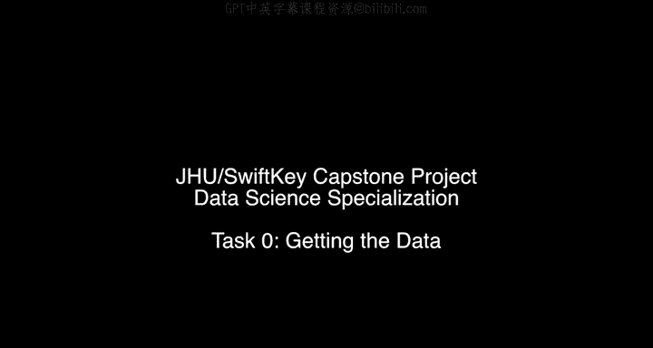

# 课程 P156：3_任务0介绍：理解问题 📚

在本节课中，我们将学习数据科学专业毕业设计的第一个任务。这个任务有两个主要目标：获取数据以及熟悉项目背景知识。

## 概述

大家好，欢迎来到数据科学专业毕业设计的第一个任务。此任务有两个目标。第一个目标是从网站获取数据。第二个目标是熟悉项目背景。

如果你记得，本项目的基本目标是构建一个英文文本的预测模型。这属于自然语言处理和文本挖掘领域。如果你对这个领域不熟悉，值得花时间做一些研究，做一些功课，阅读该领域使用的模型类型和方法。我认为这些信息在你完成毕业设计项目过程中会非常有用。

我们在任务描述中提供了一些链接，这些都是很好的起点。但你应该自由地进行自己的研究，并深入探索比任务描述中更详细的内容。重申一下，两个目标是：获取数据并查看它，确保你能打开它；其次是熟悉背景知识。

## 任务目标详解

上一节我们概述了任务，本节中我们来看看具体的两个目标。

以下是本任务的两个核心目标：

1.  **获取数据**：从指定来源下载项目所需的数据集。
2.  **熟悉背景**：了解自然语言处理与文本挖掘的基本概念，为后续建模打下基础。

## 关于项目领域

本项目涉及构建英文文本的预测模型，这直接关联到**自然语言处理**领域。一个常见的入门任务是**语言建模**，其核心是预测给定上下文后下一个词的概率，可以用公式表示为：

`P(w_n | w_1, w_2, ..., w_{n-1})`

其中 `w_n` 代表第n个词。

## 学习建议

为了顺利完成项目，我们建议你进行自主学习。除了我们提供的资源，你可以查阅更多关于自然语言处理的资料，例如N-gram模型、循环神经网络等概念。

祝你在学习中有所收获。我们整个星期都会在这里，助教也会在此解答你可能遇到的问题。

我们下次再见。

## 总结

本节课中我们一起学习了毕业设计任务0的核心内容。我们明确了任务的两个目标：获取数据和熟悉自然语言处理的项目背景。这是你开启数据科学实践项目的第一步。