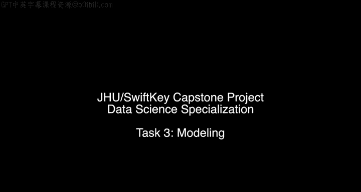

# 课程P161：任务3介绍 - 建模 🧠

在本节课中，我们将学习如何为数据开发一个统计模型。这是整个项目的核心环节，你在此阶段的工作将为后续分析奠定坚实基础。

## 概述 📋

本任务的基本目标是构建一个**N-Gram模型**。该模型能够根据给定的前一个、两个或三个词来预测下一个词。模型将基于数据中观察到的词语组合进行构建。然而，用户有时可能会输入数据集中从未出现过的词语组合，因此你需要设计一种方法来处理这些未知情况。

任务描述中提供了一些链接，帮助你开始思考这些问题。当然，我们也鼓励你进行自主研究，探索更多解决方案。

## 核心概念与考量 ⚙️

上一节我们概述了任务目标，本节中我们来看看构建模型时需要牢记的几个关键点。

以下是两个主要的考量方向：

*   **模型性能评估**：你需要思考一种方法来评估模型的性能，具体指其在预测词语时的**准确度**。
*   **算法整体效率**：你需要关注算法的整体运行效率，确保其能在合理的时间内完成计算，并且不会占用过多**内存**等系统资源。

## 总结 🎯

本节课中，我们一起学习了第三个建模任务的核心要求。我们了解到，目标是构建一个N-Gram预测模型，并需要妥善处理未知词汇组合的问题。同时，在开发过程中，必须兼顾模型的预测准确性和算法的运行效率。

祝你在本次任务中顺利，我们期待看到你的创意成果。