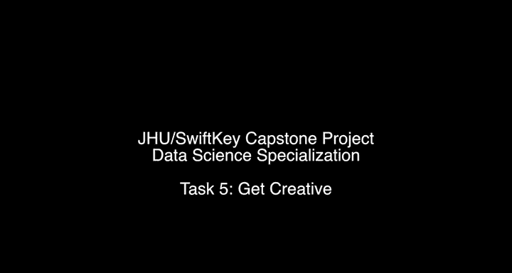

# 课程 P163：10_任务5介绍：创意探索 🚀

在本节课中，我们将学习如何对已构建的预测模型进行优化与探索。你已经拥有了一个运行良好的模型，但这并不意味着工作的结束。接下来，我们将通过一系列创意尝试，进一步提升模型的性能。

## 概述

上一节我们完成了预测模型的初步构建。本节中，我们来看看如何通过创意探索来优化模型。任务的核心是尝试各种可能提升模型性能的想法，并系统地评估它们的效果。

## 任务目标：优化模型

你已经构建了预测模型，它运行速度尚可，并且在大多数时候能预测正确。但这还不够。这就像演奏马勒第三交响曲，你现在可能只进行到第四乐章，后面还有两个乐章需要完成。

因此，本任务的目标是让模型变得更好。请回忆在上一个任务中，你被要求列出一系列可能从不同方面提升模型性能的想法。

以下是本任务的核心步骤：

1.  **遍历想法列表**：逐一尝试列表中的各种想法。
2.  **跳出框架思考**：勇于尝试不同的、创新的方法。
3.  **验证与评估**：观察哪些方法有效，哪些无效。

## 关键步骤：模型评估

在尝试各种创意的过程中，你必须持续评估模型的性能。

**关键点**：务必预留一个独立的测试数据集。这样，你才能客观地评估所构建的这些新创意模型的效果。评估公式可以简单表示为：
`最终模型性能 = 在预留测试集上的评估结果`

## 任务心态

请尝试在此任务中找到乐趣。因为，如果你没有乐在其中，那么你就不是在真正地从事数据科学工作。😊

## 总结

本节课中，我们一起学习了任务5“创意探索”的核心内容。我们明白了在拥有一个基础模型后，需要通过系统性的尝试和创新来优化它，同时要使用预留的测试集来严谨评估每一次改进的效果。现在，是时候将你的想法付诸实践，开始探索了。