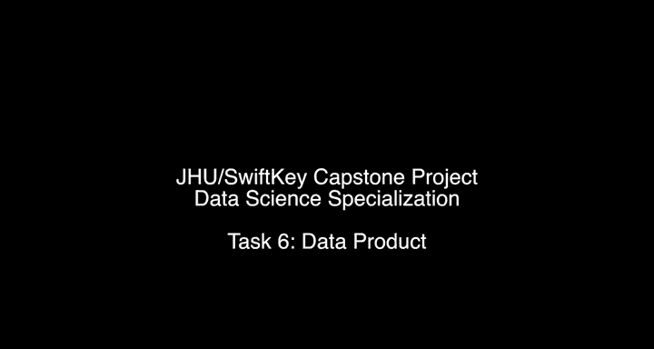

# 课程P164：11_任务6介绍：数据产品 📊

在本节课中，我们将学习如何构建一个面向广泛用户的前端界面，以展示预测算法的工作原理。这是本项目的最终任务，目标是创建易于使用的软件，让他人能够直观体验你的工作成果。

---

你已经走过漫长的学习之路，现在是时候展示你的成果了。

本任务的目标是构建一个前端界面，供广大用户使用，以展示你的预测算法如何工作。

你可能需要在几种不同的场景中完成这项任务。例如：

你可能需要向同事演示原型，展示你工作的潜力，并说服他们投入更多资源。

你可能需要向潜在用户和客户展示你开发的所有酷炫功能。

或者，你可能只是想向全世界分发你的软件，并希望构建一个简单的网络界面供人们访问。

无论出于何种原因，这里的目标是构建一个他人可以轻松使用的东西。

因为如果他人能够使用你的软件，他们就有机会自己体会到它的出色之处。

这会让你的工作变得更加轻松。

---

这是本项目中的最终任务，可以说是最后的乐章。

我希望你花时间思考你所构建的内容，并努力让它真正出彩。

我们都很期待看到你能做出什么成果。

---

本节课中，我们一起学习了如何构建数据产品的前端界面，强调了其在不同场景下的重要性，并鼓励你精心打磨最终作品，以展示预测算法的价值。