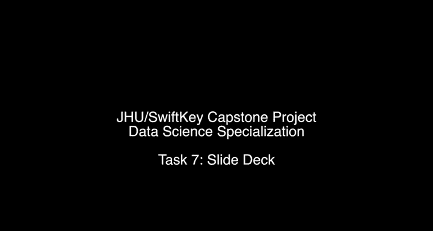

# 课程 P165：任务7介绍 - 幻灯片演示 📊

在本节课中，我们将学习如何为你的数据产品创建一个简洁有力的幻灯片演示。这个演示旨在向他人展示你的工作成果，并解释其价值。

---

## 概述

现在你已经构建了数据产品，是时候进行推介了。你需要完成的最后一项任务是制作一个幻灯片演示，展示你的工作并解释为何它值得关注。这个幻灯片不应超过五页，并且应使用我们工作室的演示工具来制作。

## 演示内容要点

以下是你的演示中需要涵盖的核心部分。

### 1. 问题背景

首先，你需要简要介绍你试图解决的问题的背景。这有助于听众理解项目的出发点和重要性。

### 2. 解决方案

接下来，描述你为解决该问题所采取的方法。这部分应清晰说明你的分析或建模思路。

### 3. 产品与应用

然后，介绍你的应用程序或产品，并说明他人如何使用它。这是展示你工作成果的核心环节。

### 4. 突出亮点

最后，重点展示你产品中一些非常出色的功能或特点，以吸引听众的兴趣。

## 演示对象与目标

想象你正在向老板、经理或潜在投资者进行演示。你的目标是以清晰、简洁的方式传达你所完成的所有出色工作。

---

## 总结

本节课中，我们一起学习了如何构建一个有效的幻灯片演示来推介你的数据产品。关键步骤包括：阐述问题背景、描述解决方案、介绍产品及其应用方式，并突出产品的核心亮点。祝你在创建演示时一切顺利！