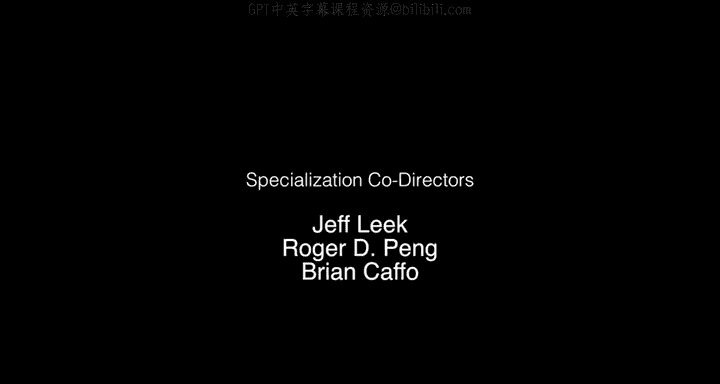

# 课程P166：13_恭喜 🎓

在本节课中，我们将一起回顾约翰霍普金斯大学数据科学专项课程的毕业寄语。课程讲师们将对完成全部课程的学习者表示祝贺，并提供一些毕业后的实用建议。

---

恭喜各位毕业生。我们非常高兴你们完成了整个数据科学专项课程。这是一段非常漫长的旅程，你们迄今为止已经完成了许多课程。我们对你们在短时间内所取得的成就印象深刻。

我们有机会查看了一些毕业设计项目，你们所展现的创造力和在所有工作中所展示的技术专长，都给我们留下了深刻印象。

在整个专项课程中，与你们互动我们感到非常愉快。我们甚至有机会在线下见到了你们中的一些人。因此，我们非常期待你们未来能够取得的成就。

上一节我们分享了讲师们的祝贺，本节中我们来看看他们给出的具体行动建议。

以下是毕业后需要完成的两项重要操作：

*   **务必在LinkedIn上发布你的证书。**
*   **你将收到一封来自我的电子邮件，邀请你加入一个LinkedIn群组。** 该群组专为完成本专项课程的学习者设立。这是一个进行社交、发布职位、寻找工作以及展示你利用本专项课程所学所做其他精彩事情的好地方。

现在，霍普金斯大学这里我们一直在开发新的课程和新的专项课程。我们有很多项目正在开发中。

因此，如果你想了解我们三人的工作动态，请在社交媒体上关注我们。我们会在那里定期发布关于我们工作的最新信息。

干得漂亮。很高兴能与你们所有人一起完成这个专项课程。我们非常期待看到你们接下来要做的事情。现在，去用科学方法挖掘那些数据的价值吧。

---

本节课中我们一起学习了课程最后的毕业寄语。讲师们祝贺学习者完成全部课程，肯定了大家的努力与成果，并提供了在LinkedIn展示证书、加入专属社群以及关注讲师动态等后续步骤。课程以鼓励学习者将所学应用于实践——“去用科学方法挖掘那些数据的价值”——作为结束。