# 课程 P20：渐近性与置信区间 📊


在本节课中，我们将学习如何将中心极限定理应用于实践，构建并理解置信区间。我们将通过具体例子，如估计平均身高、硬币投掷的成功概率以及泊松过程的故障率，来掌握置信区间的计算和解释。

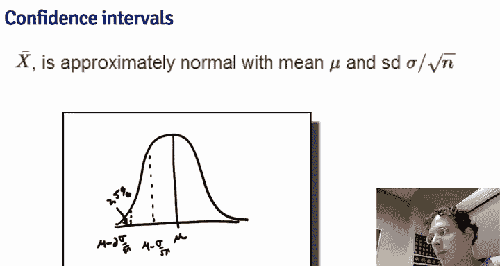

---

## 中心极限定理的实用化

上一节我们介绍了中心极限定理。本节中我们来看看如何将其转化为一个实用的工具。

样本均值 `X̄` 近似服从正态分布，其总体均值等于 `μ`，标准差等于均值的标准误 `σ / √n`。

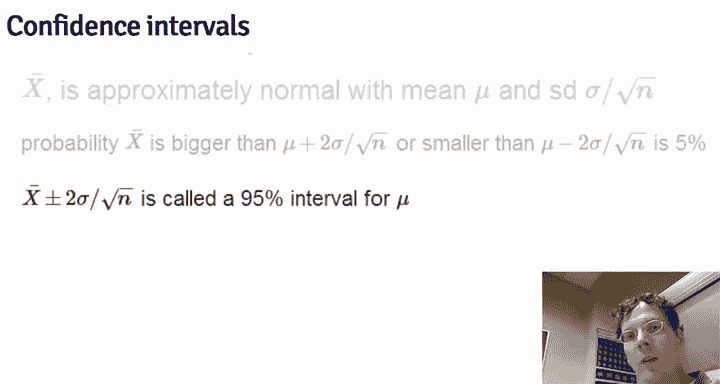

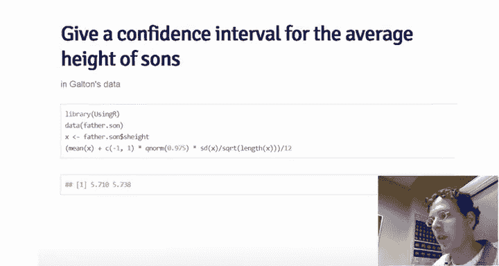

在这个分布中，`μ + 2` 个标准误的位置已经处于分布的右尾深处，一个正态随机变量大于 `μ + 2` 个标准误的概率仅为 2.5%。同理，`μ - 2` 个标准误处于左尾深处，概率也为 2.5%。

因此，`X̄` 大于 `μ + 2` 个标准误或小于 `μ - 2` 个标准误的总概率是 5%。等价地说，`μ` 落在这两个界限之间的概率是 95%。

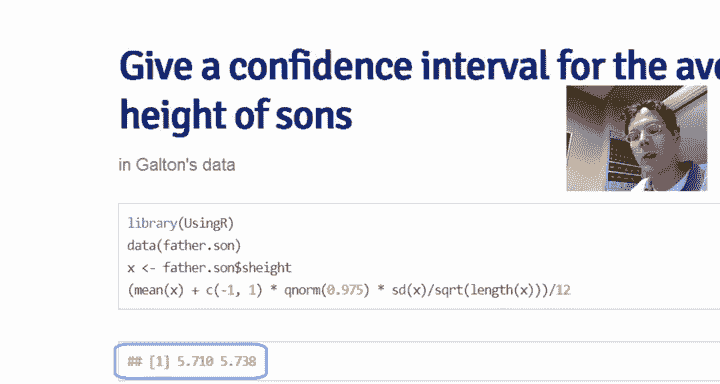

我们可以互换 `X̄` 和 `μ` 的角色而不改变概率不等式，从而得到：区间 `X̄ ± 2` 个标准误以 95% 的概率包含 `μ`。这里需要记住，我们将区间 `X̄ ± 2` 个标准误视为随机的，而 `μ` 是固定的，所以我们讨论的是区间包含 `μ` 的概率。

这个结论的实际解释是：如果我们反复从总体中抽取大小为 `n` 的样本，并构建置信区间，那么在所有构建的区间中，大约有 95% 会包含我们试图估计的参数 `μ`。

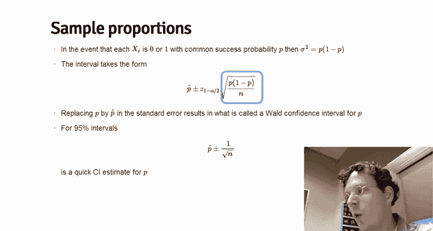

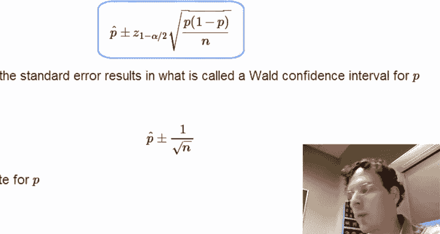

需要注意的是，这里的数字 `2` 是对 97.5% 分位数（约等于 1.96）的近似取整。如果你想要一个 90% 的置信区间，你需要每侧尾部各留 5% 的概率，那么就应该用 1.645 来替换这个 `2`。

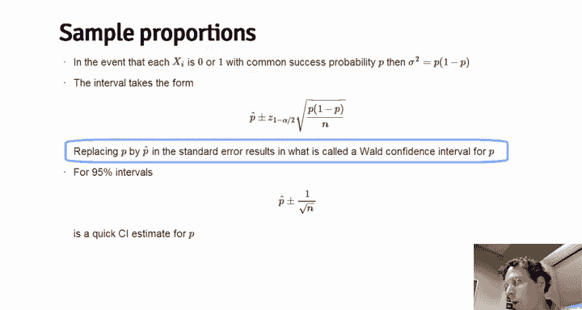

---

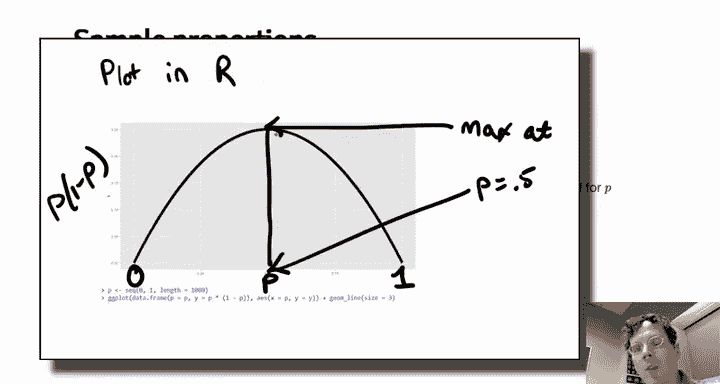

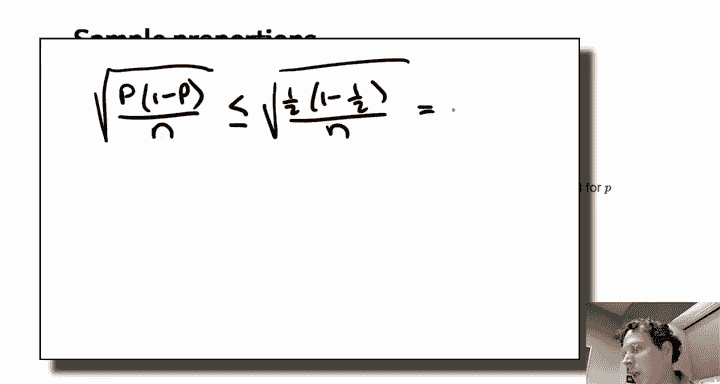

## 一个简单示例：身高估计

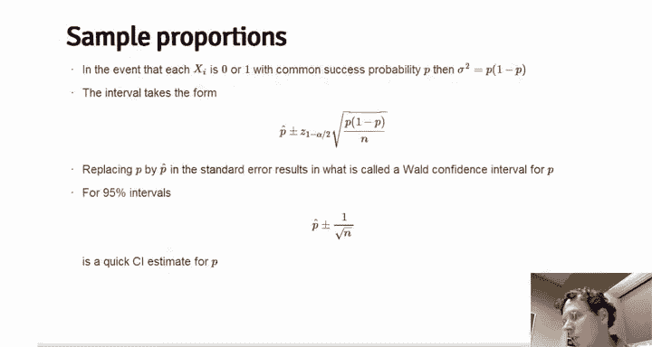

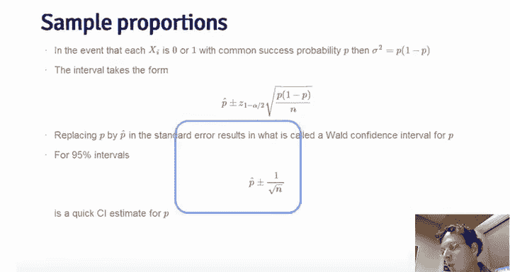

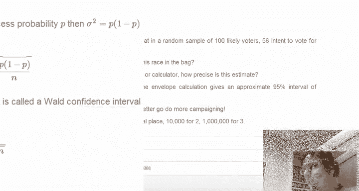

让我们通过一个简单的例子来实践。

考虑 `UsingR` 包中的 `father.son` 数据，令 `x` 为儿子的身高。我们计算均值 `X̄` 加减 0.975 正态分位数乘以均值的标准误（`sd(x) / √n`，其中 `n` 是向量 `x` 的长度）。为了将单位从英寸转换为英尺，我们除以 12。

以下是计算过程：
```r
# 假设 x 是 sons 的身高向量
n <- length(x)
se <- sd(x) / sqrt(n)
ci <- mean(x) + c(-1, 1) * qnorm(0.975) * se / 12
```
得到的置信区间是 5.710 到 5.738 英尺。

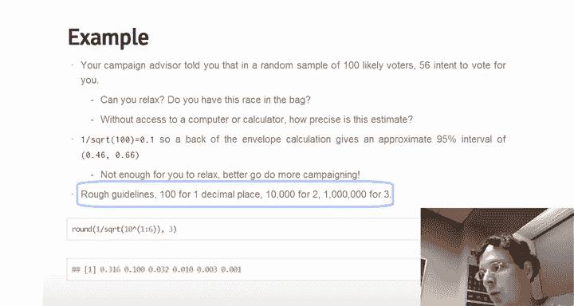

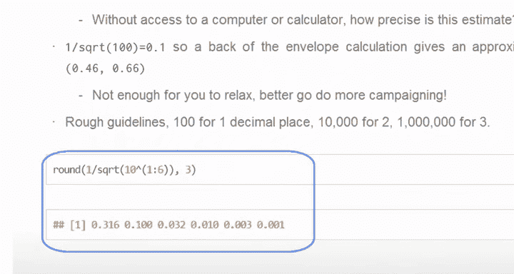

如果我们愿意假设这些儿子的数据是来自目标总体的一个独立同分布样本，那么儿子身高的平均值的置信区间就是 5.71 到 5.74 英尺。

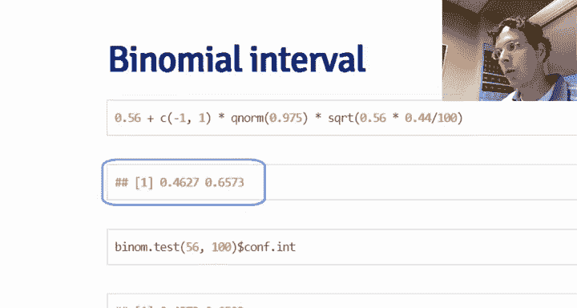

---

## 二项分布案例：硬币投掷

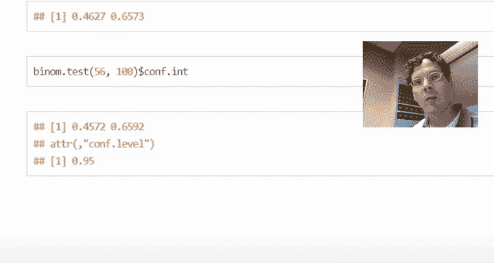

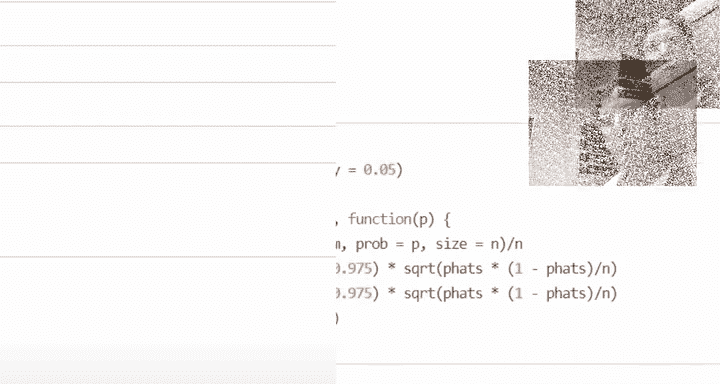

现在考虑硬币投掷，并为硬币的成功概率 `p` 构建一个置信区间。

在这种情况下，每个观测值 `Xi` 是 0 或 1，具有共同的成功概率 `p`。回忆一下，一次投掷的方差是 `p(1-p)`，其中 `p` 是硬币的真实成功概率。

那么，均值的标准误是 `√[ p(1-p) / n ]`。

因此，区间形式为：`p̂ ± Z * √[ p(1-p) / n ]`。

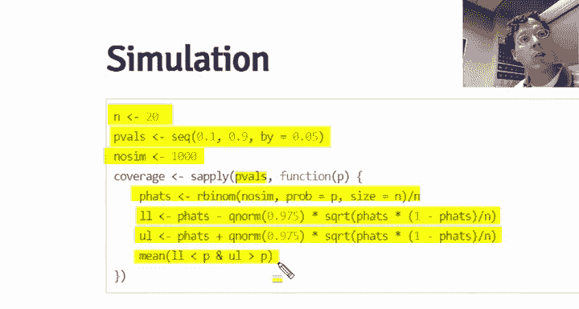

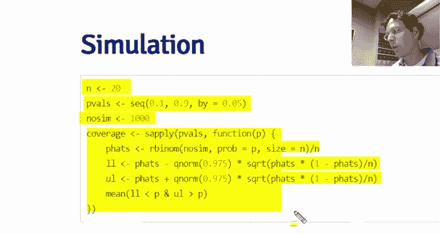

我们不知道真实的 `p`，所以无法计算这个标准误。我们通常用样本比例 `p̂` 来替代 `p`。这样构建的置信区间称为 **Wald 置信区间**。

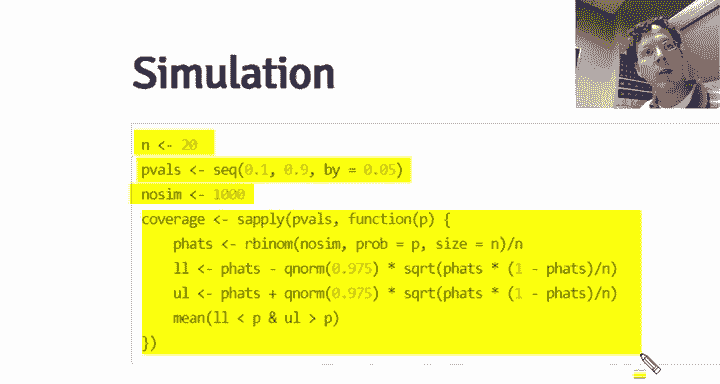

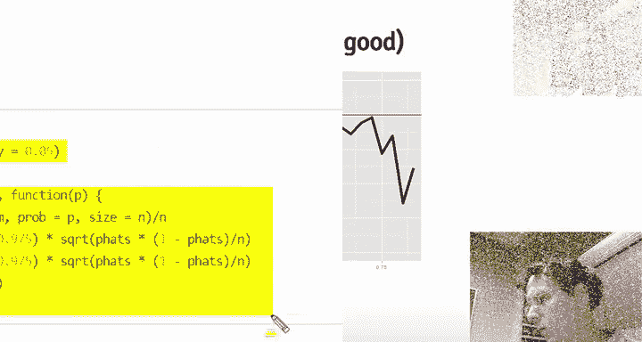

一个有用的发现是：当 `p = 0.5` 时，`p(1-p)` 达到最大值 0.25，因此 `√[p(1-p)] = 0.5`。在 95% 区间中，乘以 2 后，`0.5 * 2 = 1`，正好与分母的 `√n` 形成简洁形式。所以，对于 95% 置信区间，`p̂ ± 1/√n` 是一个快速估计 `p` 的简便公式。

---

## 快速估计的应用：选举案例

想象你正在竞选公职，你的竞选顾问告诉你，在 100 名可能投票的选民随机样本中，有 56 人打算投票给你。你能放松吗？这场选举胜券在握了吗？100 个样本中有 56 个（0.56）是否足以证明你可能获得超过 50% 的选票？

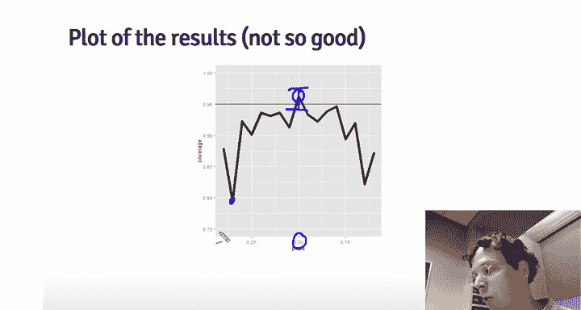

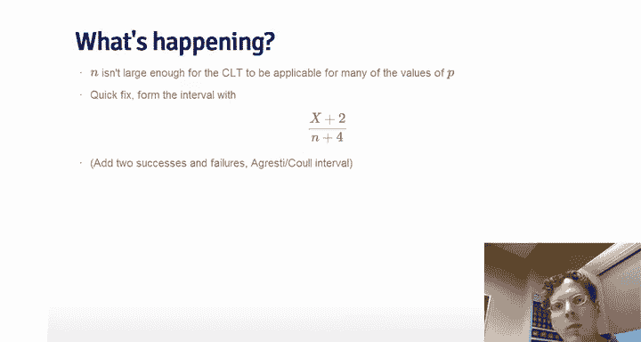

假设你手边没有电脑或计算器。你可以使用快速公式：`1 / √100 = 0.1`。因此，近似的 95% 置信区间是 `0.56 ± 0.1`，即 `0.46` 到 `0.66`。

这个置信区间表明，我们不能以 95% 的置信度排除支持率低于 0.5 的可能性。所以，你还不能放松，最好去做更多的竞选活动。

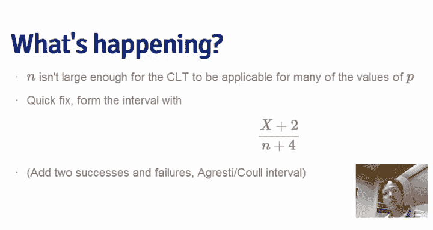

以下是一些粗略的指导原则：
*   在二项实验中，需要约 **100** 次试验来估计一位小数的精度。
*   需要约 **10,000** 次试验来估计两位小数的精度。
*   需要约 **1,000,000** 次试验来估计三位小数的精度。

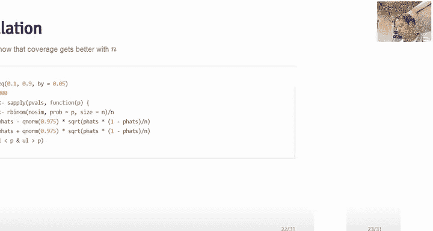

---

## 精确计算与软件实现

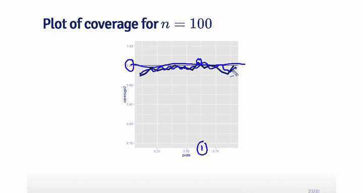

如果我们进行精确计算，将 `p̂ = 0.56` 代入标准误公式：
`0.56 ± Z * √[0.56*0.44 / 100]`
会得到区间 `0.46` 到 `0.66`，与快速估计结果一致。

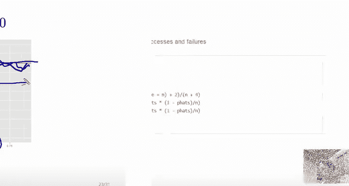

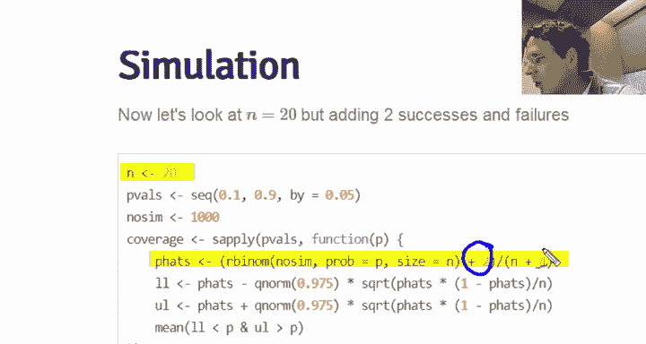

在 R 中，我们可以使用 `binom.test` 函数，它提供了一种“精确”的置信区间计算方法，不依赖于中心极限定理，能保证至少 95% 的覆盖率（但区间可能更宽、更保守）。
```r
binom.test(56, 100)$conf.int
```
这也会给出一个非常相似的区间，例如 `0.46` 到 `0.66`。

---

## 模拟：Wald 区间的覆盖性能

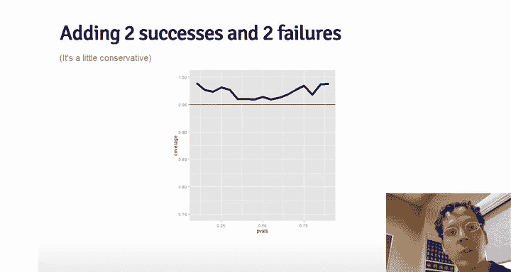

让我们通过模拟来检验 Wald 区间在有限样本下的实际表现。

我们模拟以下过程：设定真实的成功概率 `p`（从 0.1 到 0.9），对于每个 `p`，进行 1000 次实验，每次实验投掷硬币 `n=20` 次。每次实验后，我们用 Wald 方法计算 95% 置信区间，并检查它是否包含了用于生成数据的真实 `p`。最后，我们计算这 1000 次模拟中区间覆盖真实 `p` 的比例（覆盖概率）。

将覆盖概率作为真实 `p` 的函数绘图，我们发现：当 `p` 接近 0.5 时，覆盖概率接近甚至略高于 95%。但是，当 `p` 接近 0 或 1（例如 0.1 或 0.9）时，覆盖概率显著低于 95%，有时甚至远低于 90%。这是因为对于 `n=20` 和这些极端的 `p` 值，中心极限定理的近似效果不佳。

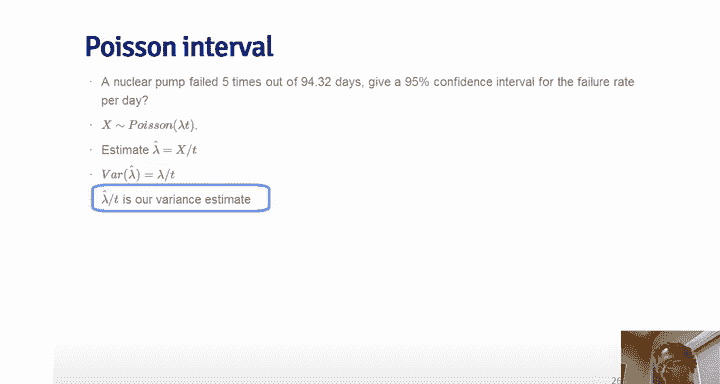

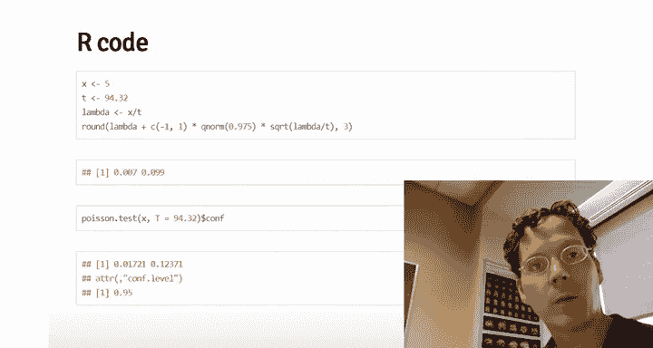

---

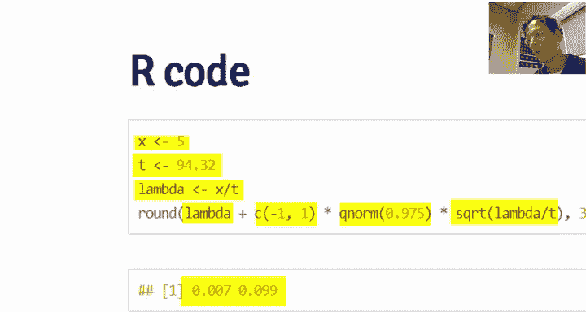

## 改进：Agresti-Coull 区间

对于小样本 `n`，有一个简单的修正方法来解决 Wald 区间覆盖率不足的问题。

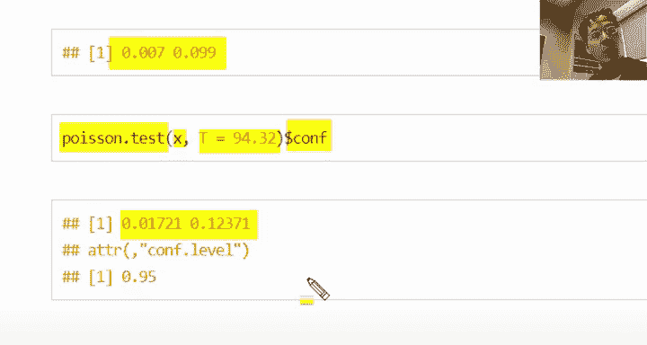

这个快速修正方法是：在成功次数 `X` 上加 2，在失败次数 `(n-X)` 上也加 2。然后使用新的样本比例 `p̃ = (X+2) / (n+4)` 来计算置信区间。这相当于将估计值向 0.5 方向“收缩”了一点。这被称为 **Agresti-Coull 区间**。

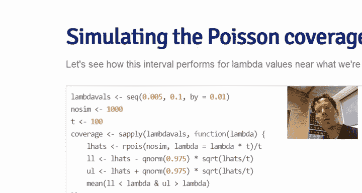

当我们对 `n=20` 重复之前的模拟，但使用 Agresti-Coull 方法时，覆盖概率对于所有 `p` 值都更稳定地保持在 95% 附近或以上，虽然有时会过于保守（区间过宽），但性能明显优于 Wald 区间。因此，通常推荐使用 Agresti-Coull 区间来代替 Wald 区间。

另外，如果我们增加样本量，例如将 `n` 从 20 增加到 100，Wald 区间的覆盖性能会得到显著改善，对于大多数 `p` 值都能接近 95% 的理论水平。

---

## 泊松分布案例：故障率估计

现在让我们为泊松过程的速率参数 `λ` 构建一个置信区间。考虑一个核泵在 `T = 94.32` 天里发生了 `x = 5` 次故障。我们想估计每天的平均故障率 `λ`。

我们假设故障次数服从泊松分布，参数为 `λT`。故障率 `λ` 的估计值是 `λ̂ = x / T`。这个估计量的方差是 `λ / T`，因此我们使用 `λ̂ / T` 作为方差的经验估计。

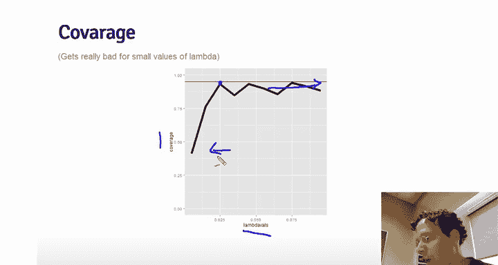

基于中心极限定理（虽然在这里的应用不那么直观，但当监控时间 `T` 很大时成立），我们可以构建大样本置信区间：`λ̂ ± Z * √(λ̂ / T)`。

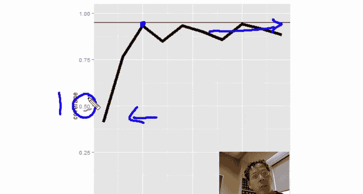

在 R 中计算：
```r
x <- 5
T <- 94.32
lambda_hat <- x / T
se <- sqrt(lambda_hat / T)
ci <- lambda_hat + c(-1, 1) * qnorm(0.975) * se
```
这给出了 `λ` 的估计值和 95% 置信区间。

此外，R 也有 `poisson.test` 函数来计算“精确”的泊松置信区间，它能保证覆盖率，但区间可能更宽。
```r
poisson.test(x, T)$conf.int
```

---

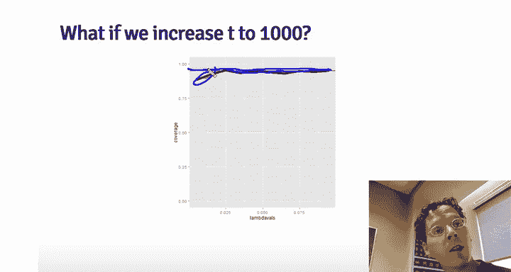

## 泊松区间覆盖率的模拟

与二项分布案例类似，我们可以模拟泊松置信区间的覆盖性能。我们设定一系列 `λ` 值，对于每个 `λ`，模拟 1000 次实验，每次实验的监控时间 `T=100`。对于每次实验，我们计算大样本置信区间，并检查它是否包含真实的 `λ`。

绘图显示，当 `λ` 较大时，覆盖概率接近 95%。但是，当 `λ` 非常小（例如接近 0）时，覆盖概率变得非常差，远低于 95%。这表明对于小 `λ` 值，不应使用这种渐近区间。

如果我们增加监控时间 `T` 到 1000，覆盖性能对于大多数 `λ` 值会得到显著改善，这符合中心极限定理的预期：当 `T → ∞` 时，覆盖率收敛于 95%。对于小 `λ` 值的问题，我们可以选择使用 `poisson.test` 提供的精确区间。

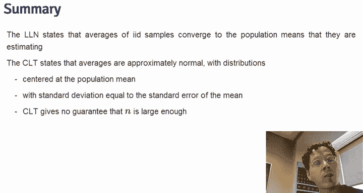

---

## 总结 📝

本节课中我们一起学习了大量关于渐近理论和置信区间的内容。

首先，我们介绍了**大数定律**，它指出独立随机变量的平均值会收敛到它们所估计的总体均值（或泊松速率收敛到真实速率）。

其次，核心内容是**中心极限定理**，它指出样本均值近似服从正态分布，中心是总体均值 `μ`，标准差是标准误 `σ/√n`。然而，中心极限定理没有保证需要多大的 `n` 才能使这种近似足够准确。

基于此，我们学习了构建**置信区间**的通用方法：`估计值 ± 分位数 × 标准误`。对于 95% 置信区间，分位数常用 2 或更精确的 1.96。置信区间越宽，其覆盖真实参数的概率（置信水平）就越高。

我们重点探讨了**二项分布**（硬币投掷）和**泊松分布**（事件计数）这两种离散情况。我们发现，当样本量小或参数处于极端值时，基于中心极限定理的 Wald 区间可能表现不佳。为此，我们介绍了：
1.  **精确方法**（如 `binom.test`, `poisson.test`），能保证覆盖率但可能更保守。
2.  针对二项分布的**Agresti-Coull 区间**（加2成功/加2失败），这是一个简单有效的改进方法。

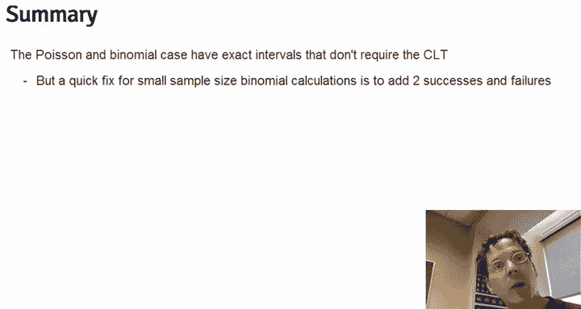

理解置信区间的关键在于其**频率解释**：如果我们重复抽样并构建区间，那么有特定比例（如95%）的区间会包含真实的参数值。