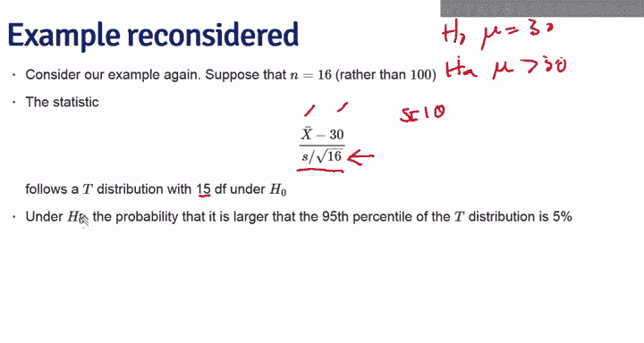
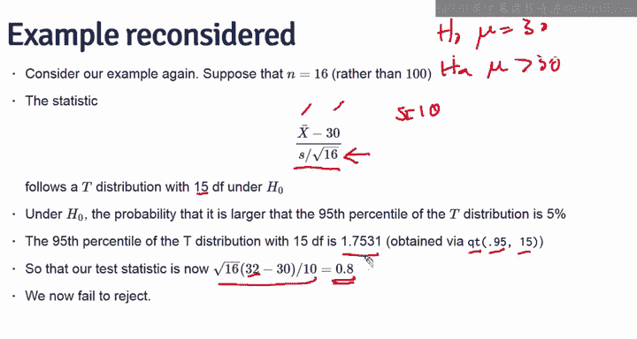
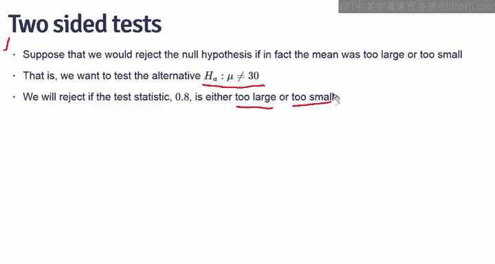
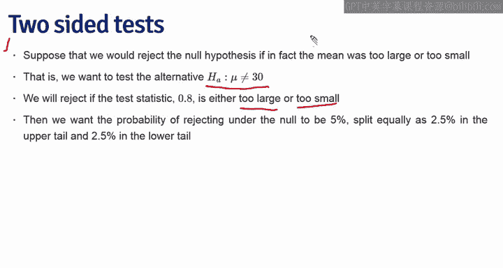
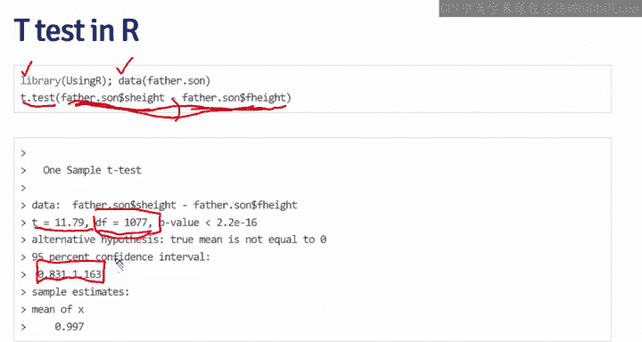

# 课程 P27：t 检验 🧪

在本节课中，我们将学习 t 检验的核心概念与应用。我们将通过一个具体的例子，探讨当样本量较小时如何进行假设检验，并比较单侧检验与双侧检验的差异。最后，我们会介绍如何使用 R 语言中的 `t.test` 函数来执行检验并解读结果。

---

## 回顾小样本量情况

上一节我们讨论了在大样本量下的假设检验。本节中我们来看看当样本量较小时的情况。

再次考虑我们的例子，假设样本量 **n** 是 16 而不是 100。

我们的检验统计量保持不变，它是样本均值减去假设的均值（我们正在检验 **H₀: μ = 30** 对 **H₁: μ > 30**），然后除以均值的标准误。现在分母是 **√16** 而不是 **√100**，并且回忆一下 **s** 是 10。

这个检验统计量（样本均值距离假设均值有多少个估计的标准误）在具体情况下服从自由度为 15 的 **t 分布**。

在零假设下，该统计量大于 t 分布第 95 百分位数的概率是 5%。

因此我们需要计算 t 分布的这个第 95 百分位数。这可以通过 `qt(0.95, df=15)` 来完成，计算结果为 **1.7531**。

我们的检验统计量，如果代入 **s=10** 和样本均值 **x̄=32**，计算结果为 **0.8**。

因此我们无法拒绝零假设，因为 0.8 小于 1.75。

---

## 进行双侧检验

上一节我们进行了单侧检验。本节中，我们来学习如何进行双侧检验。

假设我们想要在均值过大或过小时都拒绝零假设。在我们具体的科学背景下（我们只关心肥胖受试者的呼吸障碍指数是否大于参考值30），这不太合理。然而，在科学环境中，通常要求进行双侧检验，无论其科学意义如何。理解如何进行双侧检验很重要，因为有些情况下你必须进行双侧检验，即使考虑另一侧没有太大意义。

所以，在这种情况下，如果我们进行双侧检验，我们想在 **μ** 不等于 30 时拒绝零假设。换句话说，如果我们的检验统计量过大或过小，我们都会拒绝。在这种情况下，因为我们的检验统计量是正数，我们只需要考虑过大的一侧。

然而，改变的是：为了让检验统计量在两端都可能过大或过小，从而获得 5% 的总显著性水平，我们需要将概率在分布的两尾各分配 2.5%（对于小样本是 t 分布，对于大样本是 Z 分布）。

所以，现在不再使用 `qt(0.95)`，而是使用 `qt(0.975)`，自由度仍为 15。

我们希望在检验统计量大于此值时拒绝。让我画一个 t 分布的示例：这将是 `qt(0.975, df=15)` 的点，该尾部有 2.5% 的概率；而这是 `qt(0.025, df=15)` 的点，那个尾部也有 2.5% 的概率。

因此，如果我们的检验统计量大于这个值或小于那个值，我们就拒绝。然而，因为下分位数是上分位数的负数，我们总是可以说：这等同于取我们检验统计量的绝对值，并在它过大时拒绝。

这一点在这里说明。所以，在这种情况下，我们未能拒绝单侧检验。而在这张幻灯片中，我们显示我们也未能拒绝双侧检验。然而，我想你可能已经注意到，因为我们的拒绝区域移到了 t 分布更远的尾部，所以如果你未能拒绝单侧检验，那么你也将未能拒绝双侧检验。

---

## 使用 R 进行 t 检验

通常我们不会像幻灯片中那样手动计算拒绝区域并执行正式的假设检验。相反，我们通常会将数据传递给像 `t.test` 这样的函数，它会输出所有相关的统计量供我们理解检验结果。

有趣的是，我们已经知道如何操作，因为我们曾使用 `t.test` 来计算置信区间，只是还没有通过输出来理解它如何进行检验。

让我们看看在使用 R 包时，“父亲与儿子身高”的数据。我们想检验儿子身高的总体均值是否等于父亲身高的总体均值。这里的观测值是配对的：一个儿子的测量值对应一个父亲的测量值，依此类推。因此，在这种情况下，我们将计算差值，并想检验身高差值是否为 0 或非 0。

你可以使用 `t.test` 函数，可以直接将差值向量传递给函数，也可以传递两个向量并添加参数 `paired = TRUE`。

以下是 `t.test` 输出的关键部分：
*   它在这里给出你的 **t 统计量**：11.79。
*   它在这里给出你的 **自由度**：1077（我们正好有 1078 对数据计算了差值）。

现在，11 是一个相当大的 t 统计量，因此我们在此情况下拒绝零假设。还要注意自由度很大，所以在这种情况下 t 检验和 Z 检验的区别无关紧要。

当我们执行 `t.test` 时，它会自动给出 t 置信区间。除了检验输出外，查看置信区间几乎总是有用的，因为置信区间很好地弥合了统计显著性和实际显著性之间的差距。你可以看到置信区间内的值范围是否具有实际意义，因为它以你感兴趣的数据单位表示。

---

## 总结

本节课中我们一起学习了 t 检验的核心应用。我们首先回顾了在小样本量下，检验统计量服从 t 分布，并手动计算了临界值进行决策。接着，我们比较了单侧检验与双侧检验在拒绝区域设定上的区别。最后，我们实践了如何使用 R 语言的 `t.test` 函数高效地执行配对 t 检验，并强调结合置信区间来解读结果对于理解统计与实际的显著性至关重要。