# 课程28：两组检验 🧪

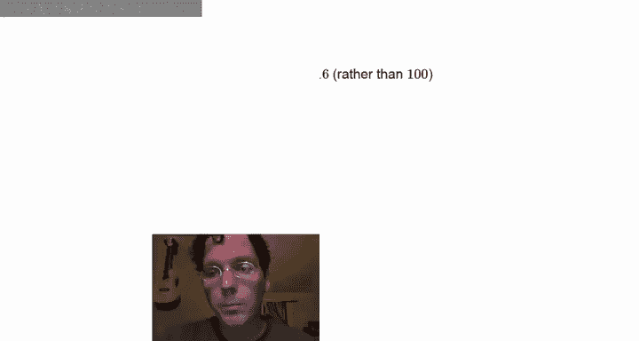

在本节课中，我们将学习如何对两组数据进行假设检验。我们将从回顾单组检验开始，然后扩展到两组比较，并探讨置信区间与假设检验之间的关系。

---

## 回顾单组检验 📊

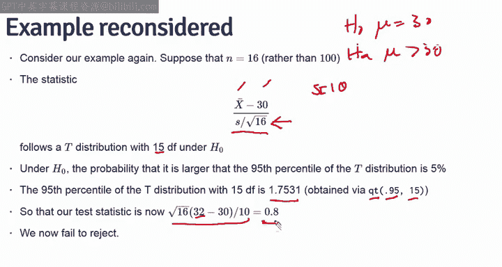

上一节我们介绍了单组数据的假设检验。本节中我们来看看当样本量较小时，检验统计量如何遵循t分布。

考虑之前的例子，假设样本量n是16，而不是100。

我们的检验统计量保持不变，它是样本均值减去假设的均值（我们正在检验H₀: μ = 30 对 Hₐ: μ > 30），然后除以均值的标准误。现在分母是√16而不是√100，并且我们记得样本标准差s是10。

这个检验统计量（衡量样本均值距离假设均值有多少个估计的标准误）在特定情况下服从自由度为15的t分布。

在原假设下，该统计量大于t分布第95百分位数的概率是5%。因此我们需要计算t分布的这个第95百分位数，这可以通过`qt(.95, df=15)`完成，结果是1.7531。

如果我们代入样本均值x̄=32和s=10，我们的检验统计量计算结果为0.8。因此我们未能拒绝原假设，因为0.8小于1.75。

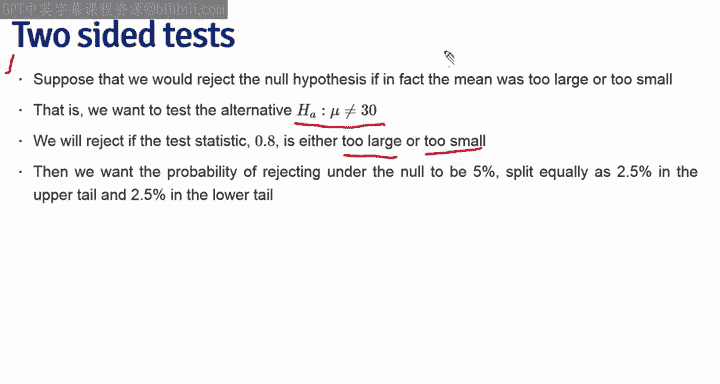

---

## 双侧检验 ↔️

现在让我们进行一个双侧检验。假设我们希望在均值过大或过小时都拒绝原假设。在我们具体的科学背景下，这不太合理，因为我们只对特定肥胖人群的呼吸障碍指数是否大于参考值30感兴趣。然而，在科学环境中，通常要求进行双侧检验，无论其科学意义如何。理解如何进行双侧检验很重要，因为有些情况下你必须进行双侧检验，即使考虑另一侧没有太大意义。

在这种情况下，如果我们进行双侧检验，我们希望在μ不等于30时拒绝原假设。换句话说，如果我们的检验统计量过大或过小，我们都会拒绝。因为我们的检验统计量是正数，我们只需要考虑过大的一侧。然而，改变的是，为了获得5%的显著性水平，并允许检验统计量过大或过小，我们需要将概率在分布的两尾各分配2.5%，无论是对小样本的t分布还是大样本的Z分布都是如此。

所以现在，我们不再使用`qt(0.95)`，而是使用`qt(0.975, df=15)`。我们希望在检验统计量大于此值时拒绝。

让我画一个t分布的例子。这将是`qt(0.975, df=15)`，该尾端有2.5%的概率。而这是`qt(0.025, df=15)`，该尾端也有2.5%的概率。如果我们的检验统计量大于前者或小于后者，我们就拒绝。然而，因为下分位数是上分位数的负数，我们总是可以说，这等同于取检验统计量的绝对值，并在其过大时拒绝。

在这个例子中，我们未能拒绝单侧检验。在这张幻灯片上，我们显示我们也未能拒绝双侧检验。然而，你可能已经注意到，因为我们将拒绝域移到了t分布更远的尾部，所以如果你未能拒绝单侧检验，那么你也将未能拒绝双侧检验。

---

## 使用R进行检验 🖥️

通常我们不会像幻灯片中那样手动计算拒绝域并执行正式的假设检验。相反，我们通常会将数据传递给像`t.test`这样的函数，它会输出所有相关的统计量供我们理解检验结果。

有趣的是，我们已经知道如何做这个了，因为我们曾经使用`t.test`来计算置信区间，只是我们还没有通过输出来理解它在检验中的作用。

让我们看看在R中使用`father.son`数据集。我们想检验儿子的总体身高均值是否等于父亲的总体身高均值。这里的观测值是配对的，一个儿子的测量值对应一个父亲的测量值，依此类推。因此，在这种情况下，我们将取差值，并想检验身高差值是否为0或非0。

你可以使用`t.test`函数，可以直接将差值向量传递给函数，或者传递两个向量并添加参数`paired = TRUE`。它在这里给出了你的t统计量11.79，以及自由度1077（因为我们正好有1078对差值）。11是一个相当大的t统计量，因此我们拒绝原假设。还要注意自由度很大，所以在这种情况下t检验和Z检验的区别无关紧要。

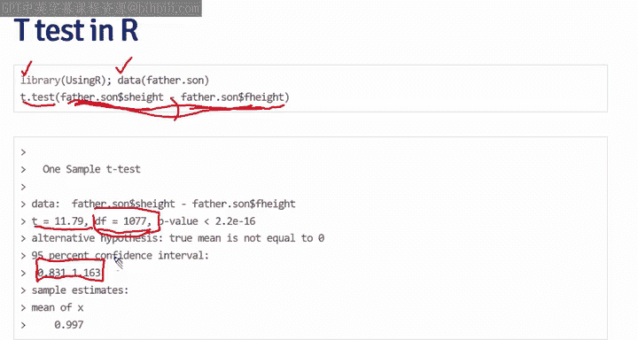

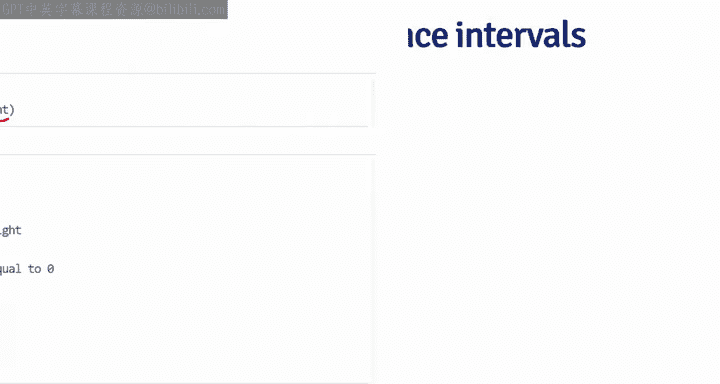

当我们进行`t.test`时，它会自动给出t置信区间。除了检验输出外，查看置信区间几乎总是有用的，因为置信区间很好地弥合了统计显著性和实际显著性之间的差距。你可以看到置信区间内的值范围是否具有实际意义，因为它是以你感兴趣的数据单位表示的。

---

## 置信区间与假设检验 🔗

说到置信区间，在前几讲中，当我们介绍置信区间时，我们通过查看假设的均值是否在置信区间内来研究它是否被支持。如果它在区间内，那么它似乎是均值的一个支持值；如果它在区间外，则不是。你可能想知道，这个过程与正式执行假设检验（例如，检验均值是否等于特定值）相比如何？

考虑前面的例子，我们感兴趣的是父亲和儿子的身高是否相等。我们得到的答案是，就假设检验而言，它们不相等。我们也得到了区间不包含0的答案。你可能想知道这两个陈述是否可能不一致。事实证明，它们不会。检查μ₀是否在区间内，等同于执行双侧假设检验，但有一个前提：用于假设检验的α必须等于1减去置信区间的α。换句话说，如果你构建一个95%的区间，并查看μ₀是否在该区间内，如果在区间内则不拒绝，在区间外则拒绝，这等同于执行一个第一类错误率恰好为α的假设检验。

这张幻灯片中说明，置信区间可以构建为所有可能值的集合，对于这些值，你未能拒绝原假设。

---

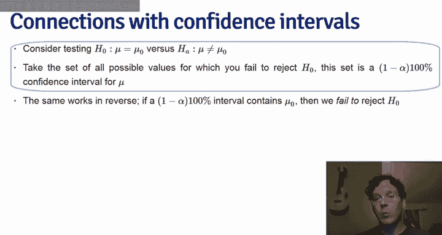

## 扩展到两组检验 📈

现在，有了我们已建立的所有基础架构，包括理解置信区间和单组假设检验，两组检验应该只是我们所做工作的一个微小扩展。

基本上，拒绝规则是相同的。我们现在想检验一组的均值是否等于另一组的均值。我们有一组相同的备择假设：μ₁ > μ₂， μ₁ < μ₂， 或 μ₁ ≠ μ₂。

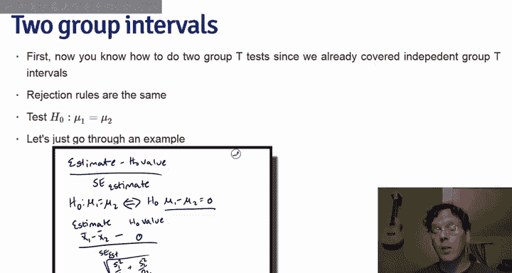

我们的检验统计量将始终相同。它是估计值x̄₁ - x̄₂减去假设的均值差（在这种情况下，假设的均值差μ₁ - μ₂为0），再除以均值的标准误。我们将通过一个例子来说明这一点。

---

## 实例：小鸡体重数据 🐥

我们将使用`ChickWeight`数据。我们调用在上次讲座中查看过的`ChickWeight`数据。

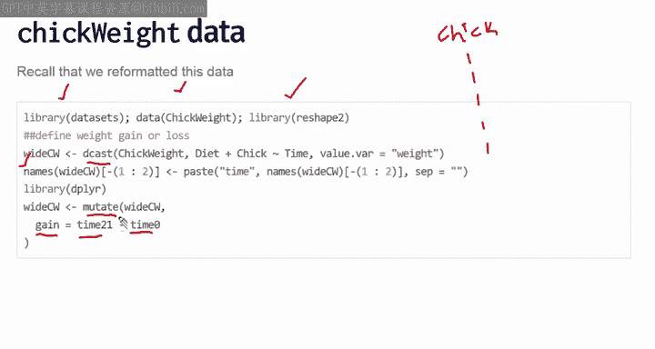

以下是加载和准备数据的步骤：
1.  加载数据集：`library(datasets); data(ChickWeight)`。
2.  数据是长格式（每个小鸡有多个时间点的测量值），我们需要使用`reshape2`包将其转换为宽格式。
3.  我们将使用`dcast`函数，然后重命名变量。
4.  我们将定义一个变量`gain`，基本上是第21天的体重减去第0天的体重。我们使用`mutate`函数可以轻松地向数据框添加变量。

在这个具体案例中，我选取了饮食1和饮食4的子集。原因是`t.test`函数中的波浪号操作符要求预测变量（本例中的`diet`）恰好只有两个水平。因为我想比较1和4，所以我这样做了。

我将设置`paired = FALSE`，因为在这种情况下，接受饮食1的小鸡与接受饮食4的小鸡是完全不同的两组，因此将它们视为配对是没有意义的。饮食1的小鸡1与饮食4的小鸡1无关。

我假设方差相等。在上次讲座中，我们得出结论，在这个特定数据中，假设等方差可能不是最好的做法。因此，我建议你尝试自己运行这个例子，设置`var.equal = FALSE`，看看它是如何变化的。

在这种情况下，t统计量是两种饮食之间平均体重增加差异的估计值减去假设值（本例中为0）。每当你进行两组检验时，除非你指定了假设的均值差，否则它会假定你感兴趣的是检验均值在原假设下是否相等，或在备择假设下是否不同。

自由度是23，这与我们在置信区间讲座中介绍的N₁ + N₂ - 2自由度相同。如果你进行不等方差检验，你可能会得到一个分数自由度，这与我们在置信区间讲座中介绍的情况相同。

它在这里再次给出了你的置信区间，这在执行假设检验时总是值得一看的。

我们的t统计量计算了均值差距离假设均值有多少个估计的标准误，结果是-2.7。这对于t分布或正态分布来说，已经相当处于尾部了。因此，它远低于我们的临界值。在这个特定案例中，我们没有明确得到临界值，但通过P值的学习后，我们将能够立即判断，如果这是一个5%水平的检验，我们知道它会拒绝，而无需实际具体计算t分位数。

---

## 二项分布检验示例 🪙

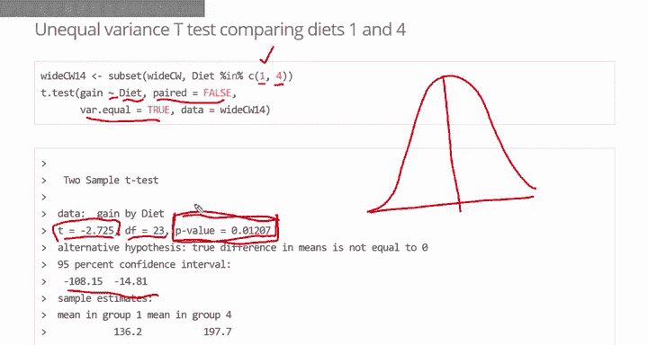

让我们看一个相当简单的非正态或非t分布的假设检验例子。

还记得你朋友有8个孩子，其中7个是女孩，你想评估这个情况的问题吗？相对于独立同分布的抛硬币，认为也许一对夫妇的性别就像抛硬币，你感兴趣的是，这对夫妇生男生女是独立同分布的公平抛硬币这一假设，这个证据有多强。

所以你想检验原假设H₀：生女孩的概率p = 0.5，备择假设Hₐ：p > 0.5，因为你有点怀疑你朋友有8个孩子，其中7个是女孩。

如果你要建立一个假设检验，那么这对夫妇可能有多少个女孩，才能使得在原假设（公平硬币）下，拥有那么多或更多女孩的概率为5%？

如果我们建立拒绝域，换句话说，如果这对夫妇有0到8个女孩中的任意数量，我们总是会拒绝。如果我们建立拒绝域为1到8个女孩，概率仍然不是5%，几乎是1。如果我们继续往下看，假设是7个女孩。我们看到，如果我们将拒绝域设为7个或8个女孩，那么在原假设下拒绝的概率刚好低于5%。注意，我们无法使其恰好等于5%，因为存在跳跃。如果拒绝域设为6或更高，概率是14%；如果设为7或8，概率是3%；如果只设为8（即只有当硬币8次全部正面朝上时才拒绝公平硬币假设），那么你的第一类错误率将是0.004。

---

## 关于此检验的说明 📝

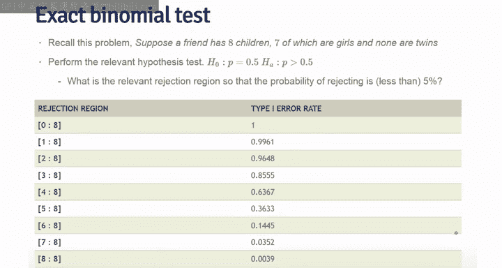

现在，我们看到最接近的拒绝域是7和8。事实上，你的朋友有7个女孩意味着我们拒绝原假设。但我们知道，在这种情况下，由于二项分布的离散性，不可能得到精确的5%水平的检验。对于更大的样本量，你可以进行正态近似，将抛硬币计数视为平均值，并当作高斯分布处理，但你已经知道如何做这个了。

对于双侧检验，在这种情况下并不明显，如果你想检验p是否等于0.5还是不等于0.5。我们将在下一讲讨论进行双侧检验的方法。

我想说，当我们从P值的角度思考时，这会变得容易一些。所以，如果这个例子让你有点困惑，等你听了P值讲座后，我想它会变得更清晰一些，精确二项式/泊松区间检验也会更容易一些。

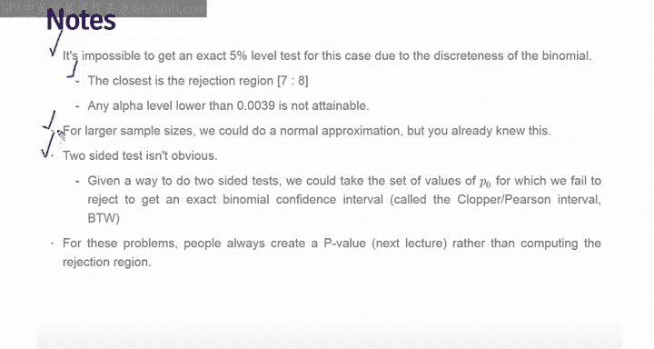

然而，我想说的是，有趣的是，如果你能对二项分布或泊松分布进行双侧检验，那么你可以反转这些检验，考虑那些你会未能拒绝原假设的值，并为泊松参数、二项参数生成一个精确的置信区间。这正是R中如何获得那些精确区间的方法，它们不使用渐近或中心极限定理类型的近似，而是得到一个精确的二项式区间，它们反转了这种类型的双侧假设检验。

---

## 总结 ✨

本节课中我们一起学习了：
1.  回顾了单组t检验，特别是小样本情况下的应用。
2.  介绍了双侧检验的概念、拒绝域的构建及其与单侧检验的关系。
3.  学习了如何使用R的`t.test`函数便捷地进行假设检验并解读结果，包括查看置信区间的重要性。
4.  探讨了置信区间与假设检验之间的等价关系。
5.  将假设检验的基础扩展到两组比较，并通过小鸡体重的实例进行了演示。
6.  最后，我们探讨了一个基于二项分布的非参数检验例子，说明了离散分布下精确检验的特点，并预告了P值将简化检验过程。

下一讲我们将讨论P值，这将巩固一些概念，并使执行假设检验变得更加容易。