# 课程1.02：概率介绍 🎲

在本节课中，我们将要学习概率的基本概念。概率是统计学和机器学习的基石，它帮助我们量化随机事件发生的可能性。我们将从最基础的定义和规则开始，确保为后续的数据科学专业课程打下坚实的基础。

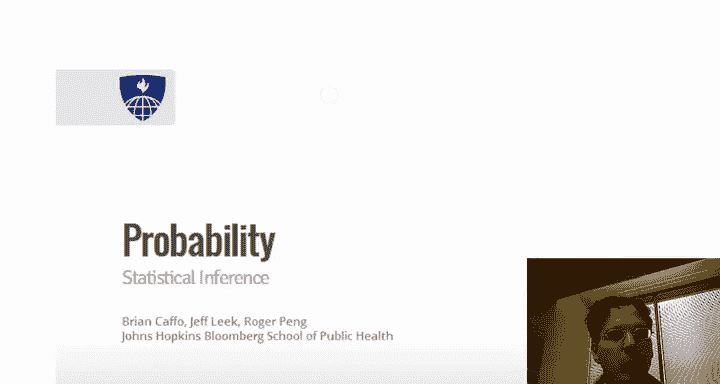

---

## 概率是什么？

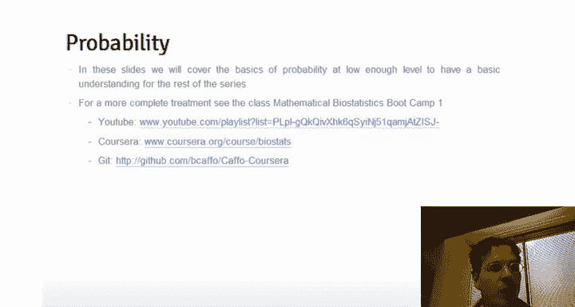

给定一个随机实验，例如掷骰子，概率是一种用于**概括随机性**的**总体量度**。这里需要强调“总体”这个词。在掷骰子的情境中，概率是骰子本身固有的属性，而不是基于一组固定投掷结果的函数。因此，当我们谈论概率时，我们讨论的不是已有数据中的某个东西，而是存在于我们想要估计的总体中的一个概念性事物。

---

## 概率的规则（概率演算）

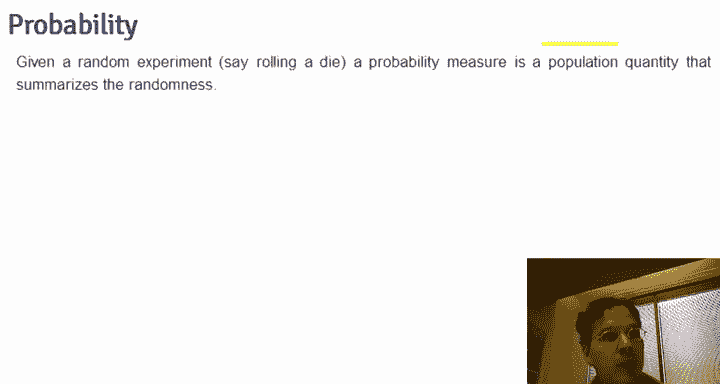

为了让概率有意义，它必须遵循一些特定的规则，这被称为概率演算。

首先，概率作用于实验的**潜在结果**。例如，掷骰子时，你可能得到1点，或者结果在集合{1, 2}中，或者结果是偶数{2, 4, 6}，或者结果是奇数{1, 3, 5}，等等。

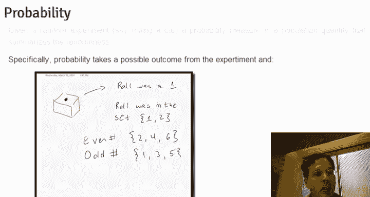

概率是一个函数，它接收任何这类可能结果的集合，并为其分配一个介于0和1之间的数字。

以下是概率必须遵循的核心规则：

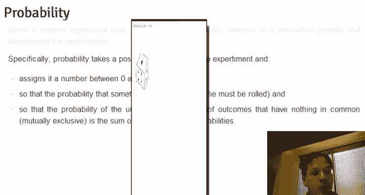

1.  **必然事件的概率为1**：某个结果必须发生。例如，掷骰子得到一个数字的概率是1。
    `P(必然事件) = 1`

2.  **不可能事件的概率为0**：没有任何结果发生的概率是0。你必须掷骰子，总会有某个结果发生。
    `P(不可能事件) = 0`

3.  **互斥事件的加法规则**：任何两个**没有共同元素**的结果集合（称为互斥事件），它们至少有一个发生的概率等于各自概率的和。
    例如，掷骰子时，得到{1, 2}的概率加上得到{3, 4}的概率，等于得到{1, 2, 3, 4}的概率。
    `如果 A ∩ B = ∅，则 P(A ∪ B) = P(A) + P(B)`

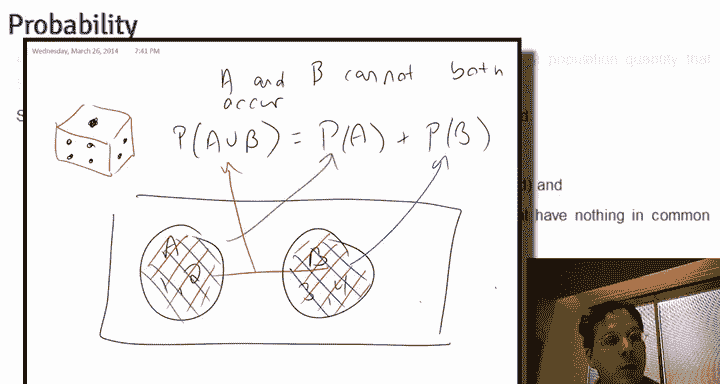

俄罗斯数学家柯尔莫哥洛夫发现，这些简单的规则足以推导出所有我们认为概率应该遵循的规则。

---

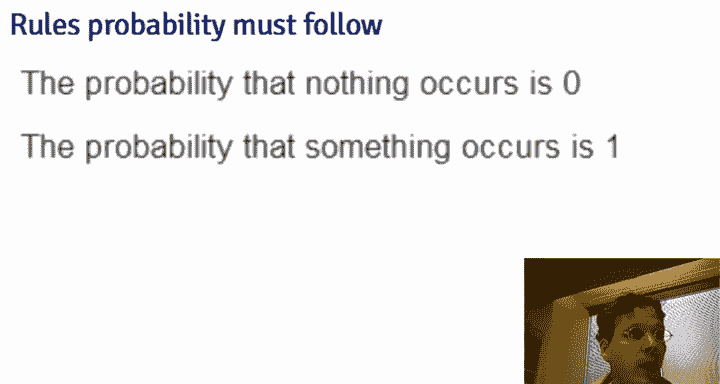

## 概率的其他重要性质

基于上述基本规则，可以推导出其他有用的性质。

上一节我们介绍了概率的基本公理，本节中我们来看看由此衍生的一些重要推论。

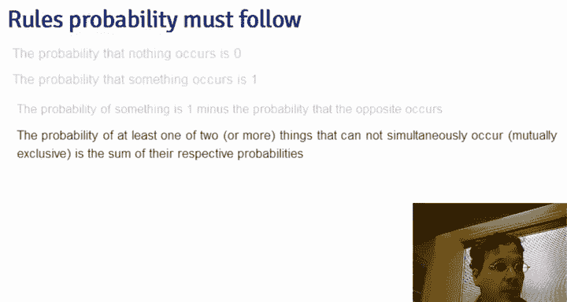

*   **互补事件**：一个事件发生的概率等于1减去其对立事件发生的概率。
    例如，掷骰子得到偶数的概率是1减去得到奇数的概率。
    `P(A) = 1 - P(A的补集)`

*   **事件的包含关系**：如果事件A的发生意味着事件B一定发生（即A是B的子集），那么A的概率小于或等于B的概率。
    通过文氏图可以很容易理解：事件A的“区域”完全包含在事件B的“区域”内，所以B的概率自然更大。
    例如，得到1点（事件A）的概率小于得到1点或2点（事件B）的概率。
    `如果 A ⊆ B，则 P(A) ≤ P(B)`

*   **一般加法公式（对任意两个事件）**：两个事件至少有一个发生的概率，等于它们各自的概率之和，减去它们同时发生的概率。
    这同样可以用文氏图直观理解：当我们把A和B的概率相加时，它们的交集部分被计算了两次（一次在A中，一次在B中）。为了得到并集的概率，我们需要减去一次重复计算的部分。
    `P(A ∪ B) = P(A) + P(B) - P(A ∩ B)`

这个公式的结果表明，如果两个事件有非空的交集（即可能同时发生），你就不能简单地将它们的概率相加。我们马上来看一个例子。

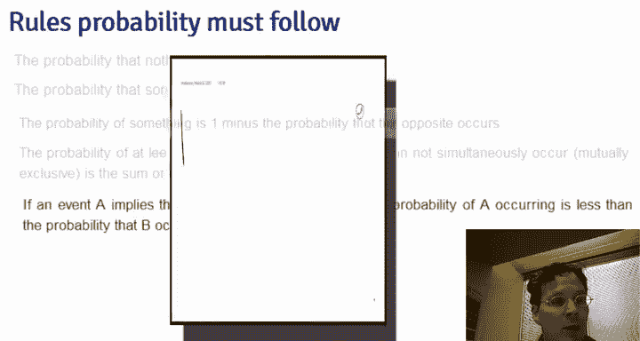

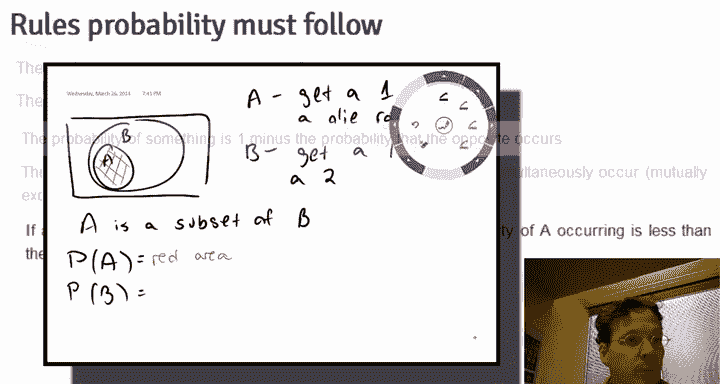

---

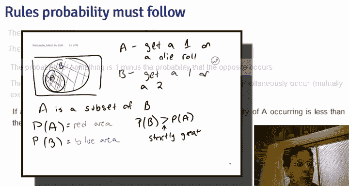

## 实例分析：睡眠障碍问题

美国国家睡眠基金会报告称，大约3%的美国人口患有睡眠呼吸暂停症。同时，大约10%的北美和欧洲人口患有不宁腿综合征。为了讨论方便，我们假设这些概率来自同一人群。

**问题**：我们能否简单地将这两个概率相加，从而得出结论：该人群中大约有13%的人至少患有其中一种睡眠问题？

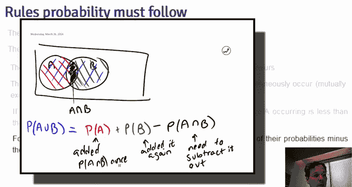

**答案**：不能。因为这两个事件**可以同时发生**，因此**不是互斥的**。我们认为有一部分人同时患有睡眠呼吸暂停症和不宁腿综合征。

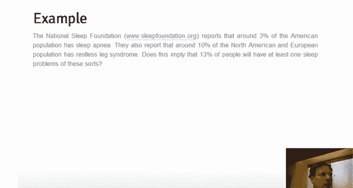

让我们具体分析一下：
*   设事件 **A** 为从该人群中随机抽取一人患有睡眠呼吸暂停症。`P(A) = 0.03`
*   设事件 **B** 为该人患有不宁腿综合征。`P(B) = 0.10`

这里，交集 `A ∩ B`（即同时患有两种疾病）是非空的。如果我们直接将两个概率相加，就会把交集部分的概率重复计算两次。要计算至少患有一种疾病的概率 `P(A ∪ B)`，我们需要使用一般加法公式，减去一次交集概率：
`P(A ∪ B) = 0.03 + 0.10 - P(A ∩ B)`

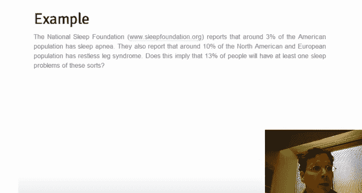

由于 `P(A ∩ B)` 是一个正数（虽然我们不知道具体是多少），所以 `P(A ∪ B)` 会小于0.13。因此，简单相加会高估实际比例。

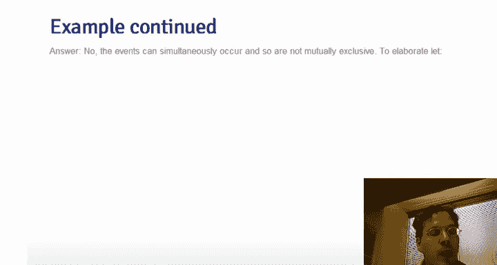

---

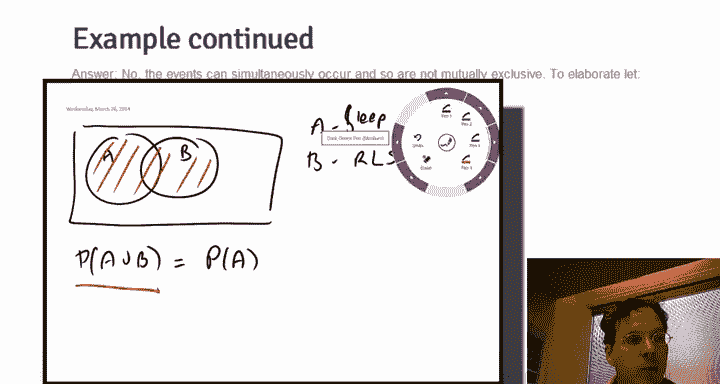

## 总结

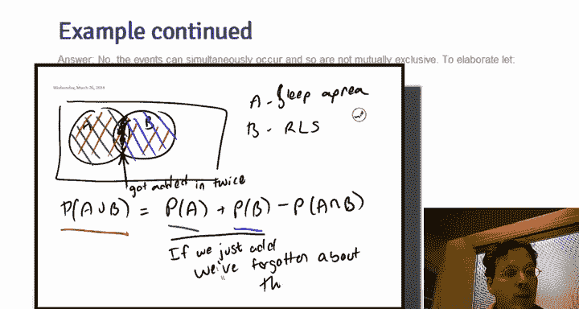

本节课中我们一起学习了概率的基础知识。我们明确了概率是描述随机实验**总体**性质的量度。我们介绍了概率必须遵循的核心规则（概率演算），包括必然事件概率为1、互斥事件可加性等。基于这些，我们推导出了互补规则、包含关系以及用于计算任意两个事件并集概率的**一般加法公式**：`P(A ∪ B) = P(A) + P(B) - P(A ∩ B)`。最后，通过睡眠障碍的实例，我们看到了正确应用这些规则的重要性，特别是当事件不互斥时，不能简单地将概率相加。这些概念是理解后续统计推断和机器学习中更复杂概率模型的基础。