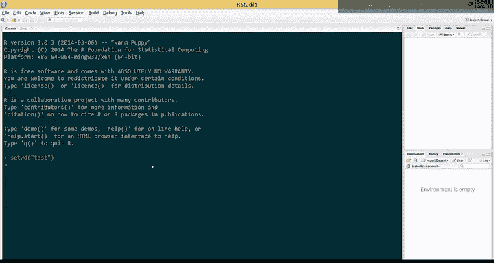
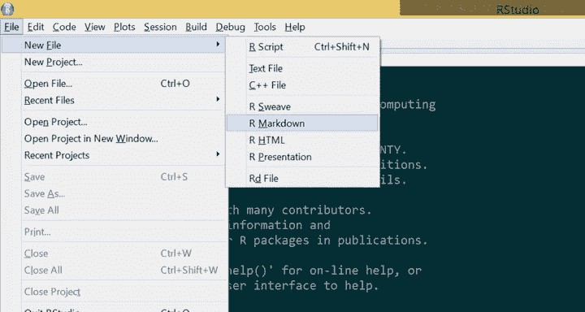
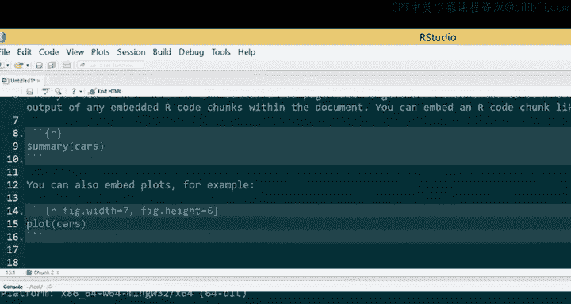
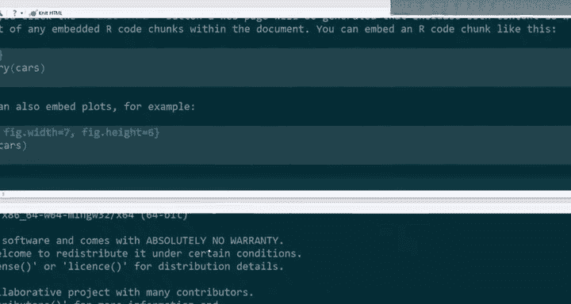
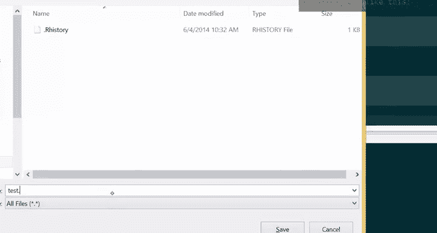
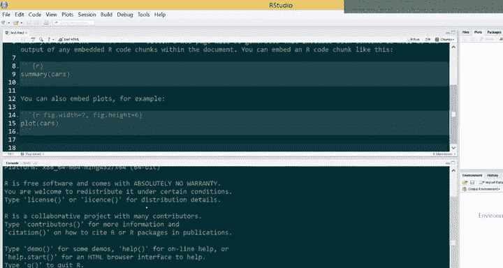
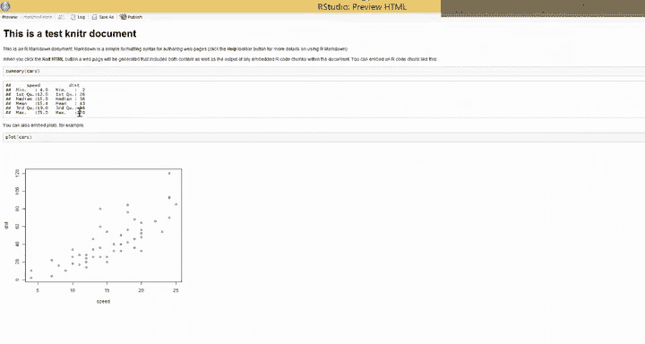
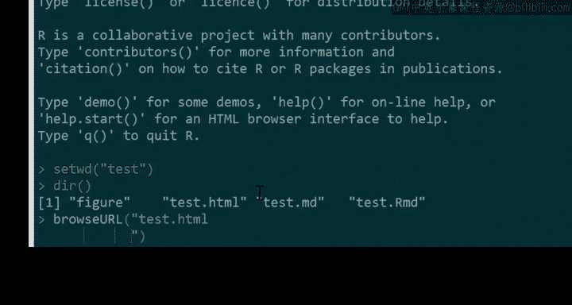
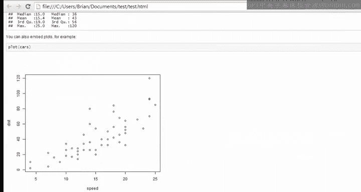

# 📘 课程 P31：完成项目所需的 knitr 知识

在本节课中，我们将学习如何使用 knitr 来创建和渲染 R Markdown 文档。这是完成课程项目所必需的核心技能。

## 概述

knitr 是一个强大的 R 包，它允许你将 R 代码、文本和结果（如图表）整合到一个文档中，并输出为 HTML、PDF 或 Word 等多种格式。本节教程将指导你快速创建一个基本的 knitr 文档。



## 创建 R Markdown 文件

首先，你需要在 RStudio 中创建一个新的 R Markdown 文件。



以下是具体步骤：
1.  在 RStudio 中，点击菜单栏的 **File**。
2.  选择 **New File**。
3.  在下拉菜单中，选择 **R Markdown**。


RStudio 会自动生成一个包含示例内容的新文档模板。


## 编辑文档内容

你可以修改文档的标题和正文。例如，将标题改为“这是一个测试 knitr 文档”。

文档中包含文本区域和 R 代码块。代码块是 knitr 文档的核心部分。

## 理解 R 代码块

R 代码块由三个反引号（`）开始和结束，反引号通常位于键盘左上角，Esc 键下方。

在代码块的开头，你需要指定语言为 `r`，这样 knitr 才会执行其中的 R 代码。

代码块可以包含多个选项来控制其行为。以下是几个最常用的选项：

*   **`eval`**：控制是否执行代码。设为 `FALSE` 时，仅显示代码而不运行。
*   **`echo`**：控制是否在输出中显示代码本身。`echo=TRUE` 会同时显示代码和结果；`echo=FALSE` 则只显示结果，不显示代码。
*   **`results`**：控制结果的显示方式。`results=‘hide’` 可以隐藏代码块的输出结果。
*   **`cache`**：控制是否缓存计算结果，以提高重复编译时的速度。

例如，一个包含绘图命令的代码块如下所示：

```r
plot(cars)
```




## 保存与渲染文档

编辑完成后，需要保存文件。请将文件保存为 `.Rmd` 格式，例如 `test.Rmd`。






保存后，你可以点击 RStudio 编辑器上方的 **Knit** 按钮来渲染文档。通常可以选择输出为 HTML 格式。




## 查看输出结果


knitr 会生成一个独立的 HTML 文件。你可以在 R 中使用 `browseURL()` 函数在浏览器中打开它。


```r
browseURL(“test.html”)
```



生成的 HTML 文件是一个标准的网页，可以在任何浏览器中查看。




## 总结


本节课我们一起学习了 knitr 的基本用法。我们了解了如何创建和编辑 R Markdown 文件，如何编写和配置 R 代码块，以及如何将文档渲染成 HTML 格式并查看结果。掌握这些知识，你就能创建包含动态代码和输出的项目报告了。