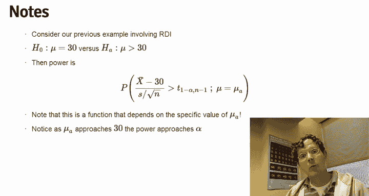
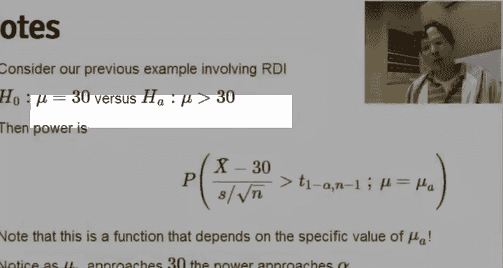
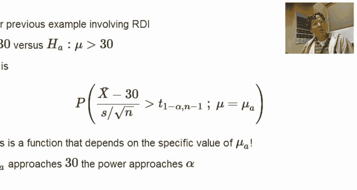

# 课程名称：约翰霍普金斯大学《数据科学：统计和机器学习》第32讲 - 第31.11节：统计功效 🎯

## 概述

在本节课中，我们将要学习统计推断中的一个核心概念——**统计功效**。我们将了解它的定义、重要性、计算方法，以及它在研究设计和结果解读中的关键作用。

---

## 什么是统计功效？💡

统计功效是指在**备择假设为真**的情况下，**正确地拒绝原假设**的概率。顾名思义，功效是一件好事，我们希望拥有更高的功效。

有趣的是，功效在**未能拒绝原假设**时比在拒绝原假设时更常被提及。让我来解释一下。

想象一下，如果你进行了一项功效很低的研究。例如，你想比较治疗A和治疗B，但你只随机分配了3个人接受治疗A，3个人接受治疗B。那么，当你比较两种治疗的疗效时，得到一个“无显著差异”的结果（即未能拒绝原假设）并不会令人惊讶，因为每组只有3个人，你几乎没有能力检测出组间有意义的差异。因此，你的“阴性”结果在某种程度上是意料之中的，或者仅仅是由于偶然性就可能发生。

另一方面，如果治疗A组和治疗B组各有300人，而你仍然未能拒绝原假设，那么这个结果就很有意义了。因为你收集了如此多的数据，理应期望看到差异。

这就是为什么功效实际上在解读“阴性”结果时比“阳性”结果时更为重要。功效最常用的场景是在**研究设计阶段**。你希望设计一项研究，使得如果备择假设为真，你有合理的机会检测到它。

---

## 错误类型与功效的关系 ⚖️

上一节我们介绍了统计功效的基本概念，本节中我们来看看它与假设检验中两类错误的关系。

**第二类错误**是一件坏事。顾名思义，它是指在**备择假设为真**的情况下，却**未能拒绝原假设**的错误。

第二类错误的概率通常用 **β** 表示。而**统计功效**就是 **1 - β**。

因此，在假设检验的错误率方面，两个最有意义的量是：
*   **α**：第一类错误率（错误地拒绝真原假设）。
*   **β**：第二类错误率（错误地未能拒绝假原假设）。

但我们通常不直接讨论β，而是更多地讨论它的补数——**功效（1 - β）**。

---

## 一个概念性示例 📊

现在，让我们通过一个概念性示例来具体理解功效的计算，之后我们会看一些具体的数值例子。

还记得我们讨论过的关于特定肥胖人群呼吸紊乱指数均值的假设检验吗？我们想检验均值μ是否等于30，备择假设是μ大于30。

我们使用了T统计量，其公式为：
`T = (样本均值 - 30) / 均值的标准误`

在原假设（μ = 30）下，我们假设该统计量服从T分布。如果我们计算该统计量大于T分布上`1 - α`分位数的概率，在原假设（μ = 30）下，这个概率就是α。

现在，功效的计算本质上是一样的，但区别在于：我们计算概率时，代入的不是原假设下的μ值（30），而是代入备择假设下的某个**大于30的μ值**。这个计算出的概率就是我们的功效。

想象一下，如果我代入的μ值是60。那么功效会是一个很大的数字。这很合理，对吧？因为如果我们想检测这个群体的均值是否是30，而它实际上是60，那么我们应该有很高的功效来检测到这一点，因为我们收集的数据会围绕60分布，而不是围绕30。

相反，如果我们真实的备择均值是30.00001，那么我们就没有很高的功效来检测它，因为它非常接近原假设值30。功效会较低。

因此，功效是一个依赖于备择假设下均值的函数。如果我们代入接近30的值，功效会看起来很像我们的第一类错误率α。如果我们代入远离30的值，功效会越来越大，直到接近100%。

---

## 总结

本节课中，我们一起学习了统计功效的核心知识。我们了解到：

1.  **统计功效**是当备择假设为真时，正确拒绝原假设的概率，是研究设计追求的目标。
2.  功效在解读“阴性”研究结果（未能拒绝原假设）时至关重要，因为它能帮助我们判断这个结果是确实没有效应，还是因为研究样本量不足（功效低）而未能检测到效应。
3.  功效与**第二类错误（β）** 直接相关，公式为：**功效 = 1 - β**。
4.  功效的大小取决于**真实的效应量**（备择假设下的参数值与原假设值的差距）、**样本量**和**显著性水平（α）**。效应量越大、样本量越大，功效通常越高。

理解并正确计算功效，是进行严谨的科学研究、合理设计实验和合理解读统计结果的基础。