# 课程33：计算功效 📊

在本节课中，我们将学习如何计算统计检验的功效。功效是指当备择假设为真时，正确拒绝原假设的概率。我们将通过一个具体的例子，探讨影响功效的各种因素，并使用R语言进行演示和可视化。

---

## 概述

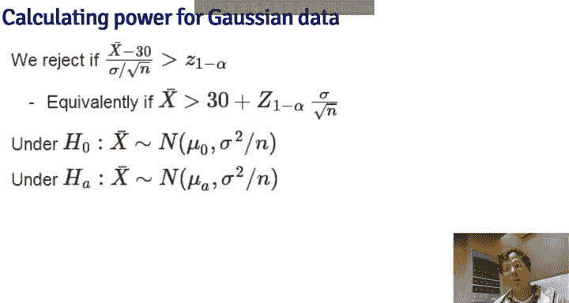

假设我们的样本均值 `X_bar` 服从正态分布。这可能是因为我们愿意接受这个假设，或者因为样本量足够大，可以应用中心极限定理，又或者我们直接假设总体本身服从正态分布。为了讨论方便，我们假设 `X_bar` 服从正态分布，并且总体的标准差 `sigma` 已知。

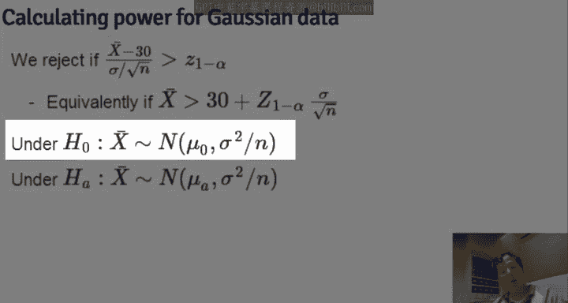

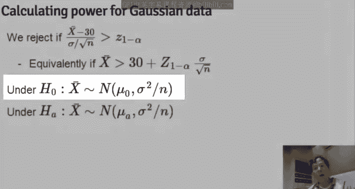

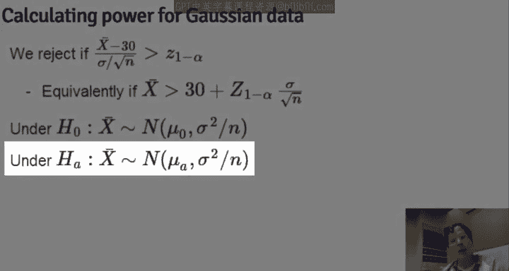

那么，如果我们的Z统计量 `(X_bar - 30) / 标准误` 大于 `z_{1-alpha}`，我们就会拒绝原假设。这等价于说，当 `X_bar > 30 + z_{1-alpha} * 标准误` 时，我们拒绝原假设。

在原假设下，`X_bar` 服从均值为 `mu_n`（本例中为30）、方差为 `sigma^2 / n` 的正态分布。在备择假设下，它服从相同的分布，唯一的区别是均值变为 `mu_A`，即备择假设下的值。

---

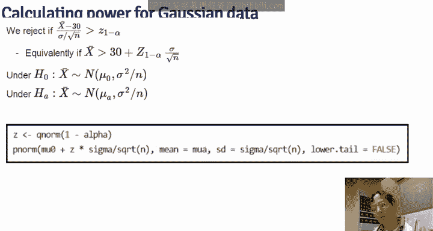

## 用R计算功效

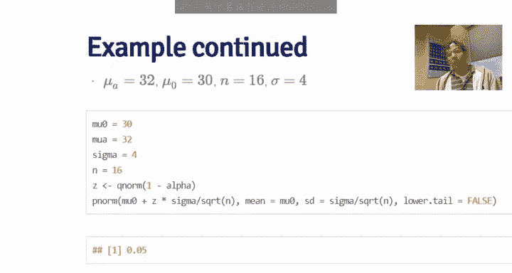

在R中计算功效非常简单。我们使用 `pnorm` 函数来计算获得大于某个临界值的样本均值的概率，但此时概率是基于备择假设的均值 `mu_A` 来计算的。

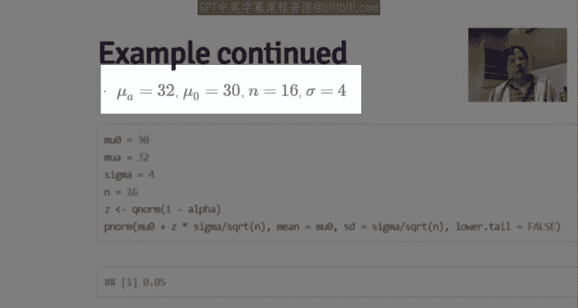

以下是计算功效的R代码：

```r
# 定义参数
mu_n <- 30
mu_a <- 32
sigma <- 4
n <- 16
alpha <- 0.05

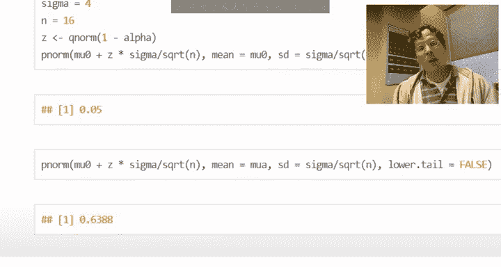

# 计算标准误
se <- sigma / sqrt(n)

# 计算Z统计量的临界值
z_critical <- qnorm(1 - alpha)

# 计算临界值对应的样本均值
critical_value <- mu_n + z_critical * se

# 计算功效：在备择假设下，样本均值大于临界值的概率
power <- pnorm(critical_value, mean = mu_a, sd = se, lower.tail = FALSE)
power
```

如果我们将 `mu` 设为原假设的均值 `mu_n`，那么计算出的概率应该等于 `alpha`。随着 `mu_A` 逐渐远离 `mu_n`，功效会变得越来越大。

---

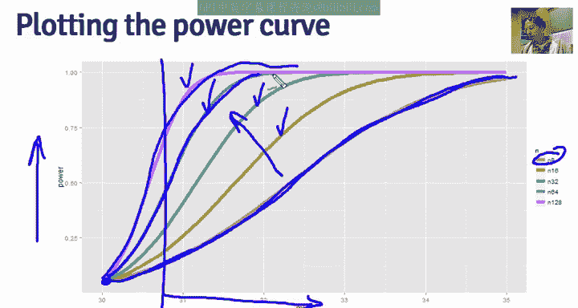

## 示例分析

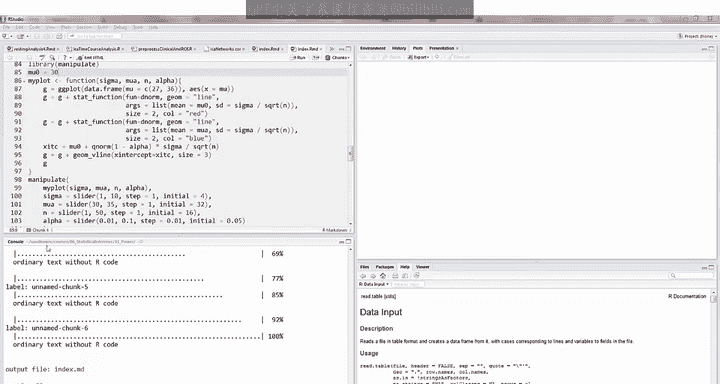

假设有人计划进行一项研究，他们想检验总体均值 `mu` 是否等于30，还是大于30。因此，原假设 `mu_n = 30`。

他们希望检测出与30相差2的效应，即 `mu_A = 32`。他们计划收集 `n = 16` 个样本，并且已知总体标准差 `sigma` 大约为4。

将上述值代入我们的公式和代码中，首先验证当 `mu = mu_n` 时，拒绝概率为5%（即 `alpha`）。然后，当 `mu = mu_A = 32` 时，功效跃升至64%。这意味着，如果我们进行这个实验，有64%的概率能检测到均值等于或大于32的情况。

---

## 功效曲线

我们可以绘制功效曲线，即功效随 `mu_A` 变化的函数，并用不同颜色表示不同的样本量 `n`。

随着 `mu_A` 增大（在图上向右移动），功效会增加。这意味着，我们想要检测的效应越大，检测到它的可能性就越高，这非常合理。

此外，随着样本量 `n` 的增大（例如从8增加到16、32、64、128），功效曲线会整体向上、向左移动。这意味着，收集更多数据时，对于特定的 `mu_A` 值，我们检测到效应的可能性（功效）会更高。

---

## 使用Manipulate函数交互探索

我们可以使用RStudio的 `manipulate` 函数，通过交互式图形来探索功效如何与两个正态分布（原假设和备择假设下的样本均值分布）相关联。

以下代码创建了一个交互式界面：

```r
library(manipulate)
library(ggplot2)

mu_n <- 30

plot_power <- function(sigma, mu_a, n, alpha) {
  se <- sigma / sqrt(n)
  z_crit <- qnorm(1 - alpha)
  crit_value <- mu_n + z_crit * se
  
  # 创建数据框用于绘图
  x_vals <- seq(mu_n - 4*se, mu_a + 4*se, length.out = 200)
  df_null <- data.frame(x = x_vals, y = dnorm(x_vals, mean = mu_n, sd = se), Hypothesis = "Null")
  df_alt <- data.frame(x = x_vals, y = dnorm(x_vals, mean = mu_a, sd = se), Hypothesis = "Alternative")
  df <- rbind(df_null, df_alt)
  
  p <- ggplot(df, aes(x = x, y = y, color = Hypothesis)) +
    geom_line(size = 1) +
    geom_vline(xintercept = crit_value, linetype = "dashed", size = 1) +
    labs(title = paste("Power =", round(pnorm(crit_value, mean = mu_a, sd = se, lower.tail = FALSE), 3)),
         x = "Sample Mean", y = "Density") +
    theme_minimal()
  print(p)
}

# 运行交互式界面
manipulate(
  plot_power(sigma, mu_a, n, alpha),
  sigma = slider(1, 10, initial = 4, step = 0.5, label = "Sigma"),
  mu_a = slider(30, 35, initial = 32, step = 0.5, label = "Mu (Alternative)"),
  n = slider(4, 100, initial = 16, step = 2, label = "Sample Size (n)"),
  alpha = slider(0.01, 0.10, initial = 0.05, step = 0.01, label = "Alpha")
)
```

在图形中，红色曲线代表原假设下的分布（均值为 `mu_n`），蓝色曲线代表备择假设下的分布（均值为 `mu_A`）。黑色虚线是临界值，它被校准为：如果红色分布（原假设）为真，样本均值大于该临界值的概率为 `alpha`。

**功效** 则定义为：如果蓝色分布（备择假设）为真，样本均值大于该黑色临界值的概率。

通过滑动条调整参数，我们可以观察到：
*   **降低 `alpha`**：临界值右移，使得拒绝原假设更难，从而导致功效降低（但第一类错误率也降低）。
*   **增加 `alpha`**：临界值左移，更容易拒绝原假设，功效提高，但第一类错误率也增加。
*   **降低 `sigma`**（减少测量噪声）：两个分布变得更窄，临界值变化，但功效显著增加。
*   **增加 `sigma`**：分布更宽，噪声更大，功效降低。
*   **增加 `mu_A`**（效应量增大）：蓝色分布向右移动，与临界值的重叠区域减少，功效增加。
*   **增加样本量 `n`**：两个分布的方差（`sigma^2/n`）减小，曲线变得更陡峭、更集中，功效显著提高。

强烈建议您运行此代码，亲自体验各个“旋钮”如何影响功效。

---

## 总结

本节课中，我们一起学习了统计检验功效的计算和影响因素。

我们了解到，功效是正确检测到真实效应的概率。它受到多个因素的影响：
*   **效应大小 (`mu_A - mu_n`)**：效应越大，功效越高。
*   **样本量 (`n`)**：样本量越大，功效越高。
*   **总体标准差 (`sigma`)**：变异性越小（噪声越低），功效越高。
*   **显著性水平 (`alpha`)**：`alpha` 设定得越高，功效越高，但第一类错误的风险也越大。

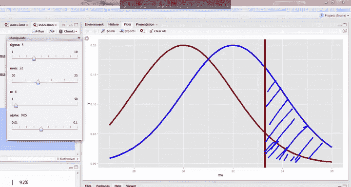

通过公式推导、R代码计算以及交互式可视化，我们直观地理解了这些关系。掌握这些概念对于科学实验设计和结果解读至关重要。