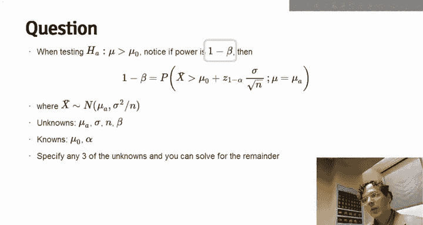
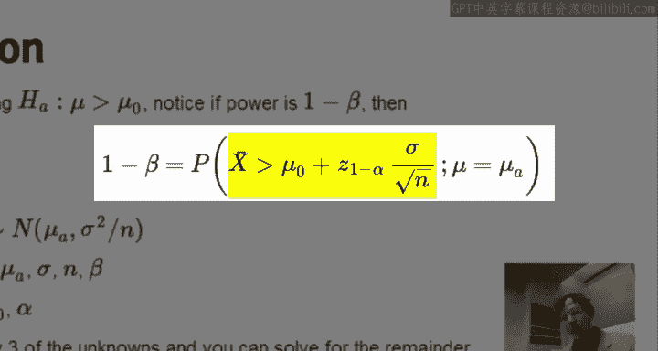
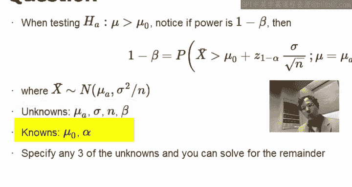
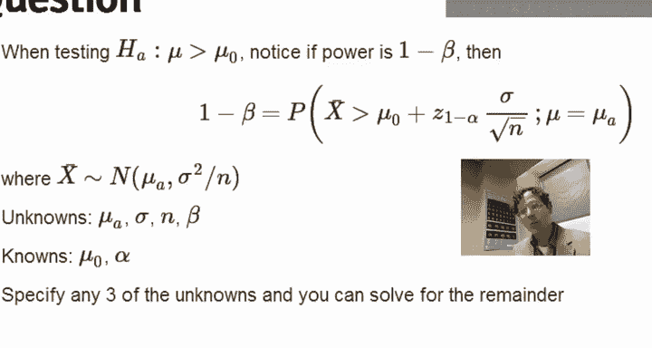
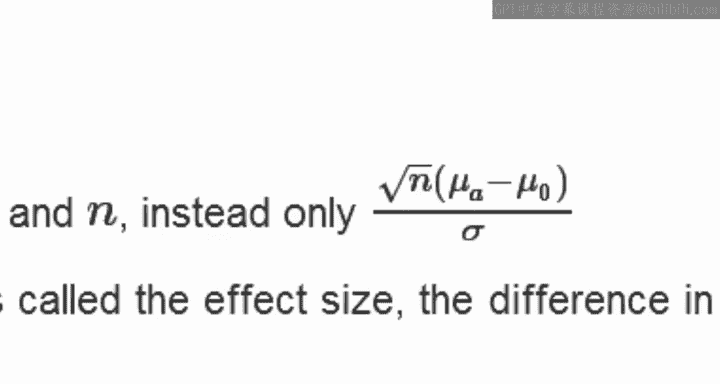
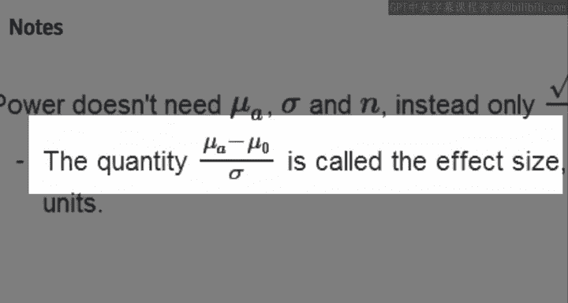

# 课程 P34：关于统计功效的说明 📊

在本节课中，我们将深入探讨统计假设检验中的一个核心概念——**功效**。我们将学习如何定义功效，理解影响功效的关键因素，并掌握如何通过已知参数求解未知参数（如样本量或可检测的效应大小）。

---

## 功效的定义与公式

上一节我们介绍了假设检验的基本框架，本节中我们来看看如何量化检验发现真实效应的能力，即统计功效。

当我们检验备择假设 **H₁: μ > μ₀** 时，功效被定义为 **1 - β**，其中 β 是第二类错误（即错误地接受原假设）的概率。

功效的计算公式如下：

**功效 = P( X̄ > μ₀ + z₁₋α × SE | μ = μₐ )**

其中：
*   **X̄** 是样本均值。
*   **μ₀** 是原假设下的总体均值。
*   **z₁₋α** 是标准正态分布在 (1-α) 水平下的分位数。
*   **SE** 是标准误，计算公式为 **σ / √n**。
*   该概率是在真实总体均值为备择假设值 **μₐ** 的条件下计算的。

这意味着，在备择假设 **μ = μₐ** 成立时，**X̄** 服从均值为 **μₐ**、方差为 **σ²/n** 的正态分布。

---

## 求解未知参数

理解公式中的已知量和未知量至关重要。这本质上是一个方程，只要固定其中几个变量，就能求解另一个。

在这个方程中，通常的**已知量**是：
*   **μ₀**：原假设均值。
*   **α**：预设的第一类错误率（显著性水平）。

而**未知量**通常包括：
*   **μₐ**：备择假设均值（希望检测到的效应）。
*   **σ**：总体标准差。
*   **n**：样本量。
*   **β** 或 **功效 (1-β)**：第二类错误率或统计功效。

以下是几种常见的应用场景：

*   **已知 μₐ, σ, n，求解功效**：评估在给定样本量和效应下，检验有多大的把握发现效应。
*   **已知 功效, μₐ, σ，求解 n**：这是在设计试验（如临床试验）时最常见的场景。为了达到期望的检验功效，需要多大的样本量？
*   **已知 功效, n, σ，求解 μₐ**：在固定样本量和功效的情况下，能够检测到的最小效应量是多少？
*   **已知 功效, n, μₐ，求解 σ**：确定在可接受的功效水平下，所能容忍的最大数据变异程度。

在实际研究中，最常被关注的是 **n**（样本量）和 **β**（功效）。研究者要么想知道“为了达到某个功效，我需要多少样本？”，要么想知道“我只有这么多样本（n），我的检验功效是多少？是否值得进行这项研究？”。

---

## 扩展到其他检验类型

理解了单侧（大于）检验的功效计算后，我们可以将其逻辑推广到其他类型的检验。

*   **对于单侧检验 H₁: μ < μ₀**：推导过程与“大于”检验类似，只需调整不等式方向。
*   **对于双侧检验 H₁: μ ≠ μ₀**：关键区别在于需要使用 **z₁₋α/₂** 作为临界值，而不是 **z₁₋α**。例如，当 α = 0.05 时，应使用 1.96，而不是 1.645。计算功效时，通常只计算 **μₐ** 所在那一侧的概率（例如，若 μₐ > μ₀，则计算右侧概率）。这种方法是一种近似，它忽略了一个很小的概率成分，但当 μₐ 与 μ₀ 相差不大时，这个近似是合理的。

---

## 影响功效的关键因素

以下是决定统计功效大小的几个基本规则：

*   **α 增大，功效增大**：放宽第一类错误的容忍度（提高α），会直接增加发现效应的概率（功效）。
*   **单侧检验的功效高于双侧检验**：这是因为在相同的α水平下，单侧检验的临界值 **z₁₋α** 小于双侧检验的 **z₁₋α/₂**，使得拒绝域更大。
*   **|μₐ - μ₀| 增大，功效增大**：待检测的效应量越大，越容易被发现。
*   **n 增大，功效增大**：样本量增加会降低样本均值的变异性（标准误 SE 减小），使得检验更敏感。
*   **σ 减小，功效增大**：数据本身的变异性减小，同样会降低样本均值的变异性，从而提高功效。

一个重要的洞见是：功效并非单独依赖于 μₐ, μ₀, σ, n 这些参数，而是依赖于它们构成的一个**一维综合指标**：

**效应大小 (Effect Size) = |μₐ - μ₀| / σ**

以及由样本量调整后的形式：

**标准化均值差 = (|μₐ - μ₀|) / (σ / √n) = √n × (效应大小)**

功效本质上只由这个综合指标决定。**效应大小**的优点在于它是**无量纲**的，这使得它可以在不同问题、不同测量单位的研究之间进行比较和解释，成为评估研究实际意义的重要指标。

---

## 总结

本节课中我们一起学习了统计功效的核心概念。我们明确了功效是 **1 - 第二类错误率**，并推导了其计算公式。我们认识到功效计算是一个包含多个参数（μ₀, μₐ, σ, n, α, 功效）的方程，可以通过固定其中三个来求解第四个，这在研究设计和评估中极为实用。我们还总结了影响功效的四大因素：**显著性水平 α、检验类型、效应大小 |μₐ - μ₀|、样本量 n 和总体标准差 σ**，并引入了**效应大小**这一无量纲的关键概念，它整合了均值差和变异性的信息，是理解和计算功效的基石。