# 课程 P36：多重比较 🔬

在本节课中，我们将要学习多重比较的概念、其重要性以及几种常用的校正方法。当我们在同一数据集上执行多次假设检验时，如果不进行校正，就很可能得到大量虚假的“显著”结果。我们将探讨如何通过不同的校正方法来控制错误率，确保研究发现的可靠性。

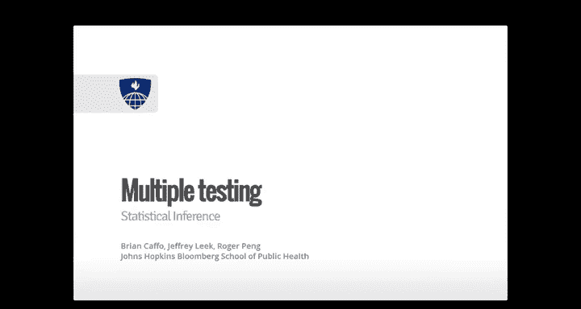

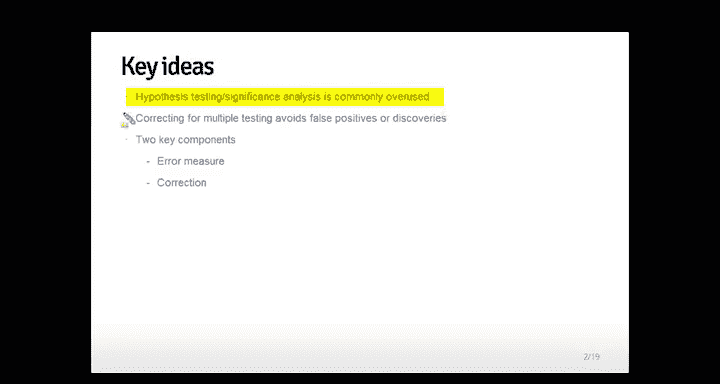

## 概述

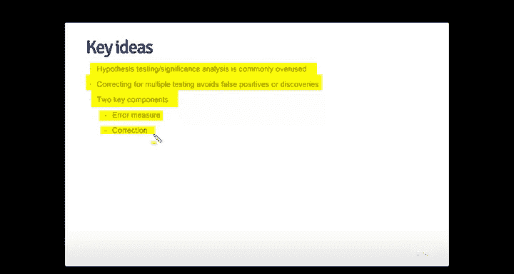

假设检验和显著性分析是统计学中被过度使用的技术。人们常常在分析同一数据时计算多个P值，然后只报告最小的P值，或者声称所有小于0.05的P值都是显著的。这种做法会带来问题。

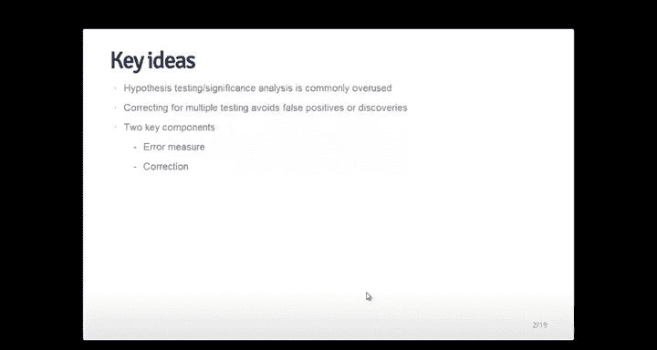

上一节我们介绍了假设检验的基本概念，本节中我们来看看当进行多次检验时，为什么以及如何进行校正。

## 为什么需要多重比较校正？

我们进行多重比较校正，是为了在分析大量变量时避免假阳性或错误发现。这主要源于数据收集技术的进步，例如新一代测序、临床影像、电子病历等，使得我们能够进行海量分析。如果不为这些分析进行校正，每次分析中允许的少量错误就会累积起来。

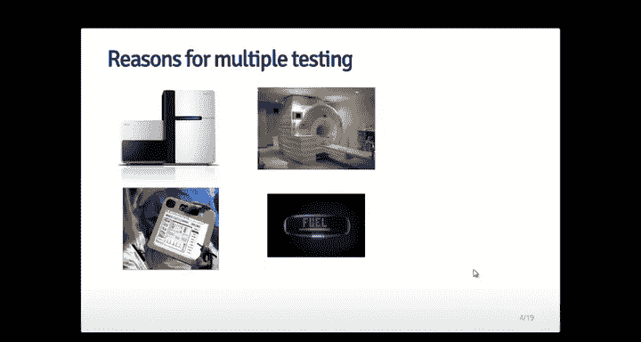

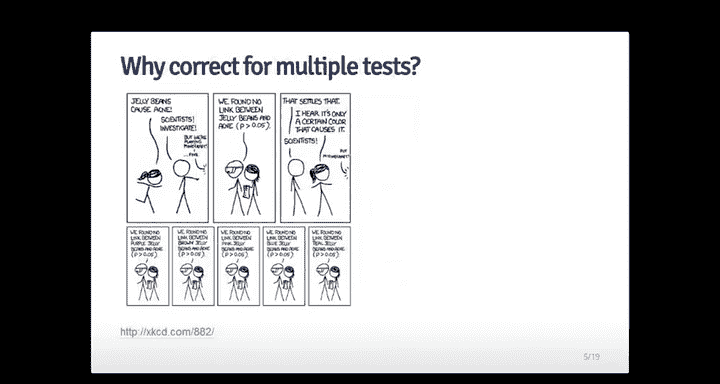

一个经典的例子是研究“软糖是否导致痤疮”。如果科学家测试了20种不同颜色的软糖，即使每种颜色与痤疮都无真实关联，仅仅由于随机性，也几乎必然会有至少一种颜色的检验结果在5%的水平上“显著”。换句话说，如果我们允许每次假设检验有5%的错误率，并进行至少20次检验，那么我们预期会发现至少一次错误，因为 `20 * 5% ≈ 100%`。

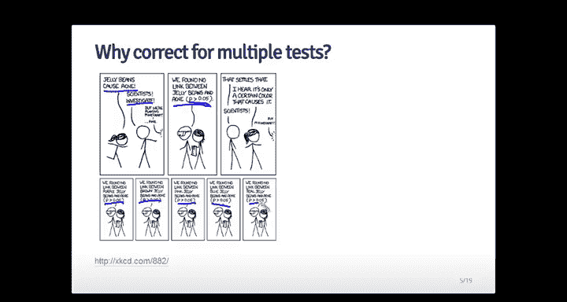

## 假设检验回顾

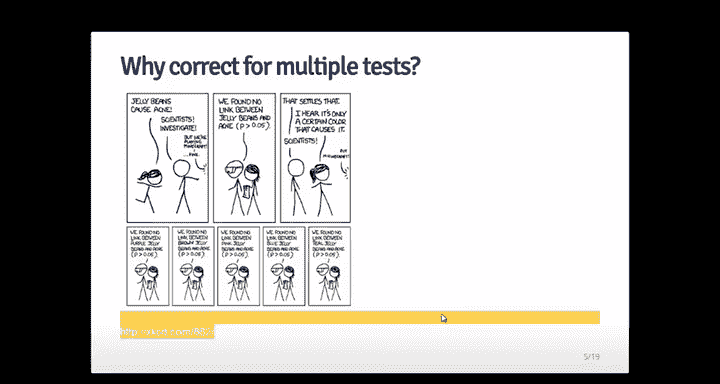

假设检验通常涉及一个参数，例如线性回归模型中的系数 `β`。我们检验的原假设是 `β = 0`（无关联），备择假设是 `β ≠ 0`（有关联）。我们计算P值，并将其与一个阈值（如 `α = 0.05`）比较。如果 `P值 < α`，我们拒绝原假设，声称存在显著关联。

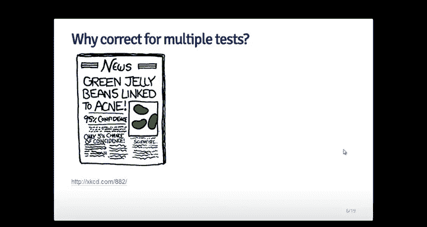

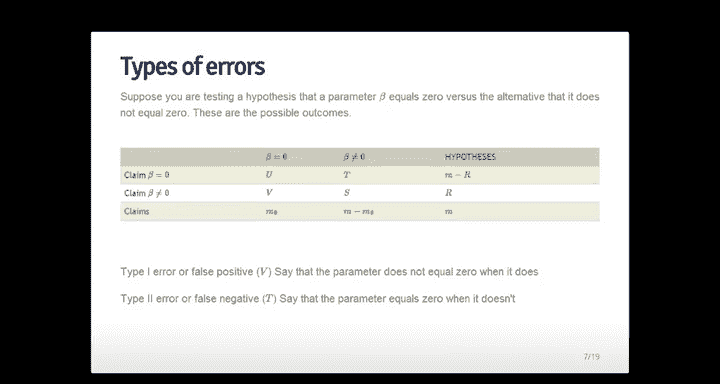

以下是假设检验可能结果的表格：

|  | 真实情况：`β = 0` | 真实情况：`β ≠ 0` |
| :--- | :--- | :--- |
| **声称 `β = 0`** | 正确决策 | 第二类错误（假阴性） |
| **声称 `β ≠ 0`** | 第一类错误（假阳性） | 正确决策 |

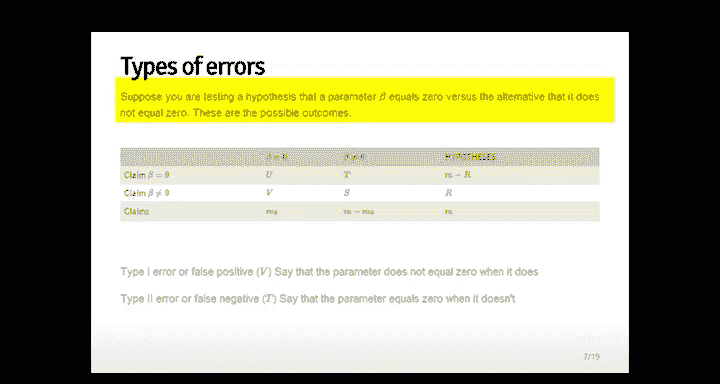

我们通常用 `V` 表示假阳性的次数。在科学研究中，人们往往更关注控制第一类错误（假阳性），以避免被错误发现误导。

## 多重比较中的错误度量

多重比较校正包含两个关键部分：一是定义你想要控制的错误度量，二是定义用于控制该错误度量的校正方法或统计程序。

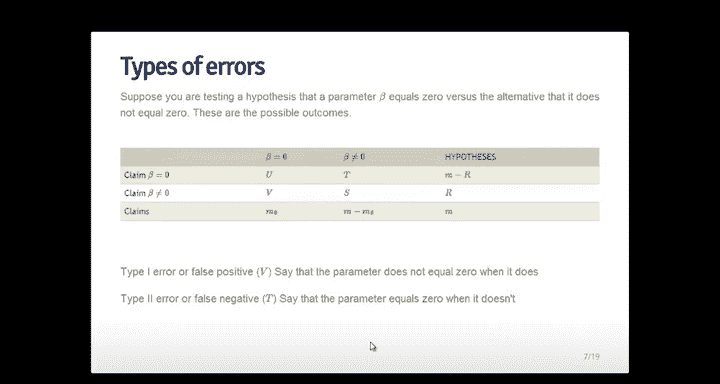

以下是几种主要的错误度量：

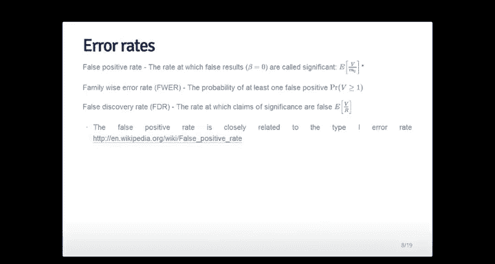

1.  **假阳性率**：在所有真实无关联的检验中，被错误地称为“显著”的比例。
    *   **公式**：`FPR = E[V] / m₀`，其中 `m₀` 是真实无关联的检验总数。
2.  **族错误率**：至少出现一次假阳性的概率。
    *   **公式**：`FWER = Pr(V ≥ 1)`。
3.  **错误发现率**：在所有声称“显著”的检验中，假阳性所占比例的期望值。
    *   **公式**：`FDR = E[V / R]`，其中 `R` 是声称“显著”的总数。当 `R=0` 时，定义 `V/R = 0`。

FWER控制非常严格，它要求“一个错误都不犯”的概率很高。FDR则相对宽松，它控制的是所有“发现”中错误的比例，允许存在一定比例的假阳性。

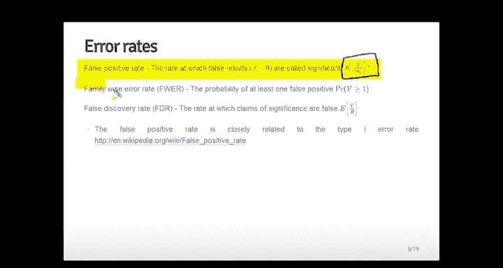

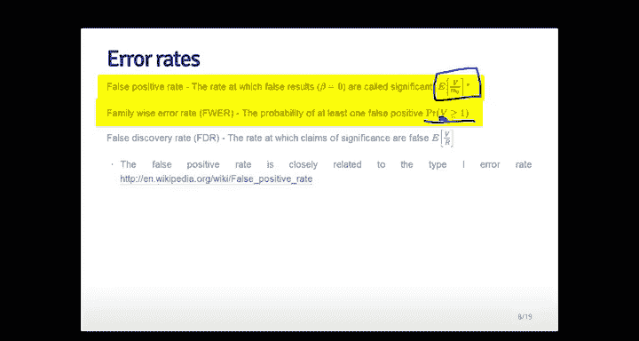

## 控制假阳性率的问题

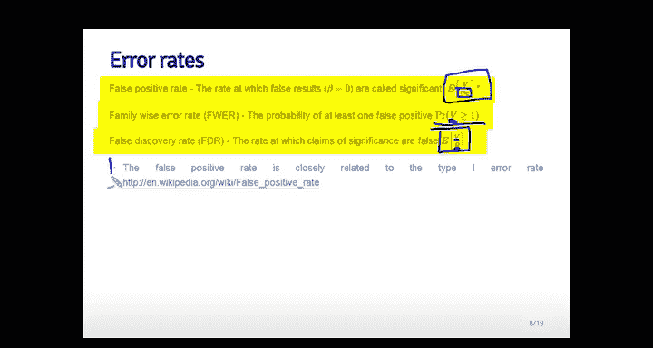

如果P值计算正确，那么直接声称所有 `P值 < α` 的检验为显著，就能在平均意义上将假阳性率控制在 `α` 水平。

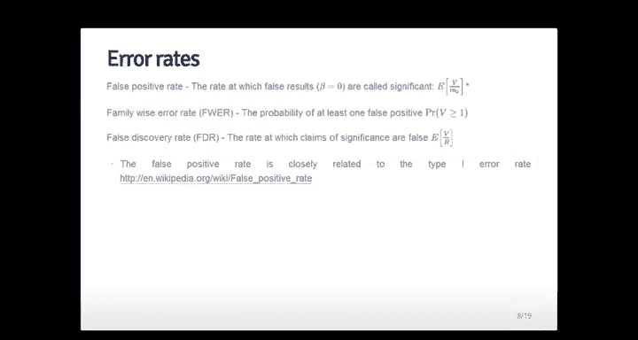

然而，问题在于：如果你进行了 `m = 10,000` 次假设检验，并设定 `α = 0.05`，那么预期的假阳性数量为 `m * α = 10,000 * 0.05 = 500`。如果你得到了500个“显著”结果，其中很可能大部分都是假阳性。

因此，我们需要能控制其他错误度量的方法，以避免如此多的假阳性。

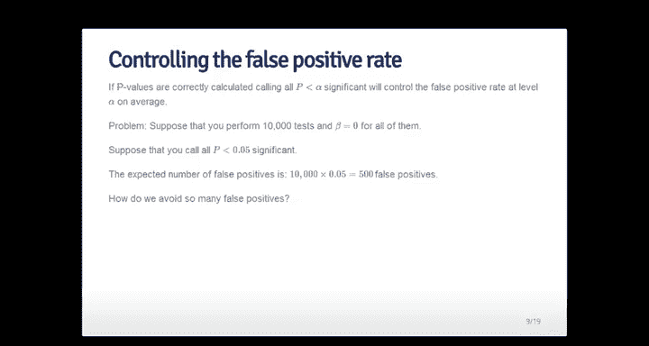

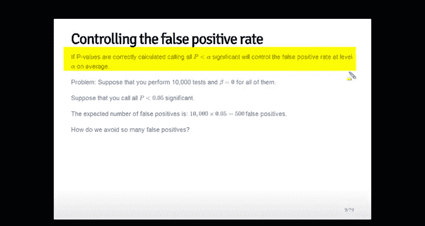

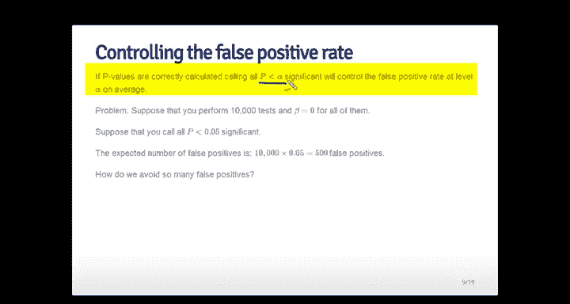

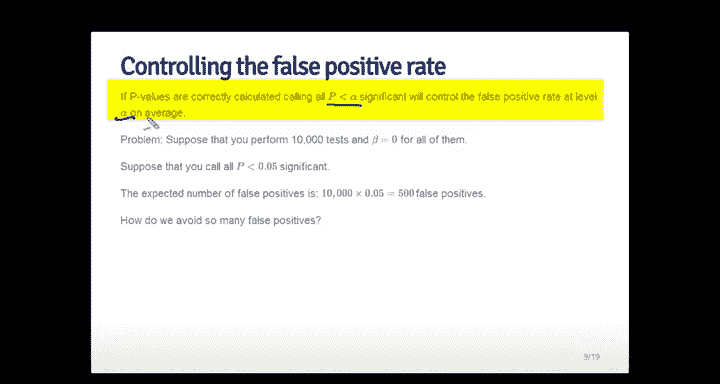


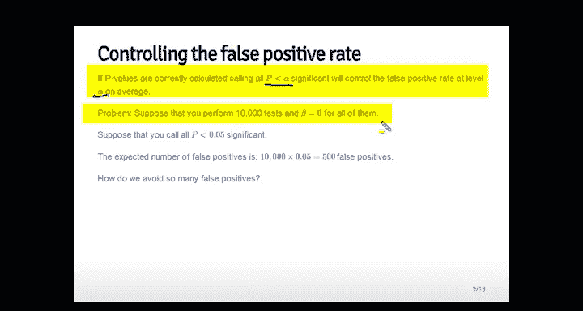

## 校正方法一：邦费罗尼校正（控制FWER）

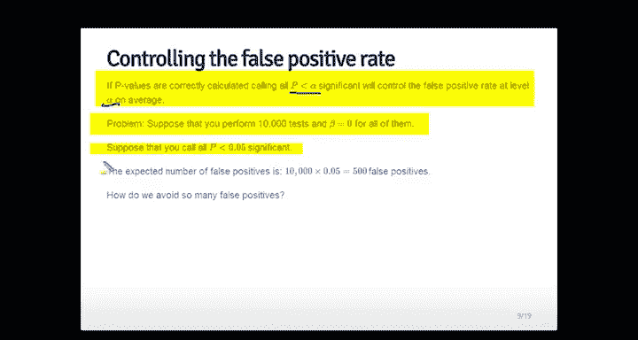

邦费罗尼校正是最古老的多重比较校正方法，用于控制族错误率。

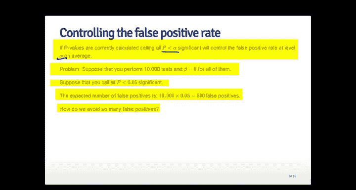

**核心思想**：如果你想进行 `m` 次假设检验，并将FWER控制在 `α` 水平，那么你需要将单次检验的显著性水平 `α` 除以检验次数 `m`。

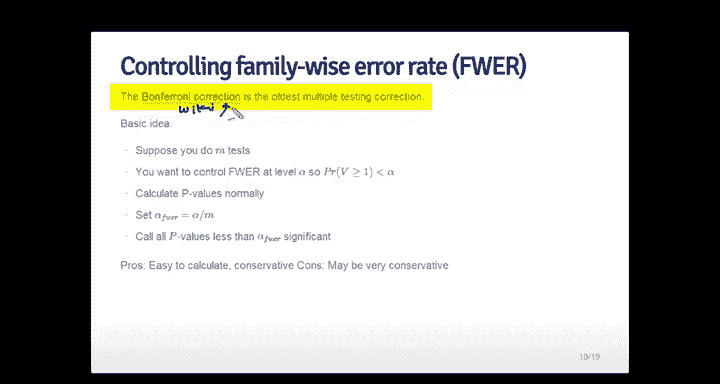

*   **校正后的显著性水平**：`α_new = α / m`
*   **决策规则**：仅当 `P值 < α_new` 时，才拒绝原假设。

**优点**：计算简单，能严格保证FWER得到控制。
**缺点**：过于保守，尤其是当检验次数 `m` 很大时，`α_new` 会变得非常小，导致发现真实信号的能力（统计功效）大大降低。

## 校正方法二：错误发现率控制（本杰明-霍克伯格法）

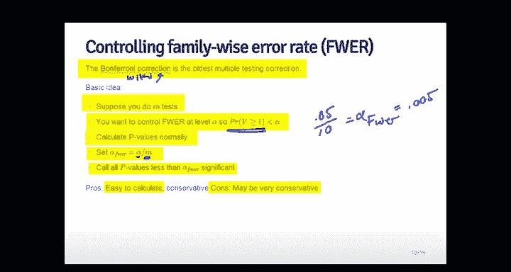

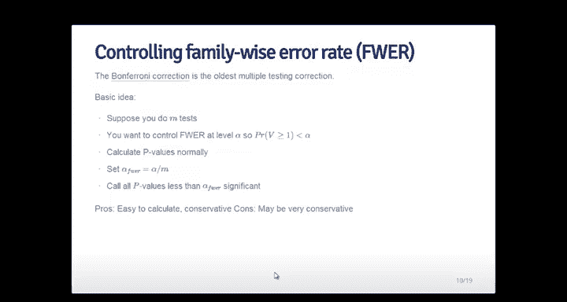

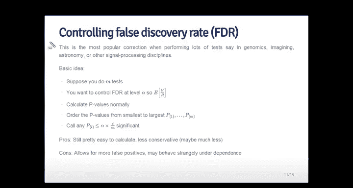

FDR控制是目前在基因组学、影像学等需要进行大量假设检验的领域中最流行的方法。

**核心思想**：控制所有“发现”中错误发现的比例。

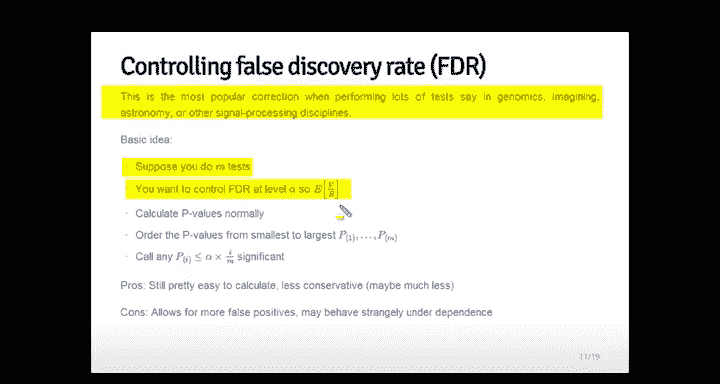

**BH法步骤**：
1.  对 `m` 次检验计算得到的P值进行排序：`P(1) ≤ P(2) ≤ ... ≤ P(m)`。
2.  对于第 `i` 个排序后的P值，判断它是否满足：`P(i) ≤ (α * i) / m`。
3.  找到最大的 `k`，使得 `P(k) ≤ (α * k) / m`。
4.  拒绝原假设 `H(1), H(2), ..., H(k)`，即声称前 `k` 个检验是显著的。

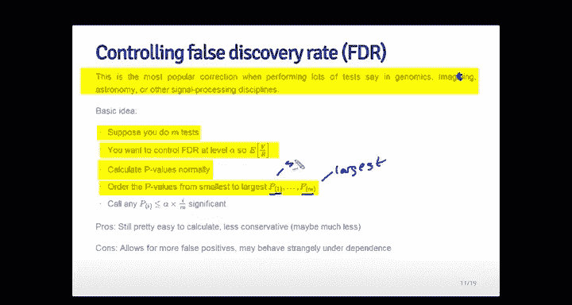

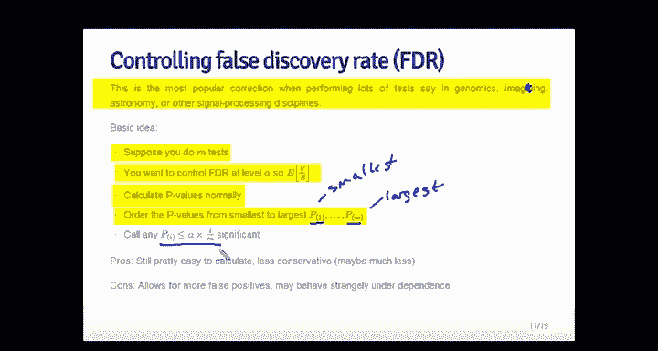


**优点**：比邦费罗尼校正更宽松，在存在较多真实信号时，能发现更多的真阳性，同时将错误发现的比例控制在 `α` 左右。
**缺点**：允许出现更多假阳性。当检验之间存在依赖关系时，其行为可能变得复杂。

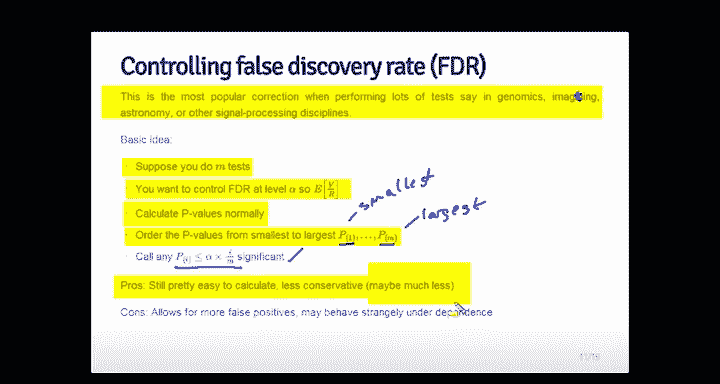

## 校正方法对比示例

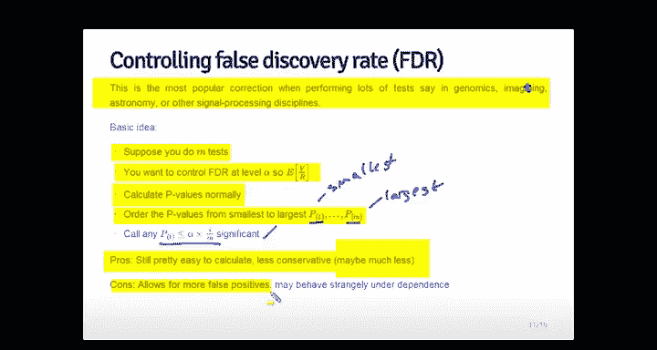

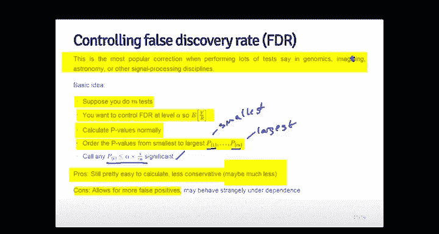

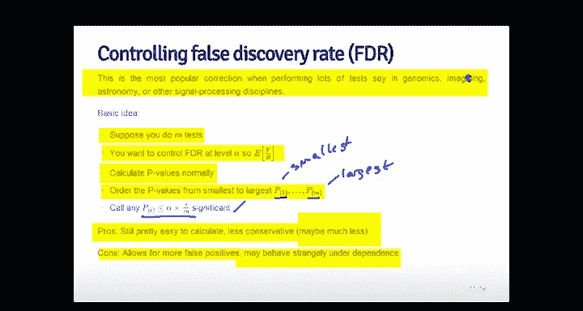

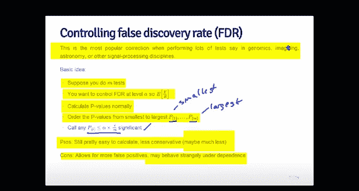

假设我们进行了10次检验，P值已排序，我们希望在 `α=0.2` 的水平上控制不同错误率。

*   **不校正（控制FPR）**：红线，所有 `P值 < 0.2` 的检验均显著。
*   **FDR控制（BH法）**：灰线，仅前3个最小的P值满足 `P(i) ≤ 0.2*i/10` 的条件，因此声称这3个显著。
*   **邦费罗尼校正（控制FWER）**：`α_new = 0.2/10 = 0.02`，绿线，仅前2个P值小于0.02，因此声称这2个显著。

这个例子直观展示了不同校正方法的严格程度：邦费罗尼最严，FDR次之，不校正最宽松。

## 调整P值法

除了调整显著性水平 `α`，另一种等价的方法是直接调整P值本身。调整后的P值可以与原始的 `α` 水平（如0.05）直接比较。

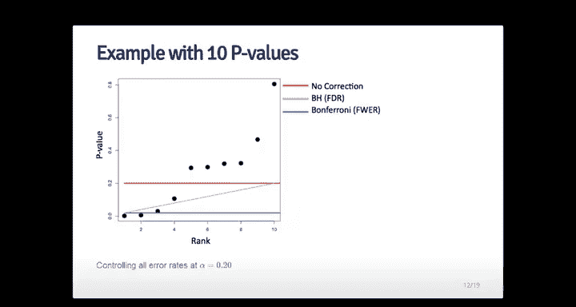

**重要提示**：调整后的P值不再具有经典P值的所有性质，不应被如此对待。但它们提供了一种便捷的方式来控制错误度量。

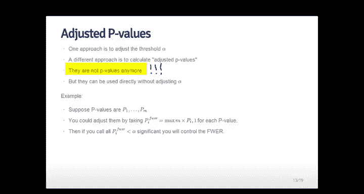

*   **邦费罗尼调整P值**：`P_adj = min(m * P, 1)`。然后判断 `P_adj < α`。
*   **BH法调整P值**：在R语言中，可以使用 `p.adjust(p_values, method="BH")` 函数直接计算。

## R语言模拟示例

以下我们通过R语言模拟来演示不同校正方法的效果。

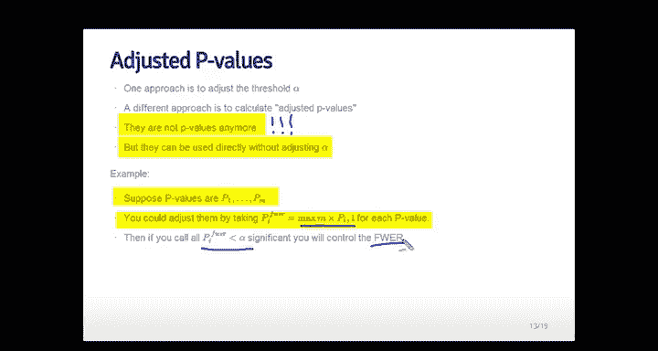

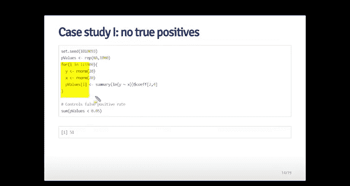

**场景一：无真实关联**
我们模拟1000个数据集，每个数据集中 `y` 和 `x` 均独立生成，无真实关联。

```r
# 模拟无真实关联的数据
set.seed(123)
m <- 1000
p_values <- replicate(m, {
  y <- rnorm(100)
  x <- rnorm(100)
  fit <- lm(y ~ x)
  summary(fit)$coefficients[2, 4] # 提取x系数的P值
})

# 不校正
sum(p_values < 0.05) # 大约会有50个假阳性

# 邦费罗尼校正
p_adj_bonf <- p.adjust(p_values, method = "bonferroni")
sum(p_adj_bonf < 0.05) # 应为0或极少

# BH法校正 (FDR控制)
p_adj_bh <- p.adjust(p_values, method = "BH")
sum(p_adj_bh < 0.05) # 也应为0或极少
```

**场景二：部分有真实关联**
我们模拟1000个数据集，其中前500个 `y` 与 `x` 独立（`β=0`），后500个 `y = 2*x + error`（`β=2`）。

```r
# 模拟部分有真实关联的数据
set.seed(456)
m <- 1000
half <- m/2
p_values <- numeric(m)
truth <- rep(c(0, 2), each = half) # 前500为0，后500为2

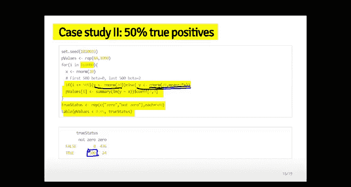

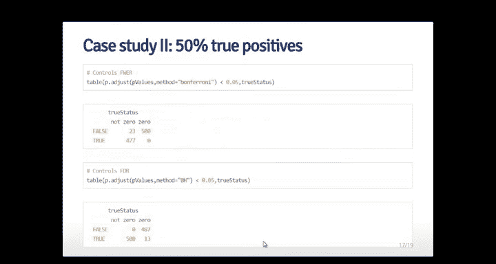

for (i in 1:m) {
  x <- rnorm(100)
  if (i <= half) {
    y <- rnorm(100) # 无关联
  } else {
    y <- 2 * x + rnorm(100) # 有关联
  }
  fit <- lm(y ~ x)
  p_values[i] <- summary(fit)$coefficients[2, 4]
}

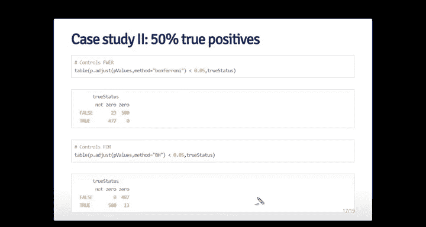

# 不校正的结果
table(Truth = truth, Significant_NoCorrection = p_values < 0.05)

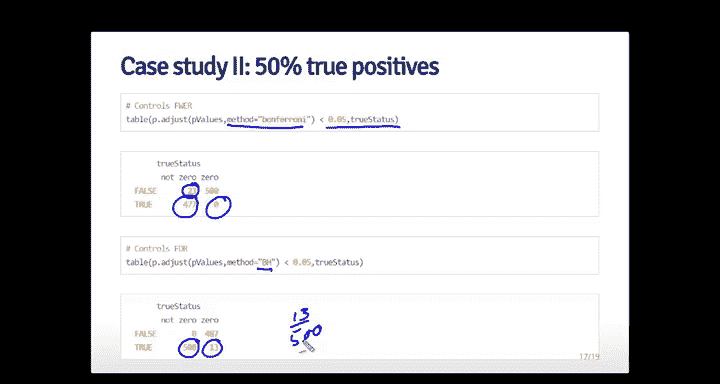

# 邦费罗尼校正的结果
p_adj_bonf <- p.adjust(p_values, method = "bonferroni")
table(Truth = truth, Significant_Bonferroni = p_adj_bonf < 0.05)

# BH法校正的结果
p_adj_bh <- p.adjust(p_values, method = "BH")
table(Truth = truth, Significant_BH = p_adj_bh < 0.05)
```
在这个例子中，你将观察到：
*   **不校正**：能发现几乎所有真实信号，但也会在无关联组产生约5%的假阳性。
*   **邦费罗尼校正**：能完全消除假阳性，但可能会漏掉一些真实信号（功效降低）。
*   **BH法校正**：能发现几乎全部真实信号，同时将假阳性在所有“发现”中的比例控制在一定水平，通常假阳性数量介于前两者之间。

## 注意事项与进一步资源

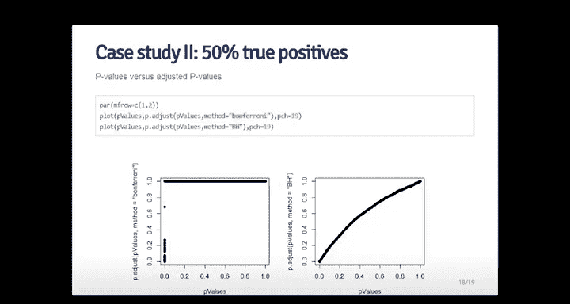

多重比较是一个庞大的子领域，存在许多不同的校正方法，特别是当检验之间存在依赖关系时。邦费罗尼和BH法适用于大多数标准问题。如果检验间存在强依赖，可以考虑使用 `p.adjust` 函数中的 `method="BY"`（Benjamini-Yekutieli法）或查阅专门处理依赖关系的文献。

**进一步阅读资源**：
1.  *A gentle introduction to multiple testing procedures with applications in genomics*.
2.  *Statistical significance for genomewide studies*.
3.  *Introduction to multiple testing*.

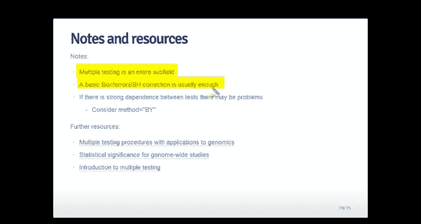

## 总结

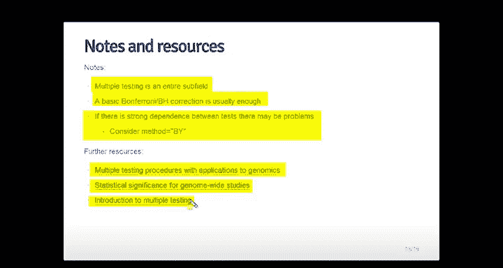

本节课中我们一起学习了多重比较的核心概念。我们了解到，当进行多次假设检验时，必须进行校正以避免假阳性泛滥。我们介绍了三种主要的错误度量：假阳性率、族错误率和错误发现率。并详细讲解了两种最常用的校正方法：严格控制FWER的邦费罗尼校正，以及更常用、更灵活的用于控制FDR的本杰明-霍克伯格法。最后，我们通过R语言模拟演示了这些方法在实际中的应用和效果。正确选择和应用多重比较校正，是确保数据分析结果可靠性的关键一步。