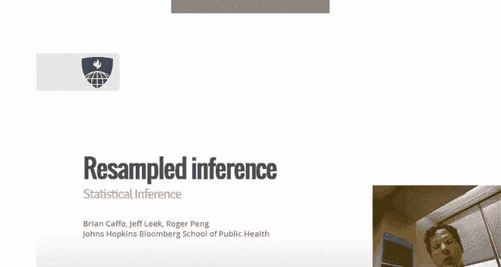
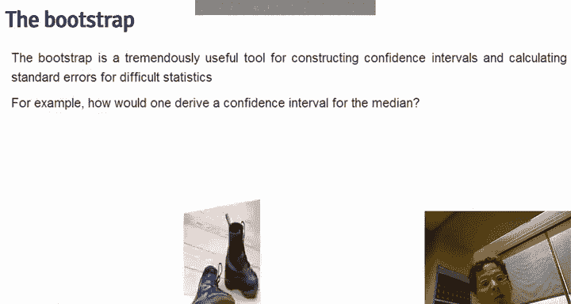
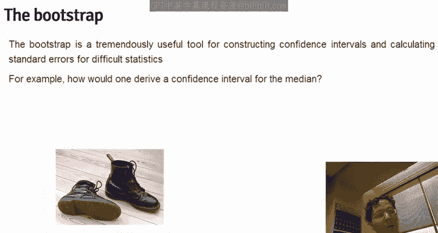
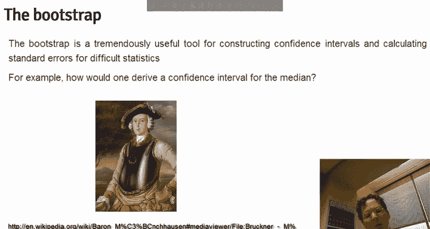
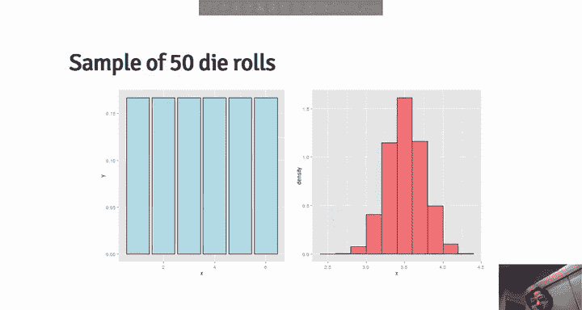
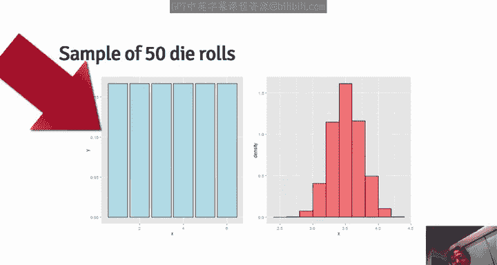
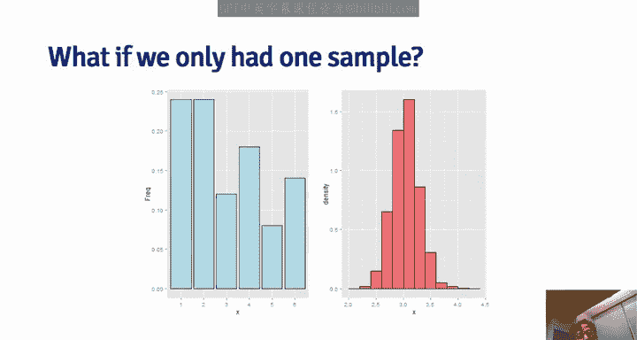
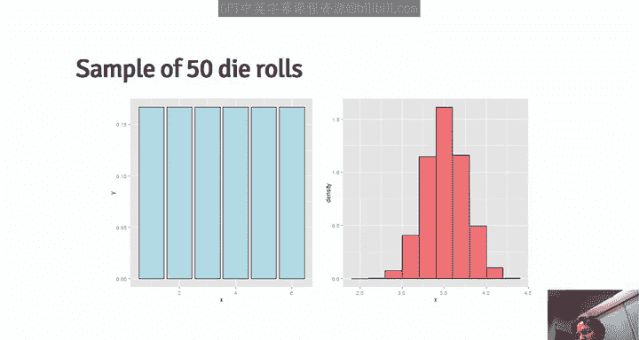
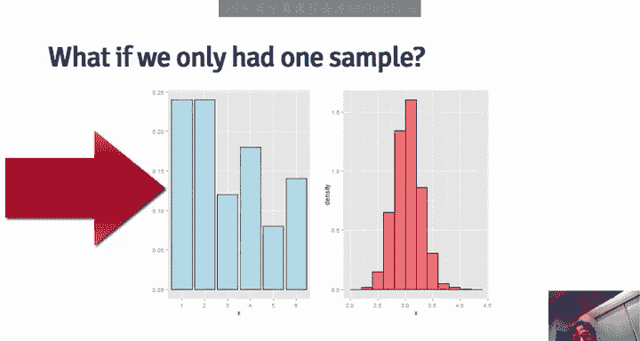
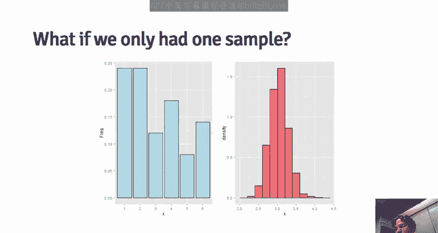

# 课程 P37：自助法 🎲



在本节课中，我们将要学习一种极其重要的统计推断工具——自助法。自助法由著名统计学家埃夫龙于1979年发明，它极大地简化了置信区间和标准误的构建过程，使数据分析师无需依赖复杂的数学推导也能进行统计推断。我们将通过简单的例子，理解自助法的核心思想、操作步骤及其应用场景。

---

## 自助法的核心思想 💡

上一节我们介绍了自助法的重要性，本节中我们来看看它的核心思想。

自助法的基本理念是，当我们只有一个来自未知总体的样本时，我们可以利用这个样本本身来估计总体分布，并基于此进行模拟推断。具体来说，我们不是从真实总体中重复抽样，而是从我们观察到的样本数据中进行有放回的重复抽样，以此来模拟统计量的抽样分布。



这个过程可以用以下伪代码描述：
```r
# 假设我们有一个原始样本 data
bootstrap_samples <- replicate(B, sample(data, size = length(data), replace = TRUE))
# 然后对每个自助样本计算我们感兴趣的统计量（例如中位数）
bootstrap_statistics <- apply(bootstrap_samples, 2, median)
```



---

## 一个简单的例子：骰子实验 🎯



考虑一个例子：我们想评估投掷一枚骰子50次所得平均值的分布特性。



如果我们知道骰子是均匀的（即总体分布已知），我们可以通过两种方式研究：
1.  进行复杂的数学推导，计算50次投掷平均值的精确分布。
2.  实际重复“投掷骰子50次并计算平均值”这个过程很多次，用模拟方法得到经验分布。



然而，在现实中，我们通常不知道骰子是否均匀。我们可能只有一个大小为50的样本（即一次50次投掷的结果），如下图所示，我们只得到了一个平均值，而非平均值的分布。



此时，自助法提供了一个解决方案：既然我们不知道真实的总体分布，我们就用样本的经验分布作为其最佳估计。我们从样本数据中进行有放回的重复抽样，每次抽取50个观测值，计算其平均值，并重复此过程多次。这样，我们就能基于这一个真实样本，模拟出平均值的近似分布。

以下是自助法在骰子例子中的操作步骤：
1.  将我们观察到的50次投掷结果（每个数字1-6及其出现次数）视为一个“袋子”。
2.  从这个袋子中有放回地抽取50个数字，构成一个自助样本。
3.  计算这个自助样本的平均值。
4.  将步骤2和3重复成百上千次，得到一系列自助样本的平均值。
5.  这些自助平均值的分布，就近似于我们从真实总体中重复抽样所得平均值的分布。



---

## 自助法的基本流程 📊




理解了骰子例子后，我们来看看自助法更通用的流程。

自助法的基本原则是：使用观测数据构建一个估计的总体分布，然后通过从这个估计分布中模拟抽样，来探究我们感兴趣的统计量的分布特性。

其流程可以概括为以下几步：

1.  **使用原始样本估计总体分布**：将原始样本的经验分布函数作为总体分布的最佳估计。
2.  **生成自助样本**：从原始样本中有放回地抽取与原始样本量相同数量的观测值，形成一个自助样本。重复此过程 `B` 次（例如1000次），得到 `B` 个自助样本。
3.  **计算统计量**：对每一个自助样本，计算我们感兴趣的统计量（如均值、中位数、回归系数等），得到 `B` 个统计量的值。
4.  **进行推断**：利用这 `B` 个统计量值构成的分布（即自助分布），来计算标准误、构建置信区间或进行假设检验。

---

## 总结与回顾 🏁

本节课中我们一起学习了自助法这一强大的统计工具。

我们首先了解了自助法在统计学历史上的重要地位，它解放了数据分析师，使其无需复杂数学推导也能进行推断。接着，我们通过骰子实验的例子，直观地理解了自助法的核心思想：当真实总体未知时，我们用样本的经验分布来近似它，并通过有放回的重复抽样来模拟统计量的变异情况。最后，我们梳理了自助法通用的四步操作流程。



自助法思想深刻，操作简单，是数据科学实践中不可或缺的工具，尤其适用于那些理论分布难以推导的复杂统计量。