# 课程 P38：自助法示例 🎯

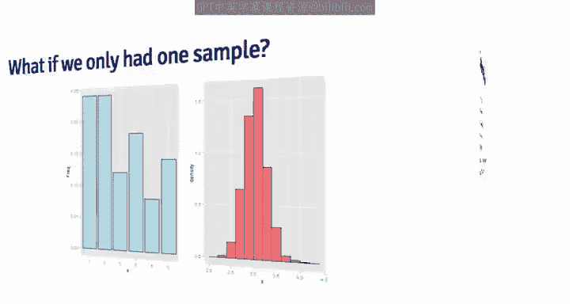

在本节课中，我们将学习如何使用自助法（Bootstrap）来估计统计量的抽样分布，特别是中位数的标准误和置信区间。我们将通过一个具体的R语言示例，使用父子身高数据集来演示整个过程。

---

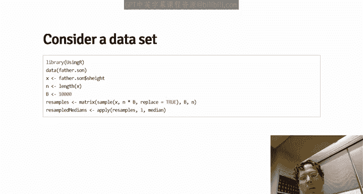

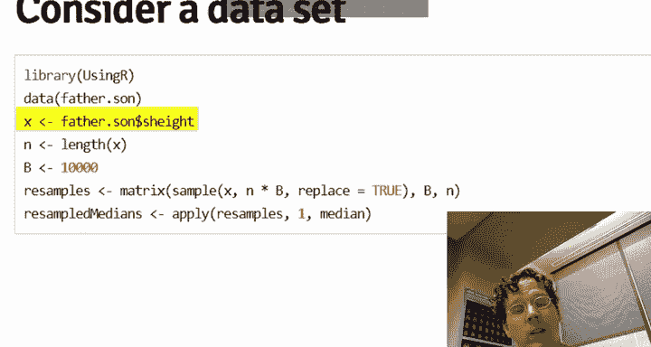

## 概述

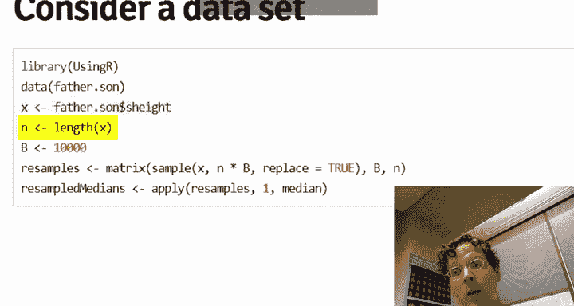

自助法是一种强大的统计方法，它通过从原始数据中有放回地重复抽样来模拟数据的抽样分布。这种方法特别适用于那些理论分布未知或难以推导的统计量。本节我们将以中位数为例，展示自助法的具体实现步骤。

上一节我们介绍了自助法的基本概念，本节中我们来看看如何用R语言实现它。

---

## 数据准备与参数设置

首先，我们加载R语言中的`UsingR`库，并获取`father.son`数据集。为了简化后续操作，我们将儿子的身高数据单独定义为变量`x`。

```r
library(UsingR)
data(father.son)
x <- father.son$sheight
```

接着，我们定义观测值的数量`n`，并设定自助重抽样的次数`B`为10,000次。

```r
n <- length(x)
B <- 10000
```

---

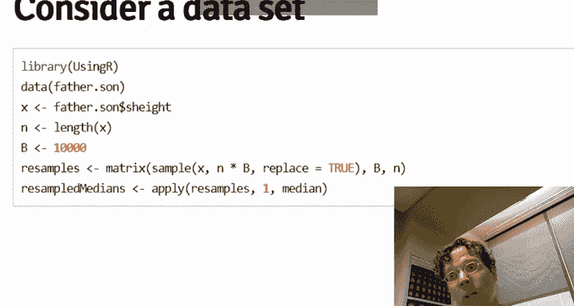

## 执行自助重抽样

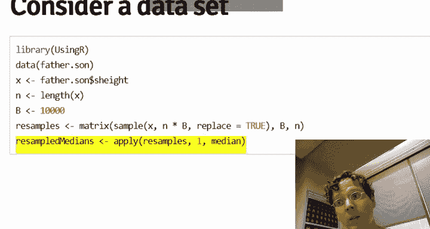

自助法的核心是从经验分布中重复抽样。经验分布为每个观测数据点赋予相同的概率 `1/n`。

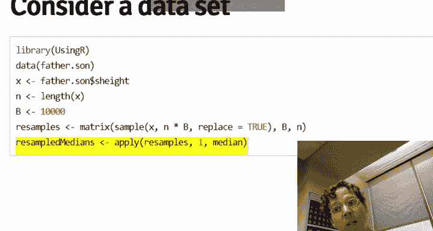

以下是生成重抽样数据集的步骤：
1.  使用`sample`函数从`x`中有放回地抽取`n`个观测值，这相当于从经验分布中生成一个样本。
2.  将这个过程重复`B`次，并将结果排列成一个矩阵。这个矩阵的每一行都是一个完整的重抽样数据集。

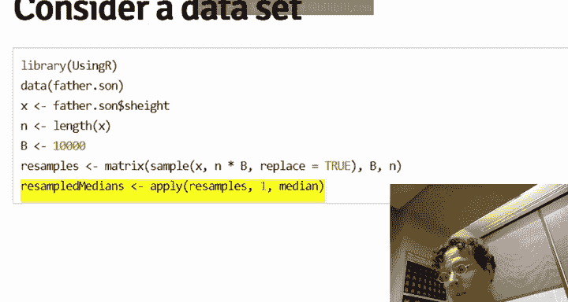

```r
resamples <- matrix(sample(x, n * B, replace = TRUE), B, n)
```

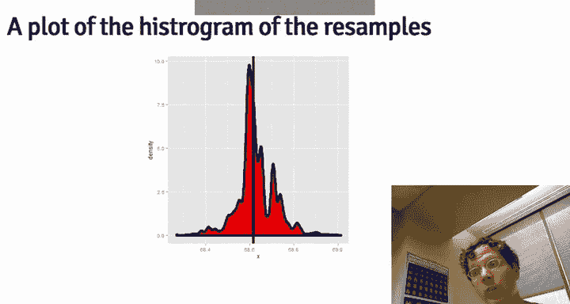

---

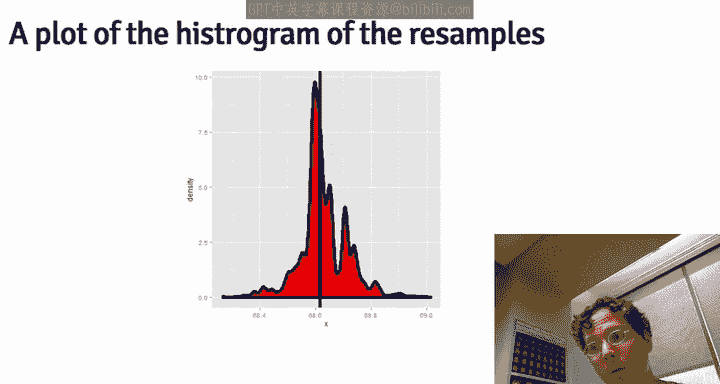

## 计算统计量

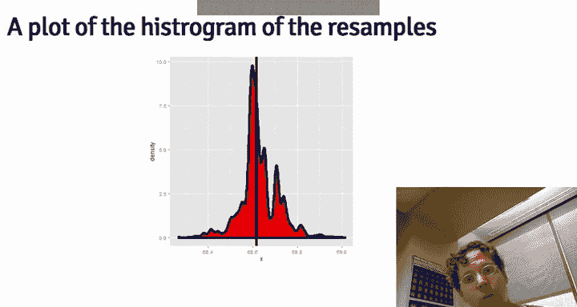

现在，我们对每一个重抽样数据集计算我们感兴趣的统计量——中位数。

```r
medians <- apply(resamples, 1, median)
```
这行代码对`resamples`矩阵的每一行（`1`表示按行）应用`median`函数，从而得到包含`B`个中位数的向量`medians`。

---


## 可视化与分析结果


我们可以绘制重抽样中位数的密度估计图，并在图上用垂直线标出原始数据的中位数。

```r
plot(density(medians))
abline(v = median(x), col = "red")
```

这张图估计了中位数的抽样分布。由于我们不知道真实的总体分布，所以用观测数据来估计它。这个分布是自助法的核心产物。

基于这个自助分布，我们可以进行多种推断：
*   **估计标准误**：计算`medians`向量的标准差，作为中位数标准误的估计。
*   **构建置信区间**：计算`medians`向量的分位数（例如2.5%和97.5%分位数），作为中位数的置信区间估计。

---

## 总结

本节课中我们一起学习了自助法的完整应用流程。我们以父子身高数据为例，通过R语言代码实现了以下步骤：
1.  从原始数据生成大量自助重抽样数据集。
2.  对每个重抽样数据集计算中位数。
3.  利用得到的中位数集合来估计其抽样分布，进而计算标准误和置信区间。

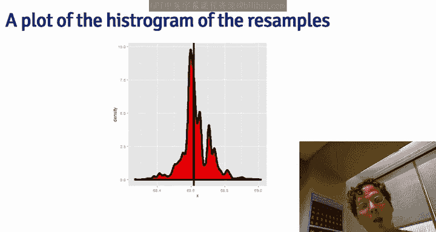

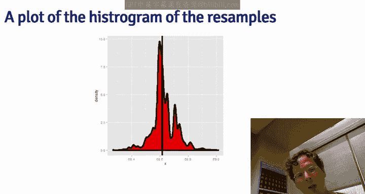

自助法是一种非常灵活的工具，它不依赖于严格的理论假设，为复杂统计量的推断提供了实用的解决方案。