# 课程39：关于自助法的说明 📊

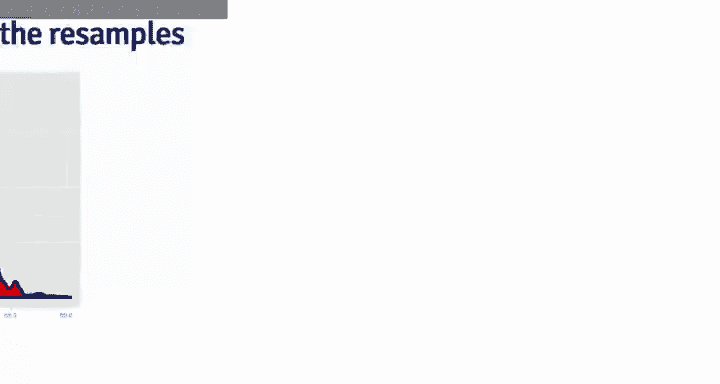

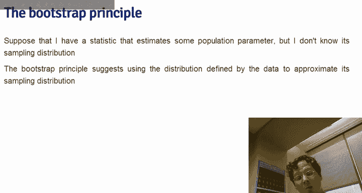

在本节课中，我们将学习自助法的核心原理、基本步骤及其在估计统计量（如中位数）的标准误和置信区间时的应用。自助法是一种强大的重抽样技术，它允许我们在不了解统计量精确抽样分布的情况下，通过从观测数据中有放回地重复抽样来近似该分布。

## 自助法原理

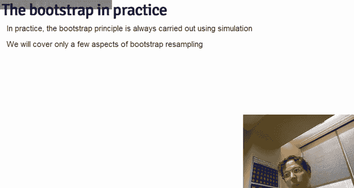

上一节我们介绍了自助法的基本概念，本节中我们来看看其核心原理。

自助法原理是：如果你有一个用于估计某个感兴趣的总体参数的统计量，但你不知道该统计量的抽样分布，那么自助法原理就是简单地使用由观测数据定义的分布来研究（或估计）那个抽样分布。

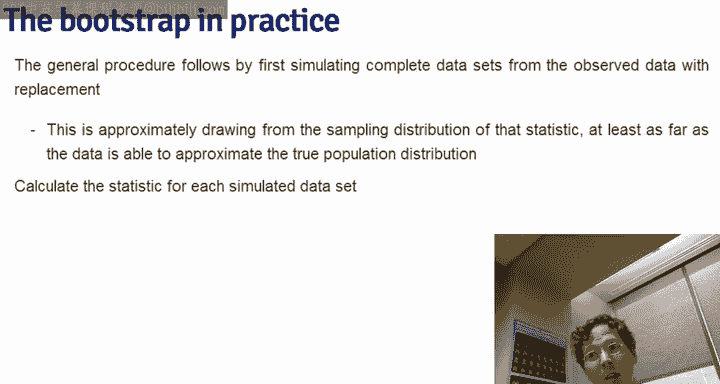

**公式**：若用观测数据近似总体分布，则通过从观测数据中有放回地重抽样得到的统计量分布，近似于该统计量的真实抽样分布。

自助法原理本身并不一定要求模拟。例如，如果我们想知道掷50次骰子所得平均值的分布，理论上可以数学推导，但使用模拟（如蒙特卡洛方法）通常更简单高效。我们不会去求解无限次掷骰的极限分布，因为蒙特卡洛模拟可以很好地近似它。

自助法的应用非常广泛，但本课程主要涵盖两个方面：**构建置信区间**和**估计标准误**。

## 自助法通用步骤

理解了原理后，我们来看看具体的操作步骤。以下是自助法的通用流程：

1.  **获取观测数据**：这是分析的起点。
2.  **有放回地重抽样**：从观测数据中随机抽取（允许重复）与原始数据集相同数量的观测值，形成一个“重抽样数据集”。
3.  **计算统计量**：针对每个重抽样数据集，计算你感兴趣的统计量（例如中位数、均值等）。
4.  **重复过程**：将步骤2和3重复进行B次（例如B=10,000次），得到B个统计量的值。
5.  **分析结果**：利用这B个统计量的值来近似原统计量的抽样分布，进而计算标准误或置信区间。

**核心代码逻辑**（伪代码）：
```r
B <- 10000 # 重抽样次数
n <- length(原始数据)
bootstrap_stats <- numeric(B) # 存储B个统计量结果

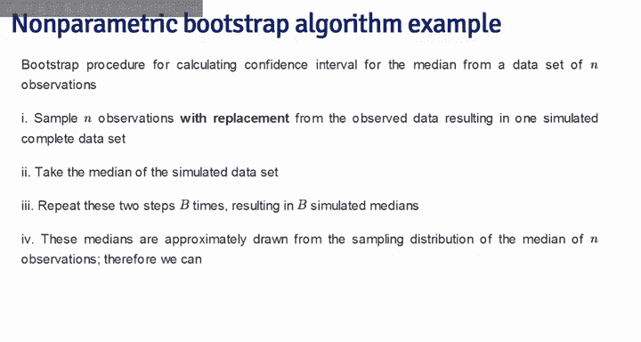

for (i in 1:B) {
  # 有放回地抽取n个观测值
  resample <- sample(原始数据, size = n, replace = TRUE)
  # 计算统计量，例如中位数
  bootstrap_stats[i] <- median(resample)
}
```

## 以中位数为例的详细算法

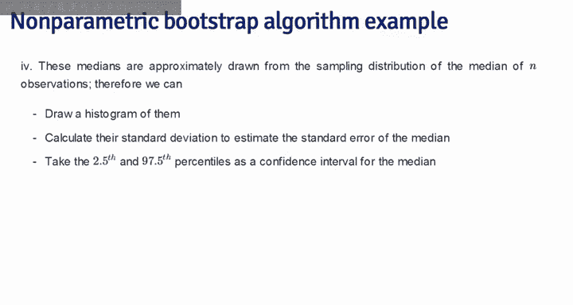

现在，让我们以估计一组n个观测值的中位数为例，详细走一遍自助法算法，用于计算置信区间或标准误。

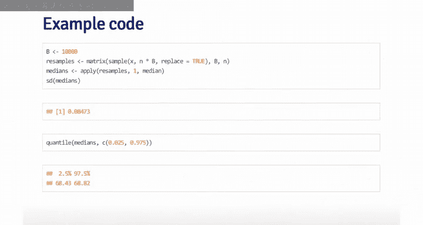

1.  **输入数据**：我们有一个长度为n的向量 `x`。
2.  **重抽样**：从 `x` 中有放回地随机抽取n个观测值，生成一个完整的重抽样数据集。**有放回**是关键，这意味着某些观测值可能被多次抽取，而有些则可能一次都没被抽到。
3.  **计算统计量**：计算这个重抽样数据集的中位数。
4.  **重复**：将步骤2和3重复B次，B是一个很大的数（如10,000），以确保蒙特卡洛误差足够小。我们通过蒙特卡洛模拟来近似自助法分布，因此需要大量重复来减少模拟本身带来的随机误差。
5.  **结果分析**：我们得到了B个中位数值，它们近似于从“在每一个观测数据点上放置1/n概率的分布”中抽样的中位数分布。我们可以用这些值做两件事：
    *   **估计标准误**：计算这B个中位数的标准差，作为中位数标准误的估计。
    *   **构建置信区间**：取这B个中位数的特定分位数（例如2.5%分位数和97.5%分位数），它们构成了中位数的所谓“自助法置信区间”。这种方法无需复杂的渐近理论就能轻松得到置信区间。

## R语言代码示例

理论需要实践来巩固。让我们通过一个具体的R代码示例来演示上述过程。我们将使用“父子身高”数据集，其中 `x` 代表儿子的身高。

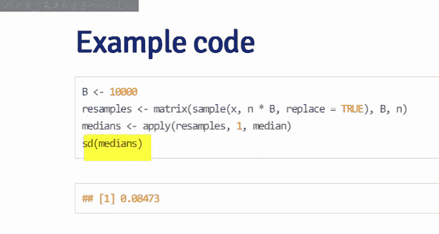

```r
# 假设 x 已包含儿子的身高数据，n = length(x)
B <- 10000 # 设定自助法重抽样次数

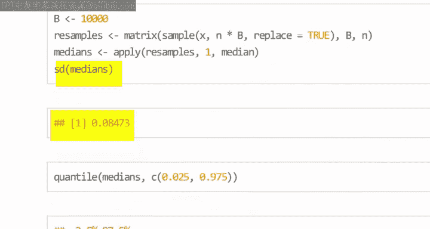

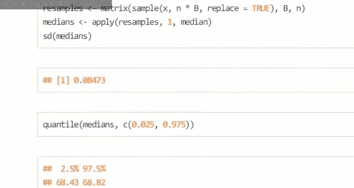

# 方法一：使用循环（清晰易懂）
bootstrap_medians <- numeric(B)
for (i in 1:B) {
  resample <- sample(x, size = n, replace = TRUE)
  bootstrap_medians[i] <- median(resample)
}

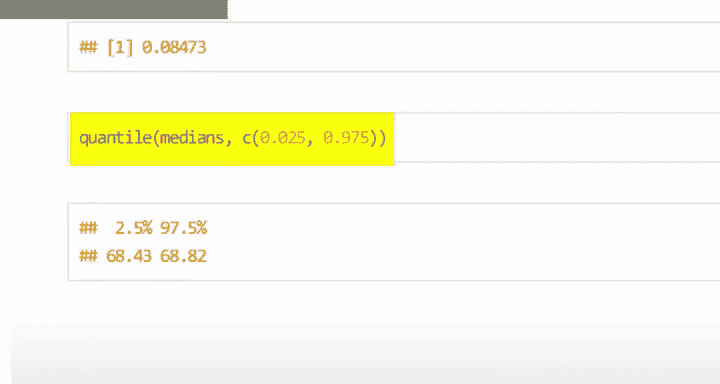

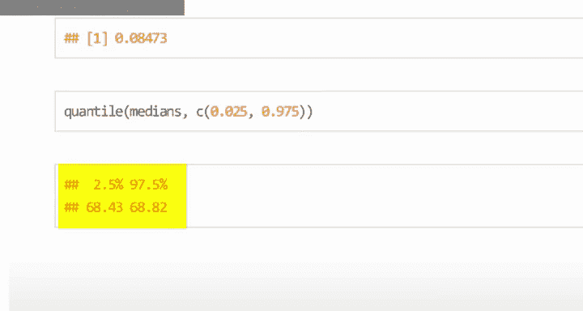

# 方法二：向量化操作（更高效）
# 一次性抽取所有样本
all_samples <- sample(x, size = n * B, replace = TRUE)
# 将结果排列成矩阵，每行是一个重抽样数据集
resample_matrix <- matrix(all_samples, nrow = B, ncol = n)
# 按行计算中位数
bootstrap_medians <- apply(resample_matrix, 1, median)

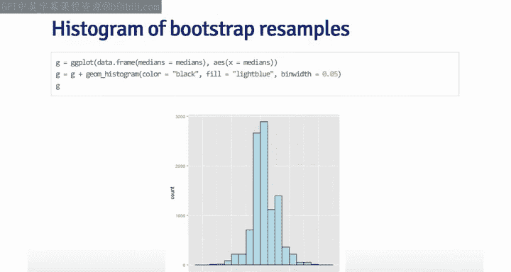

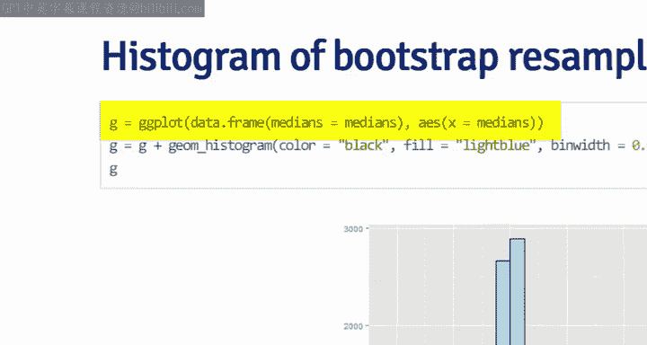

# 计算中位数的标准误估计
standard_error <- sd(bootstrap_medians)
print(paste("估计的标准误:", standard_error))

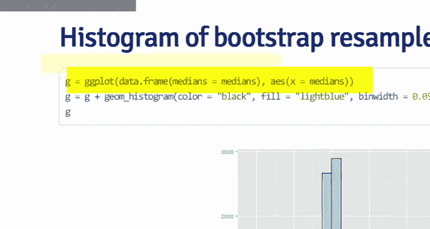

# 计算95%自助法置信区间（百分位数法）
confidence_interval <- quantile(bootstrap_medians, probs = c(0.025, 0.975))
print("95% 置信区间（百分位数法）:")
print(confidence_interval)

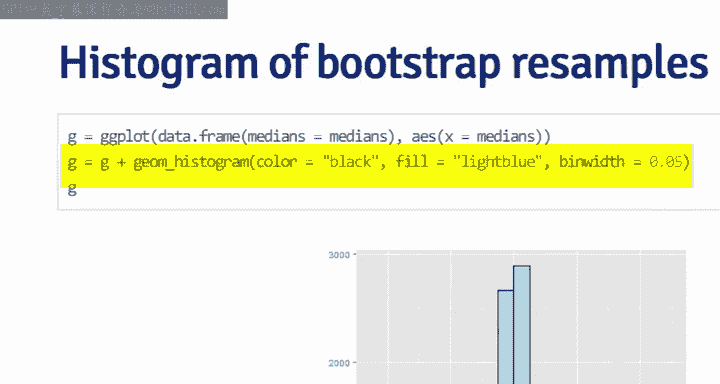

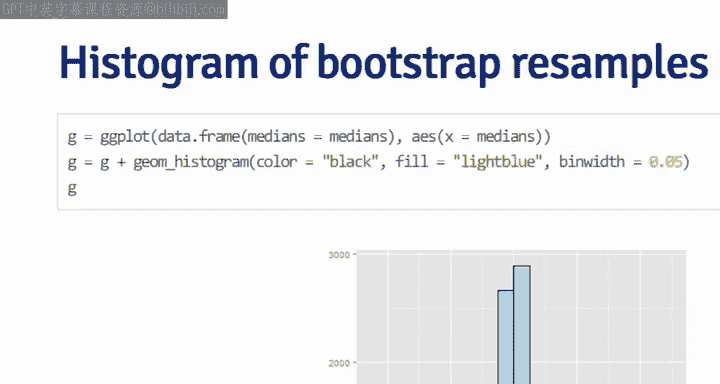

# 绘制自助法中位数的分布直方图（强烈推荐）
library(ggplot2)
plot_data <- data.frame(Medians = bootstrap_medians)
g <- ggplot(plot_data, aes(x = Medians)) +
  geom_histogram(binwidth = 0.1, color = "black", fill = "lightblue") +
  labs(title = "自助法中位数抽样分布估计", x = "中位数", y = "频数")
print(g)
```
这段代码首先进行了B次重抽样并计算中位数。然后，它计算了这些中位数的标准差作为标准误的估计，并取2.5%和97.5%分位数构建了一个95%置信区间。最后，它用直方图可视化了中位数的近似抽样分布。这个分布是基于自助法原理，用观测数据替代真实总体分布后得到的。

## 注意事项与进阶内容

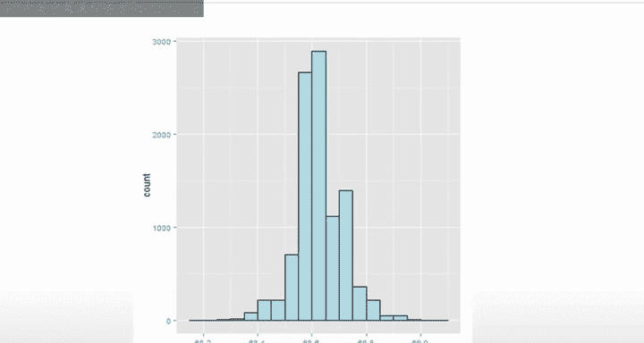

在结束之前，我们需要了解一些重要的注意事项和可能的改进方向。

1.  **非参数自助法**：我们介绍的方法是“非参数自助法”，因为它没有对总体分布形式做任何假设。
2.  **置信区间的改进**：直接使用百分位数（如2.5%和97.5%）构建的置信区间性能有时并非最优。一个广泛推荐的改进版本是**偏差校正与加速区间（BCa区间）**。在R中，你可以使用 `boot` 包轻松计算它。
    ```r
    library(boot)
    # 定义计算统计量的函数
    median_func <- function(data, indices) {
      return(median(data[indices]))
    }
    # 运行自助法
    boot_results <- boot(data = x, statistic = median_func, R = B)
    # 计算BCa置信区间
    boot_ci <- boot.ci(boot_results, type = "bca")
    print(boot_ci)
    ```
3.  **自助法的广泛应用与复杂性**：自助法是一个极其有用的工具，有诸多变体和广泛的应用场景。然而，在将其应用于时间序列数据、回归模型、纵向或多层次数据等复杂情境时，需要特别注意其 intricacies（复杂性），可能需要对重抽样方案进行特定调整。

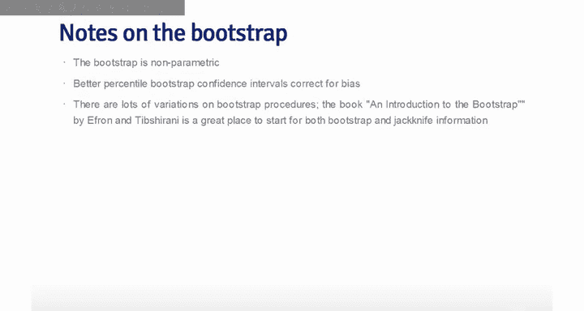

## 总结

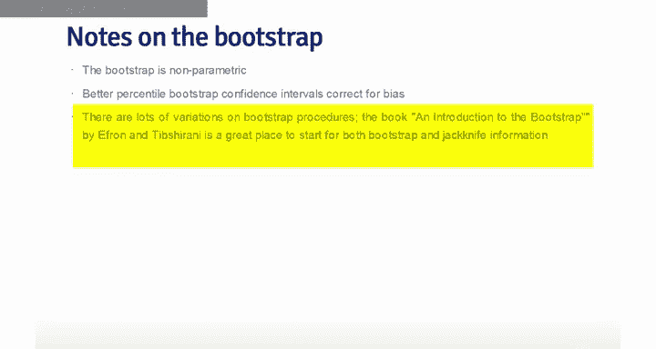

本节课中我们一起学习了自助法。我们首先理解了其核心原理：用观测数据的经验分布替代未知的总体分布，并通过有放回重抽样来近似统计量的抽样分布。然后，我们详细介绍了实施自助法的通用步骤，并以估计中位数为例，演示了如何计算标准误和构建置信区间。最后，我们通过R代码进行了实践，并指出了直接百分位数区间的局限性以及BCa区间等改进方法。自助法是一种强大而灵活的工具，为统计推断提供了坚实的计算基础。