# 课程 P40：39_13 04 置换检验 🧪


在本节课中，我们将要学习一种对数据科学家极其有用的工具——置换检验。置换检验主要用于组间比较。我们将从一个具体的组间比较案例开始，说明其应用场景和操作方法。

## 概述

置换检验是一种非参数统计方法，用于比较两个或多个组之间的差异。其核心思想是：在原假设（即组间无差异）成立的前提下，组标签的分配是随机的。通过随机置换组标签并重新计算检验统计量，我们可以构建一个在原假设下的统计量分布，从而评估观测到的统计量是否足够极端。

## 一个动机示例 🐛

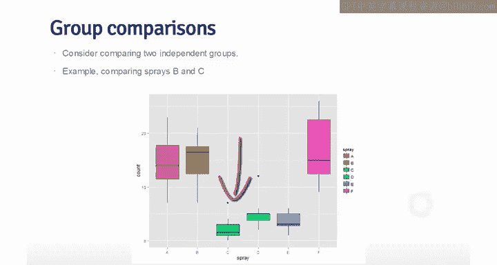

让我们从一个具体的例子开始。研究人员将一批批昆虫施以不同的杀虫剂（标记为不同的喷雾类型），并统计了每批中死亡的昆虫数量。每个喷雾类型都得到了一系列代表其效力的死亡计数。

现在，我们考虑比较杀虫剂 B 和杀虫剂 C 的效果。

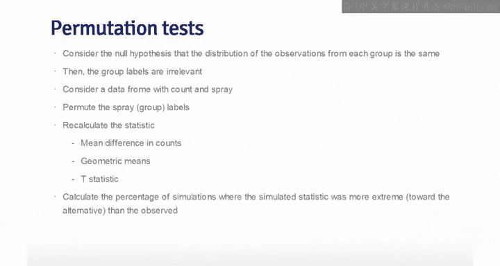

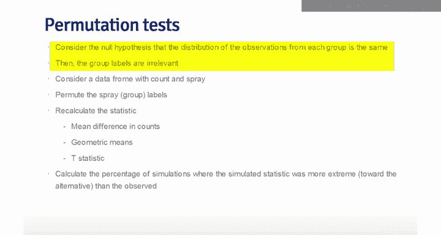


## 原假设与操作步骤

考虑原假设：**两个组的观测值分布相同**。换句话说，任何一个具体的死亡计数被分配到哪个组标签（B 或 C）是无关紧要的。


操作上，可以设想一个数据框，其中一列是死亡计数，另一列是喷雾组标签。我们会计算一个统计量，例如 B 组和 C 组平均死亡昆虫数的差值。

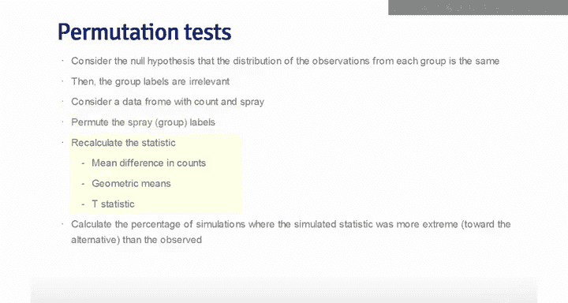

**公式**：`观测统计量 = 均值(B组) - 均值(C组)`


## 置换过程

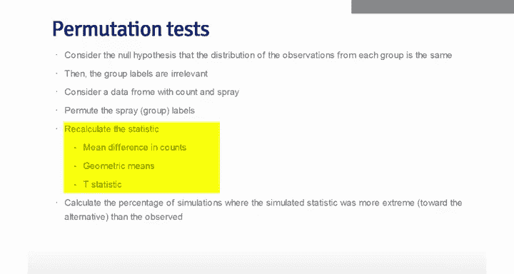

现在考虑置换组标签。我们只需将标签向量随机打乱顺序（例如，在 R 中使用 `sample()` 函数）。然后，基于置换后的标签重新计算统计量。

**代码**：`sample(group_labels)`


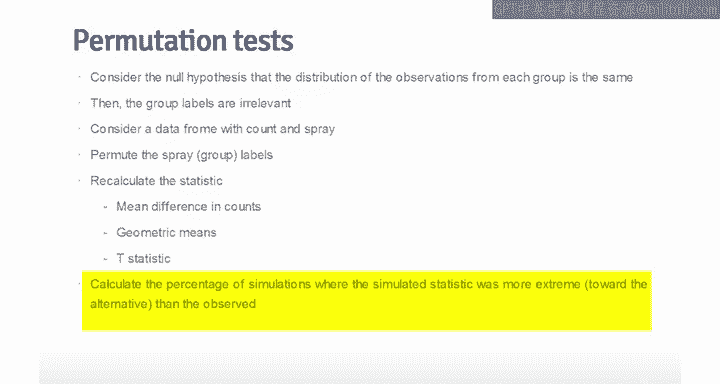

对于每一次置换，你可以使用任何你想要的统计量。例如，可以是两组间计数的均值差、几何平均数，甚至是一个 T 统计量。你可以使用 T 统计量，但不必将其与 T 零分布比较，而是与基于置换的零分布进行比较。

## 计算 P 值

要计算 P 值，只需计算在模拟中，模拟统计量比观测统计量更支持备择假设（即更极端）的百分比。

**公式**：`P值 = (模拟统计量中比观测统计量更极端的次数) / (总模拟次数)`

这将产生一个基于置换的 P 值。让我们通过一个例子来具体说明。


## 置换检验的广泛应用

置换检验非常强大，以至于它在不同场景下被反复重新发明。例如：

*   **秩和检验**：这是一种置换检验，其中数据被其秩次取代，而非原始值。
*   **Fisher 精确检验**：这也是一种基于置换的检验，适用于数据类型为二分类的情况。

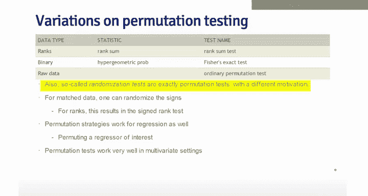

此外，当组标签是明确随机分配时（例如在随机化实验中），它可能被称为**随机化检验**。操作上，随机化检验的执行方式与置换检验相同，但在结论强度和解释上可能略有不同。


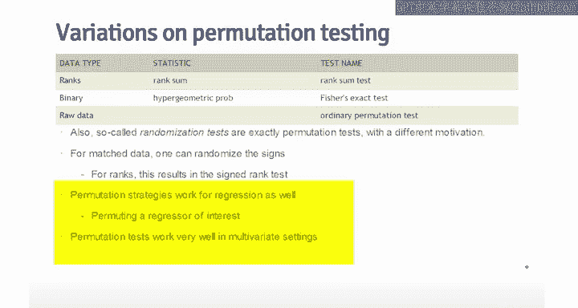

## 在回归与多元场景中的应用

置换策略也可用于回归分析，只需简单地置换回归变量即可获得零分布，这为我们后续回归课程中将要学习的基于正态分布的方法提供了另一种选择。


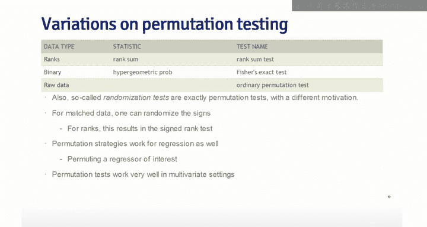

置换检验在多元设置中也表现良好，因为你可以计算控制族系错误率的各类最大统计量。不过，本节课我们不会深入这些内容，我们的目标是让你能够完成一个简单的置换检验，理解其核心思想，以便未来在此基础上进行拓展。


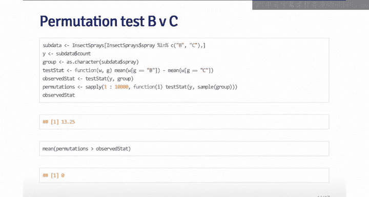

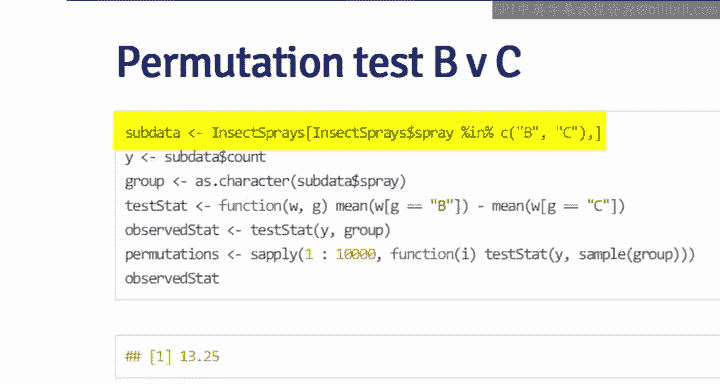

## 实战演练：昆虫喷雾数据

现在，让我们通过一个例子来演示如何进行置换检验。首先，我们提取杀虫剂 B 和 C 的数据。

**代码**：
```r
# y 是结果变量，即死亡昆虫计数
y <- insect_counts
# group 是组标签，即喷雾类型
group <- spray_labels
```
在这里，`y` 向量和 `group` 向量是完美对齐的，`y[1]` 对应 `group[1]` 的死亡计数，依此类推。

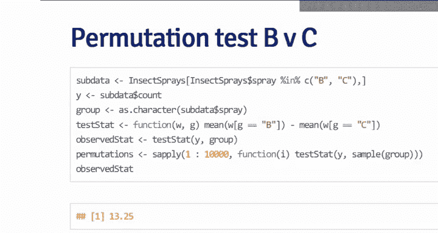


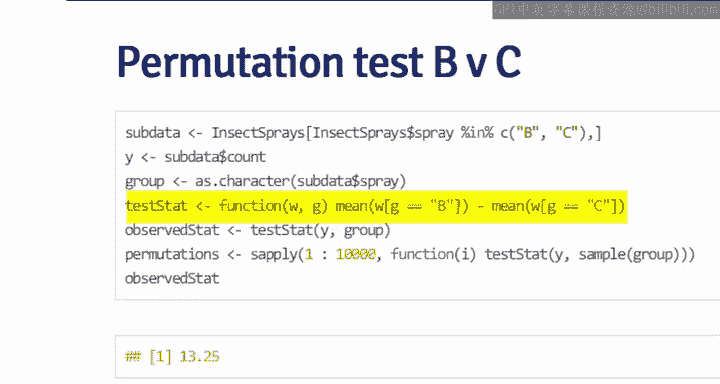

### 定义检验统计量

我们的检验统计量是 B 组和 C 组平均死亡昆虫数的差值。

**公式**：`test_statistic = mean(y[group == "B"]) - mean(y[group == "C"])`


### 计算观测统计量

将检验统计量函数应用于我们的观测数据，得到观测统计量。在这个数据集中，观测到的差值大约是 **13.25**，这意味着 B 组平均每批比 C 组多杀死超过 13 只昆虫。

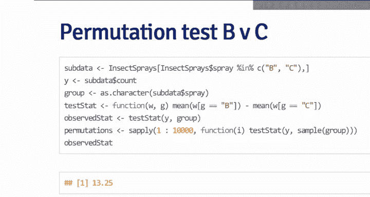


### 执行置换并构建零分布

接下来，我们通过随机置换 `group` 标签来打破 `y` 和 `group` 之间的关联（这符合原假设）。我们将此过程重复 10,000 次，每次计算一个新的检验统计量。

**代码**：
```r
perm_stats <- replicate(10000, test_statistic(y, sample(group)))
```


### 计算 P 值并得出结论

现在，计算在这 10,000 次置换中，有多少次得到的统计量比我们观测到的 **13.25** 更极端（即更大）。在这个数据集中，结果是 **0**。

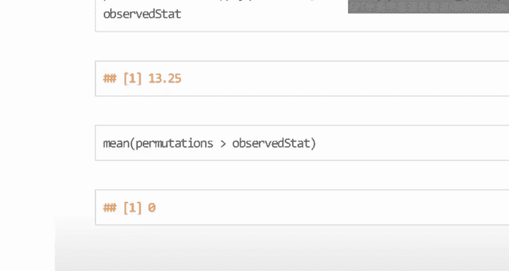

因此，P 值非常小，接近于 0。对于任何合理的显著性水平 α，我们都可以拒绝原假设。

需要说明的是，P 值并非精确为 0，因为至少存在一种置换（即原始数据本身）能产生与观测值一样大的统计量。不过，当我们进行成千上万次模拟时，这一点在比较 P 值与常规临界值（如 5%）时无关紧要。

### 可视化零分布

下图展示了由我们的置换生成的零分布。它起到了与 T 分布或标准 Z 分布类似的作用（后者要求数据正态或依赖中心极限定理）。


可以看到，零分布以 0 为中心，范围大约在 -10 到 +10 之间。图中垂直的线代表观测统计量 **13.25**，它远远位于零分布的尾部。这直观地表明，原假设很可能不成立，B 组和 C 组确实存在显著差异。通过 P 值，我们量化了这一结论，并执行了正式的假设检验。

无论是在研究统计量抽样分布的**自助法**中，还是在基于组标签可交换性思想进行正式推断的**置换检验**中，绘制此类直方图或密度估计图来查看重抽样分布都是非常重要的。

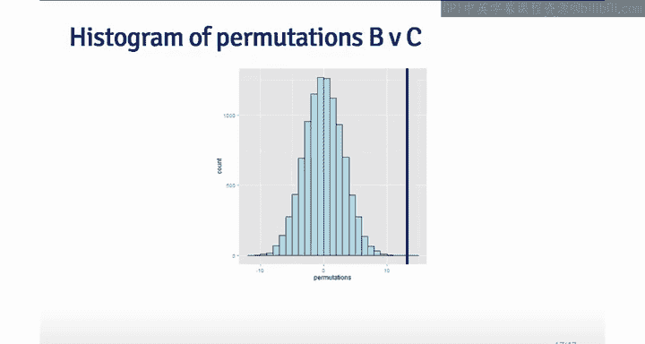

## 总结


本节课中，我们一起学习了**置换检验**。我们从组间比较的动机示例出发，理解了其原假设是组标签与结果无关。通过随机置换组标签并重复计算检验统计量，我们可以构建一个在原假设下的零分布。通过比较观测统计量在此分布中的位置，我们可以计算 P 值并进行假设检验。置换检验是一种灵活、强大且不依赖于特定分布假设的非参数方法，在数据科学中具有广泛的应用价值。