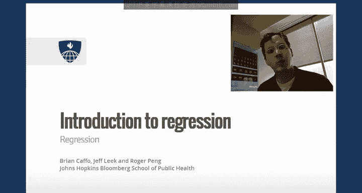
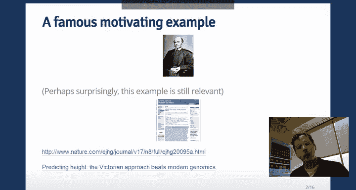
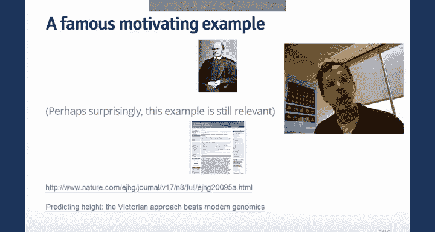
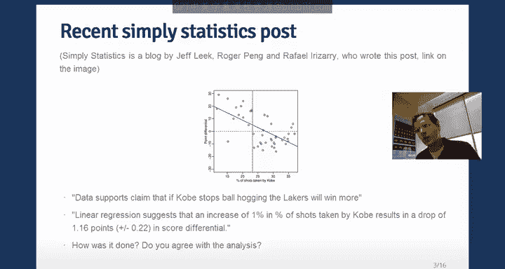
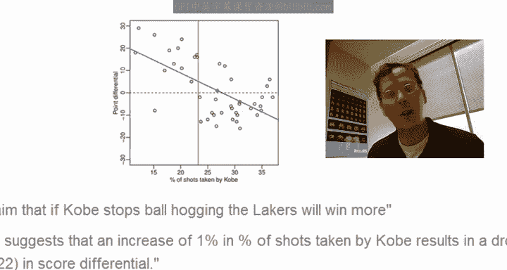
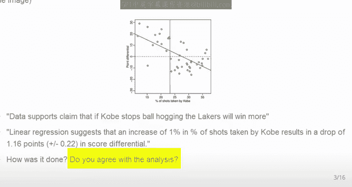

# 课程1：回归分析介绍 📊

在本节课中，我们将要学习回归分析的基本概念。回归是数据科学中最基础、最核心的工具之一，它帮助我们理解变量之间的关系，并基于这种关系进行预测。我们将从历史背景讲起，通过具体例子来理解回归分析能解决哪些问题，以及它在现代数据分析中的应用。

---

## 回归的历史渊源 📜

上一节我们提到了回归分析的重要性，本节中我们来看看它的起源。回归分析拥有丰富的历史，其概念和术语可以追溯到弗朗西斯·高尔顿。他不仅发明了“回归”这一术语和概念，还提出了与线性回归密切相关的“相关”概念。

高尔顿做了许多研究，其中之一就是根据父母的身高来预测子女的身高。这个数据集因其历史意义，我们将多次进行探讨。我的同事兼联合讲师杰夫·利里指出，这个例子至今仍然具有惊人的现实意义。

这里有一篇来自《美国人类遗传学杂志》的文章，它将利用高通量生物信息学技术获得的现代遗传数据，与弗朗西斯·高尔顿在维多利亚时代收集的测量数据进行比较，结果发现现代数据并没有表现得更好太多。这提醒我们高尔顿工作的重要性，以及他如何领先于他的时代。

---

## 一个现代数据科学案例 🏀

了解了历史背景后，我们来看一个更贴近现代数据科学家日常工作的例子。假设你关注“简单统计”博客，它由本数据科学专项课程的联合讲师杰夫·利里、罗杰·彭，以及哈佛大学生物统计系的拉斐尔·伊拉扎里共同撰写。

拉斐尔曾写过一篇关于篮球运动员“霸占球权”的博文。他在文中绘制了科比·布莱恩特出手投篮次数占比与球队单场净胜分差的关系图。

他对数据进行了线性回归拟合，并在博文中提出了一些主张。例如，其中一个主张是：数据支持“如果科比减少霸占球权，湖人队会赢得更多比赛”的说法。

但与本课程更相关的是他做出的这个具体陈述：
> 线性回归表明，科比出手占比每增加1%，会导致（湖人队）净胜分下降1.6分。

他同时给出了标准误。**如何生成并解释这样的陈述，如何遵循良好的统计实践给出标准误，将是本课程的重要内容**。我们不仅要学习如何进行分析，还要思考分析是否合理，有哪些因素可能需要考虑。这些正是我们将在本课程中讨论的话题。

---

## 回归分析能回答的问题 ❓

现在，让我们回到高尔顿的例子，具体看看回归分析能帮助我们回答哪些类型的问题。

以下是回归分析可以解决的核心问题：

*   **预测**：我们可以利用父母的身高来尝试预测其子女的身高。
*   **建立简洁的关系模型**：我们希望找到父母身高与子女身高之间一种简洁且易于描述的**平均关系**。回归分析最擅长此道，而机器学习和其它技术虽然能生成复杂且通常准确的预测模型，但它们往往不够简洁，不易解释数据，也难以产生新的、简洁的知识。
*   **分析未解释的变异**：我们可以讨论回归模型未能解释的变异，即所谓的**残差变异**。
*   **量化额外因素的影响**：我们可以量化诸如基因型信息等超出父母身高因素，在解释子女身高时的额外影响。
*   **进行统计推断**：**非常重要的是，我们要将回归与统计推断联系起来**。我们的数据只是一个样本，统计推断探讨的是需要哪些假设才能将样本结论推广到更大的总体。我们将把推断的工具应用到回归分析这个新主题上。
*   **理解“回归均值”现象**：高尔顿回答了一个有趣的问题，称为“**回归均值**”或“回归平庸”。其基本问题是：为什么非常高父母的子女往往也高，但比其父母稍矮一些？而为什么非常矮父母的子女往往也矮，但比其父母稍高一些？这就是著名的“回归均值”思想。

---

本节课中我们一起学习了回归分析的基本介绍。我们了解了它的历史起源，看到了一个现代数据科学中的应用案例，并明确了回归分析能够解决的各种核心问题，包括预测、建模、残差分析、推断以及理解“回归均值”现象。在接下来的课程中，我们将深入探讨如何具体实现和分析回归模型。