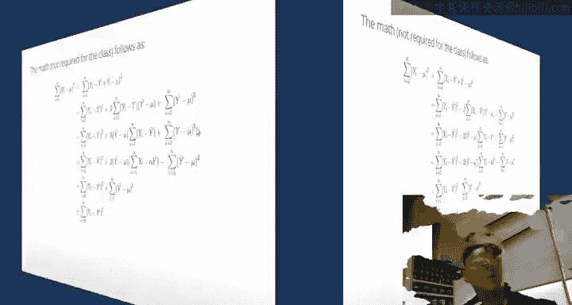
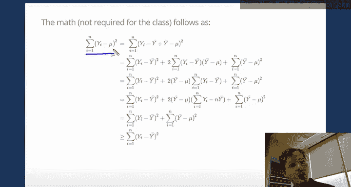
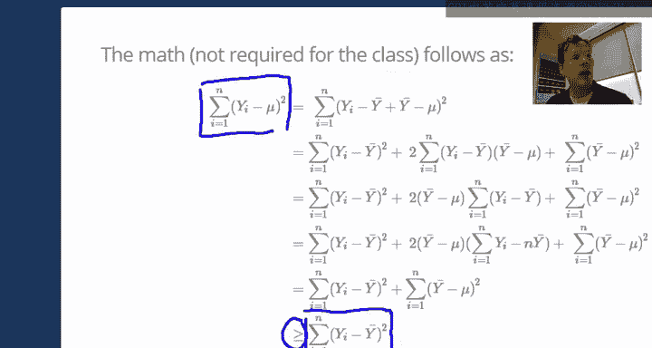

# 课程名称：数据科学：统计和机器学习 - P43：技术细节（可选跳过）🔍

在本节课中，我们将学习一个核心统计概念的证明：为什么样本均值是平方和损失函数的最小值点。我们将通过严谨的数学推导来展示这一结论。

---

上一节我们介绍了最小二乘法的基本思想，本节中我们来看看如何证明样本均值是平方损失函数的唯一最小化点。

现在，我将证明 `Y bar`（样本均值）是以下方程作为 `mu` 的函数时的最小化点。

如果这类证明不是你的兴趣所在，可以直接跳过。在后续的课程中，如果涉及类似内容，我也会给出同样的提示。

如果你打算关注这个证明，你不需要掌握微积分或线性代数的具体知识，但理想情况下，你应该非常熟悉数学符号。例如，如果你过去学过微积分但忘记了具体内容，但熟悉数学符号并能运用它，这就足够了。

好的，让我们开始证明。

这是我希望作为 `mu` 的函数来最小化的量。我的 `Y_i` 是观测到的数据点。

我将在表达式中减去并加上 `Y bar`，这相当于加零，不改变任何东西，所以等号成立。

我可以展开这个平方项，得到这一项、两倍的交叉乘积项，以及最后这一项。

让我们看看交叉乘积项。注意，`(Y bar - mu)` 不依赖于 `i`，所以我可以把它提到求和符号外面。然后，对于 `sum_i (Y_i - Y bar)` 这一项，我可以将求和分配进去。我得到 `sum_i Y_i`，然后如果我把不依赖于 `i` 的 `Y bar` 相加 `N` 次，就得到 `N * Y bar`。

但请注意，我将 `y bar` 定义为 `(1/N) * sum_i Y_i`，即观测值之和除以 `N` 得到平均值。换句话说，`N * y bar` 等于 `sum_i Y_i`。因此，`sum_i (Y_i - Y bar)` 等于零，所以整个交叉乘积项为零。

继续到下一行。我有 `sum_i (Y_i - y bar)^2` 加上 `sum_i (y bar - mu)^2`。后一项是多个平方项的和，必须为正数。如果我舍弃它，我的等号就变成了大于等于号。因为我去掉了一些正在相加的正数项，所以总值只会变小。

总结一下：对于任何 `mu` 值，这个函数的值都大于或等于我们代入 `y bar` 时的特定值。因此，`y bar` 必须是该方程的唯一最小化点。

---

本节课中我们一起学习了如何通过数学推导证明样本均值是平方和损失函数的最小值点。核心步骤是通过加减样本均值、展开平方项、利用样本均值的定义消去交叉项，最终证明任何其他 `mu` 值对应的函数值都大于等于使用样本均值时的值。