# 课程 P44：3_入门数据示例 📊

在本节课中，我们将学习如何利用父母身高数据来预测子女身高。我们将通过构建散点图、理解过绘制问题、探索回归分析的基本概念，并最终拟合一条回归线来达成这一目标。课程的核心是介绍**回归分析**，特别是**通过原点的回归**，并演示如何使用 R 语言进行实现。

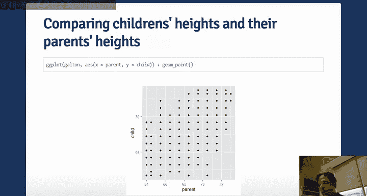

---

## 数据可视化与过绘制问题

到目前为止，我们尚未使用父母身高数据。处理此类数据时，首先应创建以父母身高为横轴、子女身高为纵轴的散点图。这里我们使用 `ggplot2` 包进行绘制。

然而，这个散点图存在多个缺陷。其中一个主要问题是**过绘制**：在许多特定的坐标点上，存在多对不同的父母-子女身高组合，导致数据点重叠，信息丢失。


为了解决这个问题，我们绘制了一个更好的图表。在这个图表中，点的大小和颜色代表了在该特定 (X, Y) 位置上的父母-子女组合的频率。

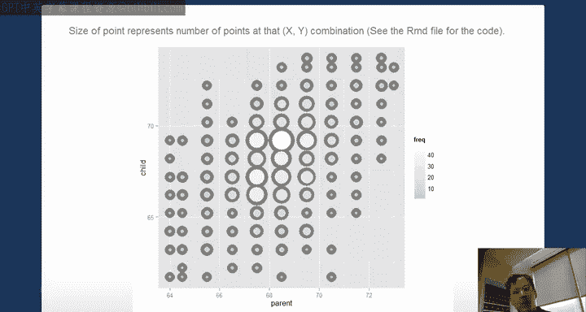

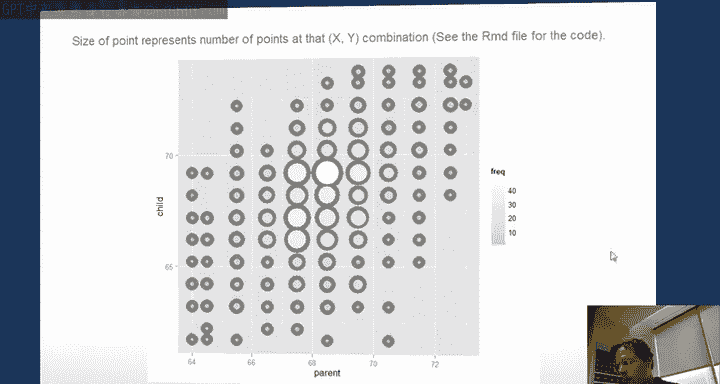

*   点的大小越大，表示该位置的组合数量越多。
*   颜色越浅（接近浅色），表示频率接近 40；颜色越深（相对偏蓝色），表示频率较低，接近 10 或 1。

这样，点的**大小**和**颜色**共同代表了每个特定 (X, Y) 坐标点上父母-子女组合的**频率**。这个图表能更好地保留数据信息。

需要指出的是，这个图仍有不足，例如两个坐标轴都没有标注单位“英寸”。在图表上标注单位是良好的实践，因此这也是本图的一个小缺陷。如果你想查看相关代码，可以在 R Markdown 文件中找到。


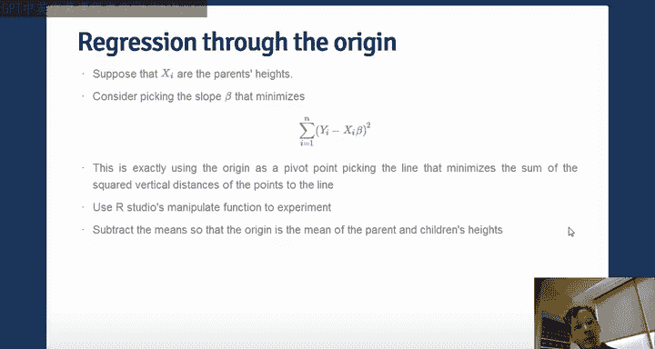


---

## 通过原点的回归

现在，假设我们想用父母身高来解释（预测）子女身高，并且我们想用一条直线来实现。为了简化问题，我们暂时**强制这条直线通过原点 (0, 0)**，也就是说，它的截距为 0。

那么，这条直线的方程就是：
`y = βx`
其中，`β` 是直线的斜率。

为了找到“最佳”直线，我们只需要找到最优的斜率 `β`。我们定义“最佳”为：使观测数据点（实际子女身高 `Y_i`）与直线上拟合点（`X_i * β`）之间的**垂直距离的平方和**最小的那条直线。

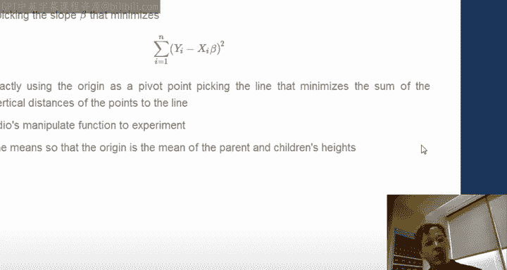

用公式表示，即找到 `β`，使得下式最小化：
`Σ (Y_i - X_i * β)^2`

这个思路与我们之前介绍的**最小二乘法**完全类似，只是现在我们将原点作为了旋转的支点，寻找能使所有点到直线垂直距离平方和最小的斜率。

我们将使用 RStudio 的 `manipulate` 函数来实验并尝试找到这条直线。

**注意**：强制回归线通过原点 (0,0) 在某些解释性场景下有用，因为它只涉及一个参数（斜率），而非两个（斜率和截距）。然而，这通常不是一个好的做法。一个简单的解决方法是：**将父母身高和子女身高分别减去各自的均值**。这样，新的坐标原点 (0,0) 就位于数据的中心位置，使得“通过原点的回归”变得更为合理。我们稍后会讨论，这与同时拟合斜率和截距的标准回归是等价的。


---

## 回归概念图解

为了阐明这些概念，请看下面的示意图。假设我们在 X 轴和 Y 轴上各有一些数据，想用 X 变量预测 Y 变量。图中的红色十字代表数据点。

我们目前所做的“通过原点的回归”，将点 (0,0) 视为支点，并尝试寻找最佳直线。对于每个观测点 `(X_i, Y_i)`：
*   它在直线上的对应点是 `(X_i, X_i * β)`。
*   垂直距离就是 `Y_i - X_i * β`。
*   我们对所有这些垂直距离进行平方并求和，试图找到使这个总和最小的斜率 `β`。

如果观察数据，理想的直线似乎应该穿过数据云的中心，而不是原点。因此，直接进行“通过原点的回归”意义不大。通过**数据中心化**（减去均值），我们将原点重新定位到数据的中心，此时再寻找仅由斜率定义的回归线就显得合理多了。我们之后会发现，这等价于拟合了包含截距的标准回归线。


---

## 使用 Manipulate 函数探索最佳斜率

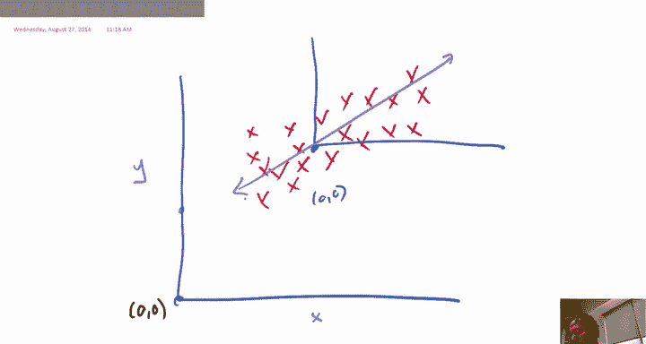

由于这是后续几节课的核心主题，我们将反复探讨这些基础概念。因此，这里不展示运行代码的过程，你可以从 R Markdown 文件中获取代码。希望在本专项课程的这个阶段，你已经熟悉运行 R 代码。

以下是操作界面的说明。图中绘制了中心化后的数据（子女身高和父母身高均已减去各自均值），因此坐标原点 (0,0) 位于数据的中心，并作为回归线的支点。

界面上方显示了当前设定的斜率 `β`（例如 0.6）以及对应的**均方误差**。均方误差的计算方式是：对于每个数据点，计算 `(子女身高 - 父母身高 * β)^2`，然后根据每个 (X, Y) 组合上的数据点频次进行加权求和（因为存在过绘制问题），再求平均。

当我们改变斜率滑块时，可以观察均方误差如何变化：
*   斜率设为 0.6 时，均方误差约为 5.0。
*   将斜率调到一个明显不佳的值（如 0.1），均方误差会显著上升（例如 6.8）。
*   将斜率调高（如 0.8），均方误差也会升高（例如 5.8）。
*   通过微调，可以发现当斜率在 0.64 左右时，均方误差最小（约 5.002）。

一个有趣的发现是：斜率为 1 并不是最佳选择。斜率为 1 意味着直接用父母身高预测子女身高。而实际上，我们需要用一个约为 0.6 的因子来缩放父母身高，才能得到对子女身高更好的预测。这正是回归斜率所起的作用。

相关 `manipulate` 代码已提供在 R Markdown 文件中，请直接从文件中获取文本，无需从幻灯片重新键入。


---

## 使用 R 的 `lm` 函数快速拟合

既然我们已经用 `manipulate` 找到了最佳斜率，现在展示如何在 R 中快速完成此操作。`lm()` 函数用于拟合线性模型。

以下是拟合代码：
```r
lm(centered_child_height ~ centered_parent_height - 1, data = galton)
```
*   `centered_child_height` 是中心化后的子女身高（减去均值）。
*   `centered_parent_height` 是中心化后的父母身高（减去均值）。
*   `- 1` 表示在模型中去掉截距项，这正是我们讨论的“通过原点的回归”。
*   `data = galton` 指定使用的数据集。

运行此代码，得到斜率估计值为 **0.646**。


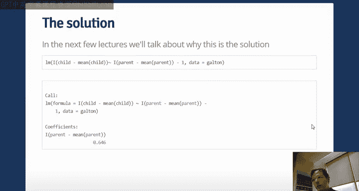

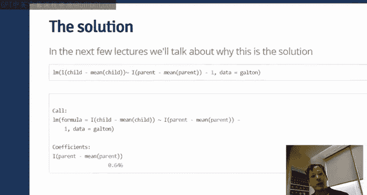

---


## 最终拟合线


在本次课程的最后一张幻灯片中，我们展示拟合的回归线。由于我们强制模型通过中心化数据的原点 (0,0)，这意味着它必须通过原始数据的均值点（父母平均身高，子女平均身高）。

因此，当我们把坐标轴平移回原始尺度时，这条斜率为 **0.646** 的直线正好穿过原始数据的中心点。


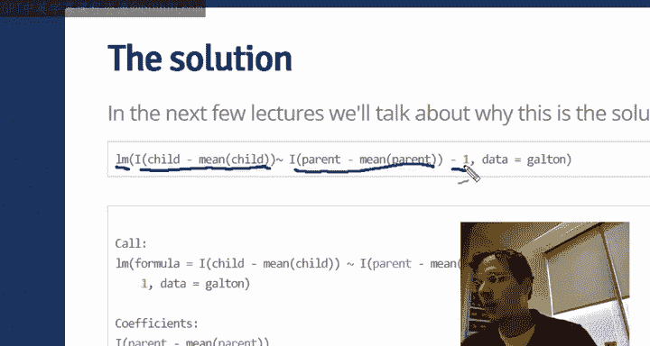


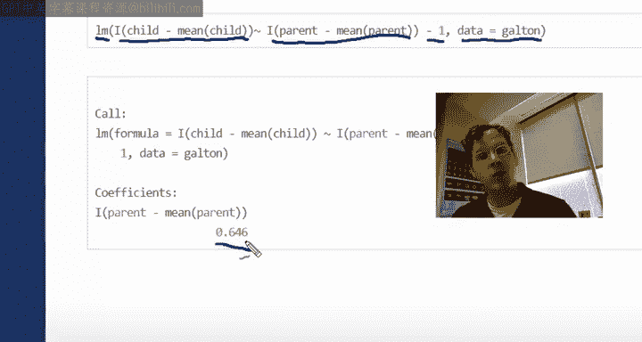

在接下来的课程中，我们将深入探讨如何得到这条线、背后的动机、以及我们可以用这条拟合线做些什么。我们可能会花接下来几节课的时间来讨论回归分析。


---

## 总结

本节课中，我们一起学习了回归分析的入门知识。我们从可视化父母与子女身高数据开始，解决了散点图的过绘制问题。然后，我们引入了“通过原点的回归”概念，通过数据中心化使其合理化，并使用交互工具和 R 的 `lm` 函数找到了最佳拟合直线的斜率（约为 0.646）。这条直线为我们用父母身高预测子女身高提供了一个简单的模型。欢迎进入回归分析的世界，我们已经在第一课中涵盖了大量内容，期待在接下来的几周与你一同深入学习。


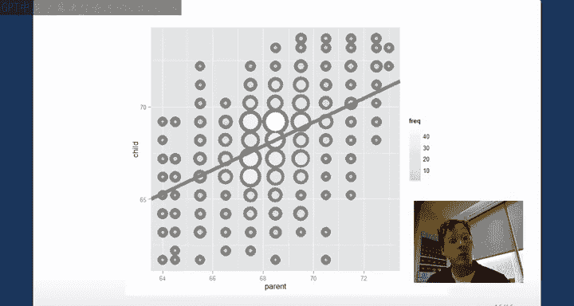

