# 课程1：回归分析基础符号与背景 📚

在本节课中，我们将学习回归分析所需的基本符号和背景知识。这些概念是理解后续课程的基础，我们将以简单直白的方式回顾它们。

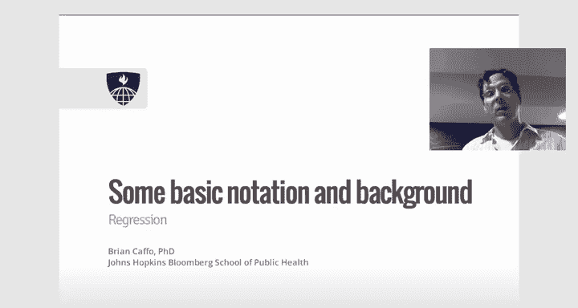

---

## 概述 📋

本节课将介绍回归分析中常用的基本符号和定义。我们将涵盖数据索引、样本均值、方差、标准化以及协方差与相关性等核心概念。这些内容虽然可能在先修课程中已涉及，但由于其在回归分析中的重要性，我们将再次进行梳理。

---

## 数据索引与符号 📝

在回归分析中，我们经常使用下标来索引一组有序的数据点。例如，我们可以用 **x₁, x₂, ..., xₙ** 表示 **n** 个数据点。

**示例**：  
假设数据为 `1, 2, 5`，则：
- **x₁ = 1**
- **x₂ = 2**
- **x₃ = 5**
- **n = 3**

我们通常使用希腊字母（如 **μ**）表示未知的总体参数，而使用普通字母（如 **x̄**）表示可观测的样本统计量。

---

## 样本均值 📊

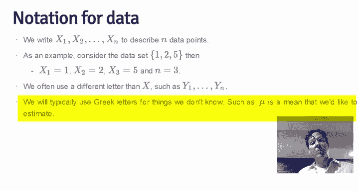

样本均值是数据集中所有观测值的平均值。我们通常用字母上方加横线表示，例如 **x̄**。

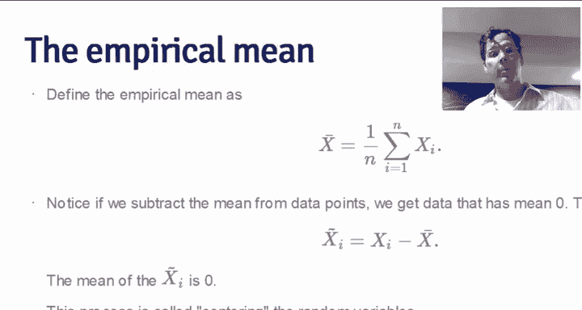

**公式**：  
\[
\bar{x} = \frac{1}{n} \sum_{i=1}^{n} x_i
\]

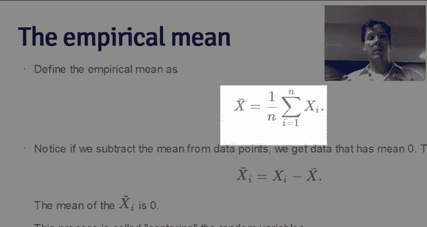

**解释**：  
- **n** 是观测值的数量。
- **∑** 表示求和符号，即将所有 **xᵢ** 相加。

---

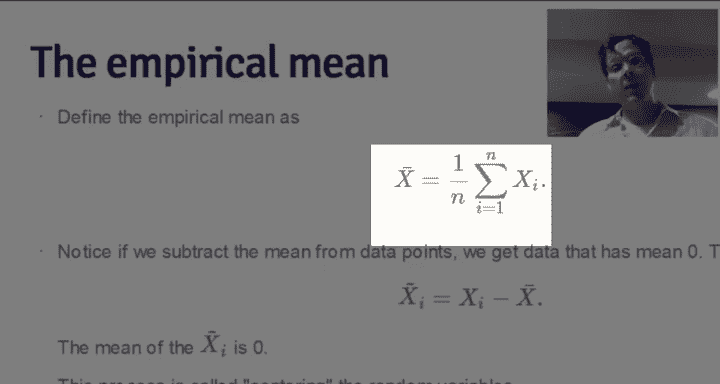

## 数据居中处理 🔄

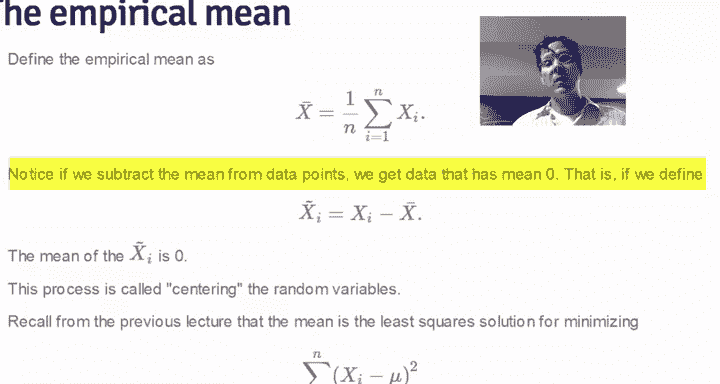

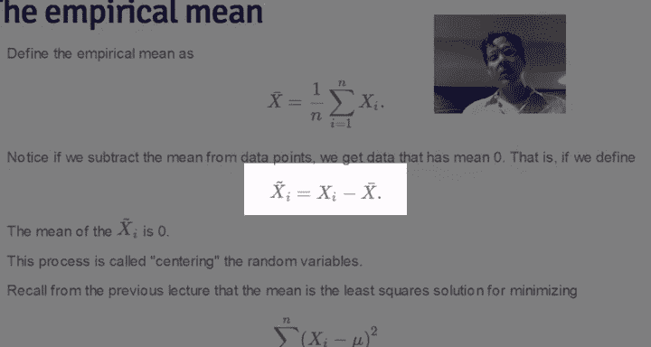

如果我们从每个数据点中减去样本均值，得到的新数据集将具有均值零。这个过程称为“居中”。

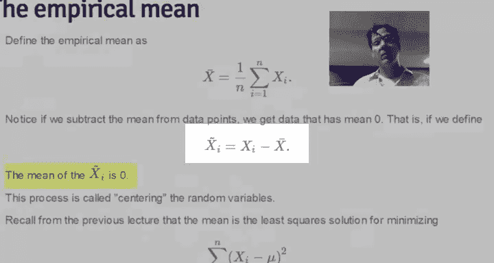

**公式**：  
\[
\tilde{x}_i = x_i - \bar{x}
\]

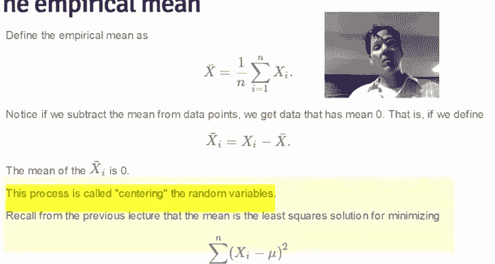

**结果**：  
新数据集 **\(\tilde{x}_i\)** 的均值为零。

---

## 方差与标准差 📏

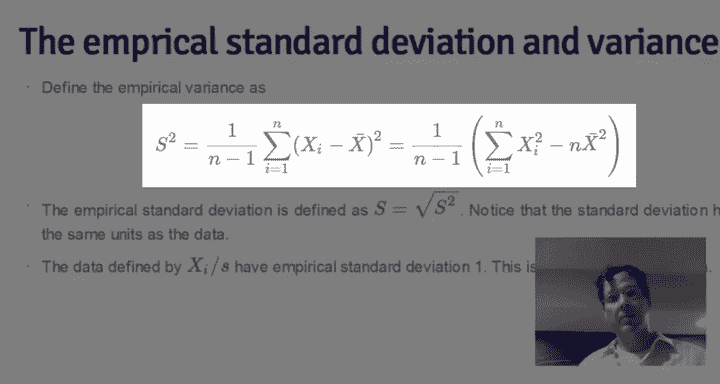

方差衡量数据点围绕均值的离散程度。标准差是方差的平方根，其单位与原始数据相同。

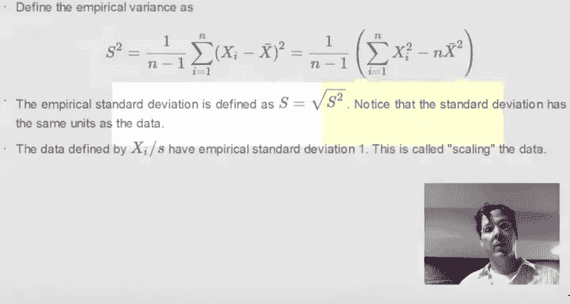

**方差公式**：  
\[
s^2 = \frac{1}{n-1} \sum_{i=1}^{n} (x_i - \bar{x})^2
\]

**标准差公式**：  
\[
s = \sqrt{s^2}
\]

**快捷公式**：  
\[
s^2 = \frac{1}{n-1} \left( \sum_{i=1}^{n} x_i^2 - n\bar{x}^2 \right)
\]

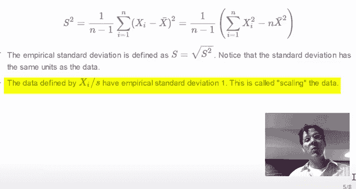

---

## 数据标准化 📐

标准化包括两个步骤：先居中，再缩放。标准化后的数据均值为零，标准差为一。

**步骤**：
1. 居中：**\(\tilde{x}_i = x_i - \bar{x}\)**
2. 缩放：**\(z_i = \frac{\tilde{x}_i}{s}\)**

**结果**：  
标准化数据 **zᵢ** 的均值为 **0**，标准差为 **1**。例如，如果某个标准化数据点的值为 **2**，则表示该点比均值高出两个标准差。

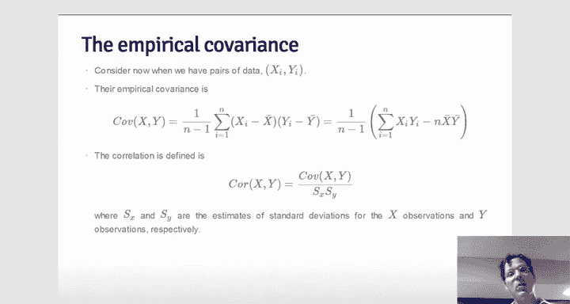

---

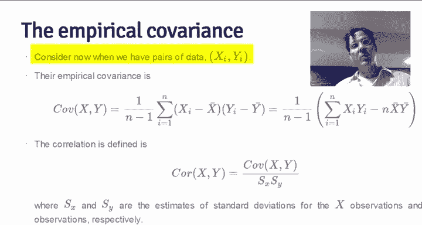

## 协方差与相关性 🔗

协方差衡量两个变量之间的线性关系强度。相关性是标准化的协方差，是一个无单位的量。

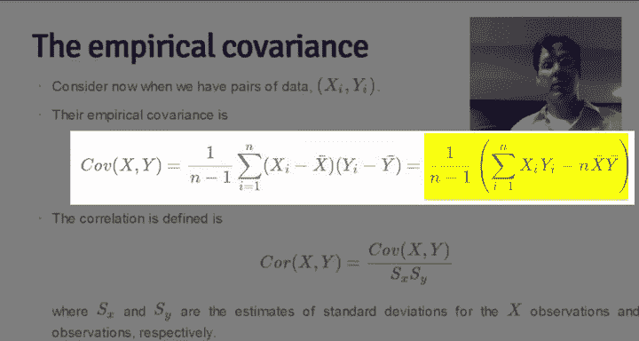

**协方差公式**：  
\[
\text{Cov}(x, y) = \frac{1}{n-1} \sum_{i=1}^{n} (x_i - \bar{x})(y_i - \bar{y})
\]

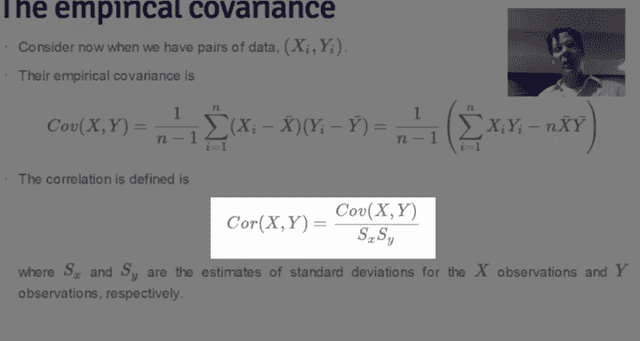

**相关性公式**：  
\[
r = \frac{\text{Cov}(x, y)}{s_x s_y}
\]

**解释**：
- 相关性 **r** 的取值范围为 **-1** 到 **1**。
- **r = 1** 表示完全正相关，数据点落在一条正斜率的直线上。
- **r = -1** 表示完全负相关，数据点落在一条负斜率的直线上。
- **r = 0** 表示没有线性关系。

---

## 总结 🎯

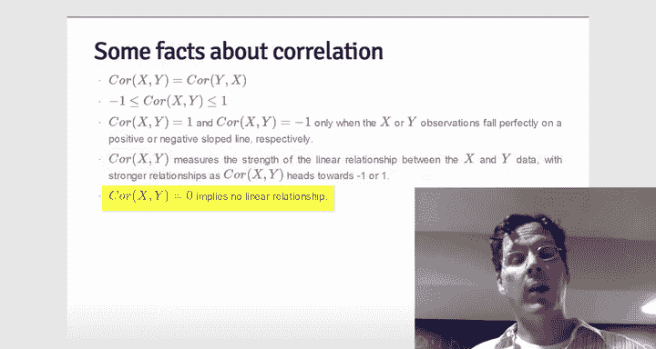

本节课我们一起回顾了回归分析中的基本符号和背景知识。我们学习了数据索引、样本均值、方差、标准化以及协方差与相关性等核心概念。这些内容是理解后续回归分析课程的基础。在下一节课中，我们将深入探讨线性回归模型的基本原理。