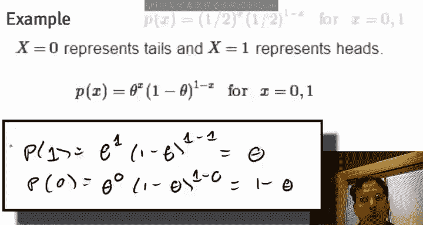
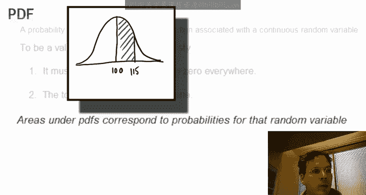
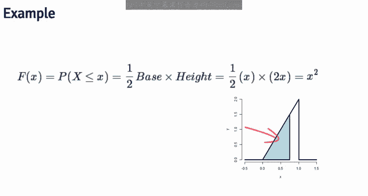
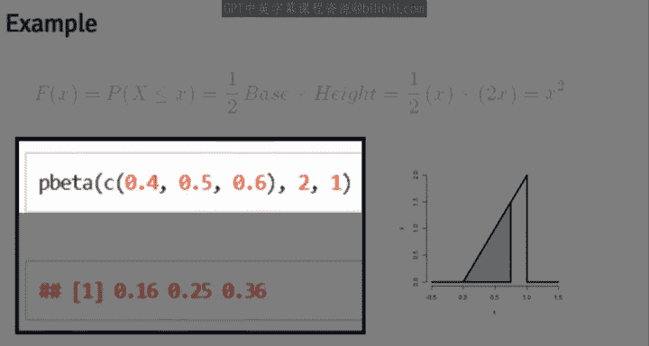
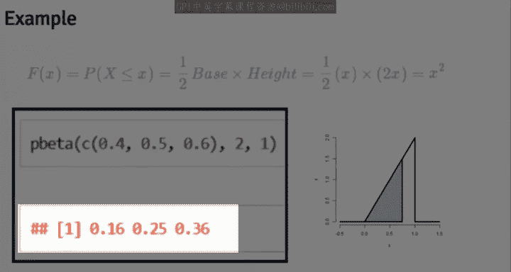
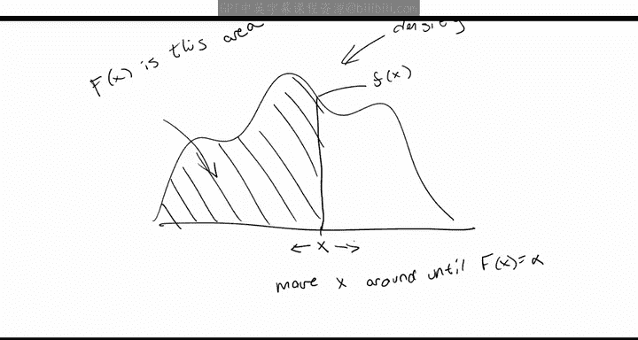
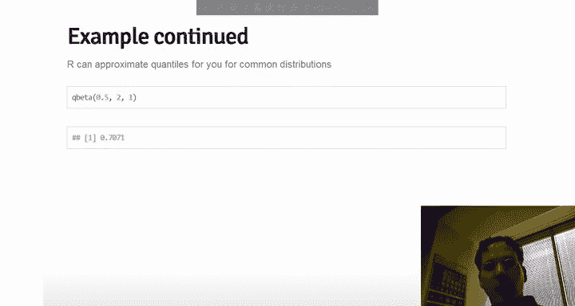
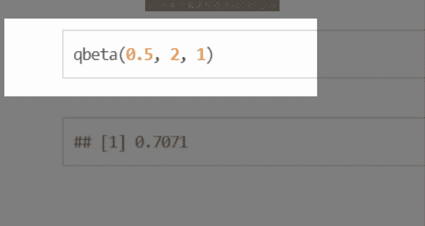
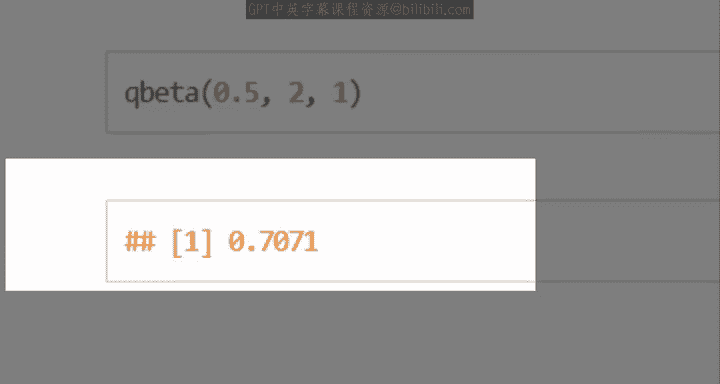
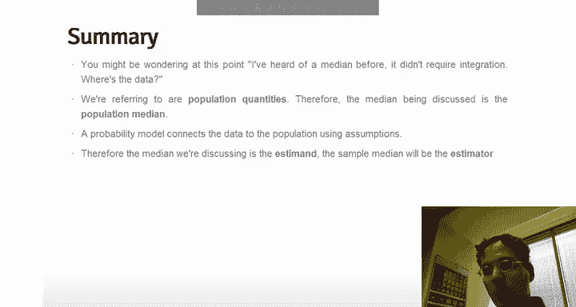

# 课程名称：概率密度函数 📊

## 概述
在本节课中，我们将要学习概率密度函数。我们将了解它与概率质量函数的区别，掌握其定义和基本规则，并通过一个简单的三角形密度函数示例，学习如何计算概率、累积分布函数和分位数。最后，我们将讨论样本统计量与总体参数之间的关系。

---

## 概率密度函数 vs. 概率质量函数

上一节我们介绍了概率质量函数，它用于描述离散随机变量取特定值的概率。

本节中我们来看看概率密度函数，它与连续随机变量相关联。

与概率质量函数必须遵循特定规则一样，概率密度函数也必须遵循特定规则才能成为一个有效的概率密度函数。一个有效的概率密度函数必须满足：函数值处处大于或等于0，并且函数曲线下的总面积必须等于1。

以下是概率密度函数的基本规则：概率密度函数曲线下的面积对应于该随机变量的概率。

例如，如果说智商服从均值为100、标准差为15的正态分布，这意味着总体遵循一个特定的钟形曲线。并且，如果我要抽取一个样本，那么样本中一个人的智商在100到115之间的概率，就是曲线下对应的这个面积。

再次注意，概率密度函数是关于总体（本例中是智商总体）的陈述，而不是关于数据本身的陈述。我们将使用数据来评估这个假设以及关于总体概率的陈述。但本质上，每当你说“概率”这个词时，你谈论的都是一个总体量。

有趣的是，当我们这样对连续随机变量的概率进行建模时，随机变量取任何特定值的概率实际上为零，因为一条线的面积为零。这不是问题，这只是将随机变量建模为具有无限精度时的一个特性，但它完全不会造成任何麻烦。

---

## 一个简单的密度函数示例

事实证明，钟形曲线是一种相当难以处理的密度函数，至少在你学会如何处理之前是这样，我们将在另一节课中学习。

所以，现在让我们使用一个简单得多的密度函数。具体来说，是一个看起来像直角三角形的函数。

函数定义为：`f(x) = 2x`，其中 `x` 在0到1之间，否则为0。

让我们给它一些背景。假设这是一个帮助热线在随机一天内接听电话的比例。

这意味着，一天内接听20%到60%电话的概率由这个面积给出。

让我们问一个问题：这在数学上是一个有效的密度函数吗？我在这里绘制了概率密度函数，它看起来像一个直角三角形。注意，R代码在这里给出，并且包含在讲座幻灯片本身中，因为幻灯片是使用slideify格式创建的。所以，实际使用Git拉取课程仓库非常重要，你可以查看RMD或R Markdown文件，获取所有讲座所有示例的所有代码。

无论如何，我们需要讨论这个概率密度函数是否是一个有效的概率密度函数。首先，注意它总是大于或等于0。其次，让我们计算它的面积。这并不难，因为它是一个直角三角形。面积是底乘以高的一半，即 `(1/2) * 底 * 高`。底是1，高是2，所以 `(1/2) * 1 * 2 = 1`。因此，面积是1。所以，这确实是一个有效的概率密度函数。

---

## 使用密度函数计算概率

让我们通过一个例子来学习如何使用这个密度函数。

问题是：从这个总体中随机抽取一天，接听电话的比例小于或等于75%的概率是多少？

结果很简洁，这正好是另一个我们需要计算的直角三角形。记住函数是 `2x`，所以在0.75处，高度是1.5。当然，底边的值是0.75。然后我们除以2，因为面积是底乘以高的一半。计算结果是56%，如这里所示。

实际上，这个密度函数是一个已知分布（称为Beta分布）的特例。我在这里给出了直接从Beta分布获取这个概率的R代码。当然，我们不需要它，因为处理三角形很简单。然而，在更复杂的情况下，我们将需要这些函数。我想补充一点，函数名前的字母“P”表示求概率。所以，`pbeta` 函数将返回Beta密度中小于等于0.75的概率。这里的2和1是特定的参数，它们使分布变成我们正在使用的这个精确的三角形。你可以看到得到相同的数字56%。

---

## 累积分布函数与生存函数

密度函数的某些区域非常有用，我们给它们命名。例如，随机变量X的累积分布函数返回随机变量小于或等于值x的概率。即，它返回 `P(X ≤ x)`。

这个定义无论X是离散还是连续都适用。记住，在我们刚刚看过的Beta分布中，R中的 `pbeta` 函数总是返回第一个参数（即小于等于该值的概率）。所以，事实上，每当你在R中使用 `p[分布名]` 函数时，它实际上返回的就是累积分布函数。

有时使用生存函数而不是分布函数也很有趣，它只是1减去分布函数。所以，它不是小于某个值的概率，而是大于某个值的概率。

想象一下，如果我们想要前面考虑的密度的累积分布函数。例如，我们想知道在给定的一天内，接听电话的比例小于等于40%的概率是多少？小于等于50%的概率是多少？小于等于60%的概率是多少？给定我们当前的特定模型，即这个直角三角形作为总体概率密度函数。

对于这些数字中的任何一个，只看图，计算方式与之前计算0.75时非常相似。它将是一个直角三角形，所以面积是 `(1/2) * 底 * 高`。底是x（你代入的任何值），高是 `2x`（该点的高度），结果就是 `x²`。

所以，函数 `x²` 接收你想要评估的数字，并给出在随机抽取的一天内，接听电话比例小于等于该值的概率。

好的，当我们在这里为这三个值调用 `pbeta`（这是R中我们的累积分布函数）时，参数2和1确保我们评估的是这个特定的Beta密度。计算结果分别是16%、25%和36%。

因此，在给定的一天内，接听电话比例小于等于40%的概率是16%。小于等于50%的概率是25%。小于等于60%的概率是36%。如果你想要生存函数，它就是1减去累积分布函数，即 `1 - x²`。

在未来，我们将处理更复杂的密度函数，但实际上会更容易，因为我们将依赖像 `pnorm` 和 `pbeta` 这样的函数，而不是直接计算它们。

---

## 分位数

你已经听说过样本分位数。例如，如果你在一次考试中得分在第95百分位数（即0.95分位数），这意味着95%的学生得分比你低，5%得分比你高。这些就是所谓的样本分位数。我们将定义它们的总体对应物。

记住，在样本分位数中，如果你想定义第95百分位数或0.95分位数，你会将观测值从小到大排列，然后找到考试分数或那个点，使得95%的观测值低于它。

具有分布函数F的分布的α分位数是点 `x_α`，使得 `F(x_α) = α`。这有点绕口，让我们试着画个图。

如果我们画一个密度函数 `f(x)`，分布函数 `F(x)` 在x处的值就是点X以下的面积，即来自这个总体的随机变量小于等于x的概率。你可以把它想象成一个考试成绩的总体，一个无限的学生总体。这里，这将是从这个总体中随机抽取一个学生得到X分或更低的概率。

α分位数是我们移动这条线，直到找到点 `x_α`，使得恰好有α概率落在它下面。这正是我们在寻找经验分位数时对数据所做的：我们不断寻找数据点，使得例如95%的考试成绩低于它，那将是样本的第95百分位数。现在，我们沿着x点移动，直到在总体分布中找到这样一个点，使得落在它下面的概率是95%。

再次强调，百分位数只是用百分比表示的α分位数，而中位数可能是最著名的分位数，即第50百分位数。

我们将大量使用分位数，所以值得强化这一点。

总体分布的第95百分位数是这样一个点：从该总体中抽取的随机变量小于该值的概率是95%，大于该值的概率是5%。

---

## 计算中位数示例

让我们通过之前的例子来计算。我们之前处理的分布的中位数是多少？

记住，该分布看起来像一个直角三角形，其分布函数（例如，如果我们想求在给定一天内接听电话比例小于等于x的概率） `F(x)` 简单地等于 `x²`，其中x必须在0到1之间才有意义。

在这种情况下，我们要求解 `0.5 = F(x) = x²`，解得 `x = √0.5`，大约是0.71。

这意味着，在大约50%的日子里，接听电话的比例小于等于70%。在大约50%的日子里，接听电话的比例大于等于70%。

我们经常使用分位数，尤其是正态分布的分位数。我们几乎从不直接通过密度函数来计算分位数，因为我们处理的分布是常见的，并且这已经为我们做好了。在R中，有一个简单的技巧。

基本上，函数名（密度名）前加“q”表示求分位数。所以在这种情况下，我们知道这是一个Beta密度。虽然你不知道，但我告诉你这是一个Beta密度。所以 `qbeta` 给我们相关的分位数。这里，我们代入0.5。记住，R将分位数的参数作为一个比例，所以如果你代入0.5，它会工作；如果你代入50表示50%，它不会工作。好的，2和1是我们还没有完全描述的参数，但你必须相信我的话，这些参数产生了我们正在看的特定Beta密度。当我们代入时，我们得到0.7071，和我们之前得到的一样。

---

## 样本统计量与总体参数

此时你可能想知道，我以前听说过中位数，但没这么复杂。我只是将观测值从小到大排序，然后取中间的那个；如果观测值是偶数个，就取中间两个的平均值。

那里你得到的是一个样本统计量。它是一个估计量。在这门课中，我们不仅要建立估计量，还要建立估计的目标或估计值。

所以在这种情况下，你的样本中位数是在估计你的总体中位数。例如，我们之前例子中的样本中位数是：如果我们抽取几天的数据，计算那些天接听电话的百分比，将这些百分比排序，然后取中间的那个，那就是中位数。

我们会将其视为对总体（即接听电话的真实中位数百分比）的一个估计量。

当然，我们需要做出很多假设来将样本与总体联系起来。然而，我们将对这些假设保持清醒的认识，并正式地发展它们。

所以无论如何，在这门课中，每个估计量都会有一个估计目标。样本均值将估计总体均值，样本中位数将估计总体中位数，样本标准差将估计总体标准差，依此类推。这是统计推断的正式过程，将你的样本与总体联系起来。

---

## 总结
本节课中我们一起学习了概率密度函数。我们了解了它与概率质量函数的区别，掌握了其必须满足大于等于零且曲线下面积为1的规则。我们通过一个直角三角形密度函数的例子，实践了如何计算特定事件的概率、累积分布函数和分位数（如中位数）。最后，我们明确了样本统计量（如样本中位数）是用于估计相应总体参数（如总体中位数）的这一核心思想，这是统计推断的基础。