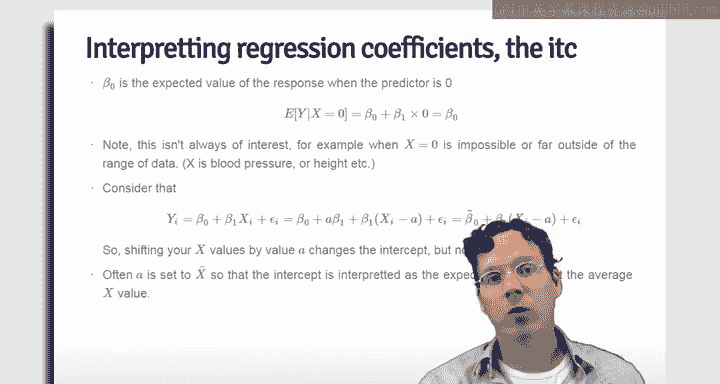
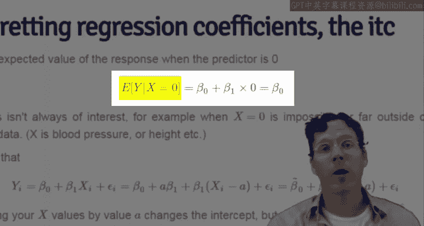
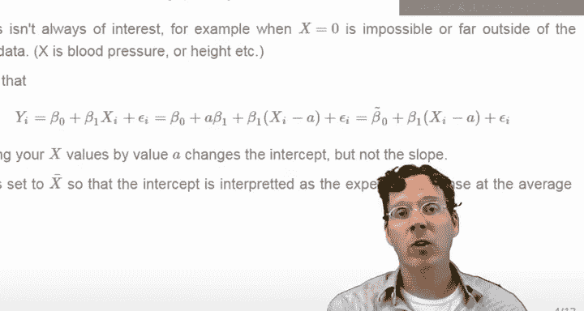
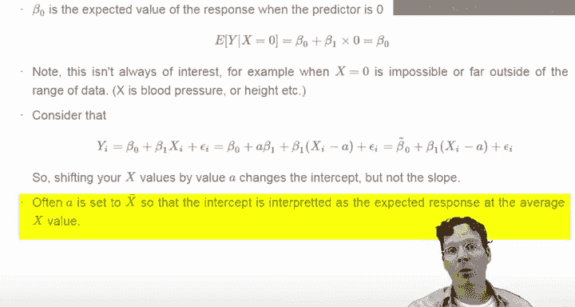

# 📊 课程名称：数据科学：统计和机器学习｜P51：10_解释系数

在本节课中，我们将学习如何在一个正式的统计框架下，解释线性回归模型中的系数。我们将重点探讨截距和斜率的含义，以及如何通过平移或缩放回归变量来改变系数的解释方式。

---

## 🎯 理解截距

上一节我们介绍了线性回归的统计框架，本节中我们来看看如何解释回归系数。

首先，以截距为例。截距是当回归变量为零时，响应变量 `y` 的期望值。这可以直接从回归公式中推导出来。

**公式**：
`E[y | x = 0] = β₀`

需要注意的是，回归变量为零的情况在实际研究中通常没有意义。例如，如果回归变量是血压，我们可能并不关心血压为零的人群的响应值。

然而，有一个简单的解决方法。我们可以考虑将回归变量平移一个常数 `A`。

**公式**：
`y = β₀ + β₁(x - A) + ε = (β₀ + β₁A) + β₁x + ε`

这相当于将回归方程重写为一个具有新截距 `β₀̃ = β₀ + β₁A` 但斜率 `β₁` 不变的方程。这表明，平移回归变量会改变截距，但不会改变斜率。

此时，截距的解释不再是当 `x = 0` 时，而是当 `x = A` 时。

一个非常常见的做法是令 `A` 等于回归变量 `x` 的平均值 `x̄`。这样，截距就被解释为当回归变量取平均值时，响应变量的期望值。

**公式**：
`E[y | x = x̄] = β₀̃`

---

## 📈 理解斜率

接下来，我们探讨回归系数 `β₁` 的模型解释。它是一个斜率，其解释形式应为“Y 随 X 的单位变化而产生的变化量”。

让我们来验证这一点。计算当 `x` 增加一个单位时，响应变量 `y` 的期望值变化。

**公式**：
`E[y | x = x+1] - E[y | x = x] = [β₀ + β₁(x+1)] - [β₀ + β₁x] = β₁`

因此，`β₁` 可以解释为：回归变量每增加一个单位，响应变量的期望变化量。这与直线斜率的常规解释类似，但这里特指响应变量的条件期望值。

记住，平移 `X` 变量不会改变斜率，正如我们在上一张幻灯片中讨论的那样。

---

## ⚖️ 缩放回归变量的影响

那么，如果我们缩放回归变量呢？通常，我们会用一个正数 `a` 来缩放。

我们可以通过乘以和除以 `a` 来重写回归方程。

**公式**：
`y = β₀ + β₁x + ε = β₀ + (β₁/a) * (x * a) + ε`

换句话说，将回归变量乘以一个因子 `a`，会导致其系数除以相同的因子 `a`。

以下是一个简单的例子来巩固这个概念：

假设 `x` 是以米为单位的身高，`y` 是以千克为单位的体重。那么 `β₁` 的单位是 **千克/米**。

如果将 `x` 的单位转换为厘米（即乘以 100，因为 1 米 = 100 厘米），为了保持 `β₁` 单位的正确性，我们需要将其除以 100。

**公式**：
`β₁ (千克/米) = β₁ (千克/厘米) * 100 (厘米/米)`

---

## 📝 总结

本节课中，我们一起学习了如何解释线性回归的系数。

*   我们了解到，**截距** `β₀` 通常解释为当所有预测变量为零时响应变量的期望值，但通过平移变量（例如减去其均值），可以使其具有更实际的意义。
*   我们明确了**斜率** `β₁` 的核心解释是：**回归变量每增加一个单位，响应变量的期望变化量**。
*   最后，我们探讨了**缩放回归变量**（乘以一个常数）对系数的影响：它会按比例改变系数的大小，但不会改变其统计显著性，只是改变了其数值和单位。

理解这些解释是应用线性回归模型进行有效推断和沟通的基础。