# 课程 P53：残差 📊

在本节课中，我们将要学习线性回归中的一个核心概念——残差。我们将了解残差的定义、性质，以及它在诊断模型拟合度和调整数据方面的应用。

---

## 引言与示例

上一节我们介绍了如何使用钻石数据集来探索钻石价格与重量之间的关系。现在，我们来看看如何量化模型未能解释的剩余变异。

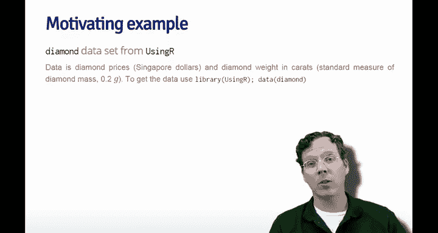

在这个数据集中，响应变量是钻石价格（新加坡元），解释变量是钻石的重量（克拉）。我们的目标是利用钻石的质量来解释其价格的变化。

下图展示了价格与质量的关系：

如果我们忽略质量，所有数据点将投影到纵轴（价格）上，此时价格呈现出很大的变异。当我们考虑质量并拟合一条回归线后，数据点围绕这条线的变异就小得多。这种围绕回归线的剩余变异，就是**残差变异**。构成这些变异的垂直距离，称为**残差**。残差对于诊断模型拟合不佳等问题非常有用。

---

## 回归模型回顾

首先，让我们回顾一下正在考虑的线性回归模型。

我们的模型假设响应变量 `Y_i`（例如价格）与预测变量 `X_i`（例如质量）之间存在线性关系，并附加一个随机误差项：

`Y_i = β_0 + β_1 * X_i + ε_i`

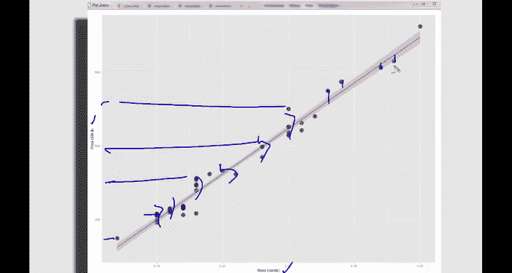

其中，误差项 `ε_i` 被假设为服从均值为0、方差为 `σ^2` 的正态分布：`ε_i ~ N(0, σ^2)`。我们尚未明确使用这个正态性假设，这将在后续课程中涉及。

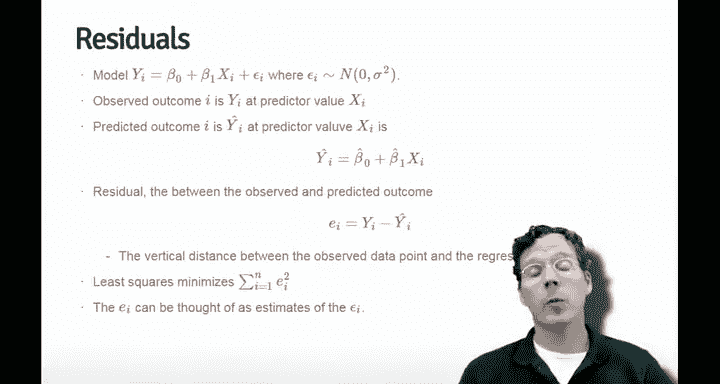

对于每个观测点 `i`，`Y_i` 是实际观测到的价格，`X_i` 是其对应的质量。

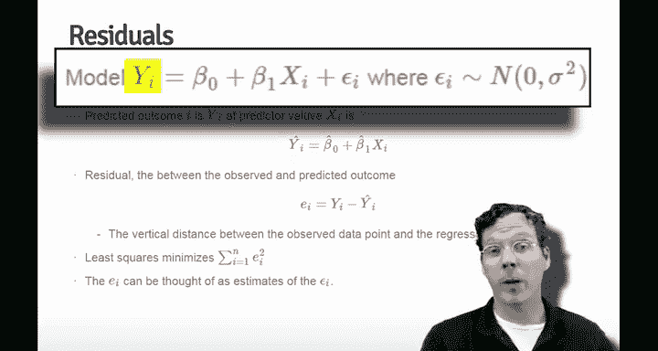

---

## 残差的定义

对应于预测值 `X_i` 的回归线上的点，是拟合值 `Ŷ_i`。

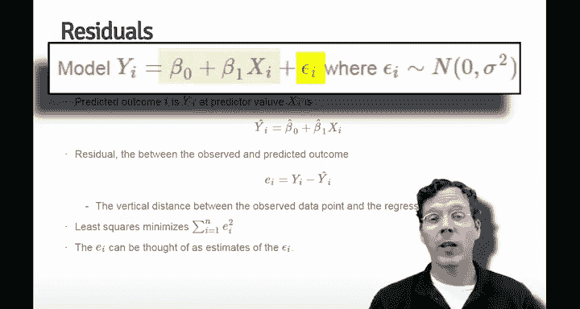

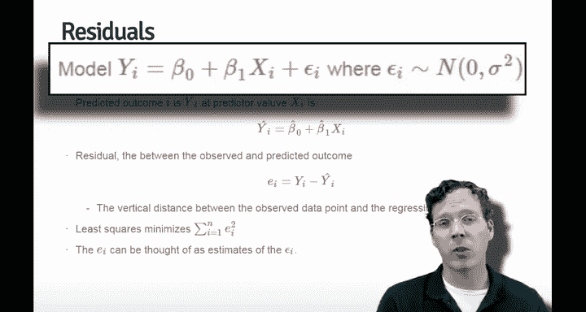

我们可以通过将估计的系数代入方程来计算拟合值：

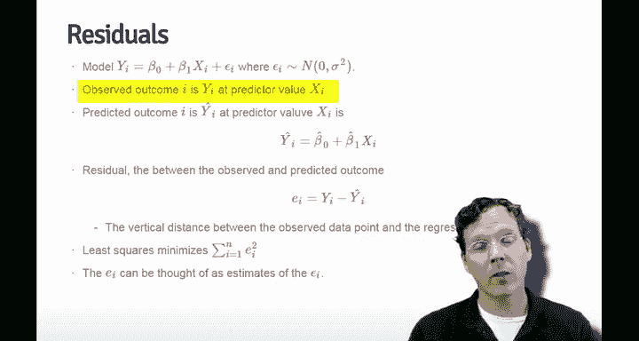

`Ŷ_i = β̂_0 + β̂_1 * X_i`

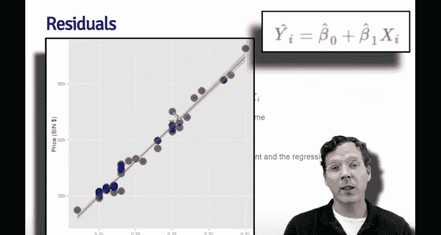

那么，**残差** `e_i` 就是观测值 `Y_i` 与拟合值 `Ŷ_i` 之间的垂直距离：

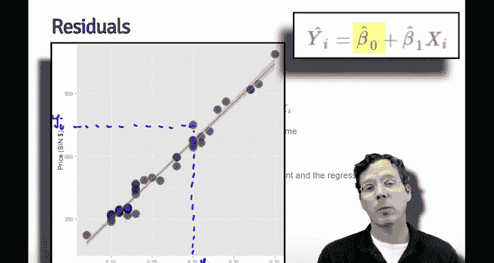

`e_i = Y_i - Ŷ_i`

请记住，最小二乘法的目标正是最小化所有残差的平方和：`∑ e_i²`。

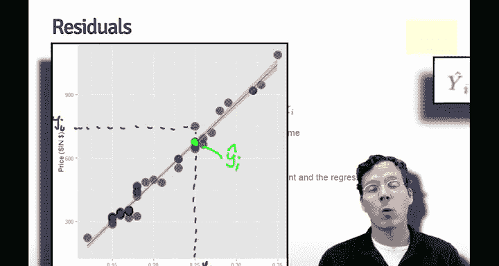

---

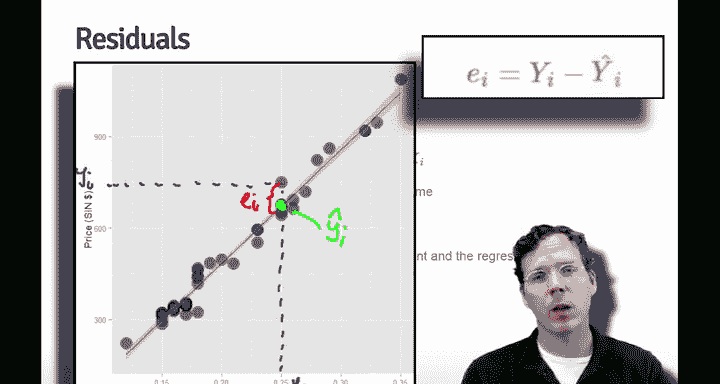

## 残差的性质

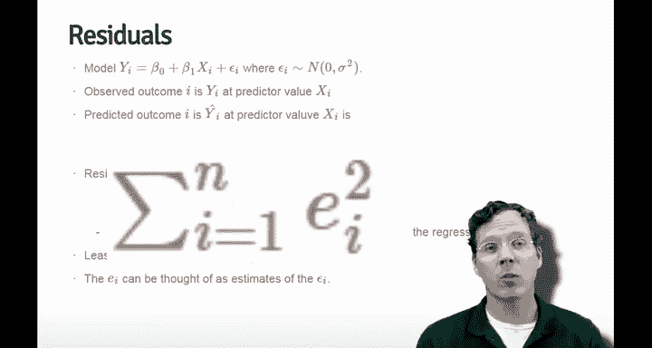

残差可以被视为对模型误差项 `ε_i` 的一种估计，但对此需要谨慎，因为后续我们会看到，仅仅向模型中添加无关的解释变量就可以人为地减小残差。

以下是残差的一些重要性质，有助于我们理解和解释它们：

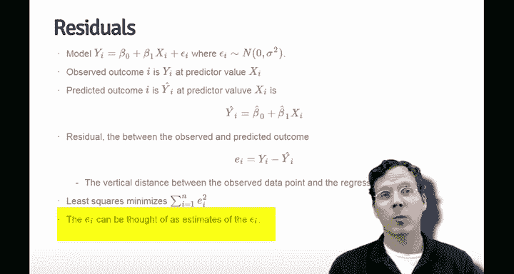

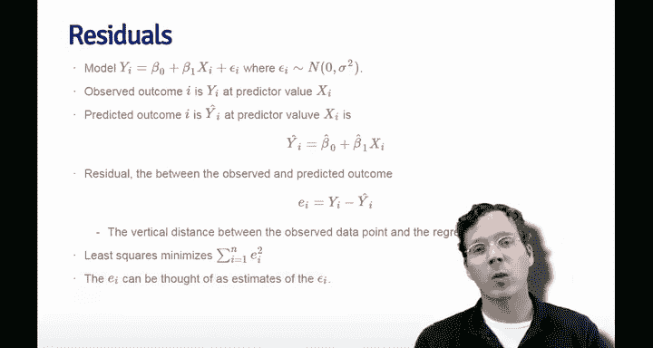

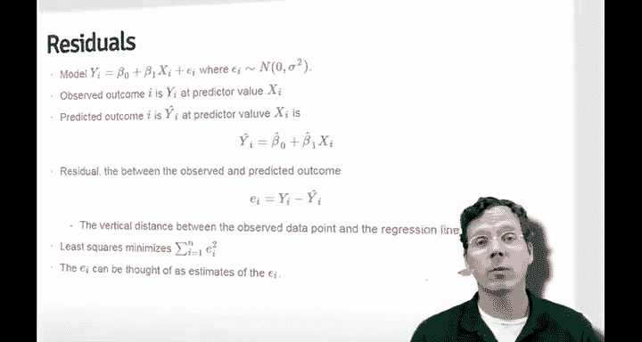

*   **期望值为零**：残差的总体期望值为零。
*   **和为零**：当模型中包含截距项时，所有残差的**经验和**为零：`∑ e_i = 0`。因此，经验均值也为零。如果模型不包含截距项，此性质不一定成立。
*   **与预测变量正交**：这个性质可以推广。在线性模型中，如果包含了某个回归变量，那么残差与该变量的乘积和也为零：`∑ e_i * X_i = 0`。

---

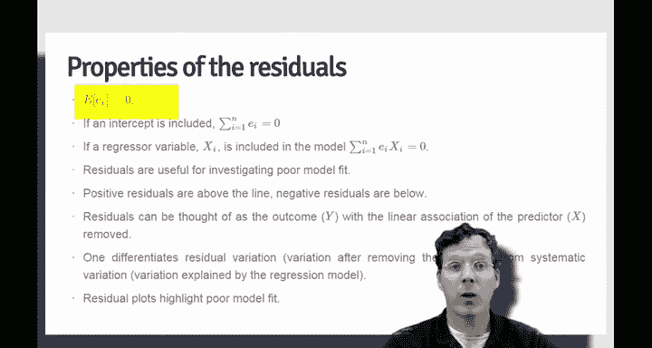

## 残差的应用

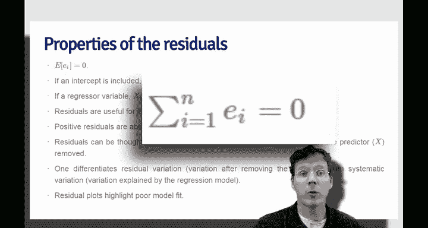

残差主要有两个重要的应用场景。

**1. 诊断模型拟合度**

残差图是诊断模型拟合不佳的强有力工具。通过绘制残差与预测值或其他变量的关系图，我们可以直观地发现模型假设（如线性、同方差性）是否被违反。我们将在接下来的幻灯片中查看一些残差图的例子。

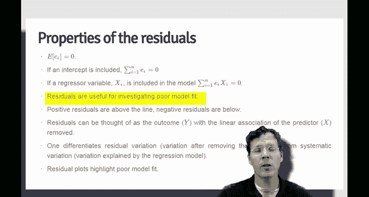

**2. 作为调整后的结果变量**

残差的另一个常见用途是，将其视为“移除了预测变量线性影响后的响应变量 `Y`”。例如，如果我们想在后续分析中研究钻石价格，但希望所有价格都处于一个已根据重量调整过的、统一的尺度上，我们就可以使用从“价格 ~ 重量”模型中得到残差。这些残差代表了排除了重量线性影响后的价格信息。

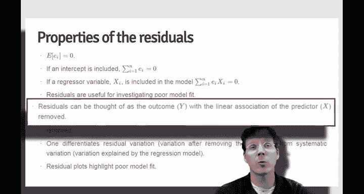

当然，必须记住，线性回归只移除了预测变量的**线性**成分。如果存在非线性关系，这部分信息仍会保留在残差中。

---

## 残差变异与系统变异

因此，我们需要区分两种变异：

*   **系统变异**：由回归模型解释的变异。
*   **残差变异**：在以线性方式考虑了解释变量后，剩余的、未被解释的变异。

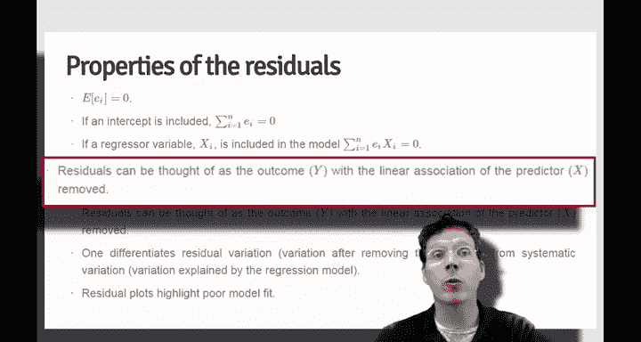

同样，残差图可以突出显示模型拟合不佳的区域，帮助我们识别系统变异中未被捕捉的部分。

---

## 总结

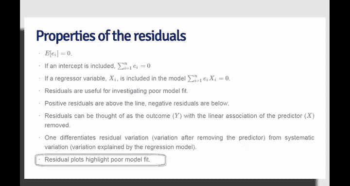

本节课中，我们一起学习了线性回归中的核心概念——残差。我们明确了残差是观测值与模型预测值之间的垂直差异，并了解了其和为0等重要性质。我们探讨了残差的两个主要用途：一是通过残差图来诊断模型的拟合优度，发现可能违背模型假设的问题；二是将残差作为“调整后”的结果变量，用于后续分析，以剔除特定预测变量的线性影响。理解残差是评估和改进回归模型的关键一步。