# 课程 P54：残差计算与可视化示例 📊

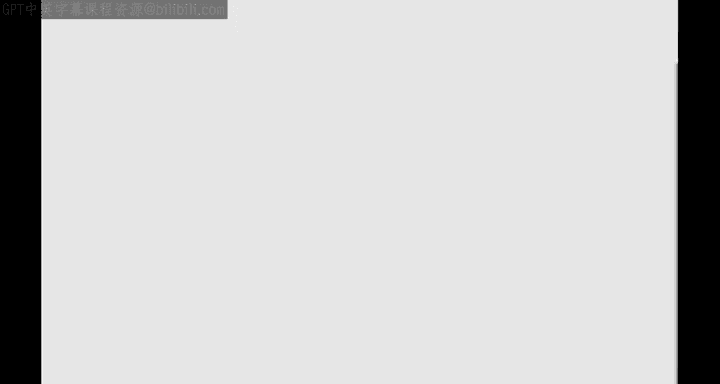

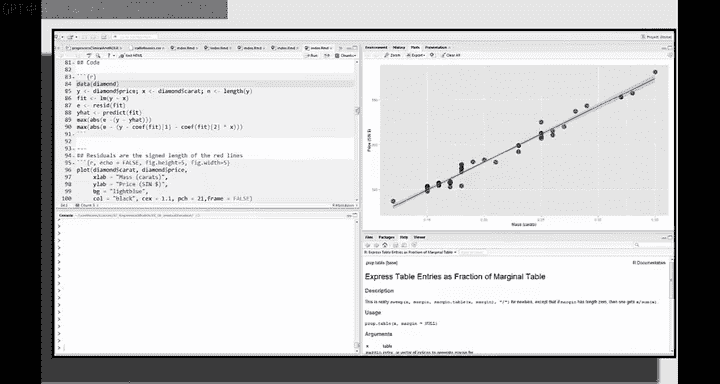

在本节课中，我们将学习如何计算和可视化线性回归模型中的残差。我们将使用钻石数据集作为例子，通过R语言演示计算残差的多种方法，并解释如何通过残差图来评估模型拟合的好坏。

---

## 计算残差

首先，我们加载钻石数据集并拟合一个简单的线性回归模型，其中价格（`price`）是因变量，克拉数（`carat`）是自变量。

```r
# 定义变量以简化代码
y <- diamonds$price
x <- diamonds$carat
n <- length(y)

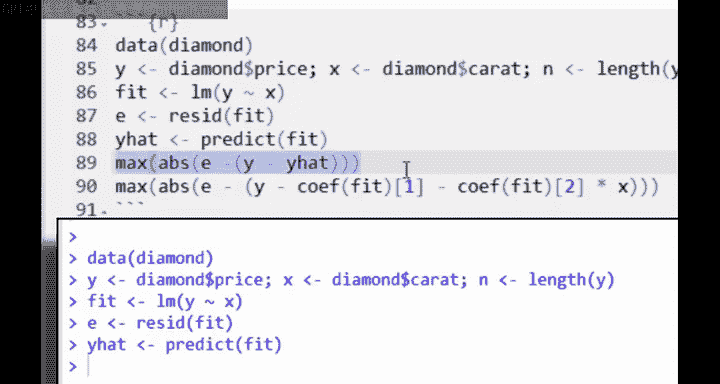

# 拟合线性模型
fit1 <- lm(y ~ x)

# 方法一：使用resid()函数直接获取残差
e <- resid(fit1)
```

上一节我们介绍了直接使用`resid()`函数获取残差的方法。本节中我们来看看如何手动计算残差，以加深理解。

以下是手动计算残差的步骤：
1.  使用`predict()`函数获取模型在观测值上的拟合值（\(\hat{y}\)）。
2.  将观测值（\(y\)）减去拟合值（\(\hat{y}\)），即可得到残差（\(e = y - \hat{y}\)）。

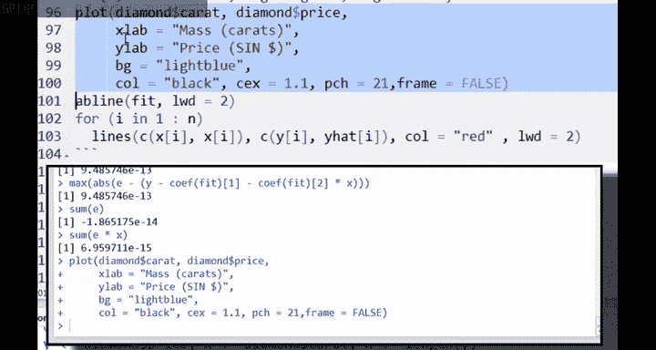

```r
# 方法二：手动计算残差
y_hat <- predict(fit1) # 获取拟合值
e_manual <- y - y_hat # 手动计算残差

# 验证两种方法结果是否一致（在数值精度内）
max(abs(e - e_manual)) # 结果应约为10^-13量级，表明两者相同
```

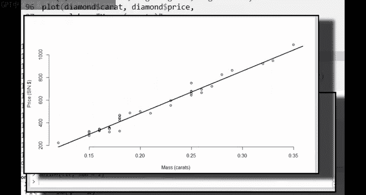

此外，线性回归模型的两个重要性质是：
*   **残差之和为零**：\(\sum_{i=1}^{n} e_i \approx 0\)
*   **残差与自变量协方差为零**：\(\sum_{i=1}^{n} e_i \times x_i \approx 0\)

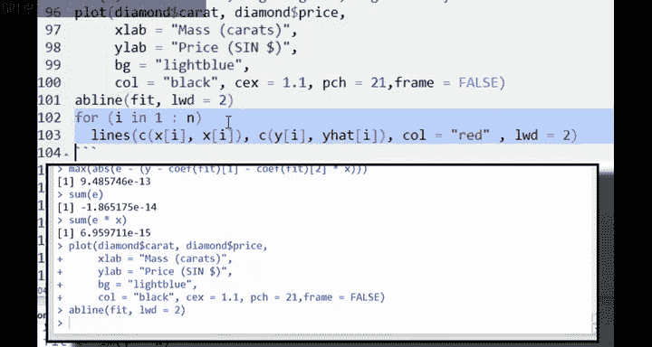

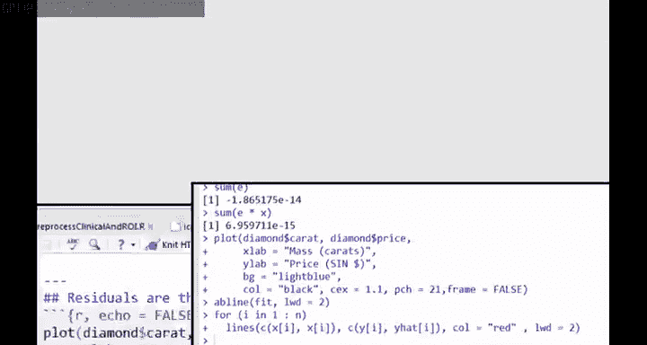

我们可以通过以下代码验证：

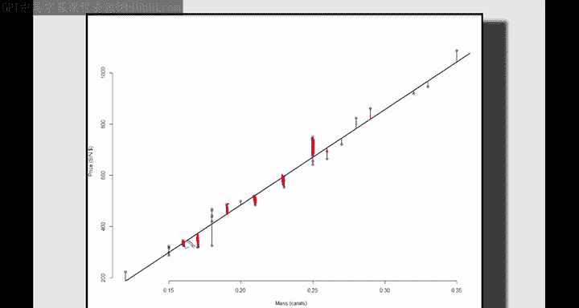

```r
sum(e) # 应接近0
sum(e * x) # 应接近0
```

---

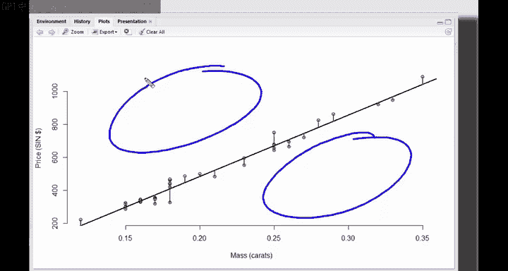

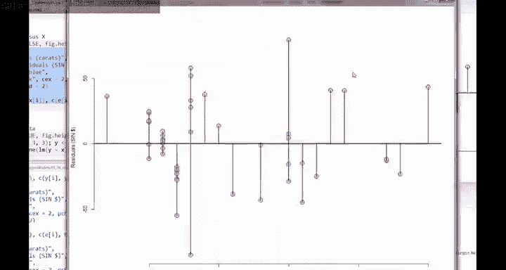

## 可视化残差

理解了如何计算残差后，我们来看看如何直观地展示它们。残差在散点图中可以表示为数据点到回归线的垂直距离。

以下是使用R基础绘图系统绘制回归线和残差线段的代码：

```r
# 绘制价格与克拉数的散点图
plot(x, y, xlab = "Carat", ylab = "Price", main = "Diamond Price vs. Carat with Residuals")
# 添加回归线
abline(fit1, lwd = 2)
# 通过循环添加残差线段（红色）
for (i in 1:n) {
  lines(c(x[i], x[i]), c(y[i], y_hat[i]), col = "red")
}
```

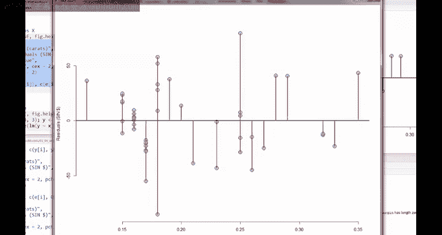

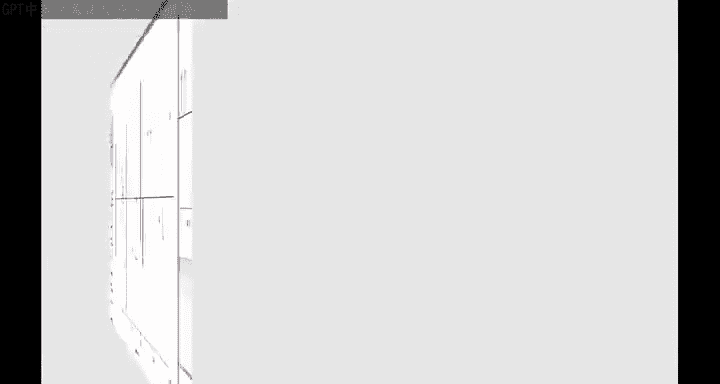

然而，上述散点图由于存在大量空白区域，并不利于清晰地观察残差的分布模式。

为了解决这个问题，我们通常会绘制**残差图**，即将残差（\(e\)）作为纵轴，自变量（\(x\)）作为横轴。

```r
# 绘制残差图
plot(x, e, xlab = "Mass (carats)", ylab = "Residual Price (SGD$)")
abline(h = 0, lty = 2) # 添加y=0的参考线
```

在残差图中，我们寻找的是**无模式**的随机分布。理想情况下，残差点应均匀分布在水平线（y=0）上下，没有明显的趋势或规律。通过残差图，我们还能发现一些在原始散点图中不明显的特征，例如数据中存在多个具有相同克拉数的钻石。

---

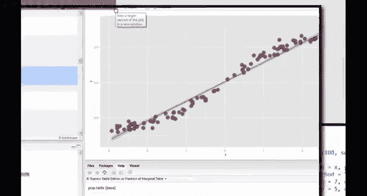

## 通过模拟数据理解残差图

为了更深入地理解残差图如何揭示模型缺陷，我们将分析两个模拟数据集。

### 示例一：未捕捉的非线性关系

首先生成一个包含线性趋势和周期性波动（正弦项）的数据，并为其添加噪声。

```r
set.seed(123)
x <- runif(100, -3, 3)
y <- x + sin(x) + rnorm(100, sd = 0.2)
```

拟合一个简单的线性模型（\(y \sim x\)）并绘制散点图与平滑曲线，非线性模式较难察觉。

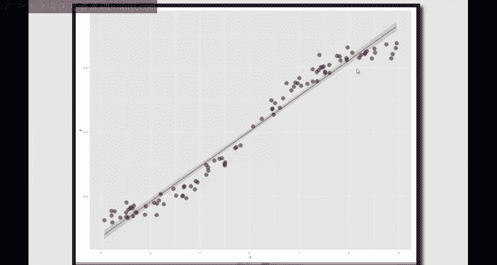

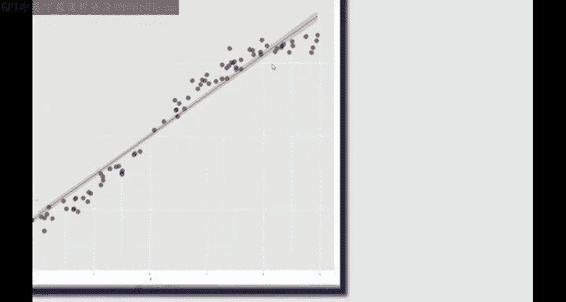

```r
library(ggplot2)
ggplot(data.frame(x, y), aes(x, y)) +
  geom_smooth(method = "lm", se = FALSE) +
  geom_point()
```

但当我们绘制残差图时，未被模型捕捉的正弦模式变得一目了然。

```r
fit_wrong <- lm(y ~ x)
resid_wrong <- resid(fit_wrong)
ggplot(data.frame(x, resid = resid_wrong), aes(x, resid)) +
  geom_point() +
  geom_hline(yintercept = 0, linetype = "dashed") +
  labs(x = "X", y = "Residuals")
```

**关键点**：即使模型不完全正确（如本例中忽略了正弦项），它仍然能提供变量间主要线性趋势的有用信息。残差图的作用是放大并凸显这些被模型忽略的次要模式。

### 示例二：异方差性

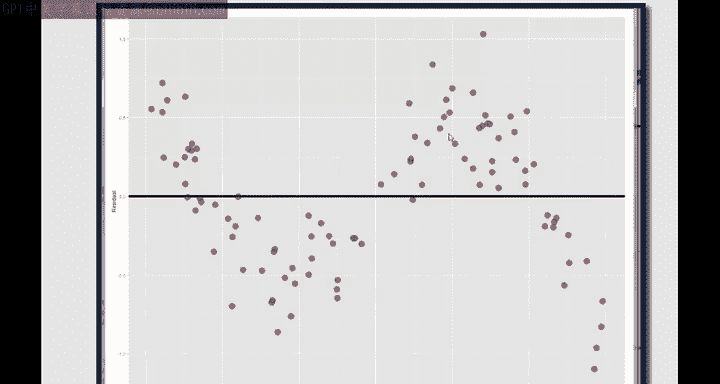


异方差性是指误差项的方差随自变量的变化而变化。生成一个方差随`x`增大的数据。

```r
set.seed(456)
x <- runif(100, 0, 10)
# 误差的标准差与x成正比
y <- x + rnorm(100, sd = 0.2 * x)
```

在原始散点图上，数据点似乎完美地落在一条直线上，异方差性完全无法察觉。

```r
ggplot(data.frame(x, y), aes(x, y)) +
  geom_smooth(method = "lm", se = FALSE) +
  geom_point()
```

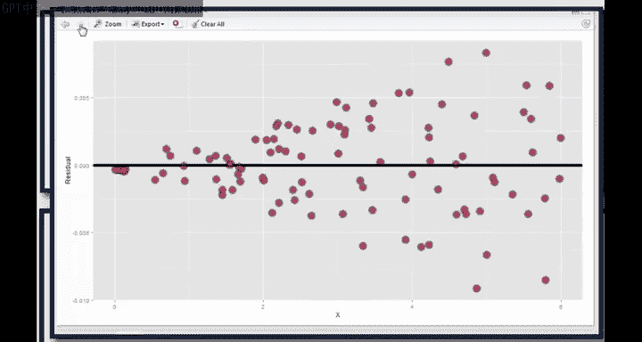

然而，残差图清晰地显示了残差的波动范围随着`x`的增大而扩大，成功诊断出异方差问题。

```r
fit_hetero <- lm(y ~ x)
resid_hetero <- resid(fit_hetero)
ggplot(data.frame(x, resid = resid_hetero), aes(x, resid)) +
  geom_point() +
  geom_hline(yintercept = 0, linetype = "dashed") +
  labs(x = "X", y = "Residuals")
```

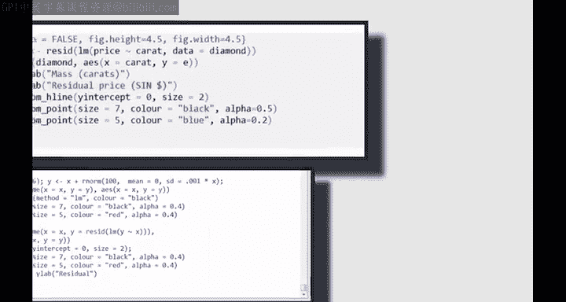

---

## 回到钻石数据集

最后，我们为钻石数据集创建一个正式的残差图。一个好的拟合模型，其残差图应看起来是随机的、无模式的。

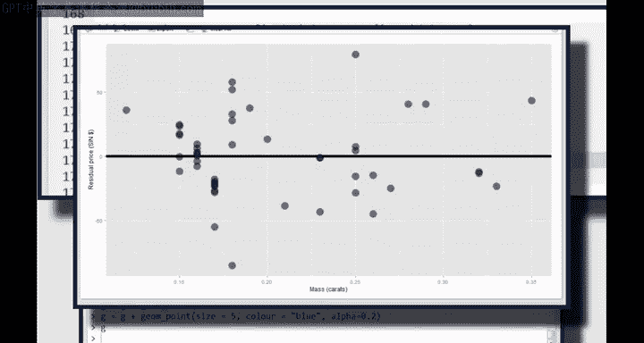

```r
# 将残差添加到数据框中
diamonds$residuals <- resid(fit1)

# 绘制残差图
ggplot(diamonds, aes(x = carat, y = residuals)) +
  geom_point(alpha = 0.5) +
  geom_hline(yintercept = 0, linetype = "dashed", color = "red") +
  labs(x = "Mass (carats)", y = "Residual Price (SGD$)",
       title = "Residual Plot for Diamond Price Model")
```

钻石数据的残差图没有显示出明显的模式或趋势，这表明仅包含克拉数的线性模型已经是一个相对合理的起点。

---

## 从残差到R平方

为了引出下一个重要概念——R平方，我们比较两种模型的残差：
1.  **仅截距模型**：残差是价格围绕其总平均值（\(\bar{y}\)）的波动，代表了数据的总变异。
2.  **包含克拉数的线性模型**：残差是价格围绕回归线的波动，代表了模型未能解释的剩余变异。

```r
# 计算两种残差
resid_intercept_only <- resid(lm(price ~ 1, data = diamonds)) # 仅截距
resid_with_carat <- resid(fit1) # 包含克拉数

# 创建比较图
library(ggplot2)
df_compare <- data.frame(
  Residuals = c(resid_intercept_only, resid_with_carat),
  Model = factor(rep(c("Intercept Only", "With Carat"),
                     each = nrow(diamonds)))
)
ggplot(df_compare, aes(x = Model, y = Residuals, fill = Model)) +
  geom_dotplot(binaxis = "y", stackdir = "center", dotsize = 0.5) +
  labs(y = "Residual Price (SGD$)", title = "Comparison of Residual Variability") +
  theme(legend.position = "none")
```

从图中可以直观看出，加入克拉数作为预测变量后，残差的波动范围（即未解释的变异）显著减小。**被解释的变异**（总变异 - 剩余变异）与**总变异**的比率，就是我们接下来要学习的**R平方**统计量。它量化了模型所能解释的数据变异性的比例。

---

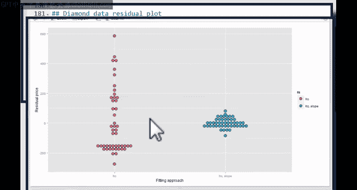

本节课中我们一起学习了如何计算和可视化线性回归的残差。我们掌握了使用`resid()`函数和手动计算两种方法，并理解了残差和为0等重要性质。通过绘制和分析残差图，我们学会了诊断模型拟合的不足，如未捕捉的非线性关系和异方差性。最后，我们通过比较不同模型的残差，为理解模型解释力度的核心指标——R平方——奠定了基础。