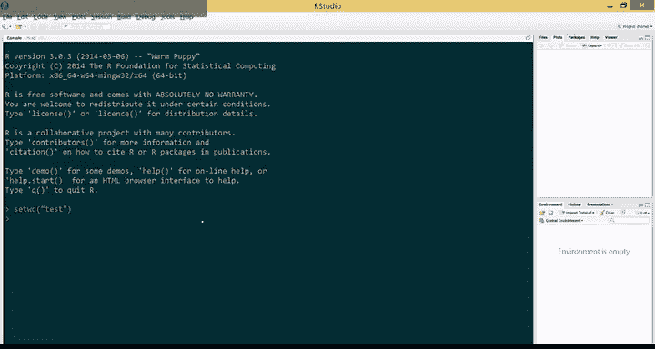
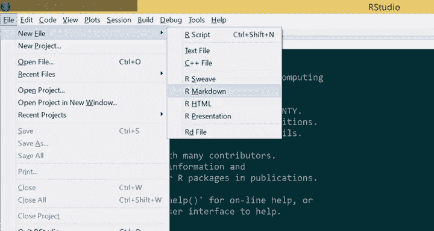
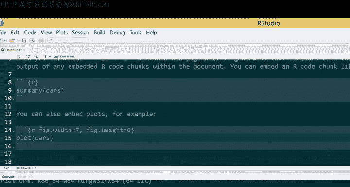
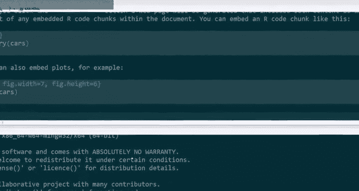
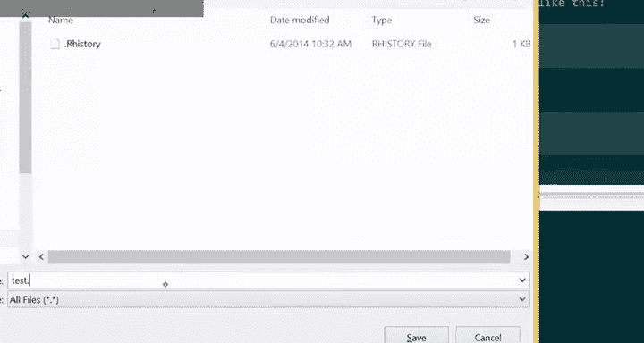
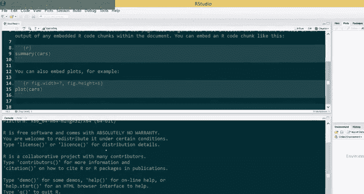
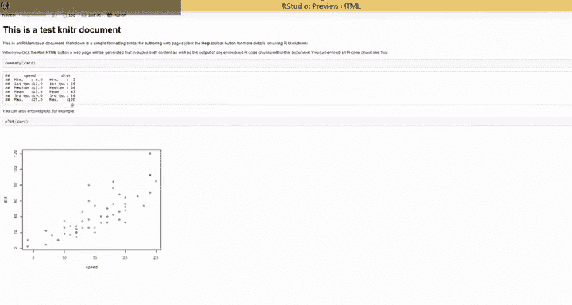
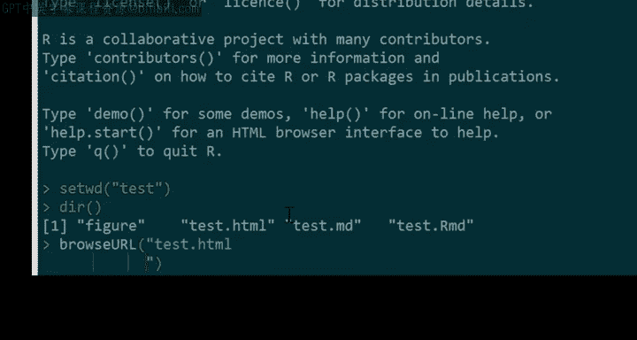
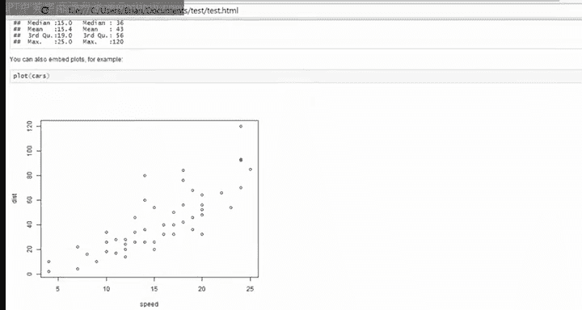

# 课程P59：📊 快速入门knitr教程

在本节课中，我们将学习如何使用knitr来创建和格式化R Markdown文档。knitr是一个强大的工具，能够将R代码、文本和输出结果整合到一个文档中，非常适合用于生成报告和完成作业。

## 概述

knitr允许你在一个文档中混合编写R代码和文本说明。当你编译文档时，knitr会执行其中的R代码，并将代码、结果（包括图表）和文本一起输出成一个格式美观的文档（如HTML、PDF）。这对于数据分析和报告撰写非常有用。



## 创建R Markdown文档

上一节我们了解了knitr的基本概念，本节中我们来看看如何创建一个新的R Markdown文档。



首先，你需要在RStudio中打开“File”菜单。你可以使用快捷键 `Alt + F`。


然后，选择“New File”，接着在下拉选项中找到并选择“R Markdown”。


选择后，RStudio会自动生成一个简单的R Markdown文档模板。你可以编辑标题，例如将其改为“测试knitr文档”。

## 理解代码块

R Markdown文档的核心是代码块。代码块是包含R代码的特殊区域，knitr会执行这些代码。

一个基本的R代码块由三个反引号（`）开始和结束，并在开头的反引号后注明语言为 `r`。其结构如下：

```r
` ` `{r}
# 你的R代码放在这里
` ` `
```

在代码块的开头，你还可以设置一些选项来控制代码的执行和输出方式。这些选项放在 `{r}` 后面的花括号内，用逗号分隔。

以下是几个最常用的选项：

*   **eval**：控制是否执行代码。例如，`eval=FALSE` 表示只显示代码但不运行。
*   **echo**：控制是否在最终文档中显示代码本身。`echo=TRUE` 会显示代码和结果，`echo=FALSE` 则只显示结果，不显示代码。
*   **results**：控制结果的显示方式。`results=‘hide’` 会隐藏代码运行的文本输出。
*   **fig**：用于控制图形输出的选项，如设置图形尺寸。

在模板文档中，已经包含了一个绘制图表的代码块示例：`plot(cars)`。




## 保存与编译文档

了解了代码块的结构后，下一步就是保存并生成最终的文档。





首先，你需要保存这个R Markdown文件。点击保存按钮或使用快捷键 `Ctrl + S`，将文件命名为例如 `test.Rmd`。


保存后，你可以点击编辑窗口上方的“Knit”按钮来编译文档。默认情况下，它会将文档编译成HTML格式。






编译过程完成后，RStudio会预览生成的HTML文档。


同时，knitr会在你的工作目录下生成一个独立的HTML文件（例如 `test.html`）。你可以在R控制台中使用 `browseURL(“test.html”)` 命令在默认浏览器中打开这个文件。





## 总结


本节课中我们一起学习了knitr的基本使用方法。我们了解了如何创建R Markdown文档，如何编写和设置R代码块，以及如何将文档编译成HTML格式。掌握这些基础操作，你就能开始创建结合了分析代码、结果和文字说明的动态报告了。