# 课程20：多元回归（第二部分）📊

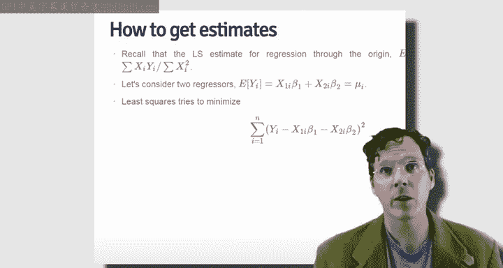

在本节课中，我们将学习如何推导多元回归的系数估计值，并深入理解多元回归模型如何通过调整其他变量的影响来估计每个预测变量的效应。我们将从简单的回归模型出发，逐步扩展到多元回归，并通过直观的解释帮助初学者理解其核心概念。

---

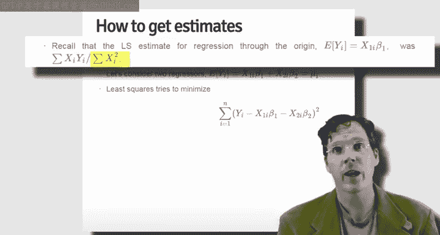

## 估计值的推导方法

上一节我们介绍了多元回归的基本概念，本节中我们来看看如何实际计算回归系数的估计值，以及R等统计软件是如何实现这一过程的。我将通过推导来展示这一过程，如果你对数学推导不感兴趣，可以跳过这部分内容。

### 回顾回归过原点的模型

首先，回顾一下回归过原点的模型。当我们有一个预测变量X和一个响应变量Y，且模型没有截距项时，斜率估计值的计算公式为：

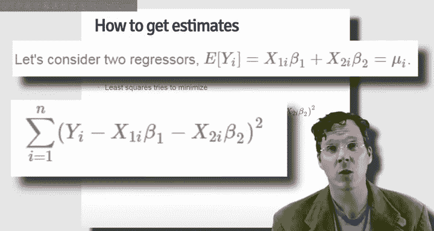

**公式：**
\[
\hat{\beta} = \frac{\sum X_i Y_i}{\sum X_i^2}
\]

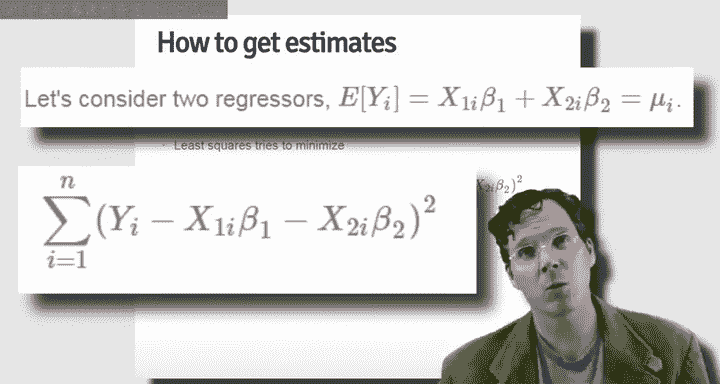

这个公式我们在课程早期讨论过。

### 扩展到两个预测变量的情况

现在，我们尝试将这一结果扩展到包含两个预测变量的情况。通过理解这个过程，你可以进一步推广到三个、四个甚至更多预测变量的情况。

以下是推导两个预测变量最小二乘估计的基本思路：

1.  **最小二乘准则**：我们希望最小化以下平方和：
    \[
    \sum (Y_i - X_{i1}\beta_1 - X_{i2}\beta_2)^2
    \]
    其中，\(X_{i1}\) 可能是截距项，\(X_{i2}\) 是感兴趣的协变量（如血压）。

2.  **固定一个系数**：假设我们固定 \(\beta_1\) 的值，那么我们可以定义一个新的响应变量：
    \[
    \tilde{Y_i} = Y_i - X_{i1}\beta_1
    \]
    此时，最小二乘准则变为：
    \[
    \sum (\tilde{Y_i} - X_{i2}\beta_2)^2
    \]
    这正好是一个关于 \(X_{i2}\) 和 \(\tilde{Y_i}\) 的回归过原点问题。

3.  **求解 \(\beta_2\)**：根据回归过原点的公式，\(\beta_2\) 的估计值应为：
    \[
    \hat{\beta_2} = \frac{\sum \tilde{Y_i} X_{i2}}{\sum X_{i2}^2}
    \]
    注意，\(\tilde{Y_i}\) 是 \(\beta_1\) 的函数。

4.  **回代求解 \(\beta_1\)**：将 \(\hat{\beta_2}\) 的表达式代回原始方程，可以得到一个只包含 \(\beta_1\) 的方程，这又形成了一个回归过原点问题，从而可以解出 \(\beta_1\)。

### 核心结论：调整其他变量的影响

通过上述推导，我们可以得到一个重要的结论：

*   **\(\beta_1\) 的估计值**，等于先从响应变量 \(Y\) 和第一个预测变量 \(X_1\) 中**剔除第二个预测变量 \(X_2\) 的线性影响**，然后对得到的残差进行回归过原点分析所得到的系数。
*   同理，**\(\beta_2\) 的估计值**，等于先从响应变量 \(Y\) 和第二个预测变量 \(X_2\) 中**剔除第一个预测变量 \(X_1\) 的线性影响**，然后对得到的残差进行回归过原点分析所得到的系数。

**简单来说，多元回归中某个变量的系数，是在“调整”或“控制”了模型中所有其他变量的线性影响之后，该变量与响应变量之间的关联程度。** 这是一个非常关键的概念，我们将在后续课程中反复利用。

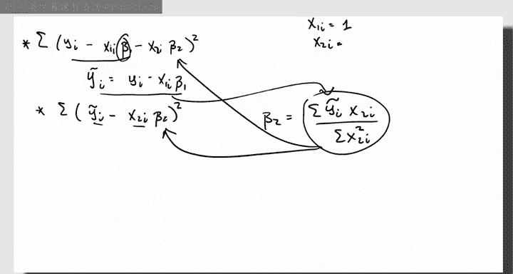

---

## 理解多元回归系数的含义

如果你跳过了前面的推导部分，请务必理解这个核心结果，因为它对于理解多元回归至关重要。

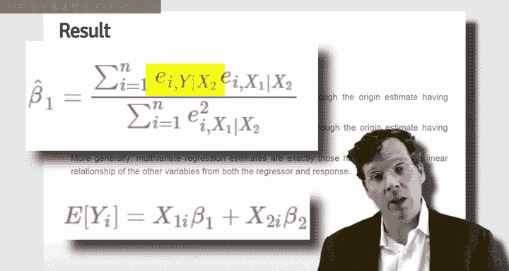

假设我们有两个协变量 \(X_1\) 和 \(X_2\)，以及一个响应变量 \(Y\)。我们拟合的模型包含这两个预测变量，其系数分别为 \(\beta_1\) 和 \(\beta_2\)。

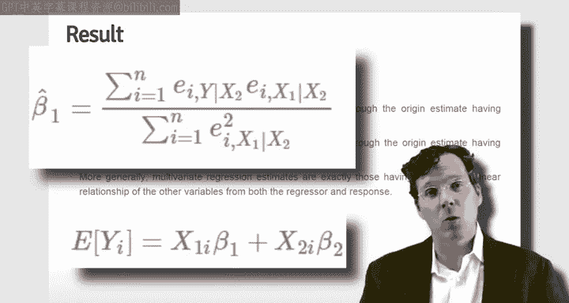

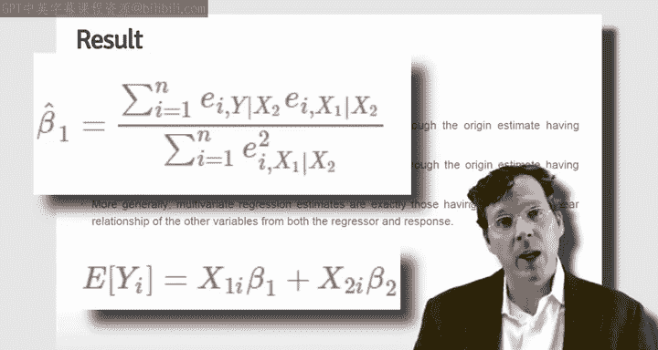

*   **\(\hat{\beta_1}\)** 的拟合值，等同于以下操作得到的系数：
    1.  用 \(X_2\) 预测 \(Y\)，得到残差 \(e_Y\)（即从 \(Y\) 中移除 \(X_2\) 的线性影响）。
    2.  用 \(X_2\) 预测 \(X_1\)，得到残差 \(e_{X_1}\)（即从 \(X_1\) 中移除 \(X_2\) 的线性影响）。
    3.  对 \(e_Y\) 和 \(e_{X_1}\) 进行回归过原点分析。
*   **\(\hat{\beta_2}\)** 的拟合值，同理，等同于先从 \(Y\) 和 \(X_2\) 中移除 \(X_1\) 的线性影响后，再对残差进行回归分析。

**这正是多元回归系数被认为“调整了其他所有变量”的原因。** 每个系数都反映了在排除其他变量干扰后的“纯净”关系。

---

## 从简单线性回归到多元回归

让我们通过一个已知的例子来巩固理解：简单线性回归（包含一个截距项和一个预测变量）。

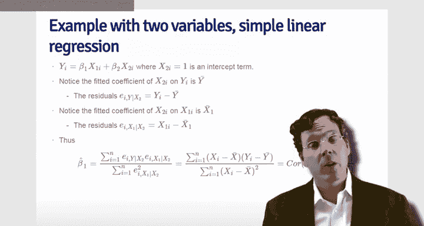

假设模型为 \(Y_i = \beta_1 X_{1i} + \beta_2 X_{2i}\)，其中 \(X_2\) 是截距项（通常设为1的向量）。

根据上述规则，要估计 \(\beta_1\)，我们需要从 \(Y\) 和 \(X_1\) 中移除 \(X_2\)（截距项）的影响。

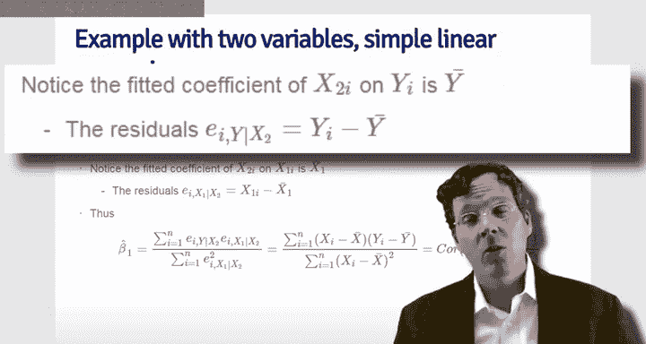

*   **从 \(Y\) 中移除截距项的影响**：用截距项（常数）预测 \(Y\)，拟合值就是 \(\bar{Y}\)，残差为 \(Y_i - \bar{Y}\)，即**中心化**的 \(Y\)。
*   **从 \(X_1\) 中移除截距项的影响**：用截距项预测 \(X_1\)，拟合值就是 \(\bar{X_1}\)，残差为 \(X_{1i} - \bar{X_1}\)，即**中心化**的 \(X_1\)。

然后，对这两个中心化后的变量进行回归过原点分析，得到的斜率估计公式为：

**公式：**
\[
\hat{\beta_1} = \frac{\sum (Y_i - \bar{Y})(X_{1i} - \bar{X_1})}{\sum (X_{1i} - \bar{X_1})^2}
\]

这恰好就是标准简单线性回归的斜率公式，也等于相关系数乘以 \(S_y / S_x\)。

---

## 扩展到更多预测变量

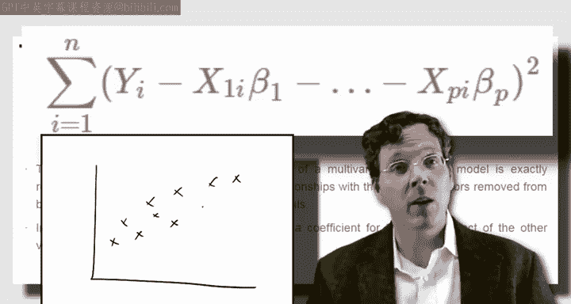

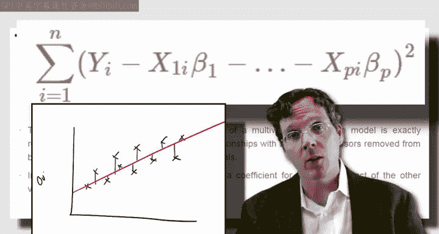

现在，我们将这个概念扩展到包含多个预测变量（\(p\) 个）的多元回归。

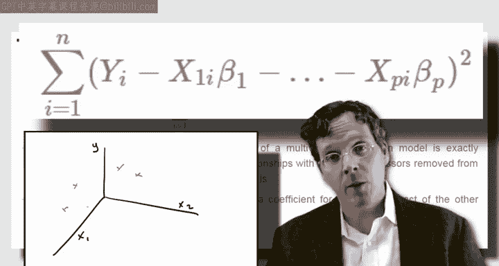

最小二乘准则变为最小化以下平方和：
\[
\sum (Y_i - \beta_1 X_{1i} - \beta_2 X_{2i} - ... - \beta_p X_{pi})^2
\]

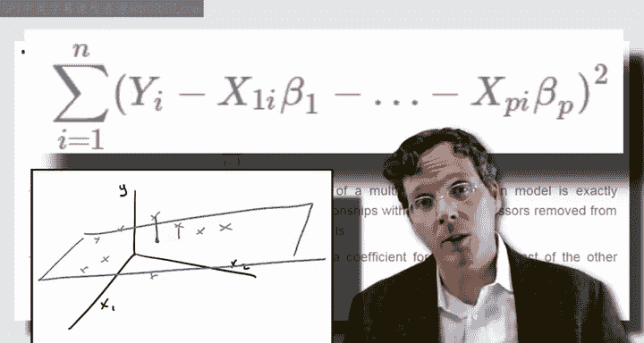

*   **可视化理解**：
    *   两个变量（一个截距，一个斜率）：最小化点到**直线**的垂直距离平方和。
    *   三个变量（一个截距，两个斜率）：最小化点到**平面**的垂直距离平方和。
    *   超过三个变量：我们无法可视化，但原理是相同的——最小化点到**超平面**的垂直距离平方和。

*   **系数的解释**：
    对于任意一个系数，例如 \(\beta_1\)，它的估计可以理解为：
    1.  从响应变量 \(Y\) 中**线性剔除**其他所有预测变量 \((X_2, ..., X_p)\) 的影响，得到残差。
    2.  从预测变量 \(X_1\) 中**线性剔除**其他所有预测变量 \((X_2, ..., X_p)\) 的影响，得到残差。
    3.  研究这两组残差之间的关系（通过回归过原点）。

因此，\(\beta_1\) 可以被视为**调整了其他所有变量线性影响后的效应**。

---

## 总结

本节课中，我们一起学习了多元回归系数估计的核心思想。关键要点在于，多元回归中每个预测变量的系数，都代表了在**控制或调整了模型中其他所有变量的线性影响之后**，该变量与响应变量之间的独特关联。我们通过推导和概念解释说明了这一过程，即通过从响应变量和当前预测变量中“剔除”其他变量的影响，再分析剩余部分的关系。下一节课，我们将通过计算机实验和具体案例，进一步学习如何解释多元回归模型中的系数。