# 课程22：多元回归示例 第1部分 🧮

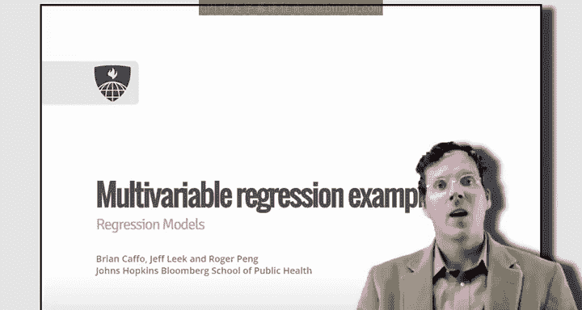

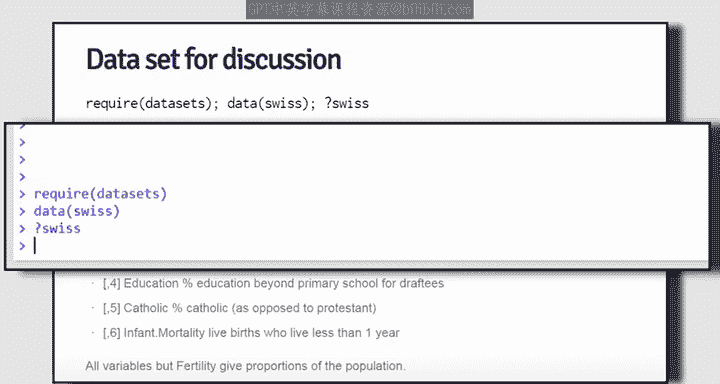

在本节课中，我们将学习多元回归分析，并通过一个著名的数据集——瑞士生育率数据——来演示其应用。我们将探讨如何拟合模型、解释系数，并理解在模型中包含或排除其他变量时，核心变量效应的变化。

---

## 数据介绍与探索

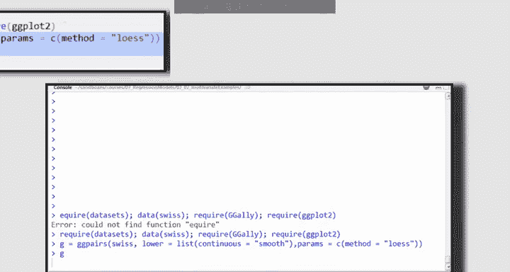

我们使用的数据集来自著名的统计教科书，名为“瑞士生育率数据”。它包含1888年瑞士47个法语省份的标准化生育率指标和一些社会经济状况指标。

变量包括：
*   **Fertility**：标准化生育率指标。
*   **Agriculture**：从事农业的男性百分比。
*   **Examination**：在军事考试中获得特定分数的应征者百分比。
*   **Education**：完成小学以上教育的人口百分比。
*   **Catholic**：天主教徒百分比。
*   **Infant.Mortality**：出生后存活不足一年的婴儿百分比。

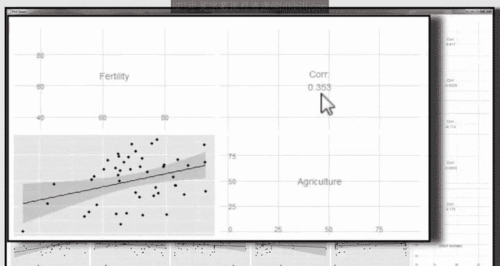

我们的目标是探究哪些因素可以解释各省的生育率差异。

在深入分析之前，我们先对数据进行基本的散点图探索。

以下是使用R语言绘制所有变量间关系的代码：
```r
require(datasets)
data(swiss)
library(GGally)
ggpairs(swiss)
```
生成的矩阵图展示了所有变量两两之间的散点图、平滑拟合线以及相关系数。例如，`Fertility`和`Agriculture`的散点图显示其经验相关系数为0.35。

---

## 拟合包含所有变量的模型

上一节我们观察了数据的基本关系，本节中我们来看看如何建立一个包含所有预测变量的多元回归模型。

我们首先拟合一个模型，将`Fertility`作为因变量，所有其他变量作为自变量。代码如下：
```r
fit <- lm(Fertility ~ ., data = swiss)
summary(fit)$coefficients
```
模型摘要中的系数表提供了每个自变量的估计值、标准误、t值和p值。

以`Agriculture`的系数`-0.17`为例，其解释为：在保持`Examination`、`Education`、`Catholic`和`Infant.Mortality`不变的情况下，我们预计从事农业的男性比例每增加1%，标准化生育率将**减少**0.17个单位。标准误`0.07`衡量了该估计的精确度。

t统计量（`-2.448`）是估计值除以标准误的结果。对应的p值（`0.018`）表明，在5%的显著性水平下，该效应是统计显著的。

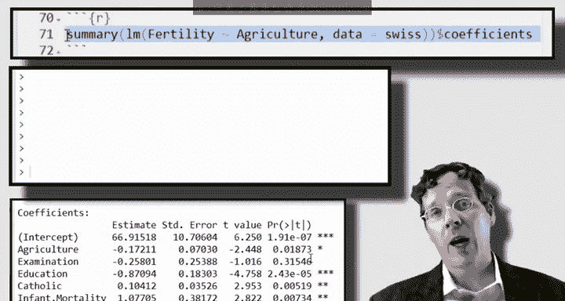

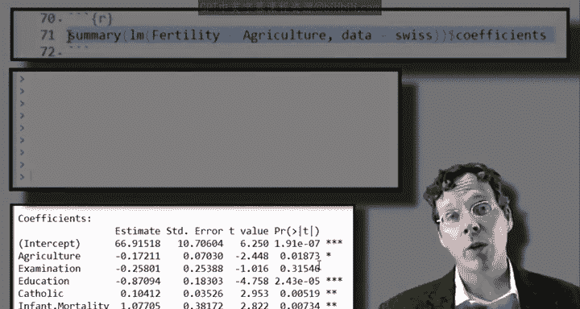

---

## 对比单变量与多变量模型

理解了全模型后，我们来看看当只考虑`Agriculture`一个预测变量时，情况会发生什么变化。

以下是仅包含`Agriculture`的简单线性回归模型：
```r
fit_agri <- lm(Fertility ~ Agriculture, data = swiss)
summary(fit_agri)$coefficients
```
有趣的现象出现了：`Agriculture`的系数符号发生了反转。在全模型中为`-0.17`（负效应），而在单变量模型中变为`0.19`（正效应）。调整了其他变量（如教育水平）后，`Agriculture`对`Fertility`的影响方向发生了改变。

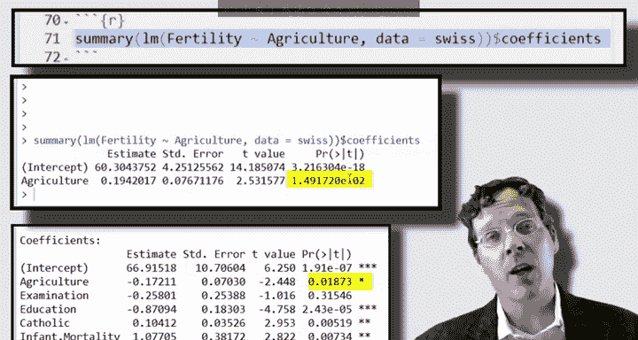

这种现象常被称为**辛普森悖论**（或更准确地说是“辛普森表象悖论”）。它并不矛盾，恰恰说明了在回归分析中，考虑其他变量（潜在混杂因素）对于理解两个变量之间的真实关系至关重要。两个模型中，`Agriculture`的系数都具有统计显著性，但科学解释却截然不同。

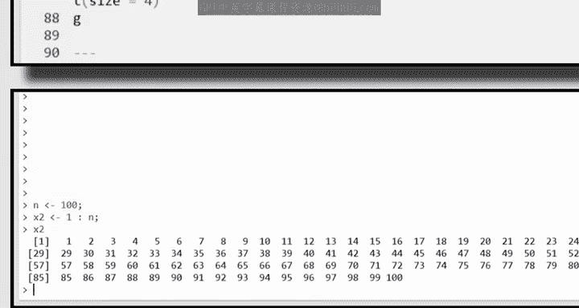

---

## 通过模拟理解效应反转

为了更直观地理解效应为何会反转，让我们通过一个模拟示例来演示。

假设我们模拟生成100个数据点：
*   `x2`：代表时间（如天数），值为1到100。
*   `x1`：与`x2`线性相关并带有随机噪声的变量（例如，你的银行存款，随时间增长但有波动）。
*   `y`：结果变量（例如，幸福感），其**真实**生成过程是：`y = -1 * x1 + 1 * x2 + 随机噪声`。这意味着`y`与`x1`负相关，与`x2`正相关。

模拟与拟合代码如下：
```r
n <- 100
x2 <- 1:n
x1 <- .01 * x2 + rnorm(n, sd = .5) # x1依赖于x2
y <- -x1 + x2 + rnorm(n, sd = .1) # y的真实模型

# 错误模型：只拟合x1
summary(lm(y ~ x1))$coefficients
# 正确模型：同时拟合x1和x2
summary(lm(y ~ x1 + x2))$coefficients
```
如果错误地只拟合`y ~ x1`，我们会得到一个巨大的正系数（约95），完全背离了真实的负效应（-1）。这是因为`x1`中包含了`x2`的效应，而`x2`与`y`有强烈的正相关，从而扭曲了`x1`与`y`的关系。

当我们正确拟合`y ~ x1 + x2`时，回归模型会从`x1`和`y`中分别移除`x2`的线性影响，然后分析剩余部分的关系。这样，我们就能得到接近真实值（-1和1）的系数估计。

可视化残差关系可以清晰地展示这一点：
```r
# 计算移除x2影响后的残差
e <- resid(lm(y ~ x2))
resid_x1 <- resid(lm(x1 ~ x2))
# 绘制残差e与残差resid_x1的关系图，此时应显示负相关
plot(resid_x1, e)
abline(lm(e ~ resid_x1), col="red")
```
残差图将显示`y`和`x1`在剔除`x2`影响后的部分呈清晰的负相关，斜率约为-1。

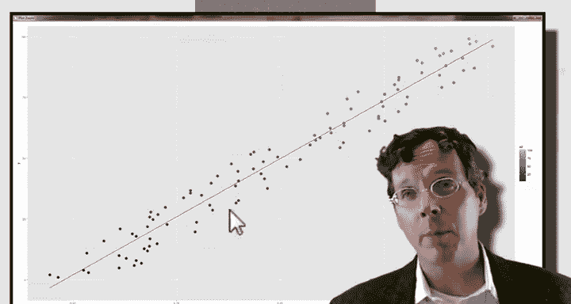

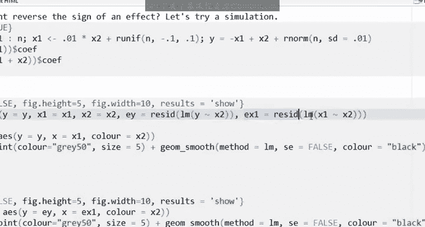

---

## 回到瑞士数据与模型选择

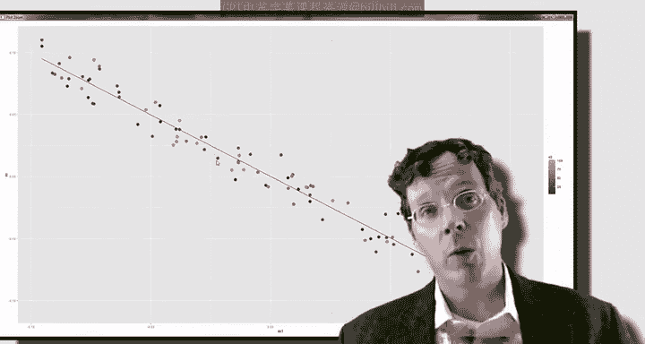

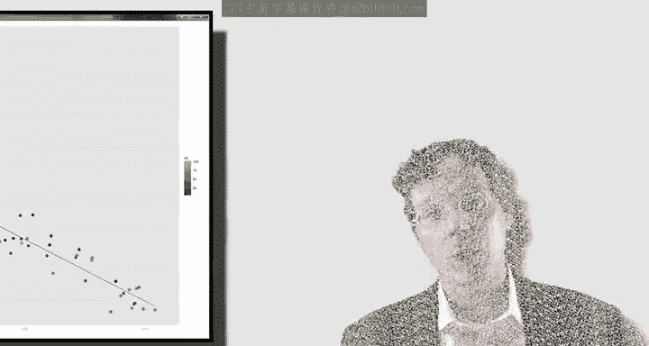

通过模拟我们理解了多变量调整的原理，现在让我们回到瑞士生育率数据。

`Agriculture`的效应在加入其他变量（特别是`Education`和`Examination`）后发生反转。值得注意的是，`Education`与`Agriculture`呈负相关（-0.64），而`Education`本身对`Fertility`有更强的负效应。此外，`Education`和`Examination`高度相关（0.7），测量的是类似的概念。

因此，如果有人仅通过`Fertility ~ Agriculture`的简单回归就声称农业比例对生育率有**因果性**的正向影响，这个结论是非常可疑的。即使在关联性层面，这种正向关联也很脆弱，因为加入合理的其他变量（如教育水平）后，关联方向就会逆转。这强调了在观察性研究中，谨慎选择模型变量并进行科学论证的重要性。

最后，我们看看在模型中引入一个完全多余的变量会发生什么。例如，我们创建一个新变量`z`，它是`Agriculture`和`Education`的简单加和。由于`z`是已有变量的线性组合，它不提供任何新信息。

拟合包含`z`的模型：
```r
swiss$z <- swiss$Agriculture + swiss$Education
fit_redundant <- lm(Fertility ~ . + z, data = swiss)
summary(fit_redundant)$coefficients
```
你会发现，`Agriculture`的系数未变（仍为-0.17），而变量`z`的系数显示为`NA`。在R中，当模型包含一个与其他变量存在精确线性关系的变量时，最冗余的那个变量会被赋予`NA`系数。这是诊断模型设定问题的一个有用线索。

---

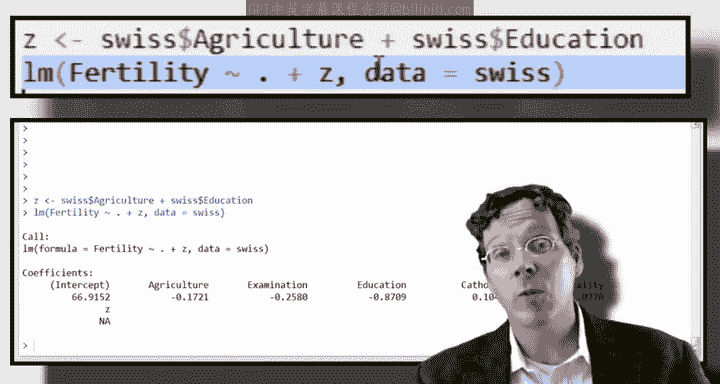

## 总结

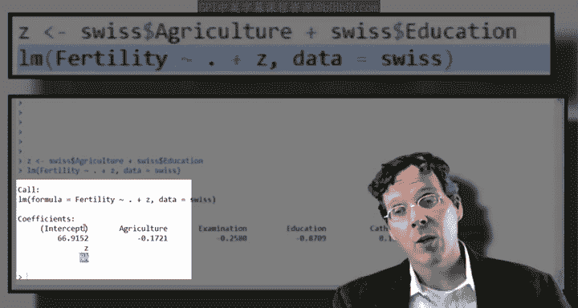

本节课中我们一起学习了多元回归分析的核心实践。我们使用瑞士生育率数据演示了如何拟合和解释多元线性模型，并观察到一个关键现象：核心预测变量（`Agriculture`）的效应方向和大小，会因模型中是否包含其他相关变量（如`Education`）而发生显著变化。我们通过一个模拟例子深入理解了这种“效应反转”背后的机制——即忽略混杂变量会导致估计偏误。最后，我们讨论了模型选择的重要性，并指出在观察性研究中，仅基于简单关联就做出因果推断是危险的，必须通过科学思考谨慎地纳入或排除潜在混杂因素。