# 课程 P64：多元回归示例 - 因子变量处理 🧪

在本节课中，我们将学习如何在多元线性回归模型中处理因子变量。我们将看到，线性回归模型非常灵活，可以轻松地将分类变量（如处理组/对照组、政治派别）作为预测因子纳入模型。我们将通过R语言示例，深入理解如何设置参考水平、解释系数，并了解不同设置对结果解读的影响。

---

## 线性回归中的因子变量

上一节我们介绍了多元回归的基本概念。本节中我们来看看，当预测变量是分类变量（因子）时，模型会发生什么变化。

你可能会惊讶地发现线性回归模型非常灵活。例如，你可以将因子变量作为回归变量，并推导出像方差分析这样的方法——如果你之前听说过，它实际上是线性模型的一个特例。

让我们通过一个例子来说明，其中我们有一个协变量 **x**，其值为0或1。我们看看将其放入线性回归模型时会发生什么。

这里，我的模型是：
**Y = β₀ + xβ₁ + ε**
其中，**Y** 是我的结果变量，**β₀** 是截距，**x** 现在只取0或1的值（例如，0代表对照组，1代表处理组），**β₁** 是系数，**ε** 是误差项。

那么，对于接受处理的人群（即 **x** 值为1的组），他们的均值是 **β₀ + β₁**。
对于对照组的人群（即协变量 **x** 为0的组），他们的均值是 **β₀**。

如果你拟合这个模型，正如你所料，处理组的估计均值就是处理组人群的均值。因此，**β̂₁ + β̂₀** 的结果就是处理组的均值。
同样，**β̂₀** 本身的结果就是对照组的均值。

现在，**β₁** 被解释为那些 **x** 值为1（即接受处理）的个体，其平均响应的增加（或减少，如果为负值）。

这是一种很好的方法，可以将一个两水平的因子变量作为线性回归变量来拟合。它不仅通过拟合值告诉你两组的均值，还自动为你提供了比较两组的推断（即T检验）。顺便说一下，**β₁** 的T检验与假设方差相等的两独立样本T检验完全相同。

---

## 扩展到多水平因子

我们可以将其扩展到两个以上的水平。例如，假设你有一个三水平的变量。比如你有一个结果变量，但你想将其与美国政治派别（在本例中，假设只考虑民主党人、共和党人或注册无党派人士）进行比较。

你可以通过以下方式实现：
*   创建一个变量 **x₁**，共和党人为1，否则为0。
*   创建一个变量 **x₂**，民主党人为1，否则为0。
*   我们省略了 **x₃**（无党派人士为1，否则为0），因为它将是冗余的。

以下是原因：
如果一个人是共和党人，那么他的均值将是 **β₀ + β₁**（因为 **x₁=1**，**x₂=0**）。
如果一个人是民主党人，那么他的均值将是 **β₀ + β₂**（因为 **x₁=0**，**x₂=1**）。
如果一个人是无党派人士，那么他的均值将只是 **β₀**（因为 **x₁=0**，**x₂=0**）。

这就是我们不能包含第三项的原因。根据我们设置变量的方式，如果我们知道你不是共和党人也不是民主党人，那么在我们的数据集中你一定是无党派人士。因此，在模型中添加第三个变量将是冗余的，不会提供任何新信息。我们这里有三个均值（共和党、民主党、无党派）和三个参数（**β₀**， **β₁**， **β₂**）。如果我们添加一个额外的参数，模型就会出问题。

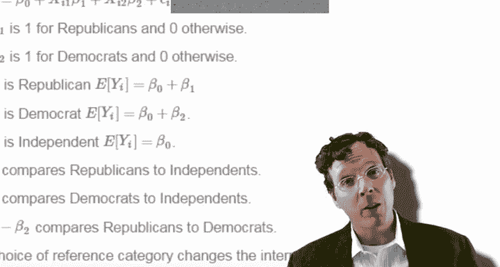


如果我们观察这里的均值：
*   **β₁** 比较了共和党人与无党派人士（**β₀ + β₁** 与 **β₀**）。
*   **β₂** 类似地比较了民主党人与无党派人士。
*   **β₁ - β₂** 则比较了民主党人与共和党人。

通过省略无党派人士的回归变量，截距 **β₀** 就变成了无党派人士的均值。所有其他系数都被解释为相对于无党派人士的差异。**β₁**（共和党协变量前的系数）现在被解释为共和党人与无党派人士之间的变化。**β₂**（民主党协变量前的系数）被解释为民主党人与无党派人士之间的变化。

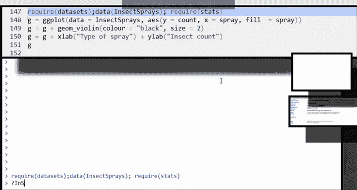

如果我们包含了无党派人士的回归变量而省略了共和党人的，那么截距将代表共和党人，民主党系数将代表民主党 vs 共和党，无党派系数将代表无党派 vs 共和党。

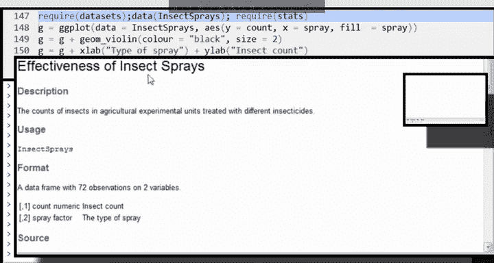

R语言会自动为你处理这一点。如果你将一个变量作为因子值包含，它会自动选择其中一个水平作为参考水平。主要观点是：**在处理因子变量和线性模型时，你设定的参考水平对系数的解释方式有很大影响。**

---

## R语言实战示例

现在，让我们通过一个R语言示例来观察因子变量以及R是如何处理它的。

首先，我们需要加载必要的包和数据。

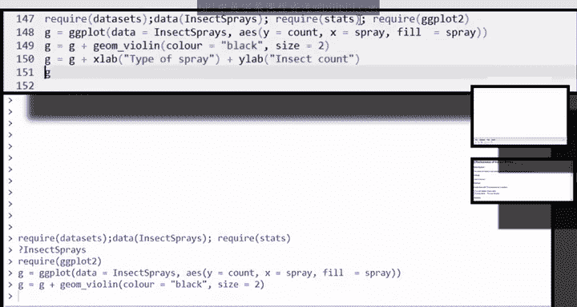

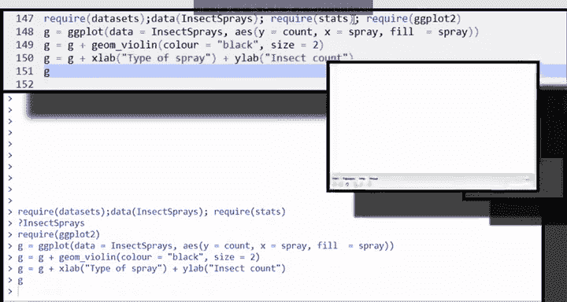

```r
# 加载所需包和数据
require(datasets)
data(InsectSprays)
require(ggplot2)
```

这个数据集（`InsectSprays`）的结果变量是计数（`count`，推测是施用喷雾后存活的昆虫数量），预测因子是喷雾类型（`spray`，因子变量）。

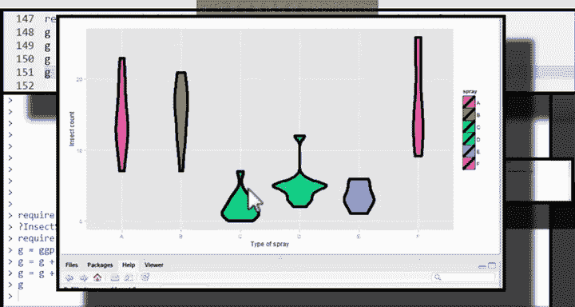

让我们先可视化数据。

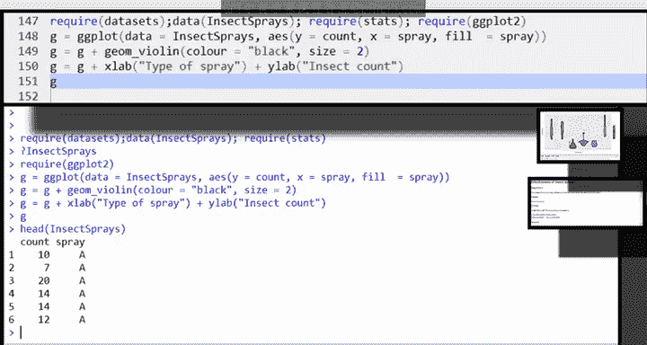

```r
# 创建小提琴图观察数据分布
g <- ggplot(data = InsectSprays, aes(y = count, x = spray, fill = spray))
g <- g + geom_violin()
g <- g + xlab("Spray Type") + ylab("Insect Count")
print(g)
```

小提琴图显示了六种喷雾（A到F）各自的昆虫计数分布。例如，喷雾A的计数似乎最高，喷雾C最低。

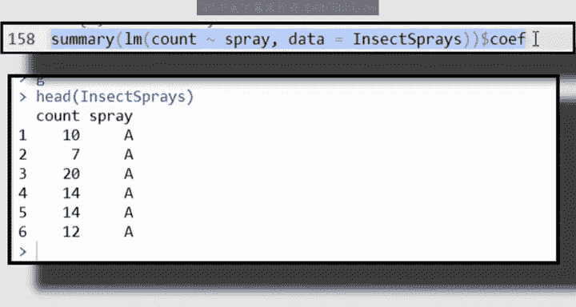

---

### 拟合包含因子变量的线性模型

接下来，我们拟合一个以`count`为结果变量、`spray`为预测因子的线性模型。

```r
# 拟合线性模型
fit <- lm(count ~ spray, data = InsectSprays)
summary(fit)$coefficients
```

查看系数表，你会发现截距（`(Intercept)`）以及`sprayB`、`sprayC`、`sprayD`、`sprayE`、`sprayF`的系数，但`sprayA` conspicuously missing（ conspicuously missing）。

这里的逻辑是，所有系数现在都是与喷雾A（参考水平）的比较。
*   **截距 (14.500)** 是喷雾A的估计均值。
*   **sprayB (0.833)** 是喷雾B与喷雾A的均值差。
*   **sprayC (-12.417)** 是喷雾C与喷雾A的均值差（负值表示更低）。

如果你想比较喷雾B和喷雾C，你需要计算 `(Intercept + sprayB)` 与 `(Intercept + sprayC)` 的差，或者直接计算 `sprayB - sprayC` 的系数差（但标准误需要额外计算）。

---

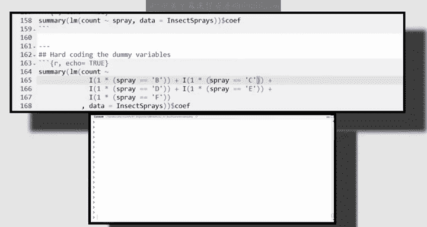

### 手动创建虚拟变量

为了展示R在幕后做了什么，我们可以手动创建虚拟变量来硬编码相同的模型。

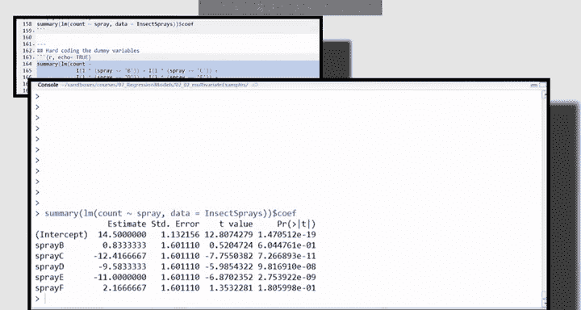

```r
# 手动创建虚拟变量，以A为参考水平
hardcoded_fit <- lm(count ~
                     I(spray == 'B') + I(spray == 'C') +
                     I(spray == 'D') + I(spray == 'E') +
                     I(spray == 'F'),
                   data = InsectSprays)
summary(hardcoded_fit)$coefficients
```

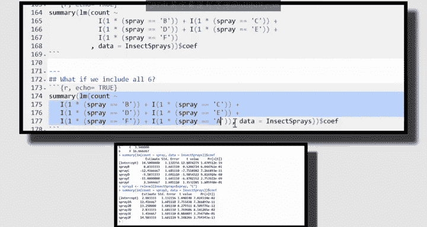

这个模型的结果与让R自动处理因子变量时完全相同。我们创建了当喷雾为B、C、D、E、F时为1，否则为0的变量，从而强制A成为参考水平。

---

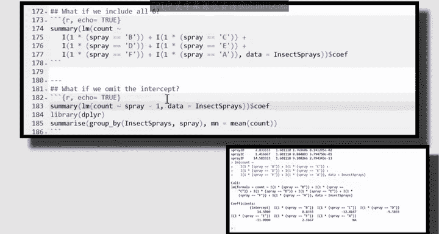

### 错误示范：包含冗余变量

如果我们错误地包含了所有水平的变量（包括参考水平A），会发生什么？

```r
# 错误：包含所有水平，导致冗余
wrong_fit <- lm(count ~ I(spray == 'A') + I(spray == 'B') +
                  I(spray == 'C') + I(spray == 'D') +
                  I(spray == 'E') + I(spray == 'F'),
                data = InsectSprays)
summary(wrong_fit)$coefficients
```

你会看到`I(spray == "A")TRUE`系数旁边出现`NA`。这是因为模型有6个均值需要估计，但我们试图用7个参数（截距+6个虚拟变量）来拟合，这导致了完全共线性，R会自动丢弃其中一个冗余变量。

---

### 无截距模型：获取各水平均值

如果我们希望系数直接代表每个组的均值，而不是与参考水平的差值，可以拟合一个无截距模型。

```r
# 无截距模型，系数为各水平均值
no_int_fit <- lm(count ~ spray - 1, data = InsectSprays)
summary(no_int_fit)$coefficients
```

现在，你会得到`sprayA`、`sprayB`...`sprayF`的系数，它们分别等于各喷雾组在数据中的实际均值（例如，`sprayA`的系数14.5就是A组的均值）。

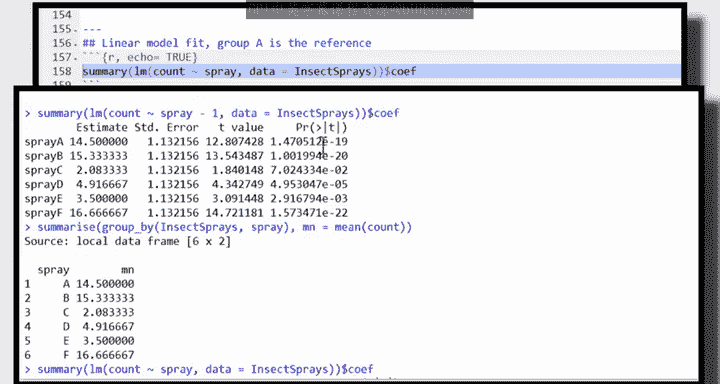

**重要提示**：这个模型与包含截距的模型在数学上是等价的，只是系数的解释不同。在无截距模型中，每个系数都是该组均值的检验（是否等于0）。而在有截距模型中，截距检验参考水平均值是否为0，其他系数检验该水平与参考水平的差异。**通常，我们更关心组间比较，因此R默认包含截距并设置参考水平。**

---

### 更改参考水平

如果我们希望以喷雾C作为参考水平，可以使用`relevel`函数。

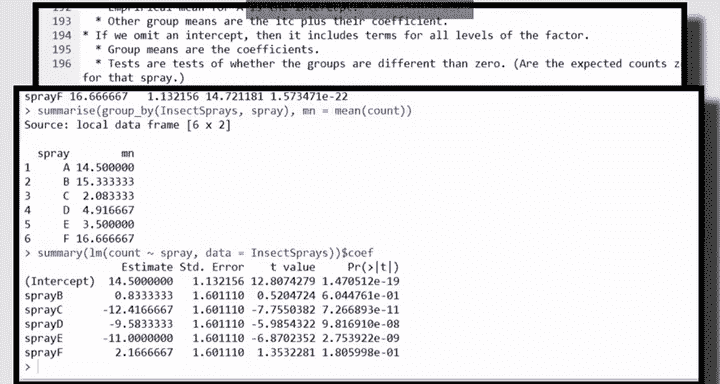

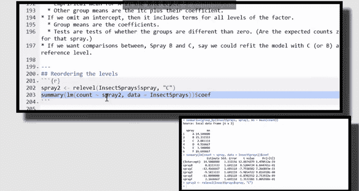

```r
# 更改参考水平为C
InsectSprays$spray2 <- relevel(InsectSprays$spray, ref = "C")
ref_c_fit <- lm(count ~ spray2, data = InsectSprays)
summary(ref_c_fit)$coefficients
```

现在，系数表显示截距（2.083）是喷雾C的均值。`spray2A`的系数（12.417）是喷雾A与喷雾C的均值差，`spray2B`的系数（13.250）是喷雾B与喷雾C的均值差。P值也相应地检验这些差异。

---

## 核心要点总结

本节课中我们一起学习了在线性回归中处理因子变量的关键点：

1.  **默认行为**：在R中，当在`lm()`公式中包含一个因子变量时，R会自动包含一个截距，并将因子的第一个水平（按字母或数字顺序）设置为**参考水平**。截距代表参考水平的均值，其他系数代表各水平与参考水平的均值差。
2.  **系数解释**：`sprayB`的系数不是喷雾B的均值，而是`均值(B) - 均值(A)`。要得到B的均值，需计算`截距 + sprayB系数`。
3.  **假设检验**：在默认模型中，对`sprayB`系数的T检验，检验的是“喷雾B的均值是否与喷雾A的均值不同”。
4.  **无截距模型**：使用 `- 1` 可以拟合无截距模型，此时每个系数直接代表对应因子水平的均值。但此时的假设检验变为“该水平均值是否等于0”，这通常不是我们关心的。
5.  **更改参考水平**：使用`relevel()`函数可以方便地更改参考水平，从而改变所有系数的比较基准和解释。
6.  **避免冗余**：手动创建虚拟变量时，务必为`k`个水平只创建`k-1`个变量，并省略参考水平对应的变量。

---

## 关于本示例的注意事项

需要指出的是，这里展示的数据分析并非一个完整的分析。将计数数据当作正态分布来建模可能存在问题，因为计数数据有下限（≥0）。更自然的做法可能是将其建模为泊松分布或过度离散泊松分布（这将在广义线性模型部分涉及）。

此外，方差显然不是恒定的（即异方差性）。我们的均值估计可能是正确的，但基于正态和同方差假设的推断（如P值和置信区间）很可能不准确。处理这类问题需要更高级的方法，我们将在课程后续部分或更高级的统计推断课程中讨论。

---

**总结**：线性回归模型通过使用虚拟变量，可以灵活地纳入和分析分类预测因子。理解如何设置和解释参考水平，是正确解读模型结果、进行有效组间比较的关键。R语言提供了便捷的工具来自动化或手动控制这一过程。