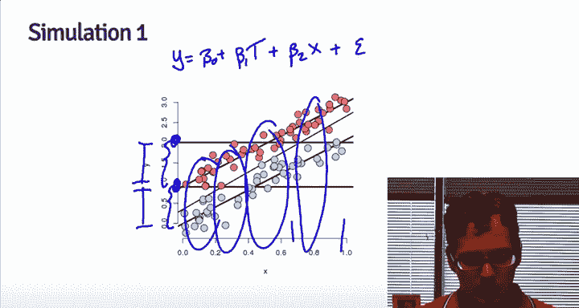
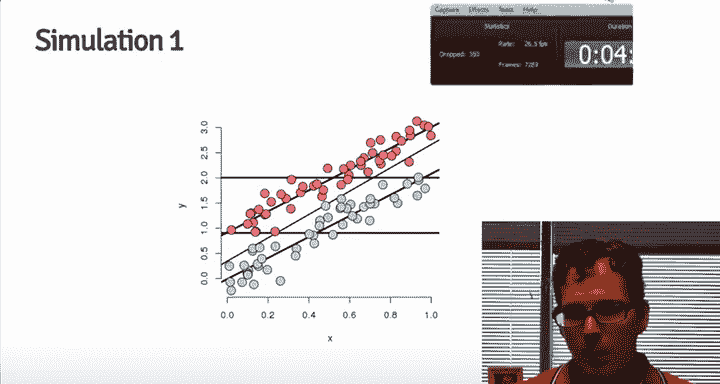
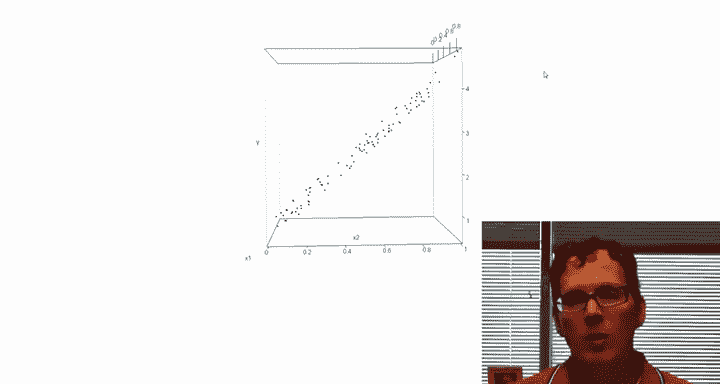
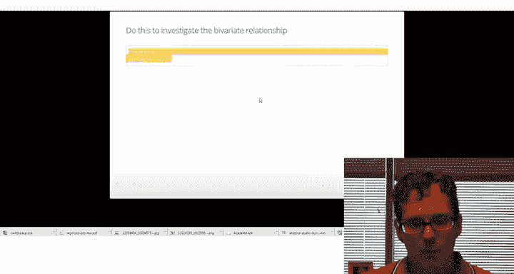

# 课程 P67：多元回归中的变量调整示例 📊

在本节课中，我们将通过一系列示例，探讨在回归模型中调整一个变量如何影响我们观察到的另一个变量与结果之间的**表观关系**。我们将看到，调整变量可以导致效应估计值发生显著变化，甚至完全逆转。

---

## 模拟数据与代码概述

在开始具体示例前，我们使用R代码模拟了本课所需的数据并生成图表。后续将不再展示代码细节，但所有代码均可在R Markdown文档中找到。

---

## 示例一：调整前后效应一致

上一节我们概述了课程目标，本节中我们来看看第一个模拟场景。这是一个相对直接的情况。

图中水平线显示了**组别状态**（例如处理组与对照组）的**边际效应**，即不考虑变量X时的效应。例如，若Y代表血压，红线均值代表处理组，蓝线均值代表对照组。

同时，数据中结果变量Y与回归变量X之间存在清晰的线性关系。我们可以拟合如下模型：

`y = β₀ + β₁ * Treatment + β₂ * x + ε`

该模型会拟合出两条**平行线**。其中，**β₁** 代表两组之间**截距的变化**（即处理效应），而 **β₂** 是两组**共同的斜率**。

在这个例子中，不考虑X的边际效应与在线性模型中纳入X后得到的截距变化（β₁）大致相同。

以下是关于此示例的另一点说明：
*   对于X的任意给定值，我们都有大量红点和蓝点可以直接比较两组。例如，若将X按区间分组，在每个区间内我们都能直接比较处理组和对照组的结果。这类似于一个设计良好的随机化实验，其中处理组和对照组的X值分布相似。

---

## 示例二：调整后效应消失（无重叠）

现在，让我们尝试一个会产生巨大差异的场景。

同样，水平线显示了忽略X时，红色处理组与蓝色对照组之间的边际差异，这个差异看起来很大。

然而，如果我们拟合包含X的模型并观察截距的变化，会发现差异变得极小，甚至不存在。

因此，这是一个当我们**考虑X后，巨大的处理效应变为零**的案例。

关于此数据集还需注意：
*   X值在某种程度上几乎能完美预测你属于哪一组（例如，X值小为蓝组，X值大为红组）。这与随机化实验的理想情况相反。在随机化中，很难根据X值预测处理分配。
*   我们**没有任何重叠的X值**来直接比较两组。对于任何特定的X值，我们无法直接比较红组和蓝组。这意味着我们严重依赖模型的假设来比较两组，这是一个不理想的设置。

这种现象可能出现在观察性数据分析中。例如，处理（是否服用降压药）可能与X（胆固醇水平）高度相关，而X本身又影响结果（血压）。调整X实际上是在调整导致接受处理的因素，这使得因果推断变得复杂。

---

## 示例三：辛普森悖论（效应符号反转）

这是一个存在部分重叠的案例。

观察边际均值：红线（处理组）的边际均值高于蓝线（对照组），忽略X时似乎存在显著的正向处理效应。

然而，当我们拟合模型并观察截距变化时，情况发生了逆转：调整X后，蓝组（对照组）的截距反而高于红组（处理组）。调整后的估计值显著，且符号与未调整的估计值**完全相反**。

这种现象常被称为**辛普森悖论**。它描述的是：一个变量与结果的关系，在纳入另一个变量进行调整后发生了逆转。但从数据图示来看，这并不奇怪，也并非真正的“悖论”。

---

## 示例四：从无效应变为有效应

在这个例子中，情况又有所不同。

忽略X时，两组之间基本没有边际效应。

然而，当我们调整X后，却观察到了一个巨大的效应。

这展示了另一种可能性：我们从**不显著**的效应，通过调整X，得到了一个**显著**的效应。

由此可见，调整变量可能带来的结果变化没有固定规则。效应可能从显著变为不显著，保持显著，保持不显著，或者符号反转，**所有排列组合都可能发生**。

---

## 示例五：存在交互作用的情况

这是最后一个此类示例，它考虑了一种更复杂的情况。

如果我们假设两组斜率相同并拟合平行线模型，显然会得到错误结论，因为图中的红蓝两组线**斜率明显不同**。

我们可以拟合一个包含交互项的模型：
`y = β₀ + β₁ * Treatment + β₂ * x + β₃ * (Treatment * x) + ε`
这个模型会拟合出两条具有**不同截距和不同斜率**的线。

对于此数据，**不存在一个统一的“处理效应”**。如图所示，在X值较低的区域，蓝组结果高于红组；在X值较高的区域，红组结果高于蓝组。处理效应**依赖于X的水平**。

因此，一个重要结论是：**如果你的模型中包含了交互项，那么回归输出中单独的处理项系数（β₁）本身不能再被解释为统一的处理效应**。这个例子展示了当存在**效应修饰**（或交互作用）时，调整会如何彻底改变对效应的理解。

---

## 从二元变量到连续变量

以上讨论并不局限于二元处理变量和连续X变量的情况。为了说明这一点，我们考虑一个场景：结果变量Y，以及两个连续变量X1和X2（X2用颜色深浅表示）。

在二维散点图（Y vs X1）中，Y和X1似乎没有明显关系。

然而，当我们从三维空间观察（Y, X1, X2），或者更实际地，观察**残差图**时，关系就显现了。

以下是具体方法：
1.  首先，分别从Y和X1中**移除X2的线性影响**，得到它们的残差。
2.  然后，绘制Y的残差与X1的残差之间的关系图。
3.  在这个残差图中，我们可以清晰地看到，在排除X2的影响后，Y和X1之间存在着强烈的剩余关系。

这个连续变量的例子旨在表明，所有在二元情况下出现的现象——效应反转、变大、变小、从显著到不显著（或反之）——在**多个连续回归变量**的场景中同样可能发生。二元情况只是更容易可视化而已。

---

## 模型选择与专业考量

最后，我们需要思考一个关键问题：当不同模型（调整X与否）给出不同结果时，**哪个模型是正确的？**

答案并非来自统计本身，而必须结合**具体的学科知识、临床或科学专业知识**。在模型构建过程中，需要反复与领域专家沟通。

例如，如果模型中同时包含收缩压和舒张压，由于两者高度相关，调整其中一个会使另一个的效应减弱，但这可能并无实际科学意义。我们需要判断调整某个变量在专业上是否合理。

因此，要获得可解释的系数和合理的结论，没有捷径可走。这需要一个团队协作的过程，融合**科学专业知识、统计知识和计算技能**。如果不同的调整策略导致系数发生重大变化，那么就需要团队共同讨论、评估每个模型的利弊。

至于**自动化模型选择**（更多在机器学习课程中讨论），它更适合于在损失函数下获得良好的预测效果，而非直接获取可解释的系数。对于以解释为目的的模型构建，亲手进行细致的、基于专业知识的分析是不可替代的。

---

## 总结

本节课中，我们一起学习了多元回归中**变量调整**如何影响效应估计。我们通过多个模拟示例看到：
*   调整一个变量可以使处理效应**变大、变小、消失、出现，甚至符号反转**（辛普森悖论）。
*   当处理变量与调整变量**高度相关**或数据**缺乏重叠**时，调整的影响尤为显著。
*   存在**交互作用**时，处理效应不再是单一值，而是依赖于其他变量的水平。
*   这些现象在**连续变量**间同样存在，可通过分析残差来探查。
*   最终，**选择正确的调整变量需要结合专业领域知识**，不能仅仅依赖统计指标。