# 课程30：模型选择 第1部分 🔍

在本节课中，我们将要学习在回归分析背景下，当模型包含多个变量时，如何进行模型拟合。我们将重点讨论模型选择的基本原则，以及包含或遗漏变量对模型结果的影响。

---

上一节我们介绍了多变量回归的背景，本节中我们来看看回归分析与预测建模在目标上的关键区别。

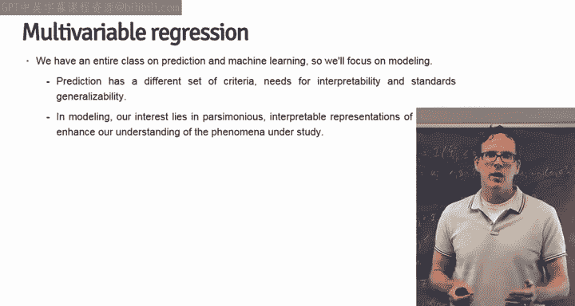

在预测建模中，我们通常不太关心模型的可解释性，因此更能容忍复杂的模型、大量的交互项，以及使用自动化搜索算法来针对特定损失函数寻找最佳预测模型。

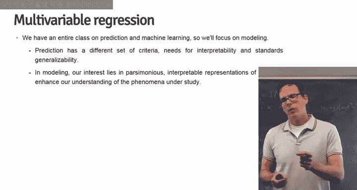

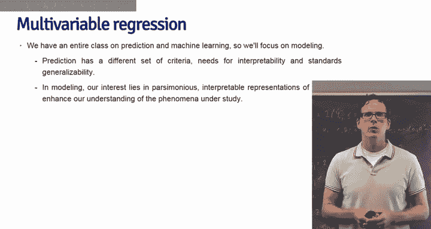

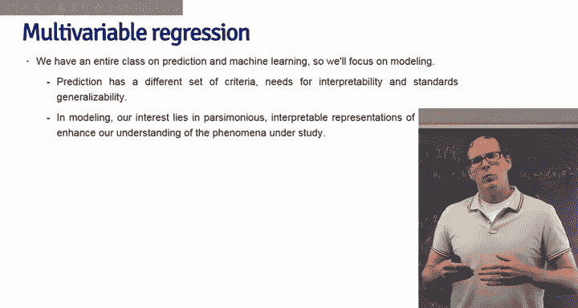

相比之下，在许多回归分析的应用场景中，我们更希望得到简单、可解释的模型。这意味着我们将高度重视**简约性**原则，即寻找能够解释我们所观察现象的最简单模型。这个原则类似于奥卡姆剃刀定律：在其他条件相同的情况下，最简单的解决方案很可能是正确的。在这里，我们同样倾向于选择简单的模型而非复杂的模型。

这一原则具有广泛的影响。例如，如果一个回归模型中的某个变量只能解释极少量的额外变异，但严重损害了模型的可解释性，我们通常会选择省略这个变量，即使它确实能解释一小部分正面的变异性。

---

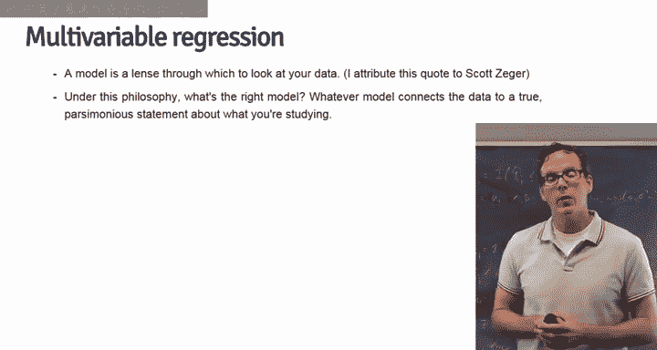

接下来，我们引入Scott Zeger的一个观点，这有助于我们思考模型的意义。

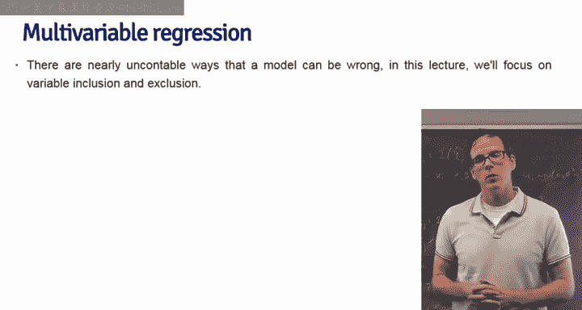

他喜欢将模型视为观察数据的**透镜**。从这个角度看，模型本身没有对错之分。任何能让你从数据中学到有价值且真实信息的模型，就是“正确”的模型。透镜的比喻意味着，有时你需要显微镜来观察超精细的细节，有时则需要望远镜来获取宏观层面的信息。模型也是如此，合适的模型能突出正确的特征，揭示真实的信息。这是一种非常有用的思考模型的方式。

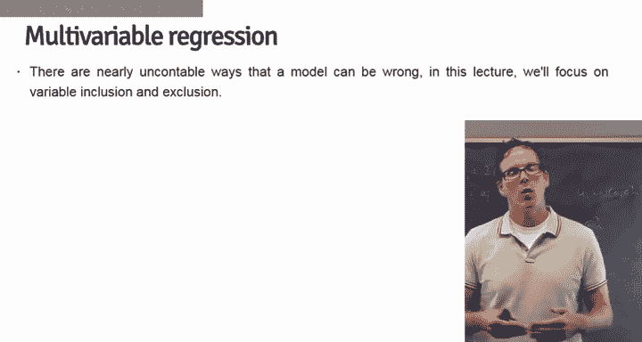

---

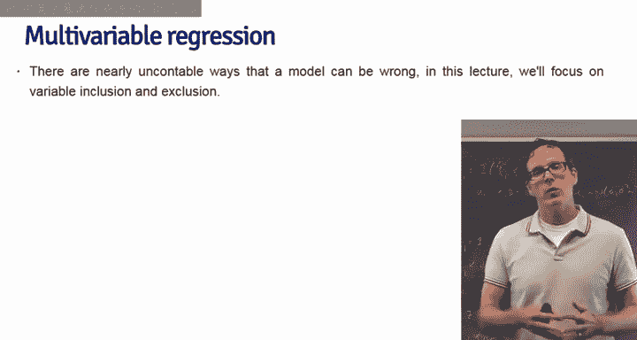

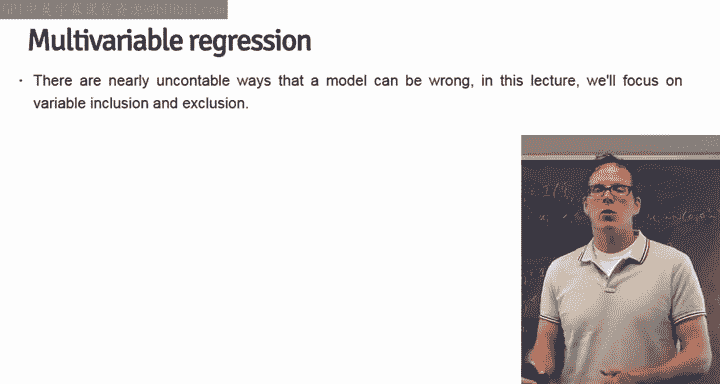

当我们关注特定实例，例如一个治疗效果的群体平均效应时，情况会有所不同。此时，模型可能存在无数种出错的方式，并误导我们。例如，可能导致我们得出存在治疗效果的结论而实际上没有，或者相反。

在本节课程中，我们将探讨当模型中包含不必要的回归变量，或遗漏了重要的回归变量时，会发生什么。

---

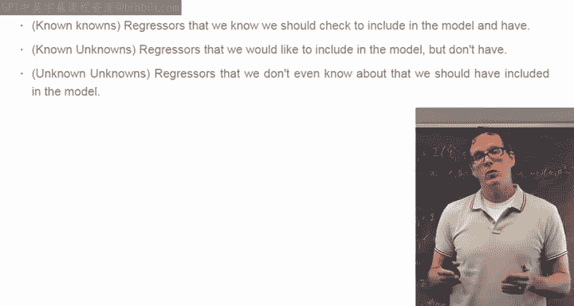

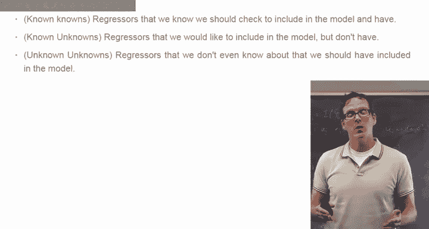

为了更系统地理解变量选择问题，我们引用唐纳德·拉姆斯菲尔德的一段话。这段话虽然曾受争议，但对于回归分析却非常贴切。

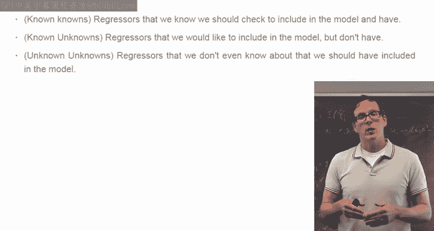

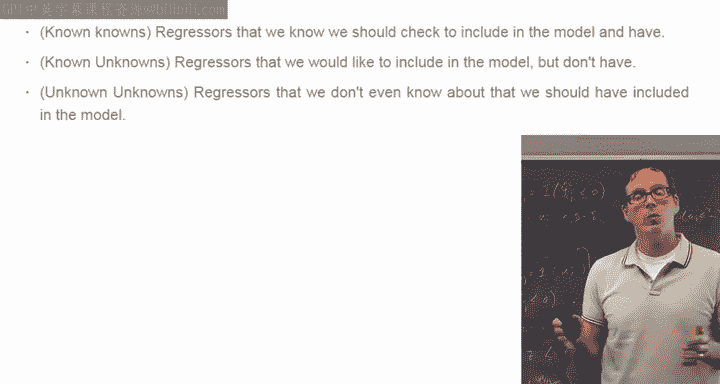

他将事物分为三类：
*   **已知的已知**：我们知道我们已知的事物。
*   **已知的未知**：我们知道我们未知的事物。
*   **未知的未知**：我们不知道我们未知的事物。

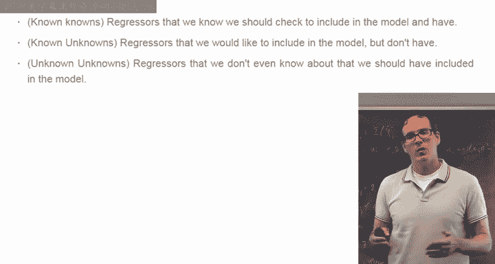

在回归的语境下：
*   **已知的已知**：是我们知道应该包含在模型中，并且已经记录下来的回归变量。我们只需将其放入模型。
*   **已知的未知**：是我们知道应该包含在模型中，但不幸没有收集到的变量。
*   **未知的未知**：是我们应该包含在模型中，但我们既没有收集到，也不知道它们是否重要的变量。

这个分类为我们构建回归模型时所需的思考路径提供了一个框架。

---

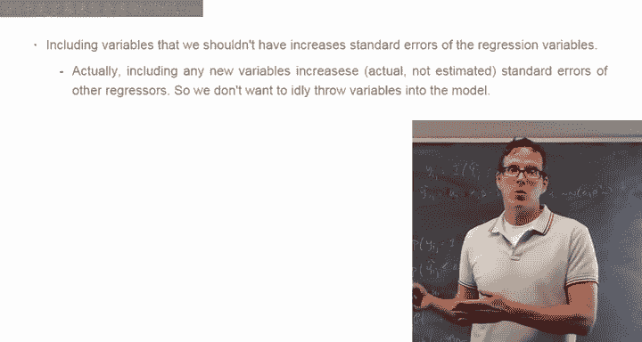

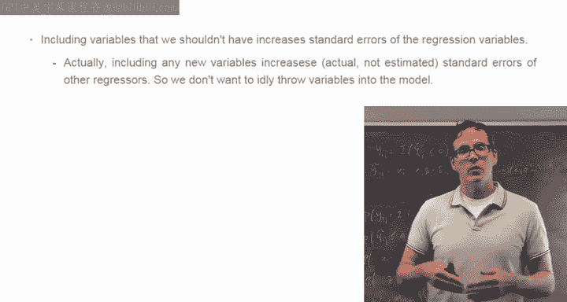

基于上述分类，我们来讨论一些处理这些变量的通用规则。

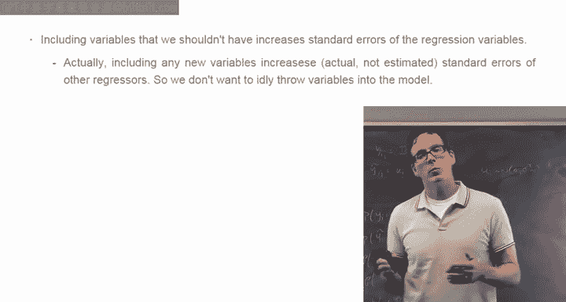

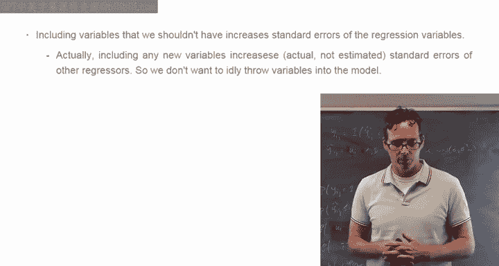

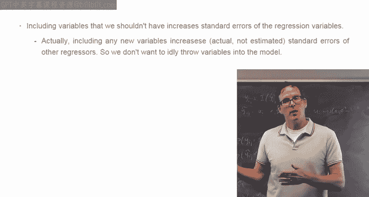

**首先，如果我们遗漏了一个本应包含的变量，通常会导致估计偏差。**
具体来说，如果你关注某个特定回归变量（如处理效应）的效应，但遗漏了一个与该变量相关的其他变量，那么你得到的估计值很可能是有偏的，无法准确反映你想要估计的真实效应。防止这种情况的一种方法是尝试进行**随机化**。如果你遗漏的变量与你感兴趣的变量不相关，那么通常无论你是否包含它，都不会有太大影响。这就是为什么A/B测试和临床试验如此强大。

但需要注意的是，如果存在太多混杂因素，即使随机化也可能无法完全解决问题。

**其次，包含不重要的变量又会如何？这一定是坏事吗？**
包含不必要的变量可以消除因遗漏变量而产生的偏差。如果你生成一堆与任何事物都无关的标准正态随机数并将其放入回归模型，它们不会引入偏差。然而，它们会**增大标准误**。向回归模型中引入不必要的变量会膨胀标准误，我们实际上可以量化这种膨胀的程度。

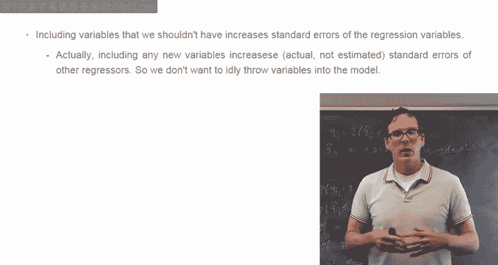

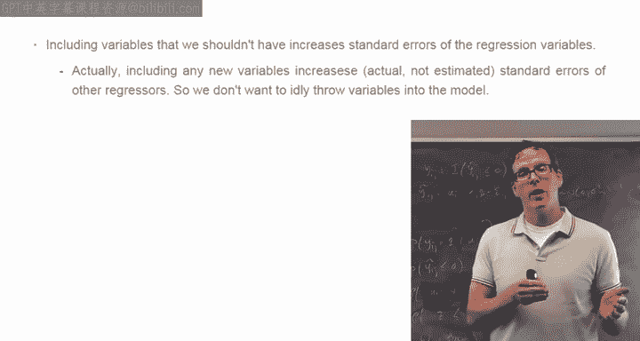

此外，像 **`R²`** 这样的模型评价指标，并不一定是判断包含不同回归变量的模型孰优孰劣的好方法。原因在于，随着你放入更多回归变量，**`R²`** 几乎总是会上升，无论这些变量是否有用。同样，残差平方和或均方误差在回归中随着加入更多回归变量也保证会下降。

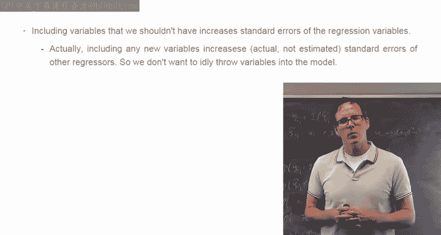

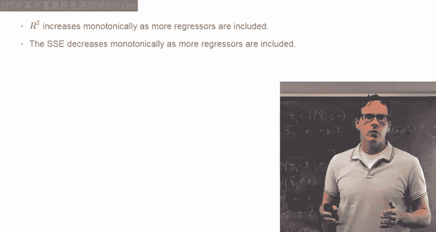

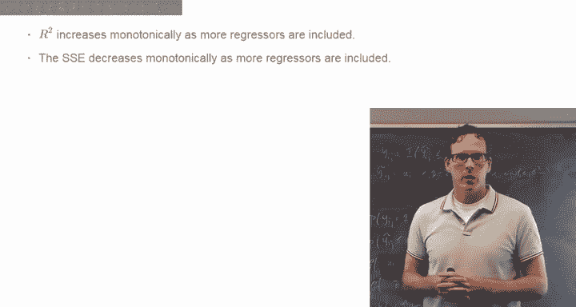

以下是一个示例：我模拟了一组数据，并不断增加回归变量的数量（这些变量只是生成的随机正态向量）放入模型。结果显示，**`R²`** 持续上升，尽管我放入的只是一堆随机噪声。

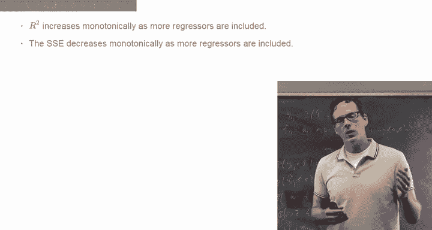

---

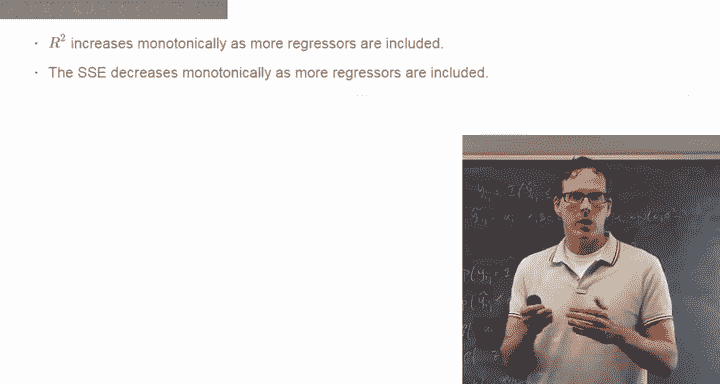

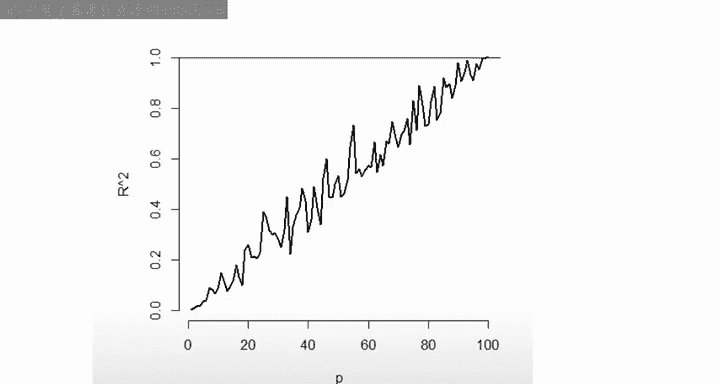

本节课中我们一起学习了多变量回归模型选择的基础。我们区分了回归分析与预测建模的目标差异，强调了简约性原则和模型作为“透镜”的视角。我们借助“已知的已知、已知的未知、未知的未知”框架，分析了遗漏重要变量会导致估计偏差，而包含无关变量则会增大标准误，并指出像 **`R²`** 这样的指标在模型比较中的局限性。理解这些原则是进行有效模型选择的第一步。