# 课程31：模型选择 第2部分 📊

在本节课中，我们将深入学习模型选择的第二部分，重点探讨在回归模型中包含不必要变量所带来的影响，即**方差膨胀**现象。我们还将介绍**方差膨胀因子**这一实用工具，并讨论模型选择的一般策略，包括嵌套模型检验。

---

## 方差膨胀：包含不必要变量的代价

上一节我们讨论了遗漏重要变量会导致估计偏差。本节中，我们来看看另一个现象：如果模型中包含了不重要的解释变量，则会导致所谓的**方差膨胀**。

我将通过一个模拟实验来演示这一点。

首先，我设定样本量为100，并进行1000次模拟。我定义了三个解释变量 `x1`、`x2`、`x3`，它们最初是三个独立的随机正态向量。

```r
n <- 100
sims <- 1000
x1 <- rnorm(n)
x2 <- rnorm(n)
x3 <- rnorm(n)
```

然后，我模拟生成结果变量 `Y`，它**仅**依赖于 `x1` 和随机误差，与 `x2`、`x3` 无关。

```r
# 真实模型：Y 仅依赖于 x1
Y <- 0.5 * x1 + rnorm(n, sd=0.1)
```

接着，我拟合三个模型：
1.  仅包含 `x1` 的模型。
2.  包含 `x1` 和 `x2` 的模型。
3.  包含 `x1` 和 `x3` 的模型。

我重复模拟多次，并观察 `x1` 系数估计值的标准差变化。之所以用模拟，是因为方差膨胀影响的是**真实**的标准误，而非模型估计出的标准误。当加入一个无关变量时，观测到的标准误不一定增大，因为方差是估计值，存在不确定性。

在 `x1`、`x2`、`x3` 相互独立的情况下，模拟结果如下：

```
模型1（仅x1）的标准误标准差：~0.031
模型2（x1, x2）的标准误标准差：~0.032
模型3（x1, x3）的标准误标准差：~0.032
```

可以看到，包含无关变量 `x2` 或 `x3` 后，`x1` 系数估计的变异性几乎没有增加。这是因为它们与 `x1` 不相关。

---

## 相关性导致的严重方差膨胀

现在，让我们看一个不同的情况。我重新生成 `x2` 和 `x3`，使它们高度依赖于 `x1`。

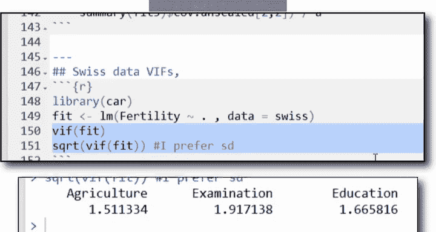

```r
x1 <- rnorm(n)
x2 <- x1 + rnorm(n, sd=0.1)  # x2 高度依赖 x1
x3 <- x1 + rnorm(n, sd=0.01) # x3 极度依赖 x1
```

重复上述模拟实验，结果发生了显著变化：

```
模型1（仅x1）的标准误标准差：~0.031
模型2（x1, x2）的标准误标准差：~0.15
模型3（x1, x3）的标准误标准差：~0.31
```

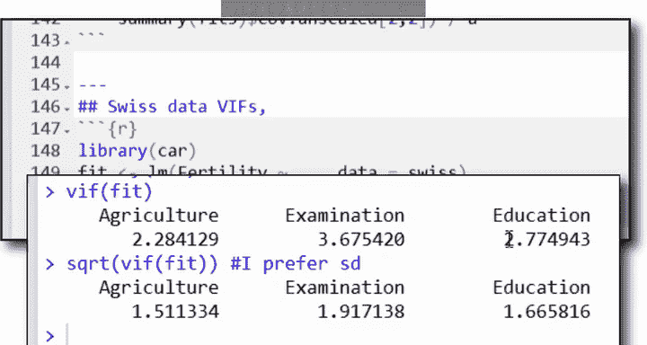

在第三个模型中，标准误膨胀了约10倍！这揭示了一个普遍规律：**如果你加入的变量与你关心的核心变量高度相关，那么方差膨胀会非常严重**。

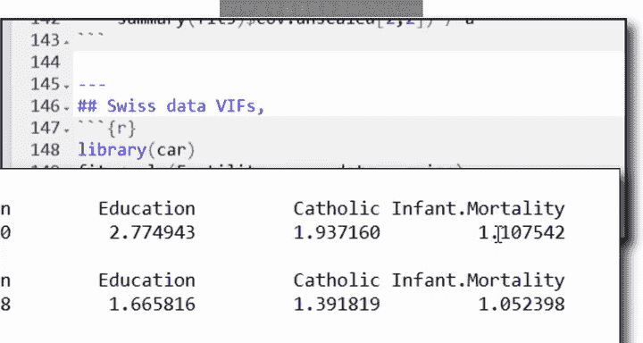

例如，如果在模型中已经包含了舒张压，又加入了高度相关的收缩压，那么舒张压系数的标准误会显著增大。另一个例子是同时包含身高和体重。如果这些变量是必须控制的，那么你只能接受增大的标准误；但如果是不必要的，则应避免加入。

**核心结论**：遗漏重要变量会导致**偏差**；包含不必要变量，尤其是与核心变量相关的变量，会导致**方差膨胀**。这也再次说明了随机化的重要性——它能平衡已知和未知的混杂因素，使处理效应与其他变量不相关，从而避免此类方差膨胀。

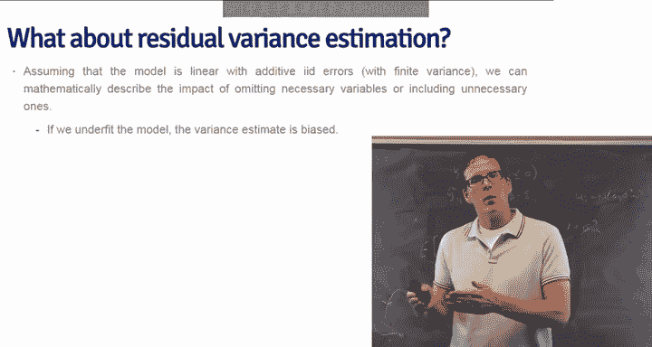

---

## 方差膨胀因子

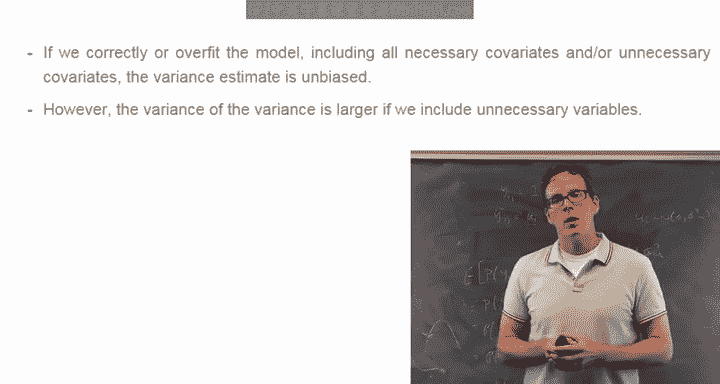

我们无法直接计算真实的方差膨胀量，因为它依赖于未知的真实残差方差 σ²。但是，我们可以比较方差的比例，这样 σ² 会被约掉，从而得到一个衡量标准误膨胀程度的指标，即**方差膨胀因子**。

方差膨胀因子的定义是：在当前模型设定下，某个变量系数的方差，与在所有其他变量都与该变量正交（不相关）的理想设定下的方差之比。

以下是使用瑞士生育率数据计算 VIF 的示例。首先需要加载 `car` 包。

```r
library(car)
# 拟合包含所有变量的模型
fit <- lm(Fertility ~ ., data = swiss)
# 计算方差膨胀因子
vif_values <- vif(fit)
print(vif_values)
```

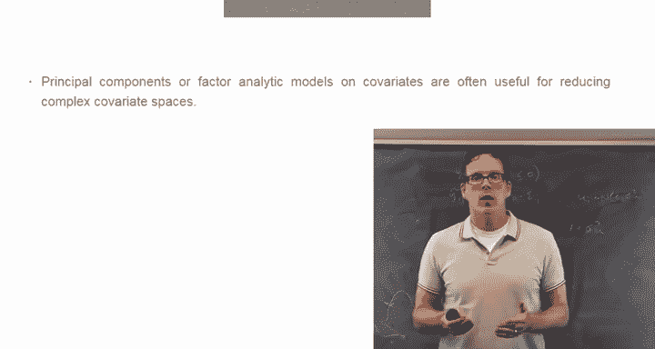

VIF 的结果解读如下。例如，`Agriculture` 的 VIF 约为 2，这意味着其系数的方差是理想正交情况下的 2 倍，标准误是理想情况的 `sqrt(2) ≈ 1.41` 倍。`Examination` 的 VIF 高达 3.67，说明其方差膨胀严重，这与它和 `Education` 高度相关的事实一致。而 `Infant.Mortality` 的 VIF 接近 1，表明它与其他变量基本不相关，因此没有明显的方差膨胀。

方差膨胀因子是一个非常实用的小工具，可以帮助你评估模型中是否存在不必要的共线性问题。

---

## 对残差方差估计的影响

到目前为止，我们讨论的都是包含或不包含变量对**回归系数**的影响。但回归模型中还有另一个重要参数：残差方差 σ² 的估计。

假设误差独立同分布且线性模型形式正确，那么：
*   **欠拟合**：如果遗漏了重要变量，方差估计是**有偏的**。因为本应由这些遗漏变量解释的系统性变异，被错误地归入了残差。
*   **正确拟合或过拟合**：如果模型包含了所有正确项，或者包含了不必要的变量，方差估计是**无偏的**。然而，如果包含了不必要的变量，方差估计值本身的**方差会增大**，即估计的可靠性下降。

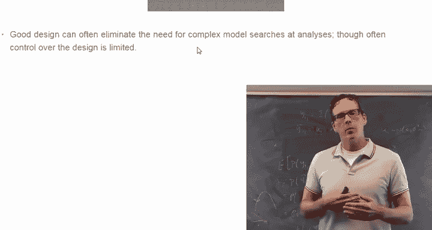

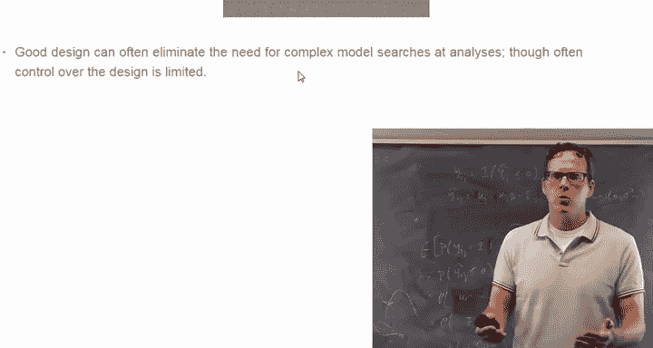

简而言之，对于方差估计，规则类似：遗漏变量导致**偏差**，包含不必要变量导致估计**不精确**。

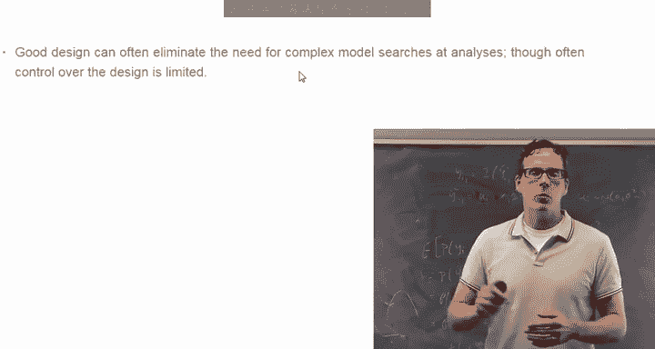

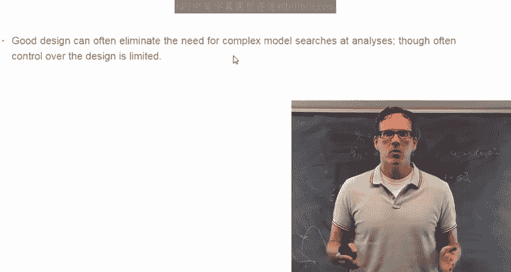

---

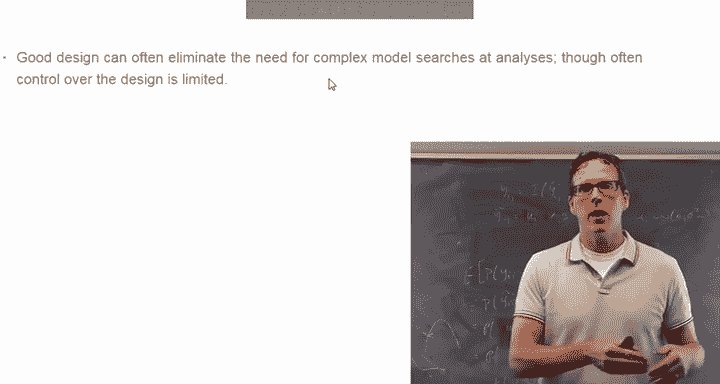

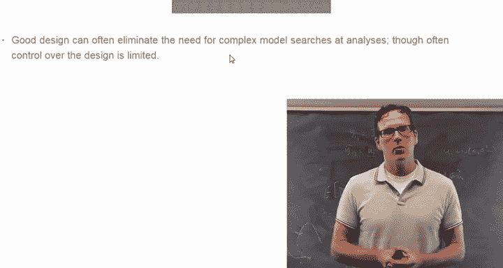

## 模型选择策略与嵌套模型

现在我们来谈谈一般的模型选择。自动化模型选择更多是机器学习领域的主题。对于线性回归，当变量很多并考虑交互项、多项式时，模型空间会爆炸式增长。此时可能需要主成分分析等降维技术，但这会牺牲可解释性。

**良好的实验设计**通常能减少模型选择的困扰。例如：
*   **随机化**：能平衡已知和未知的混杂因素。
*   **区组设计**：在农业试验中，将田地分成区块，在区块内随机分配处理。
*   **交叉设计**：在生物统计中常见，让每个受试者先后接受不同处理，以个体自身作为对照。

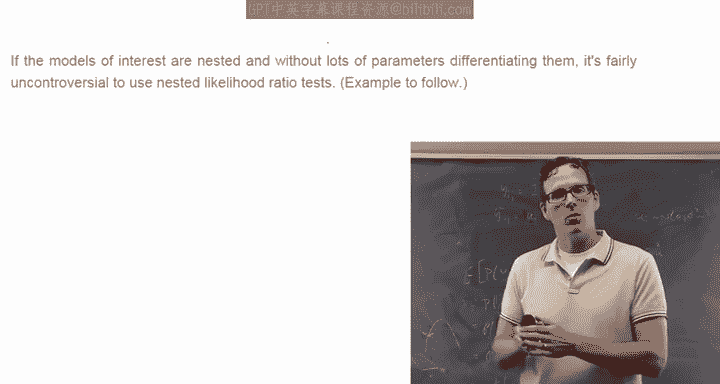

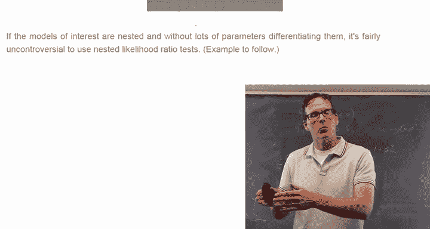

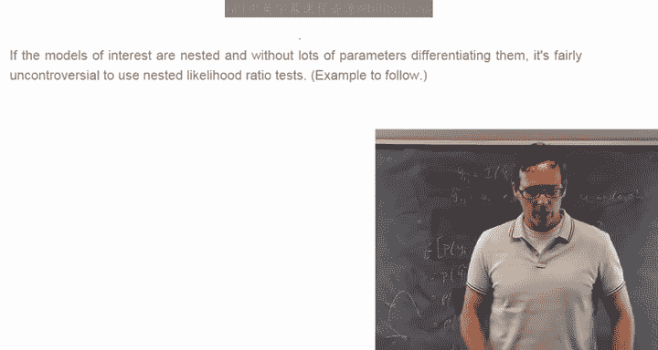

这些设计策略可以在数据收集阶段就控制很多混杂因素，简化后续的模型构建。

最后，介绍一种我常用且实用的自动化搜索技术：**嵌套模型检验**。当我特别关注某个核心变量（如处理效应），但担心处理组在其他变量上不平衡时，我会构建一系列嵌套模型。

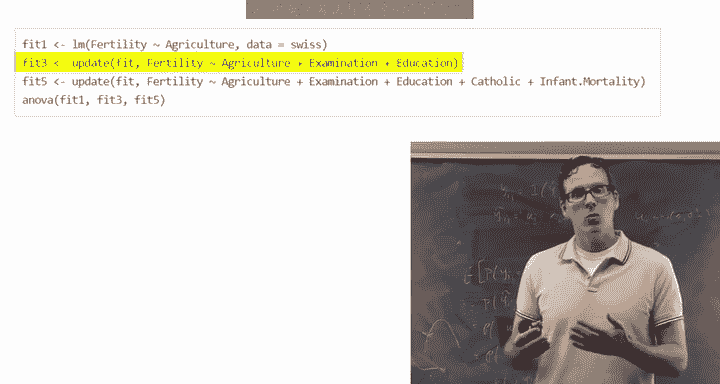

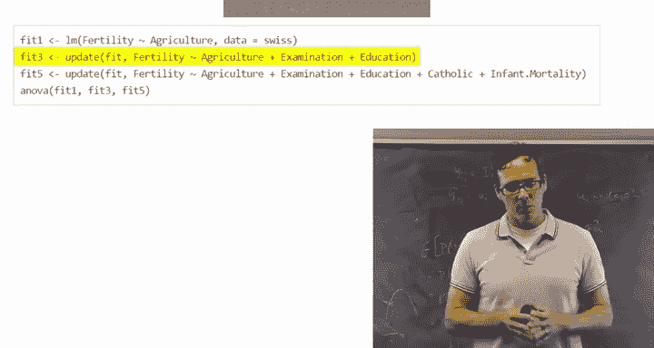

以下是使用瑞士数据演示嵌套模型检验的 R 代码：

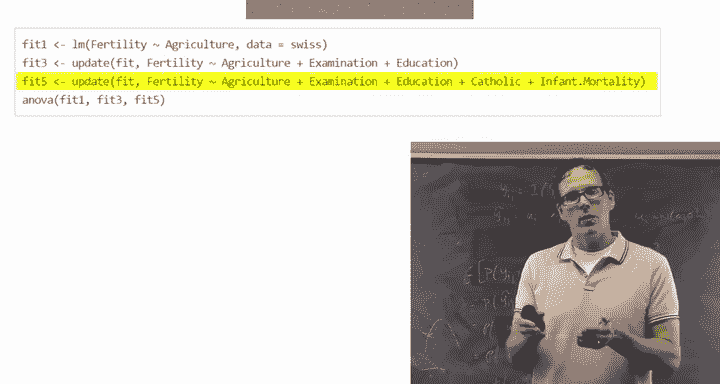

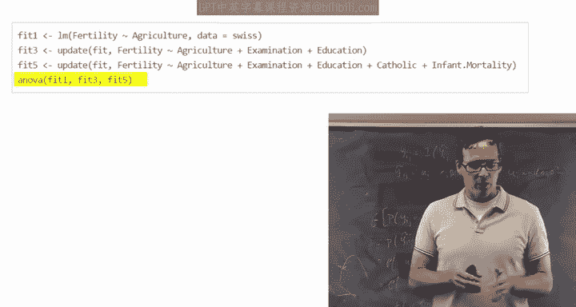

```r
# 拟合三个嵌套模型
fit1 <- lm(Fertility ~ Agriculture, data = swiss)
fit2 <- lm(Fertility ~ Agriculture + Examination + Education, data = swiss)
fit3 <- lm(Fertility ~ ., data = swiss) # 包含所有变量

# 使用 anova 进行嵌套模型比较
anova(fit1, fit2, fit3)
```

`anova` 函数会输出一系列检验结果，通过 F 检验判断逐步加入的变量集是否显著必要。例如，输出可能显示，在 `Agriculture` 基础上加入 `Examination` 和 `Education` 是必要的；进一步加入 `Catholic` 和 `Infant.Mortality` 也是必要的。

**嵌套模型检验的适用场景**：当你关心的分析路径自然形成一系列模型（每个模型都比前一个更复杂，且包含前一个模型的所有项）时，这种方法非常合理且易于解释。如果模型之间不是嵌套关系（例如一个模型包含 A 不含 B，另一个包含 B 不含 A），则需要使用信息准则等更复杂的自动化选择方法。

---

## 总结

在本节课中，我们一起学习了：
1.  **方差膨胀**：在回归模型中包含不必要变量，尤其是与核心变量相关的变量，会增大系数估计的标准误，降低估计精度。
2.  **方差膨胀因子**：一个用于量化这种膨胀程度的实用工具，VIF 值越大，说明共线性问题越严重。
3.  **对残差方差的影响**：遗漏变量会使方差估计有偏；包含不必要变量虽不会导致偏差，但会使方差估计本身更不稳定。
4.  **模型选择策略**：良好的实验设计（如随机化、区组、交叉设计）可以从源头减少模型选择的复杂度。
5.  **嵌套模型检验**：当分析围绕一个核心变量展开，并逐步控制其他变量时，这是一种直观且有效的模型比较方法。

最后，请记住统计学家乔治·博克斯的名言：“**所有模型都是错的，但有些是有用的。**” 我们的目标不是找到“完全正确”的模型，而是构建一个能帮助我们理解数据、揭示有用真相的透镜。

本节课到此结束，我们下节课再见！