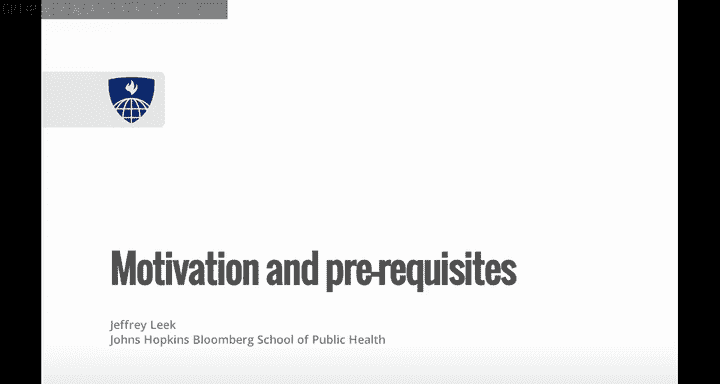
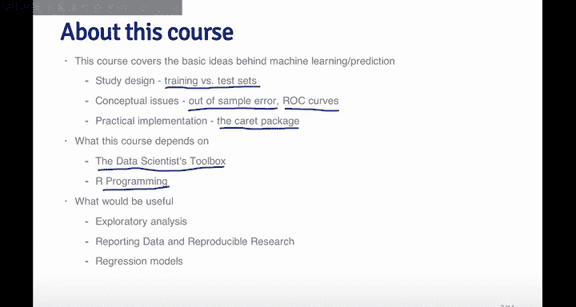
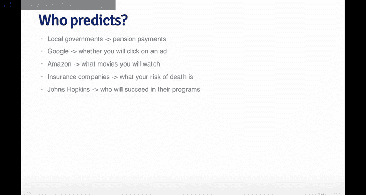
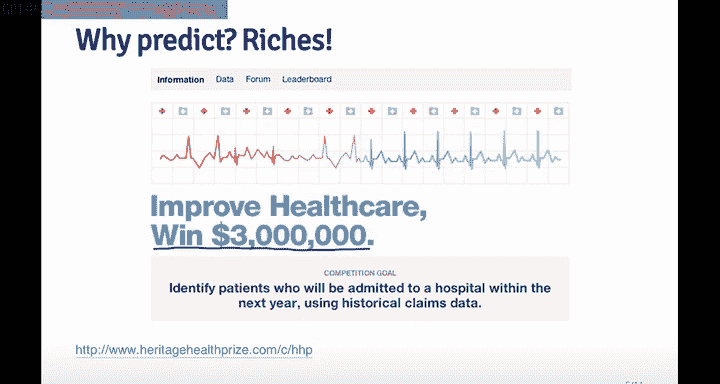
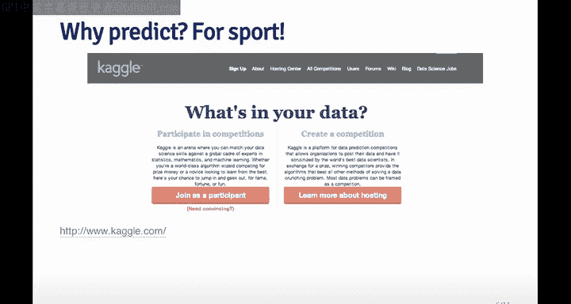
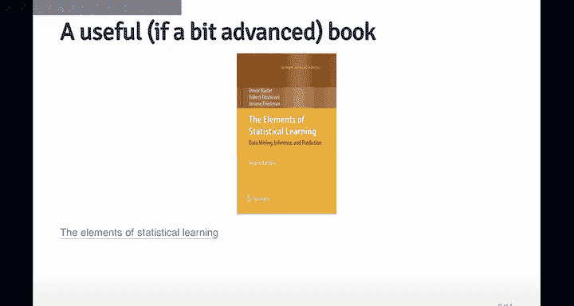
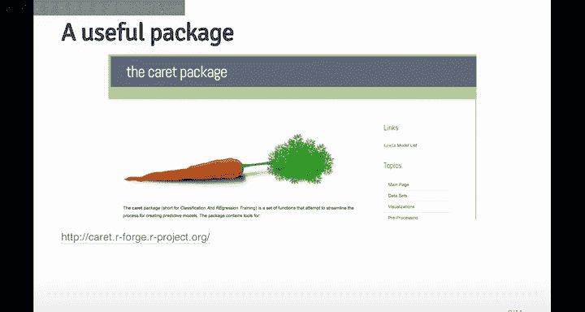
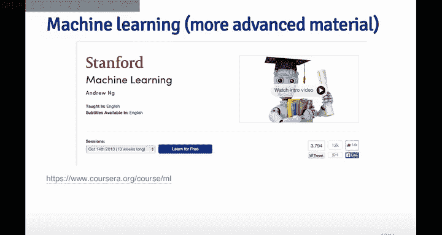
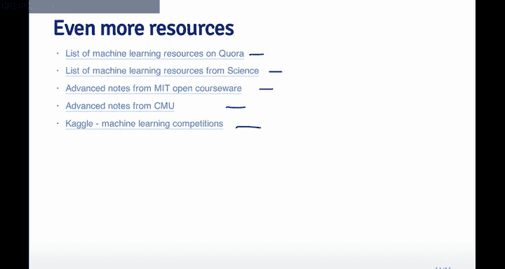

# 课程01：预测的动机 🎯

在本节课中，我们将要学习机器学习与预测的基本概念，了解预测在现实世界中的应用，并明确本课程的学习目标与预备知识。

## 概述

预测是数据科学的核心领域之一。本课程将涵盖机器学习与预测的基础理念，目标是提供实用且动手性强的学习体验。我们将介绍主流技术，并深入探讨在实际应用中实施机器学习时的具体细节与实际问题。

## 课程内容与目标

本课程将覆盖机器学习与预测的基本思想。我们的目标是通过实践来深入理解机器学习。

以下是本课程将涵盖的主要内容：
*   **主流技术**：例如线性回归和随机森林等许多人使用的技术。
*   **实践细节**：在实际案例中实施机器学习的具体细节和实际问题。
*   **研究设计**：例如训练集与测试集的划分，以及如何在真实数据中构建预测器。
*   **概念性问题**：例如样本外误差和过拟合。我们将讨论如何防止模型过度拟合噪声从而导致在新样本上预测不佳的问题。
*   **评估方法**：例如ROC曲线，用于评估预测器性能的方法。

我们将重点在R语言中实践这些机器学习算法并理解相关概念。我们将大量使用`caret`包，它为R中众多的机器学习包提供了一个统一的框架。

## 预备知识 📚

本课程相当依赖于你在《数据科学家工具箱》和《R语言程序开发》课程中学到的工具。如果你尚未学习这些课程，强烈建议你在学习本课程前先完成它们。

学习过《探索性数据分析》、《数据报告与可重复性研究》以及《回归模型》课程也会很有帮助。这些课程并非必需，但本课程的许多内容将与这些材料相关。提前了解这些内容会使你学习本课程时更轻松。

## 谁在进行预测？🤔

这是一个重要的问题，也是本课程的重要动机。如今，大多数组织都在以某种形式使用机器学习，无论是简单的还是复杂的。

以下是几个预测应用的例子：
*   **地方政府**：可能预测未来的养老金支付，以了解其财政收入机制是否足以覆盖这些支出。
*   **谷歌**：可能预测你是否会点击广告，从而只向你展示最可能获得点击的广告以增加收入。
*   **亚马逊和网飞**：这类公司会向你展示一部电影，并希望你购买下一部。为此，它们需要预测你可能感兴趣的电影，以保持你的观看兴趣并增加收入。
*   **保险公司**：雇佣大量的精算师和统计学家来预测你在各种情况下的风险（包括死亡），以确定设定保险费率的合适价格。
*   **约翰斯·霍普金斯大学**：我工作的地方，也会希望预测哪些申请者最有可能在项目中取得成功。

所有这些不同的预测任务由各种组织执行，并且复杂程度不同。预测你可能会点击哪个广告可能涉及大量预测变量和复杂的算法；而有些预测任务则可能简单得多。无论如何，预测已成为当今每个主要组织的重要组成部分。

## 为什么要进行预测？💡

进行预测的原因有很多。

首先是为了**荣誉**。上图是克里斯·芬德斯基，他是赢得网飞大奖赛的团队成员。网飞大奖赛是一项百万美元奖金，颁发给能够降低网飞在预测用户可能感兴趣的新电影时误差的团队。克里斯是一个大型组织的一员，该组织将多个团队的模型融合在一起，做出了最佳预测并赢得了奖金。赢得这类竞赛能带来极大的荣誉感。

其次是为了**经济利益**。不仅掌握预测技能可以在相关组织中获得高薪职位，预测竞赛本身也提供丰厚的奖金。例如，“传承健康奖”提供了300万美元奖金，奖励给能最佳预测谁将在一年内住院的团队。虽然无人赢得全额奖金，但参与者在中期奖项中赢得了不少钱。此外，许多人基于在竞赛中的表现创立了数据分析公司。

## 预测即运动 🏆

如今，数据科学，特别是预测，已经成为一种“运动”。Kaggle等组织主办众多竞赛，你可以尝试预测特定实验的结果或各种不同的事物。这些竞赛通常有固定的时间限制，并常常设有奖金。竞赛充满乐趣，设有排名和排行榜，你可以享受竞争的乐趣。

## 预测促进决策 🩺

预测也应用于改善医疗决策，这更接近我的研究领域。例如，Oncotype DX是一种预后基因表达特征，可用于预测患有乳腺癌的女性在特定条件下的生存期。这对于医生为乳腺癌患者制定治疗方案非常有用。

## 推荐资源

有一本我认为非常有用的书，叫做《统计学习基础》。虽然对这门课来说有点进阶，但其中的许多工具仍然极其有用。你可以在作者网站上免费获取PDF版本，但如果你真的喜欢这本书，我也鼓励你购买它。作者投入了大量心血，这是一本伟大的著作，包含了本课程将涉及的许多信息。

## 核心工具：`caret`包 ⚙️

本课程中将最常使用的包是`caret`包。它整合了R中构建的大量预测器，并允许你以一种统一的框架来设置训练集和测试集，从而避免构建预测模型时出现的许多问题。

## 进阶学习路径 🚀

如果你希望学习更进阶的材料，一个去处是Coursera上的机器学习课程。所谓进阶材料，是指你可能对算法背后的数学细节，或处于最前沿的高级机器学习算法感兴趣。我认为那门课程是你开始学习这类材料的绝佳起点。正如我所说，本课程将涵盖基础知识，重点带你从零基础到能够应用，使你能够在日常工作中使用机器学习工具，但未必涵盖机器学习算法的所有顶级细节。

## 丰富的学习资源

关于机器学习，实际上有海量的信息可供学习，这是当前非常热门的话题。我在这里列出了一些链接，指向Coursera、Science、MIT、CMU和Kaggle的信息，这些资源将以各种不同的方式为你提供大量关于如何进行机器学习的信息。如果本课程激发了你的兴趣，并让你对这些其他内容感到兴奋，那也将是非常棒的。

## 总结

本节课中，我们一起学习了预测在数据科学中的核心地位、本课程的目标与内容结构，以及预测在商业、医疗、竞赛等领域的广泛应用。我们还明确了学习本课程所需的预备知识，并介绍了`caret`这一核心工具及相关的进阶资源。接下来，我们将开始深入探讨构建预测模型的具体步骤。