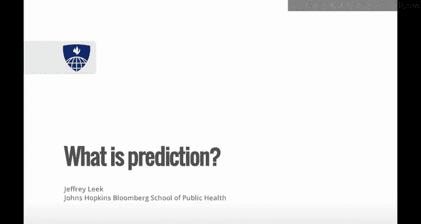
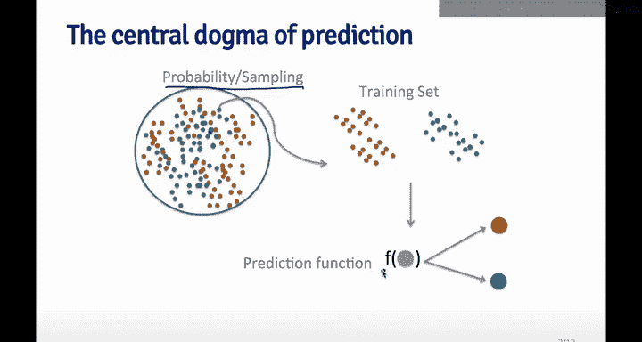
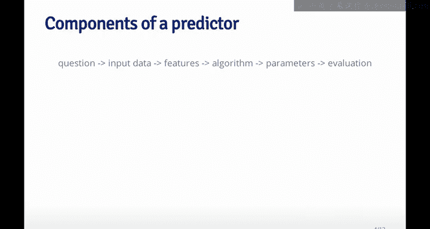
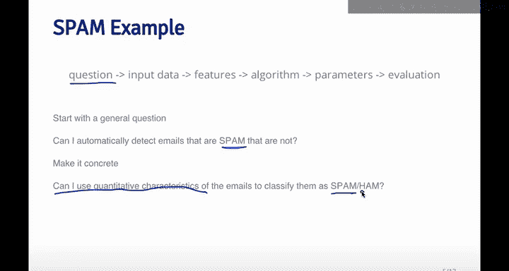
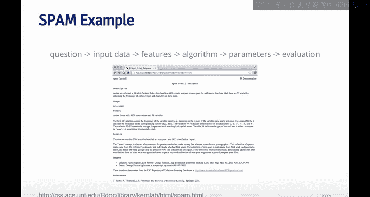
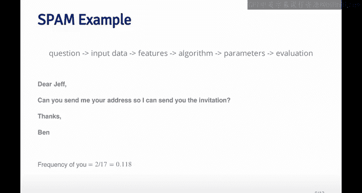
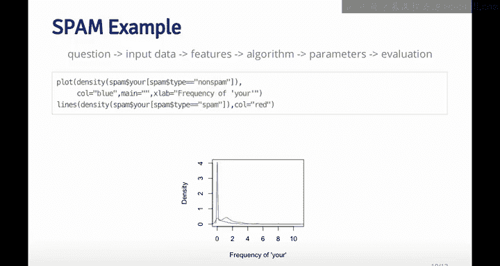
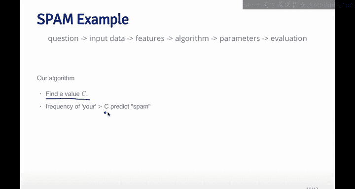
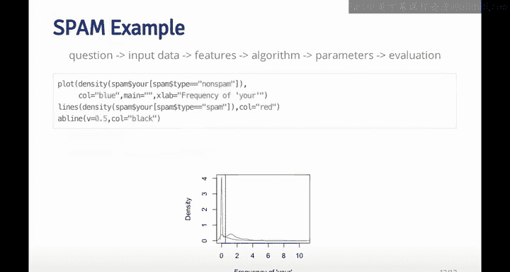
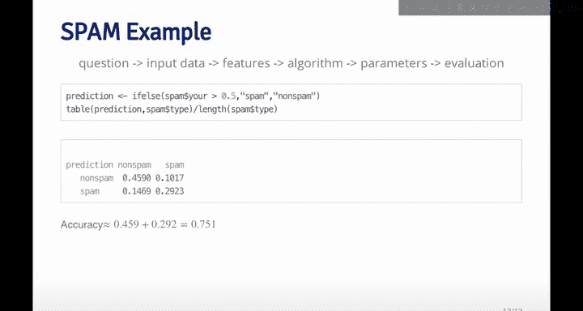

# 课程 P82：什么是预测？🤔

在本节课中，我们将学习预测问题的基本概念和构建预测器的完整流程。我们将通过一个简单的垃圾邮件分类示例，了解从定义问题到评估算法的每一步。

---

## 概述

机器学习领域的许多工作都聚焦于寻找最佳算法来提取信息并用于预测。然而，退一步审视整个预测问题同样重要。

上一节我们介绍了预测的整体框架，本节中我们来看看构建预测器的具体步骤和关键组件。

## 预测器的构建步骤 📊

以下是构建一个预测器的主要组成部分：

1.  **明确问题**
    你需要从一个非常具体、定义清晰的问题开始：你试图预测什么？你使用什么来预测？

2.  **收集数据**
    出去收集你能获得的最佳输入数据，用于进行预测。

3.  **特征工程**
    从数据中，你可以使用已测量的特征，也可以通过计算构建你认为对预测目标有用的特征。

4.  **应用算法**
    在此阶段，你可以开始使用你可能读过的机器学习算法，例如随机森林或决策树。

5.  **参数估计与评估**
    然后，你可以估计这些算法的参数，并使用这些参数将算法应用于新的数据集，最后在新数据上评估该算法。

## 一个关键但常被忽视的环节 🔍

我认为在构建机器学习算法时，一个非常重要但常被低估的环节是审视构建训练集和测试集的概率与抽样步骤。

这是构建每个机器学习算法都必需的组成部分，即决定你将使用哪些样本来构建该算法。但有时它会被忽视，因为你听到的关于机器学习的所有“动作”都发生在构建实际机器学习函数本身的时候。

一个非常著名的、说明这可能引发问题的例子是最近关于谷歌流感趋势的讨论。谷歌流感趋势试图使用人们在谷歌上输入的搜索词来预测流感发病率。他们发现，其算法最初能非常准确地反映美国各地特定时间的流感病例数，且比政府方法更快、更便宜。

但他们当时没有意识到的问题是，人们使用的搜索词会随时间变化，这影响了算法性能。随着人们互联网使用习惯的改变，谷歌流感趋势算法最终产生了高度不准确的结果。这个例子表明，选择正确的数据并明确具体问题至关重要，正如数据科学专项课程中其他课程所强调的那样。

## 示例：垃圾邮件分类 📧

我将通过一个快速的小例子向你展示整个过程是如何运作的。这显然是真实机器学习算法的简化版本，但能让你体会其中的要点。

### 第一步：定义问题

你通常从一个相当笼统的问题开始。例如：**我能否自动检测出垃圾邮件和非垃圾邮件？**

垃圾邮件是指那些同时发送给成千上万人的、你可能不感兴趣的邮件。在进行机器学习时，你通常需要将问题具体化。

因此，问题可以具体为：**我能否使用这些邮件的量化特征，将其分类为垃圾邮件或“火腿”邮件（即人们希望收到的邮件）？**

### 第二步：获取输入数据

一旦有了问题，就需要找到输入数据。在本例中，R语言中实际上有一些可用的、已经预处理好的数据。它在`kernlab`包中，是垃圾邮件数据集。我们可以直接将数据加载到R中，它已经为我们收集了一些关于垃圾邮件和火腿邮件的信息。

但我们需要记住，这些数据可能并非完美。事实上，我们并没有收集到的所有邮件，也没有你个人收到的所有邮件。因此，在使用这些数据构建预测算法时，我们需要意识到其潜在的局限性。

### 第三步：计算特征

假设你有一堆邮件。以下是一封发送给我的示例邮件：
> Dear Jeff, can you send me the address so I can send you the invitation? Thanks, Ben.

如果我们想构建一个预测算法，我们需要计算这些邮件的一些特征，以便用于构建预测算法。

一个例子是，我们可以计算特定单词出现的频率。这里我们查找单词“you”出现的频率。在这封邮件中，它出现了两次。所以，17个单词中有2个是“you”，约占邮件单词数的11%。

我们可以为拥有的每一封邮件计算相同的百分比。现在，我们就有了一个可以尝试用于预测的量化特征。

`kernlab`包中的数据实际上就是这样的信息：对于每封邮件，我们都有某些单词出现的频率。例如，如果“credit”或“money”在邮件中频繁出现，你可能会认为那封邮件是垃圾邮件。

作为一个例子，我们查看了单词“your”在邮件中出现的频率。我在这里绘制了一个该数据的密度图。X轴是“your”在邮件中出现的频率，Y轴是该频率在邮件中出现的密度或次数。

你可以看到，大多数垃圾邮件（图中红色部分）往往有更多“your”的出现。而所有火腿邮件（我们真正希望收到的邮件）则在这里靠近零的位置有一个高得多的峰值。因此，含有大量“your”的火腿邮件非常少。

### 第四步：构建与评估算法

我们可以构建一个算法。在本例中，让我们构建一个非常简单的算法。我们可以估计一个算法，我们只想找到一个**截断值C**，其中如果“your”的频率高于C，则我们预测为垃圾邮件，否则预测为火腿邮件。

回到我们的数据，我们可以尝试找出最佳截断值。这里有一个你可以选择的截断值示例：选择0.5作为截断值。如果高于0.5，我们说是垃圾邮件；如果低于0.5，我们说是火腿邮件。

我们认为这可能有效，因为你可以看到蓝色火腿邮件的大峰值在该截断值以下，而垃圾邮件的一个大峰值在该截断值以上。因此，你可能会认为这将捕获相当一部分垃圾邮件。

然后我们对此进行评估。我们会为每封不同的邮件计算预测值。我们的预测规则是：如果“your”的频率高于0.5，则是垃圾邮件；如果低于，则是非垃圾邮件。

接着，我们制作这些预测的表格，并将其除以我们拥有的所有观测值的长度。我们可以说，当邮件是非垃圾邮件时，我们大约有46%的时候预测正确；当邮件是垃圾邮件时，我们大约有29%的时候预测正确。总计，我们大约有45% + 29% = 75%的时候预测正确。因此，我们的预测算法在这种情况下大约有75%的准确率。

这就是我们评估算法的方式。当然，这是在同一个我们计算预测函数的数据集上进行的。正如我们将在后续课程中看到的，这将是总体误差的一个乐观估计。

---

## 总结 🎯

本节课中我们一起学习了构建预测算法的基本步骤概述。我们从定义具体问题开始，经历了数据收集、特征工程、算法应用与参数估计，最后在新数据上评估算法性能。通过垃圾邮件分类的简单示例，我们看到了一个完整预测流程的实践，并认识到数据选择和问题定义在预测中的核心重要性。