# 课程 P84：样本内误差与样本外误差 📊

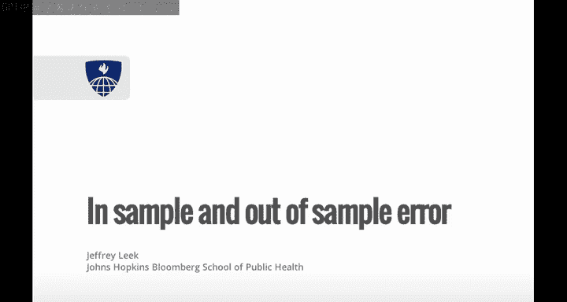

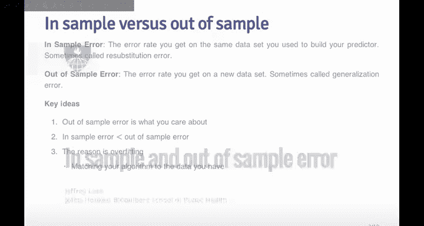

在本节课中，我们将学习机器学习与预测中一个最核心的概念：**样本内误差**与**样本外误差**。理解这两个概念对于评估模型在真实世界中的表现至关重要。

## 概述

我们将通过一个简单的例子，解释样本内误差与样本外误差的区别，并探讨为何在训练数据上表现完美的模型，在新数据上表现可能反而更差。核心原因在于**过拟合**。

## 什么是样本内误差与样本外误差？

上一节我们介绍了预测模型的基本概念，本节中我们来看看如何评估模型的误差。

*   **样本内误差**：指在用于**训练**预测器的同一数据集上计算出的错误率。在机器学习文献中，有时也称为**重代入误差**。
    *   **公式**：`样本内误差 = 在训练集上的错误率`
    *   样本内误差通常对模型的实际性能估计**过于乐观**。因为预测算法可能会针对该特定数据集中收集到的**噪声**进行微调。

*   **样本外误差**：指在**未用于训练**的新数据集（例如，由不同人员或在不同时间收集的数据）上计算出的错误率。在机器学习中，这有时被称为**泛化误差**。
    *   **公式**：`样本外误差 = 在新数据集（测试集）上的错误率`
    *   样本外误差更能反映模型在真实实践中的表现，是我们真正关心的指标。

**核心关系**：`样本内误差 < 样本外误差`。原因在于**过拟合**——模型与手头数据拟合得“太好”，以至于捕捉了数据中的随机噪声，从而降低了在新数据上的鲁棒性。

## 一个简单的示例：垃圾邮件分类

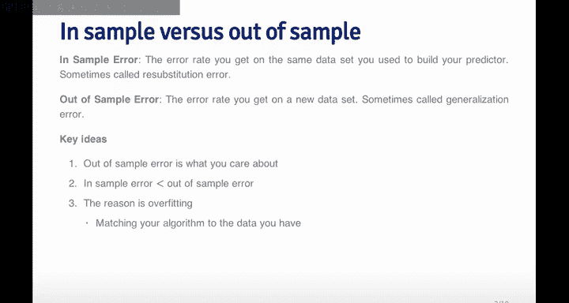

为了直观理解，我们来看一个基于垃圾邮件数据的简单示例。我们使用 `kernlab` 包中的 `spam` 数据集，并关注一个特征：电子邮件中大写字母的平均数量。

以下是构建示例的步骤：

1.  我们从数据集中随机抽取了10封邮件作为**训练集**。
2.  我们绘制了这10封邮件的大写字母平均数，红色点代表垃圾邮件（spam），黑色点代表非垃圾邮件（ham）。
3.  观察发现，通常垃圾邮件的大写字母平均数更高。

基于此，我们尝试构建两个不同的预测规则。

### 规则一：复杂规则（追求训练集完美）

我们希望构建一个在训练集上准确率100%的规则。

*   **规则描述**：
    *   如果大写字母平均数 > 2.7，则预测为垃圾邮件。
    *   如果大写字母平均数 < 2.4，则预测为非垃圾邮件。
    *   如果大写字母平均数在 2.4 到 2.45 之间，也预测为垃圾邮件（此条专门为捕获训练集中一个特殊的低值垃圾邮件点而设）。

*   **在训练集上的表现**：该规则实现了**100%的准确率**，完美分类了所有10封邮件。

### 规则二：简单规则（基于通用阈值）

我们构建一个更通用、更简单的规则。

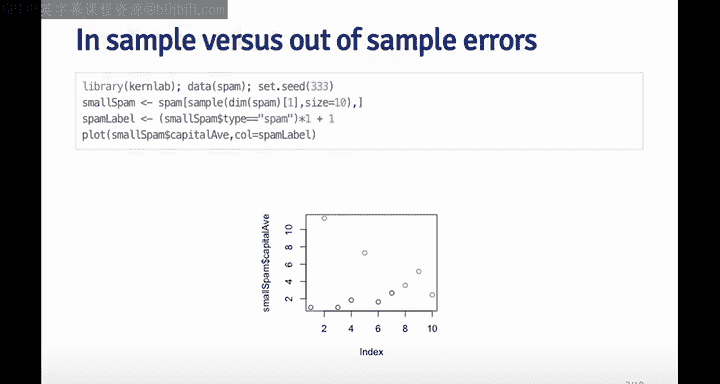

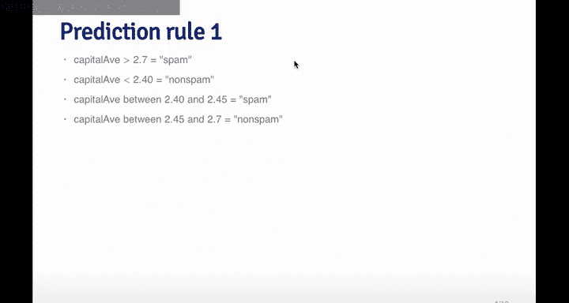

*   **规则描述**：
    *   如果大写字母平均数 > 2.4，则预测为垃圾邮件。
    *   如果大写字母平均数 <= 2.4，则预测为非垃圾邮件。

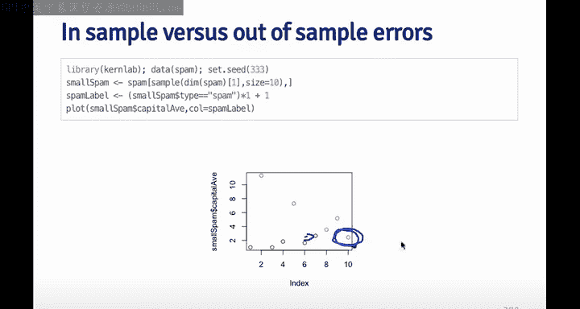

*   **在训练集上的表现**：该规则会**错误分类**训练集中的那一封特殊的低值垃圾邮件，因此在训练集上的准确率**低于规则一**。

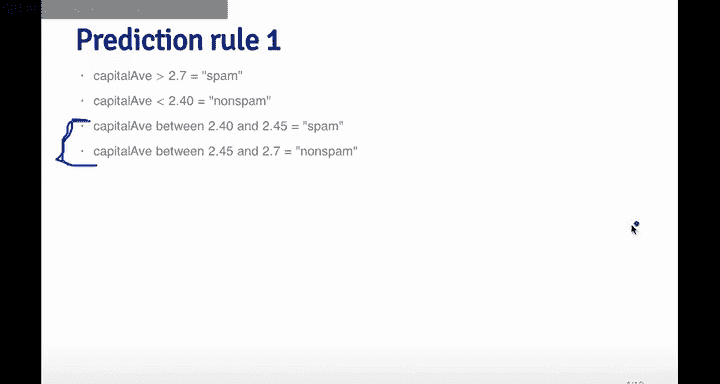

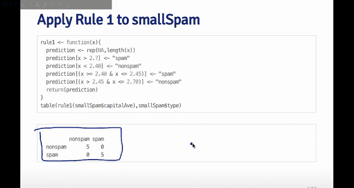

### 在完整数据集上的测试（样本外误差）

现在，我们将这两个规则应用到完整的 `spam` 数据集（而不仅仅是那10个训练样本）上，以评估它们的**样本外误差**。

我们通过混淆矩阵来统计预测结果：

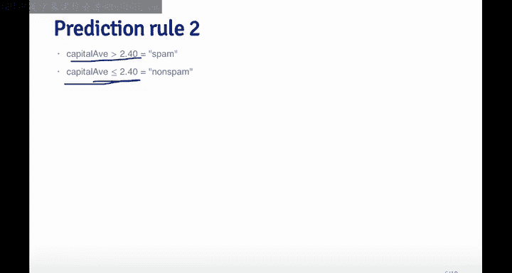

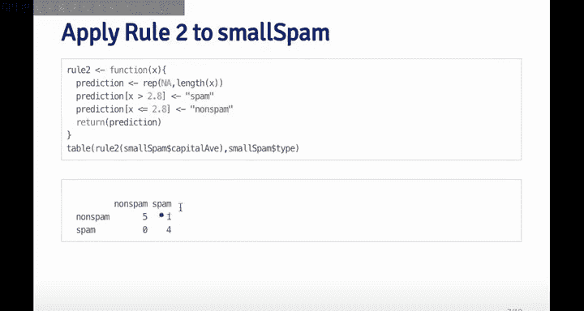

```r
# 示例性代码逻辑（非实际运行代码）
# 计算规则一在完整数据集上的正确预测次数
correct_complex <- sum(predictions_complex == actual_labels)
# 计算规则二在完整数据集上的正确预测次数
correct_simple <- sum(predictions_simple == actual_labels)
```

结果出乎意料：
*   **简单规则**在完整数据集中正确预测了约 **3396** 次。
*   **复杂规则**在完整数据集中正确预测了约 **3366** 次。

**简单规则的样本外表现反而更好**，比复杂规则多正确分类了约30封邮件。

## 为什么会这样？—— 过拟合与信号噪声

上一节我们对比了两个规则的表现，本节我们来深入分析其背后的原因。

在任何数据集中，都包含两部分：

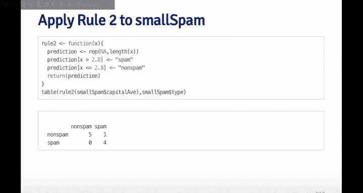

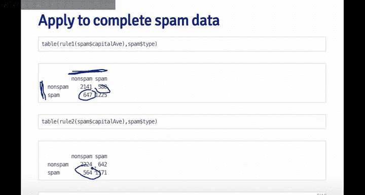

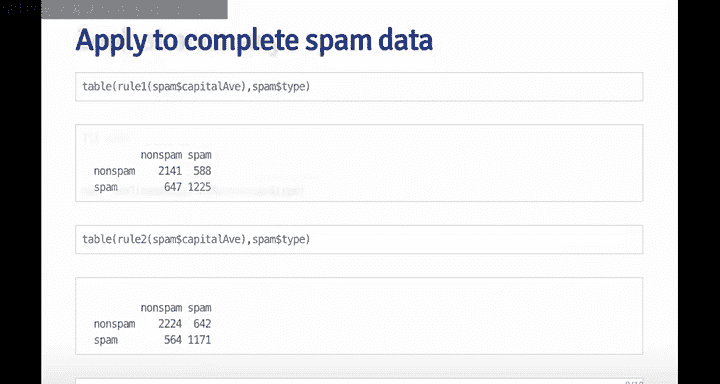

1.  **信号**：我们试图用来预测的、稳定且有意义的模式（例如：“垃圾邮件通常有更多大写字母”）。
2.  **噪声**：由于测量或随机性导致的、无意义的变异。

预测器的目标是**捕捉信号，忽略噪声**。

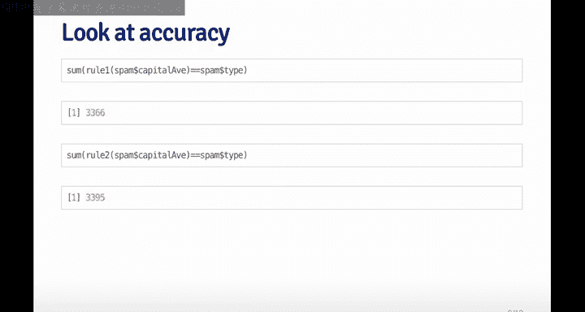

*   在**小规模训练集**中，你总可以构建一个像“复杂规则”那样的完美拟合器。它通过精细地划分预测空间，捕捉了数据的每一个特性。
*   然而，这样做不仅捕捉了**信号**，也捕捉了该特定训练集中的**噪声**（例如，那封恰好大写字母较少的垃圾邮件只是随机抽样的结果）。
*   当把这个过度调优的模型应用到包含不同噪声的新数据（完整数据集）时，其针对训练集噪声的调整反而会**损害泛化性能**。

相比之下，**简单规则**虽然牺牲了一点训练集精度，但因为它更通用、更稳健，所以能更好地捕捉**核心信号**，并在新数据上获得更低的样本外误差。

## 总结

本节课中我们一起学习了：

1.  **核心概念**：
    *   **样本内误差**：模型在**训练数据**上的误差，通常过于乐观。
    *   **样本外误差**：模型在**新数据**上的误差，反映真实泛化能力，是更重要的指标。
    *   二者关系：`样本内误差 < 样本外误差`。

2.  **核心问题**：**过拟合**。即模型过于复杂，过度拟合了训练数据中的噪声，导致泛化能力下降。

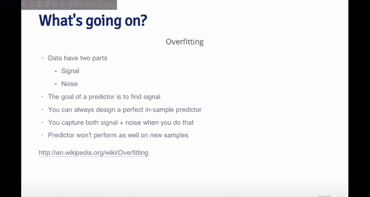

3.  **核心启示**：在机器学习中，我们的目标不是构建在训练集上最精确的模型，而是构建**足够简单、足够稳健**的模型，使其能够捕捉数据中的**信号**，同时避免拟合**噪声**，从而在未知数据上表现良好。评估模型时，务必关注其**样本外误差**。