# 课程 P87：6_接收者操作特征曲线 📈

在本节课中，我们将要学习接收者操作特征曲线，通常简称为 **ROC 曲线**。这是一种非常常用的技术，用于衡量预测算法的质量或优劣。

在二分类问题中，我们通常预测两个类别之一。例如，预测一个人是生是死，是健康还是生病，或者是否会点击某个广告。然而，预测算法的输出通常是定量的。换句话说，我们使用的几乎所有建模算法都不会直接将你归入某一类，它们可能会给出一个概率，比如存活的概率，或者一个从1到10的评分，表示点击广告的可能性。

## 阈值选择的影响

我们选择的**阈值**会产生不同的结果。例如，如果我们预测某人的存活概率是 0.7，并设定阈值 0.5（即概率高于 0.5 的人被预测为存活），那么这是一种预测结果。另一种情况是，如果我们设定阈值为 0.8，那么对同一个人的预测结果就会不同。不同的阈值具有不同的特性：它们可能在识别存活者方面表现更好，也可能在识别死亡者方面表现更好。

为了系统地评估这种权衡，人们使用 **ROC 曲线**。

## 理解 ROC 曲线

上一节我们介绍了阈值选择的重要性，本节中我们来看看如何用 ROC 曲线来可视化这种权衡。

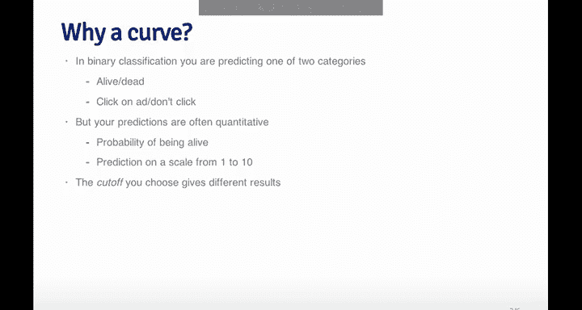

ROC 曲线的思想是：在 **x 轴**上，我们绘制 **1 - 特异性**，也就是**假阳性率**。在 **y 轴**上，我们绘制**灵敏度**，也就是**真阳性率**。

这条曲线上的每一个点都对应一个特定的阈值。对于一个给定的阈值，你会得到一个特定的假阳性率（x 轴上的点）和一个特定的灵敏度（y 轴上的点）。通过绘制所有可能阈值对应的点并连接成曲线，我们就得到了 ROC 曲线。

我们可以通过绘制 ROC 曲线来判断一个算法的好坏。以下是真实 ROC 曲线的示例：

例如，观察“NetChop”算法对应的曲线（图中红色曲线）。当 1 - 特异性（假阳性率）等于 0.2 时（即特异性为 0.8），我们可以沿着 x 轴找到 0.2 的位置，然后垂直向上找到与红色曲线的交点。这个交点对应的 y 轴值（灵敏度）大约为 0.4。这意味着该算法在此时具有很高的特异性，但灵敏度较低。

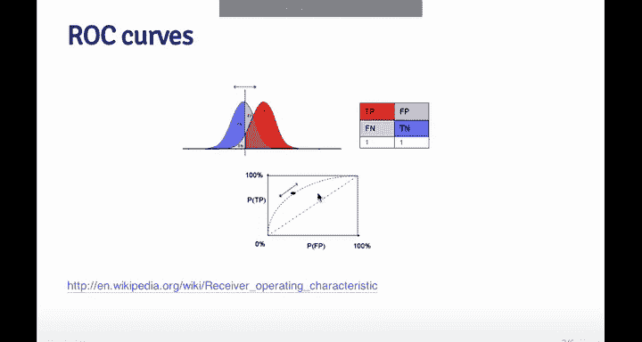

类似地，如果我们沿着 x 轴向右移动（即允许更高的假阳性率），我们通常会获得更高的灵敏度。这条曲线清晰地展示了**灵敏度**和**特异性**之间的权衡关系。

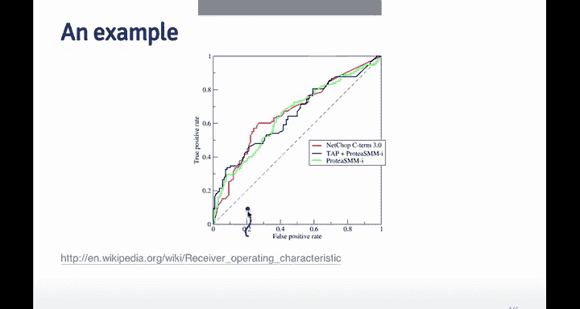

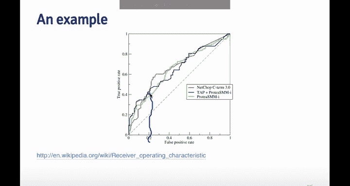

## 量化比较：曲线下面积

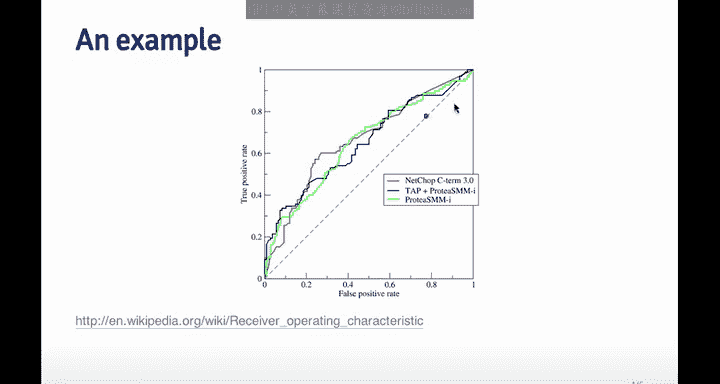

虽然 ROC 曲线能展示权衡关系，但我们可能更想知道哪个预测算法更好。人们常用的一种量化方法是计算**曲线下面积**。

换句话说，就是计算 ROC 曲线下方与坐标轴围成的总面积。这个面积量化了特定预测算法的性能：**AUC 值越高，预测器越好**。

以下是几个需要关注的标准 AUC 值：

*   **AUC = 0.5**：这相当于 ROC 曲线落在 45 度对角线上。这等同于随机猜测，就像抛硬币一样。这是一个很差的性能。
*   **AUC < 0.5**：这比随机猜测还要差。
*   **AUC = 1.0**：这是一个完美的分类器。意味着对于预测算法的某个阈值，你能同时获得完美的灵敏度和特异性。
*   **AUC > 0.8**：通常，根据领域和具体问题的不同，AUC 值高于 0.8 的预测算法被认为是相当不错的。

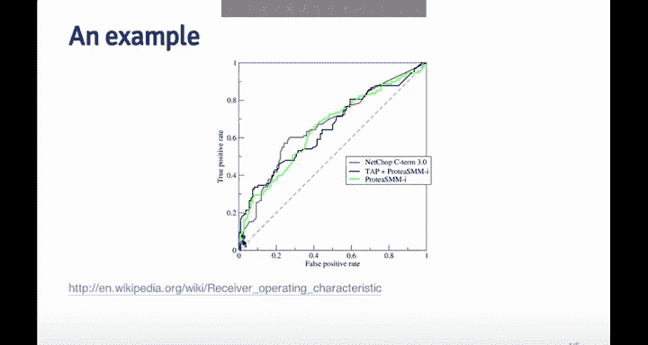

## 如何解读 ROC 曲线

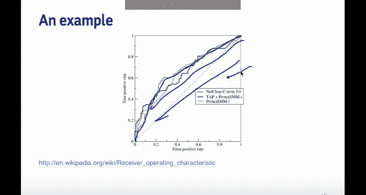

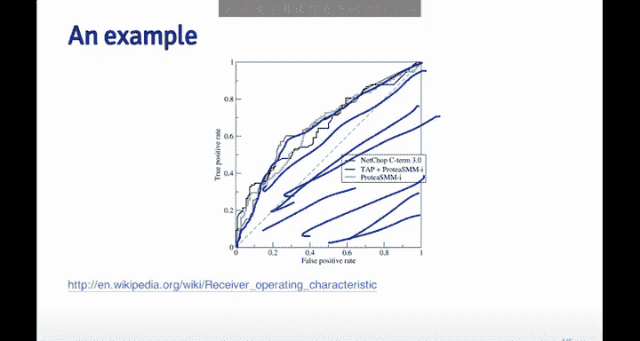

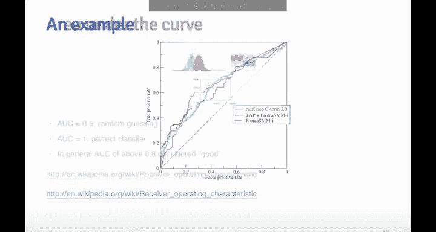

一般来说，解读 ROC 曲线时需要注意：记住 45 度对角线对应的是随机猜测。在这条线上，灵敏度和（1-特异性）相等。

一个完美的分类器的 ROC 曲线会从原点 (0,0) 直接垂直上升到左上角 (0,1)，然后水平延伸到 (1,1)。因此：

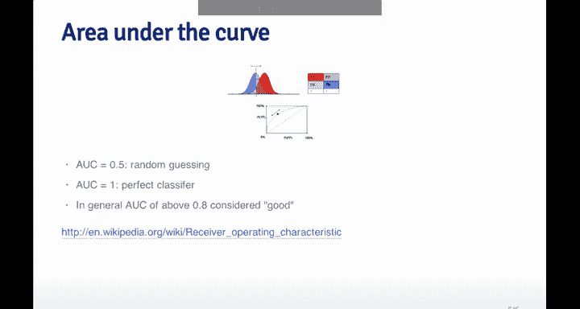

*   **ROC 曲线越靠近图表的左上角，性能越好。**
*   **ROC 曲线越靠近右下角，性能越差。**

我们希望曲线尽可能陡峭地上升并贴近左上角。这就是解读 ROC 曲线的方法，在我们后续为输出定量数值的二分类预测器选择特定阈值时，这将非常有用。

## 总结

本节课中，我们一起学习了 **ROC 曲线**。我们了解到：

1.  ROC 曲线是一种可视化工具，用于展示二分类预测模型中，在不同**阈值**下**灵敏度**与**假阳性率**之间的权衡。
2.  曲线的 x 轴是 **1 - 特异性**， y 轴是**灵敏度**。
3.  我们可以通过计算**曲线下面积**来量化比较不同预测模型的整体性能。AUC 值越高，模型通常越好。
4.  完美的分类器 AUC 为 1.0，随机猜测的 AUC 为 0.5。
5.  解读 ROC 曲线时，曲线越靠近图表的**左上角**，表明模型的分类性能越优秀。

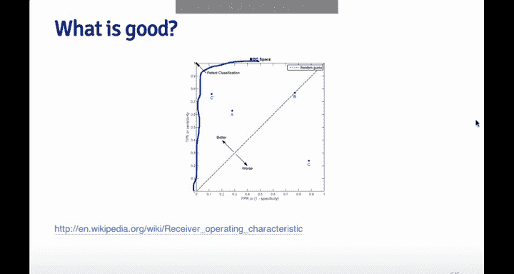

掌握 ROC 曲线和 AUC 对于评估和选择机器学习模型至关重要。