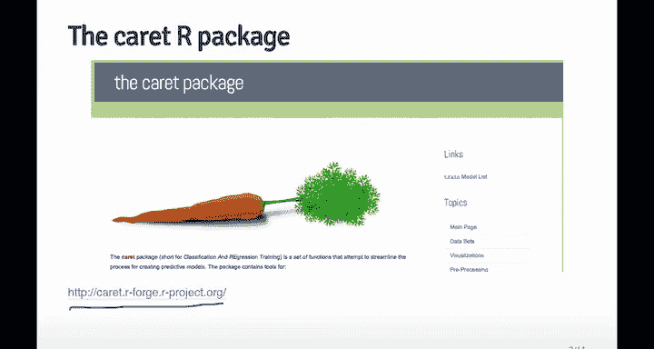
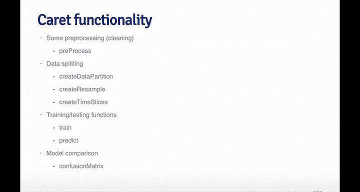
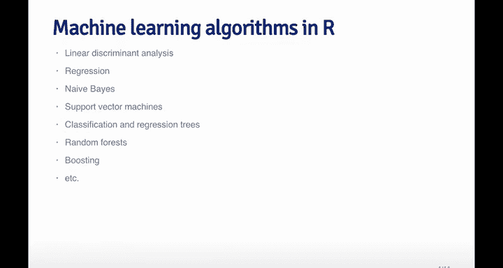
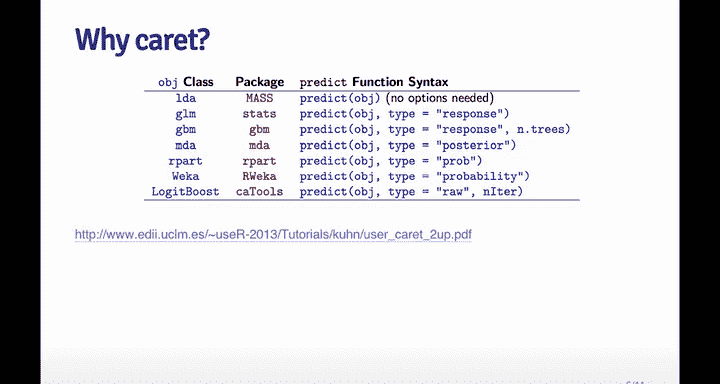
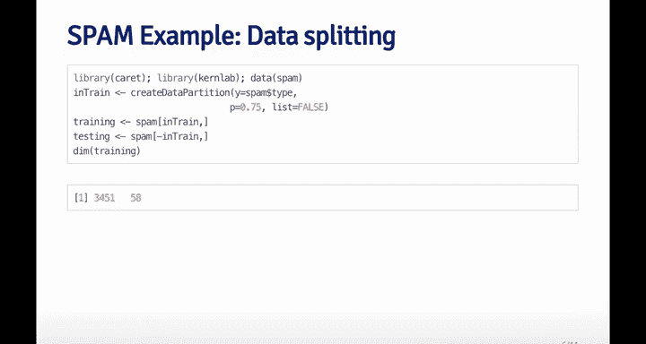
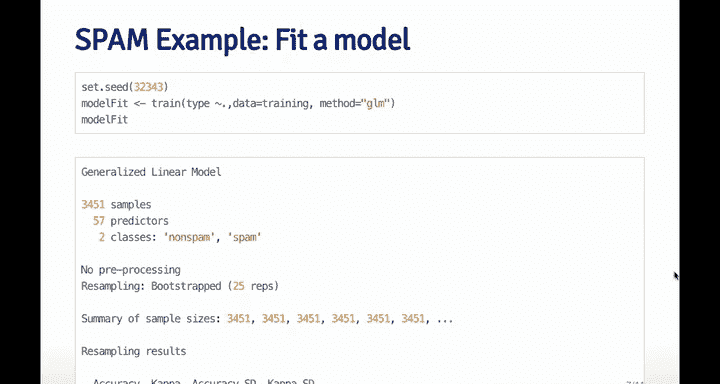
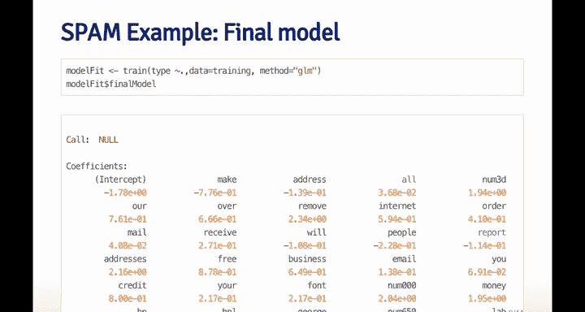
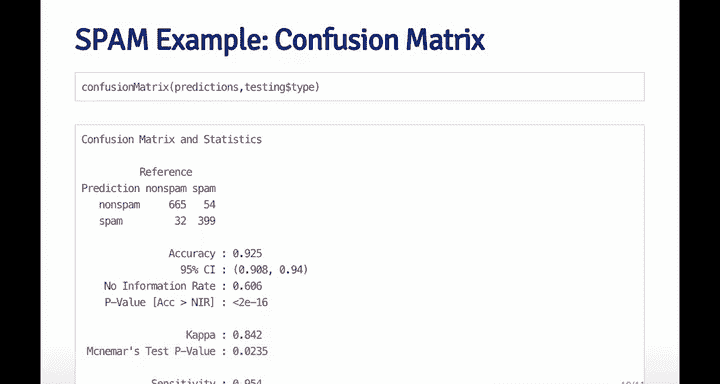
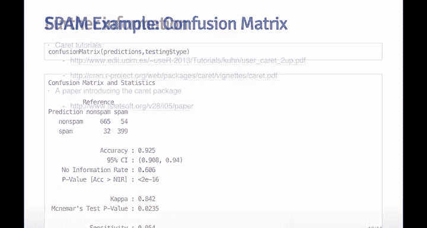
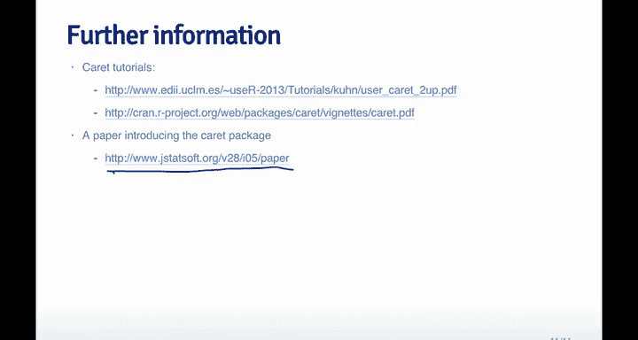

# 课程 P90：Caret 包 🧰


在本节课中，我们将要学习 R 语言中一个非常实用的前端包——Caret 包。Caret 包封装了许多预测算法和工具，为数据预处理、模型训练、验证和比较提供了一个统一的框架，极大地简化了机器学习的工作流程。



## 概述与功能

Caret 包是一个功能强大的工具集，其核心目标是统一 R 语言中众多机器学习算法的接口。它解决了不同算法包在调用方式、参数设置和结果输出上的差异问题。

以下是 Caret 包提供的主要功能：

*   **数据预处理**：提供工具来清理数据并设置特征，使其适用于预测模型。
*   **数据分割与交叉验证**：通过 `createDataPartition` 和 `createTimeSlices` 等函数，可以在训练集内进行数据分割和交叉验证。
*   **模型训练与预测**：使用 `train` 和 `predict` 函数来创建训练集、训练预测模型，并将其应用于新数据集。
*   **模型比较**：使用 `confusionMatrix` 函数来评估模型在新数据集上的表现，并提供多种准确性度量指标。



## 统一的算法接口

R 语言内置了大量的机器学习算法，从经典的统计学习方法（如线性判别分析、回归）到计算机科学中广泛使用的算法（如支持向量机、分类与回归树、随机森林和提升法）。这些算法由不同背景的开发者构建，因此它们的调用接口各有不同。

例如，考虑以下不同的预测算法类：从线性判别分析到提升法。对于每一种算法，在 R 中创建的对象（例如 `obj`）可能属于不同的类（如 `lda`、`glm`）。当我们对这些对象使用 `predict` 函数进行预测时，每次都需要传递略有不同的参数。



```r
# 不同算法预测示例
predict(glm_fit, newdata, type = "response")   # GLM 需要 type="response"
predict(rpart_fit, newdata, type = "prob")     # rpart 需要 type="prob"
```

Caret 包提供了一个统一的框架，允许你使用同一个 `predict` 函数，而无需为获得相同类型的预测结果去指定所有可能关心的选项。

## 快速入门示例

上一节我们介绍了 Caret 包的设计理念。本节中，我们通过一个具体示例来看看如何使用它。我们将使用 `spam` 数据集来演示一个完整的建模流程。

首先，加载必要的包并准备数据。

```r
library(caret)
library(kernlab) # 包含 spam 数据集
data(spam)
```



### 1. 数据分割

首先，我们需要将数据集划分为训练集和测试集。以下是具体步骤：

*   使用 `createDataPartition` 函数，基于结果变量 `type` 创建索引。
*   设定 `p = 0.75`，表示使用 75% 的数据进行训练，25% 的数据进行测试。
*   利用生成的索引 `inTrain` 来子集化数据，分别得到训练集和测试集。

```r
# 创建数据分区索引
inTrain <- createDataPartition(y = spam$type, p = 0.75, list = FALSE)

# 划分训练集和测试集
training <- spam[inTrain, ]
testing <- spam[-inTrain, ]
```

### 2. 训练模型



接下来，我们使用 `train` 函数来拟合一个模型。

*   公式 `type ~ .` 表示使用数据框中除 `type` 外的所有其他变量来预测 `type`。
*   `data` 参数指定训练数据集。
*   `method` 参数指定要使用的算法，这里我们选择 `"glm"`（广义线性模型）。

```r
# 使用训练集训练一个 GLM 模型
modelFit <- train(type ~ ., data = training, method = "glm")
```

`train` 函数会执行模型拟合，并可能采用重采样（如自助法）等技术来评估模型性能并选择最佳模型。在本例中，它使用了 25 次重复的自助法，并校正了可能存在的偏差。

### 3. 查看模型与预测



模型训练完成后，我们可以查看最终的模型参数，并使用它对新数据进行预测。

要查看拟合的模型细节，可以访问 `modelFit` 对象的 `finalModel` 组件。

```r
# 查看最终拟合的模型
modelFit$finalModel
```



要对新样本进行预测，只需使用统一的 `predict` 函数，传入模型对象和测试数据。

```r
# 对测试集进行预测
predictions <- predict(modelFit, newdata = testing)
```

### 4. 模型评估

最后，我们需要评估模型在测试集上的表现。`confusionMatrix` 函数是完成此任务的强大工具。

它需要两个主要参数：模型的预测结果和测试集的真实结果。函数会输出混淆矩阵以及一系列汇总统计量。

```r
# 计算混淆矩阵以评估模型性能
confusionMatrix(predictions, testing$type)
```

混淆矩阵会展示预测类别与实际类别的对应情况（例如，预测为垃圾邮件且实际为垃圾邮件的数量），并给出准确率、95% 置信区间、灵敏度、特异度等关键指标。

## 延伸学习资源





本节课我们一起学习了 Caret 包的基本使用方法。关于 Caret 包的更多高级功能和细节，本课程后续会继续介绍。此外，以下资源也非常有用：

*   **官方教程**：Caret 包的官方网站提供了详细的教程，涵盖了本课程未涉及的内容。
*   **学术论文**：Journal of Statistical Software 上有一篇介绍 Caret 包的优秀论文，可供深入阅读。



通过本节课的学习，你应该已经掌握了使用 Caret 包进行数据分割、模型训练、预测和评估的基本流程。这个统一的框架将帮助你在后续的机器学习项目中更高效地工作。