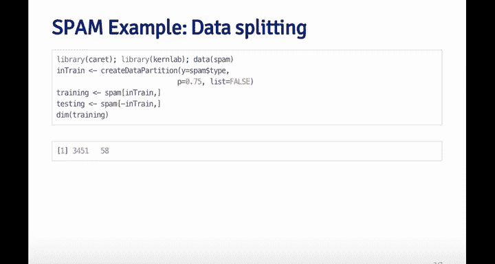
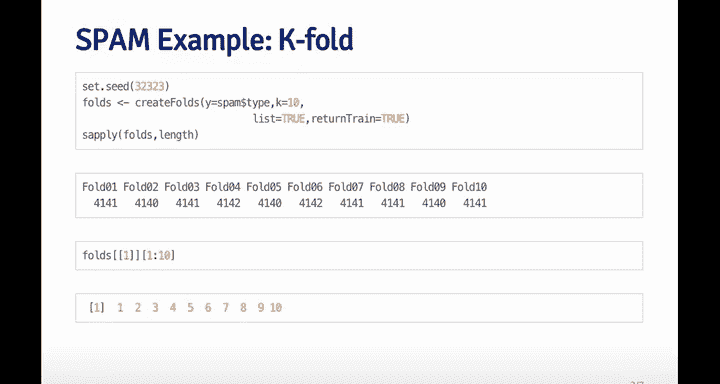
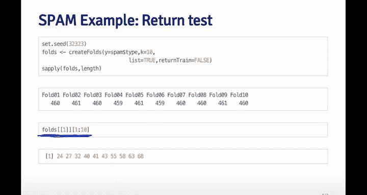
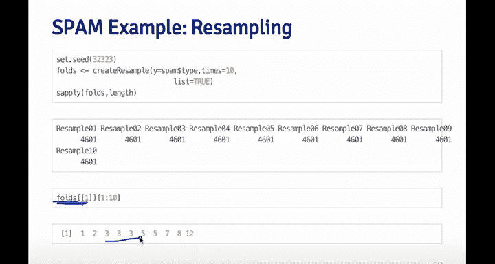
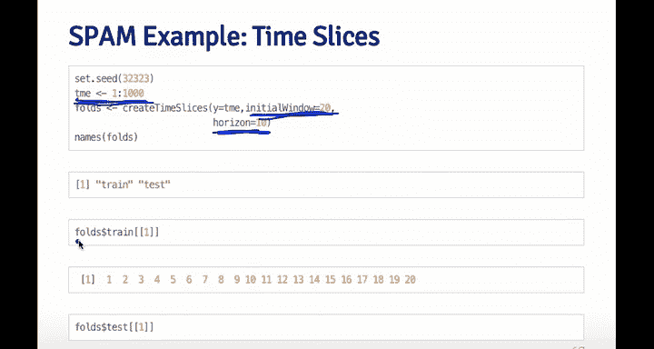
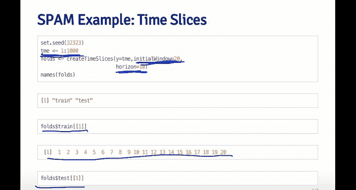
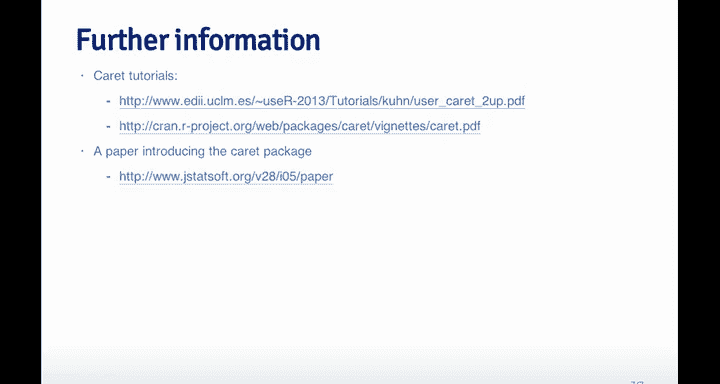

# 课程 P91：数据切片 📊

在本节课中，我们将学习数据切片技术。数据切片是数据科学和机器学习工作流程中的关键步骤，主要用于将数据集划分为训练集和测试集，或为交叉验证、自助法等模型评估方法创建数据子集。

我们将使用 `caret` 包中的函数，并以垃圾邮件数据集为例进行演示。


---

## 创建训练集与测试集

上一节我们介绍了数据切片的基本概念，本节中我们来看看如何将数据集初始分割为训练集和测试集。这是构建预测模型的第一步。

我们可以使用 `createDataPartition` 函数。该函数根据指定的结果变量，按比例将数据划分为训练集和测试集，同时保持原始数据中各类别的比例。

以下是具体步骤：

```r
# 加载必要的包和数据
library(caret)
data(spam)

# 使用 createDataPartition 创建索引
intrain <- createDataPartition(y = spam$type, p = 0.75, list = FALSE)
```

在上述代码中：
*   `y = spam$type` 指定了用于分层抽样的结果变量。
*   `p = 0.75` 表示75%的数据分配给训练集。
*   `list = FALSE` 确保返回一个索引向量而非列表。

接下来，我们利用生成的索引 `intrain` 来创建训练集和测试集：

```r
# 创建训练集（索引在 intrain 中的样本）
training <- spam[intrain, ]

# 创建测试集（索引不在 intrain 中的样本）
testing <- spam[-intrain, ]
```

这样，我们就完成了数据集的初始分割。

---

## 为交叉验证创建K折



在模型训练阶段，我们经常使用交叉验证来评估模型性能。本节我们将学习如何将训练集进一步分割为K个折（fold）。

`caret` 包中的 `createFolds` 函数可以帮我们实现这一点。该函数将数据随机划分为K个大小相近的子集。

以下是创建10折交叉验证索引的方法：

```r
# 创建10折交叉验证的索引列表
folds <- createFolds(y = spam$type, k = 10, list = TRUE, returnTrain = TRUE)
```

参数说明：
*   `k = 10` 指定折数为10。
*   `list = TRUE` 表示以列表形式返回结果，列表的每个元素包含一个折的训练样本索引。
*   `returnTrain = TRUE` 表示返回的是每个折的训练集索引。若设为 `FALSE`，则返回测试集索引。

创建完成后，我们可以检查每个折的大小：

```r
# 检查第一折的样本数
length(folds[[1]])
```

每个折包含的样本数大致相等，确保了交叉验证的均衡性。



---

## 自助法重采样

除了K折交叉验证，自助法（Bootstrap）是另一种重要的重采样技术。本节我们来看看如何使用 `createResample` 函数进行自助法抽样。

自助法通过有放回地抽样来创建多个训练集，有助于评估模型的稳定性。

执行自助法重采样的代码如下：



```r
# 执行有放回的重复抽样，创建10个自助样本
resamples <- createResample(y = spam$type, times = 10, list = TRUE)
```

参数说明：
*   `times = 10` 指定创建10个重采样数据集。
*   由于是有放回抽样，同一个样本可能在一个自助样本中出现多次。

我们可以查看第一个自助样本的前几个索引，观察重复出现的情况：

```r
# 查看第一个自助样本的前10个索引
head(resamples[[1]], 10)
```

---



## 时间序列数据切片

对于时间序列或具有顺序依赖关系的数据，我们不能进行随机分割。本节将介绍如何使用 `createTimeSlices` 函数为这类数据创建合适的训练和测试切片。

该函数可以生成一系列连续的时间窗口，用于滚动预测。

假设我们有一个包含1000个时间点的序列：

```r
# 创建一个时间索引向量
time <- 1:1000

# 创建时间切片
time_slices <- createTimeSlices(y = time, initialWindow = 20, horizon = 10, fixedWindow = TRUE)
```

参数说明：
*   `initialWindow = 20` 定义每个训练切片包含20个连续时间点。
*   `horizon = 10` 定义每个测试切片包含紧随其后的10个时间点。
*   `fixedWindow = TRUE` 表示训练窗口大小固定。



生成的 `time_slices` 是一个列表，包含 `train` 和 `test` 两个子列表，分别存储了各个切片的索引。



---

## 总结与进一步学习

本节课中我们一起学习了数据切片的核心技术。我们掌握了：
1.  使用 `createDataPartition` 划分初始的训练集和测试集。
2.  使用 `createFolds` 为K折交叉验证创建数据折。
3.  使用 `createResample` 执行自助法重采样。
4.  使用 `createTimeSlices` 为时间序列数据创建滚动窗口切片。



这些技术是构建稳健机器学习模型的基础。`caret` 包的官方教程和相关论文提供了关于时间切片及其他高级切片技术的更多详细信息，在后续课程和作业中我们也会看到更多实际应用案例。