# 课程13：预测变量的基本预处理 📊

在本节课中，我们将学习预测变量的基本预处理技术。预处理是数据科学和机器学习中的一个关键步骤，它涉及在将数据输入预测算法之前，对数据进行清理和转换，以提高模型的性能和稳定性。

## 概述


上一节我们介绍了数据探索的重要性。本节中，我们来看看如何对预测变量进行预处理。预处理对于基于模型的算法（如线性判别分析、朴素贝叶斯、线性回归等）尤其重要，因为这些算法对数据的分布和尺度较为敏感。通过预处理，我们可以使数据更符合算法的假设，从而获得更好的预测结果。


## 为何需要预处理？🔍

首先，我们需要绘制变量的分布图，以观察是否存在异常行为。有时，预测变量的分布会非常奇怪，可能需要进行转换，使其对预测算法更有用。

以下是加载数据和查看变量分布的一个例子：

```r
# 加载必要的包和数据
library(caret)
library(kernlab)
data(spam)

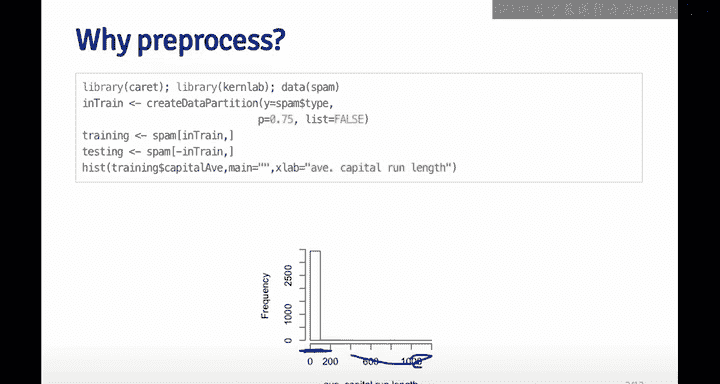

# 分割数据为训练集和测试集
inTrain <- createDataPartition(y=spam$type, p=0.75, list=FALSE)
training <- spam[inTrain,]
testing <- spam[-inTrain,]

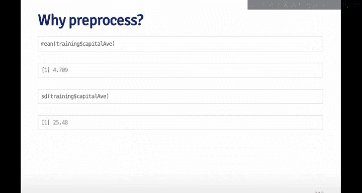

# 查看一个变量的分布
hist(training$capitalAve, main="", xlab="连续大写字母的平均长度")
```

从直方图中可以看到，变量 `capitalAve` 的分布非常偏斜，大部分值很小，但存在少数极大值。这种偏斜和高变异性会给基于模型的预测器带来困难。

该变量的均值约为4.7，但标准差非常大，表明其变异性极高。因此，我们可能需要进行预处理，以防止机器学习算法被其偏斜和高变异性所误导。

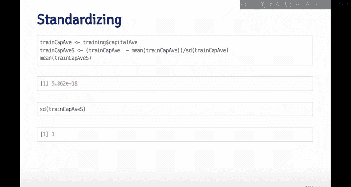

## 标准化变量 📏

一种常见的预处理方法是标准化变量。标准化的通常做法是，对变量值减去其均值，然后除以标准差。

**标准化公式**：
`标准化值 = (原始值 - 均值) / 标准差`

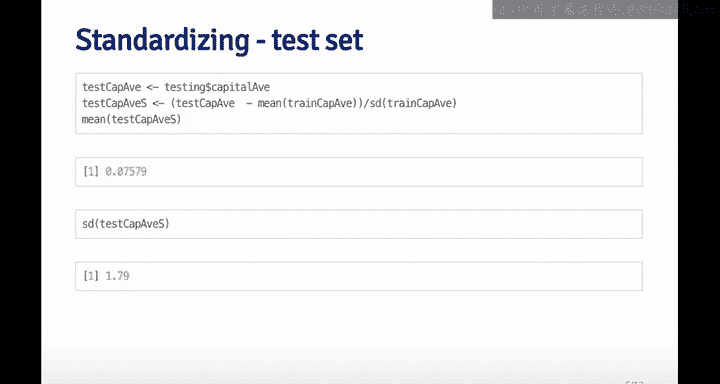

执行此操作后，变量的均值将变为0，标准差将变为1。这可以显著减少我们之前看到的变异性，并在一定程度上统一变量的尺度。

需要牢记的是，当我们将预测算法应用于测试集时，只能使用在训练集中估计的参数。这意味着，对测试集应用相同的标准化时，必须使用训练集的均值和标准差。因此，测试集中的均值不会恰好为0，标准差也不会恰好为1，但它们应该接近这些值。

## 使用 `preProcess` 函数 🛠️

`caret` 包中的 `preProcess` 函数可以自动完成许多标准化工作。

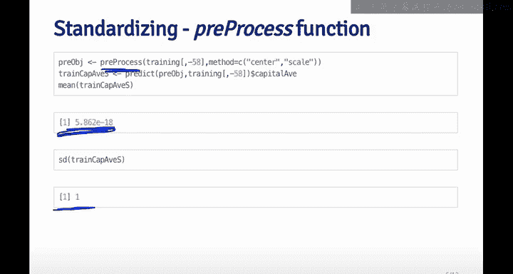

以下是使用 `preProcess` 函数进行中心化和缩放的示例：

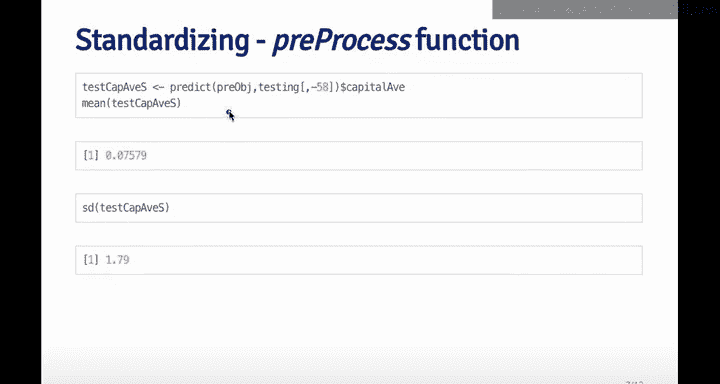


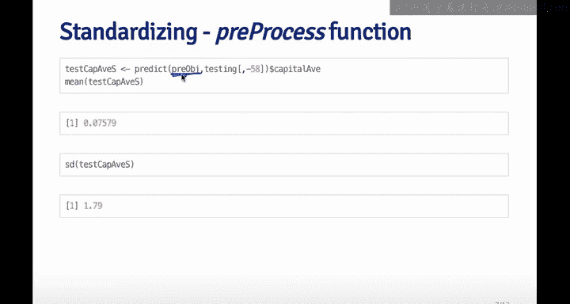

```r
# 对训练集预测变量进行预处理（不包括第58列的结果变量）
preObj <- preProcess(training[,-58], method=c("center", "scale"))


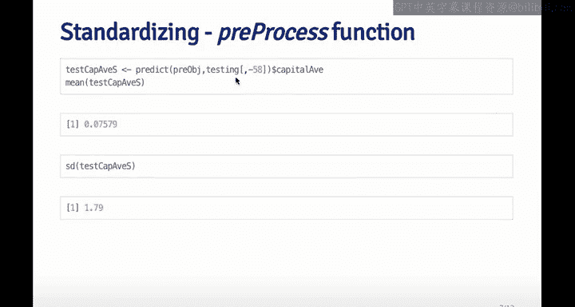

# 应用预处理转换到训练集
trainCapAveS <- predict(preObj, training[,-58])$capitalAve

# 查看处理后的均值和标准差
mean(trainCapAveS) # 应接近0
sd(trainCapAveS)   # 应接近1
```

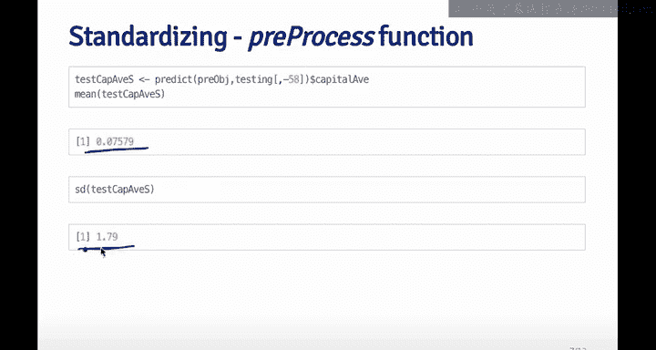

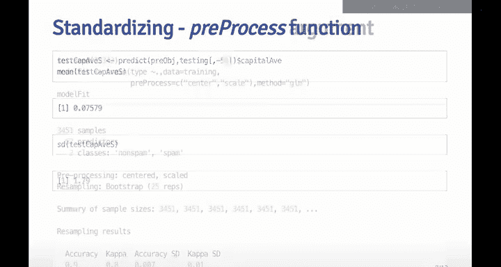

`preProcess` 函数可以执行许多过去需要手动完成的预处理技术。

## 将预处理应用于测试集 🔄

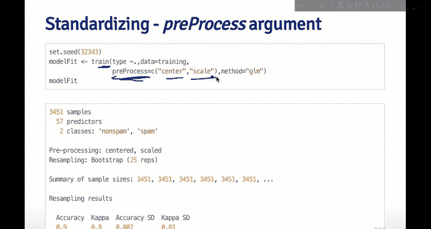

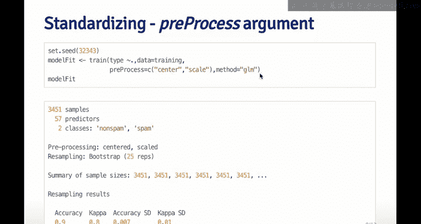

我们可以使用在训练集上创建的预处理对象，将相同的转换应用于测试集。

```r
# 将相同的预处理应用于测试集
testCapAveS <- predict(preObj, testing[,-58])$capitalAve

# 注意：测试集的均值不会恰好为0，标准差也不会恰好为1
mean(testCapAveS)
sd(testCapAveS)
```

在预处理后的测试集数据中，任何变量的均值都不会恰好等于0，标准差也不会恰好等于1，但由于我们使用了训练集的值进行标准化，它们应该接近这些值。


## 在 `train` 函数中直接预处理 🚀


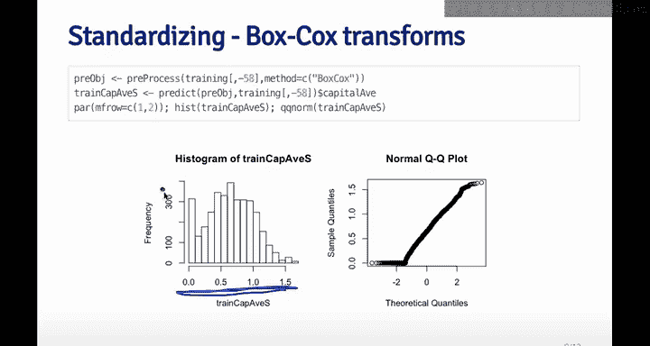

你还可以将预处理命令作为参数直接传递给 `caret` 包中的 `train` 函数。

```r
# 在训练模型时直接指定预处理参数
set.seed(32343)
modelFit <- train(type ~ ., data=training,
                  preProcess=c("center", "scale"),
                  method="glm")
modelFit
```

这样，`train` 函数会在使用预测变量构建预测模型之前，自动对它们进行中心化和缩放。

## 其他类型的转换：Box-Cox 变换 📈

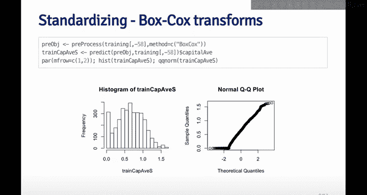

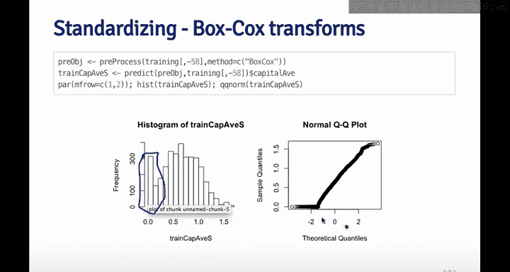

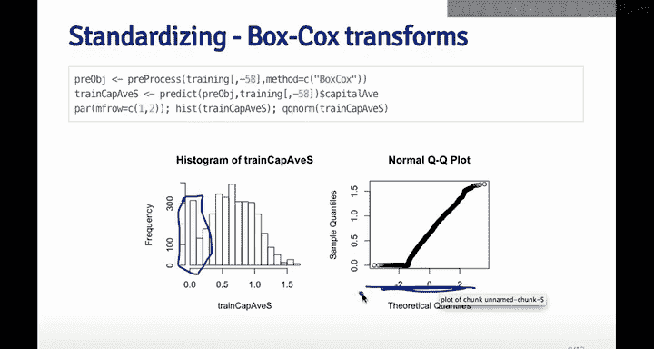

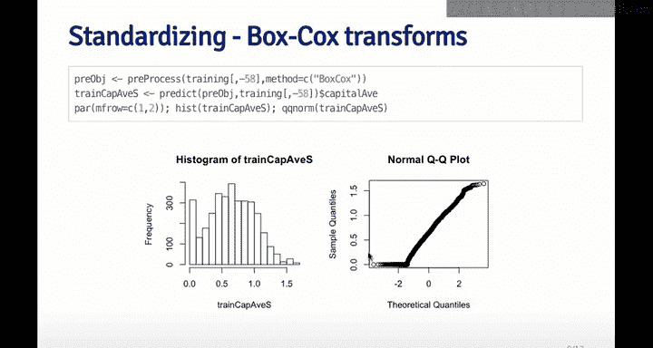

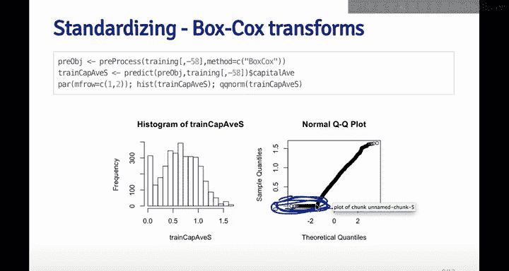

除了中心化和缩放，你还可以使用其他类型的转换。Box-Cox 变换就是一组转换方法，它试图将连续数据转换为更接近正态分布的数据，这是通过最大似然估计一组特定参数来实现的。

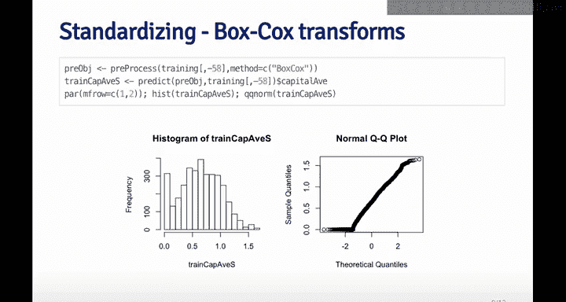

以下是应用 Box-Cox 变换的示例：

```r
# 对变量进行 Box-Cox 变换
preObj <- preProcess(training[,-58], method=c("BoxCox"))
trainCapAveS <- predict(preObj, training[,-58])$capitalAve

# 查看变换后的分布
par(mfrow=c(1,2))
hist(trainCapAveS)
qqnorm(trainCapAveS)
```

变换后，数据分布看起来更接近正态分布（钟形曲线）。但需要注意，它并不能解决所有问题。例如，如果存在大量完全等于0的重复值，这种连续变换可能无法完美处理。

## 处理缺失值：K-最近邻插补 🧩

数据集中经常存在缺失值，而大多数预测算法无法直接处理缺失数据。此时，我们可以使用 K-最近邻插补法来估算缺失值。

以下是使用 K-最近邻插补的步骤：

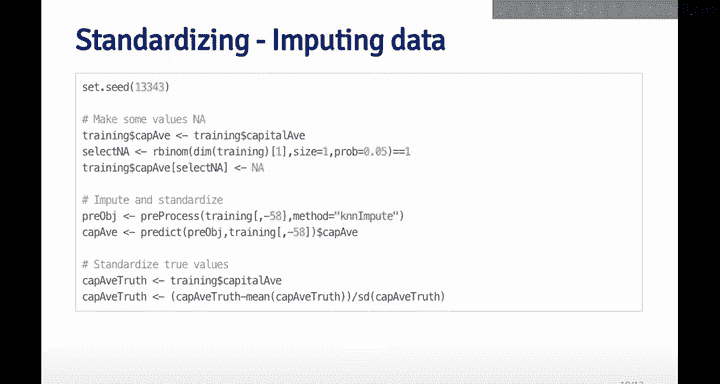

1.  在数据中随机创建一些缺失值以进行演示。
2.  使用 `preProcess` 函数进行 K-最近邻插补。
3.  评估插补效果。

```r
# 设置随机种子以确保结果可重现
set.seed(13343)

# 在 capitalAve 变量中随机创建缺失值
training$capAve <- training$capitalAve
selectNA <- rbinom(dim(training)[1], size=1, prob=0.05)==1
training$capAve[selectNA] <- NA

# 使用 K-最近邻插补（这里设置 k=10）
preObj <- preProcess(training[,-58], method="knnImpute")
capAve <- predict(preObj, training[,-58])$capAve

# 比较插补值与原始真实值（仅针对被设为缺失的值）
truth <- training$capitalAve[selectNA]
imputed <- capAve[selectNA]
quantile(truth - imputed) # 查看差值分位数
```

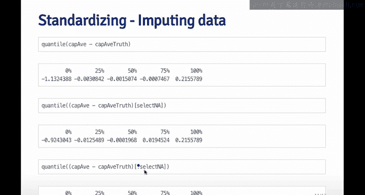

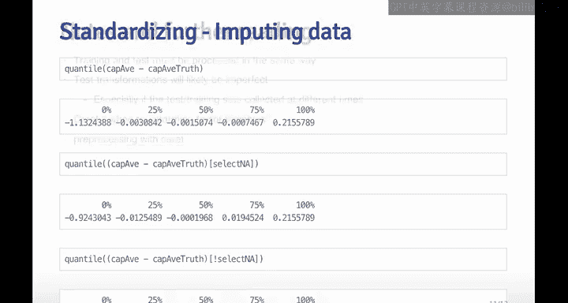

通过比较插补值与原始值，我们可以评估插补的效果。通常，差值应接近0，表明插补效果良好。

## 重要原则与注意事项 ⚠️

以下是关于训练集和测试集转换需要牢记的几个要点：

*   **一致性原则**：训练集和测试集必须以相同的方式进行预处理。
*   **参数复用**：对训练集所做的任何处理都会产生一组参数（如均值、标准差、变换参数）。在应用于测试集时，必须且只能使用这些参数，而不能基于测试集重新估计新的转换。
*   **不完美性**：这意味着测试集的转换很可能是不完美的，尤其是当测试集和训练集是在不同时间或以不同方式收集时，某些转换可能不会完全奏效。
*   **变量类型**：到目前为止讨论的所有转换（除了插补）都是基于连续变量的。对于因子变量，确定正确的转换更为困难。大多数机器学习算法设计用于处理二元预测变量（通常不预处理）或连续预测变量（有时需要预处理以使其更接近正态分布）。

`caret` 包在底层处理了许多这类问题。如果你使用 `train` 函数内置的预处理功能，它会以正确的方式将预处理应用于测试集。

## 总结

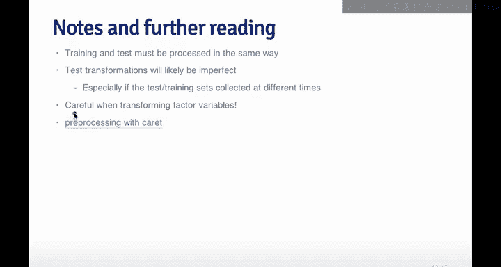

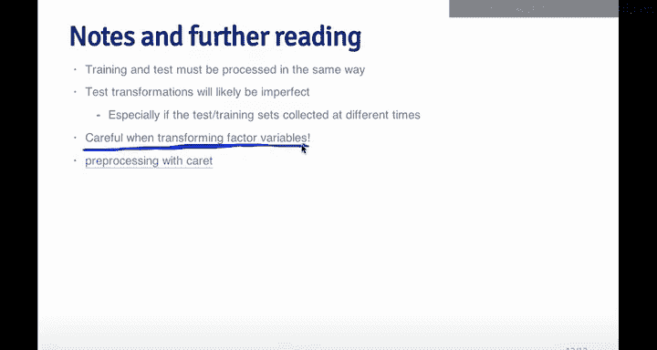

本节课中，我们一起学习了预测变量的基本预处理技术。我们探讨了为何需要预处理，介绍了标准化变量（中心化和缩放）的方法，并演示了如何使用 `caret` 包的 `preProcess` 函数自动化这一过程。我们还了解了如何将预处理对象应用于测试集，以及在 `train` 函数中直接集成预处理步骤。此外，我们介绍了 Box-Cox 变换来处理偏斜数据，以及使用 K-最近邻插补来处理缺失值。最后，我们强调了保持训练集与测试集预处理一致性的核心原则。掌握这些预处理技能，将为构建更稳健、更准确的机器学习模型奠定坚实基础。

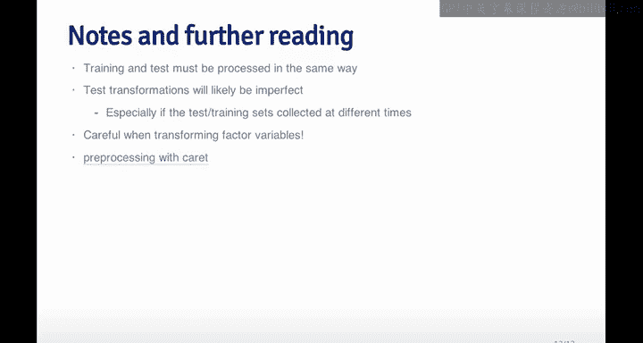

**延伸阅读**：你可以访问 [caret 包预处理文档](https://topepo.github.io/caret/pre-processing.html) 以获取关于使用 `caret` 包进行预测数据预处理的更多信息。