# 课程 P95：14_协变量创建 📊

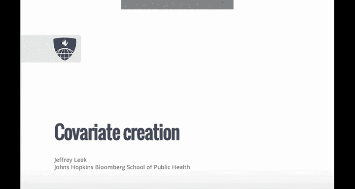

在本节课中，我们将要学习协变量创建。协变量有时被称为预测变量或特征，它们是你在模型中实际包含的变量，用于组合起来预测你所关心的任何结果。

协变量创建或特征创建有两个层面。第一个层面是获取你拥有的原始数据，并将其转化为可以使用的预测变量。原始数据通常以图像、文本文件或网站等形式存在。在你没有以某种有用的方式将信息总结为定量或定性变量之前，围绕这些信息建立预测模型是非常困难的。

因此，我们的目标是将原始数据转化为特征或协变量。这些变量应尽可能多地描述数据，同时进行一定程度的压缩，使其更容易拟合标准的机器学习算法。

这里的思路是，假设你有一封电子邮件，如左侧的示例邮件所示。直接将邮件本身插入预测函数是非常困难的，因为大多数预测函数基于少量变量并围绕它们建立定量模型，而这种方法不适用于自由文本。因此，你需要做的第一件事是创建一些特征。这些特征就是描述原始数据的变量。以电子邮件为例，我们可能会考虑描述这封邮件的不同方式。例如，我们可以计算邮件中大写字母的平均数量。在这封邮件中，100%的字母是大写字母。

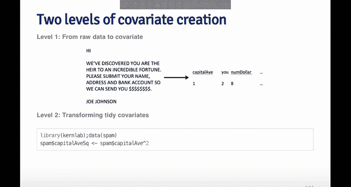

你可能会问某个特定单词出现的频率。例如，你可以问“you”出现了多少次。在这封邮件中，“you”出现了两次，所以我们为这封邮件计算出的特征值是2。你可能还会计算美元符号的数量。这可能是预测邮件是否为垃圾邮件的非常好的指标。在这里，你可以看到有大量的美元符号，共有八个，因此我们为该数据集计算了另一个特征。

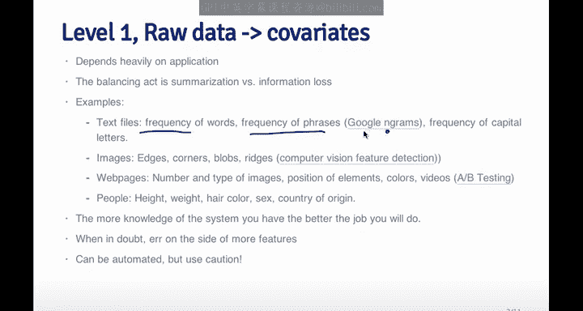

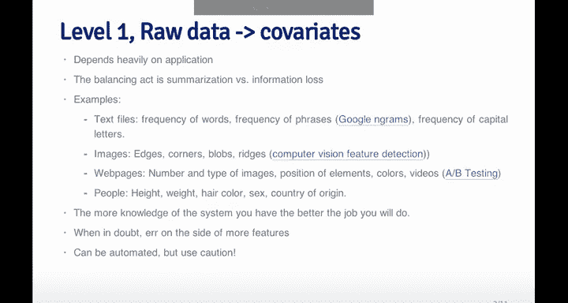

因此，从原始数据到协变量的这一步，通常需要大量思考数据的结构，以及如何以最少数量的变量提取最有用的信息，并捕获你想要的一切。下一阶段是转换这些协变量。

换句话说，我们计算了这个数字，比如大写字母平均比例。但可能与我们所关心的结果有良好关系的，不是平均比例本身，而是平均比例的平方、立方，或者是它的其他函数。因此，下一阶段是将变量转换为更有用的变量。

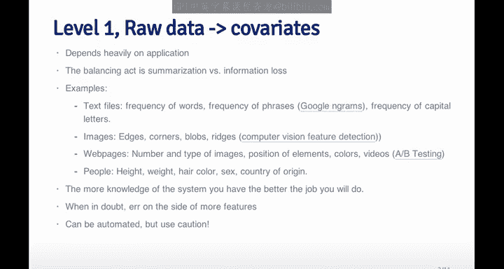

例如，如果我们加载当前的实验数据和垃圾邮件数据集，我们可以获取大写字母平均比例这个变量，然后将其平方，并赋值给一个新变量“大写平均平方”，这在后续的预测算法中可能有用。

以上是创建协变量的两个步骤。第一步，从原始数据到协变量，这在很大程度上取决于具体应用。正如我在上一张幻灯片中展示的，在电子邮件案例中，可能是提取单词出现的频率等；在语音案例中，可能是了解频率或音色；在图像案例中，可能是识别图像的特征，例如如果是人脸，鼻子、耳朵或眼睛的位置在哪里。这将极大地取决于你的应用是什么。这里的平衡点无疑是总结与信息丢失。换句话说，最好的特征是那些仅捕获图像或邮件中相关信息，并丢弃所有真正无用的信息的特征。因此，关键在于你必须非常仔细地思考如何选择正确的特征，以解释原始数据中大部分正在发生的事情。

以下是一些例子：
*   对于文本文件，特征可能是单词或短语的频率。有一个很酷的网站叫Google Ngrams，它告诉你历史上书籍中不同短语出现的频率。
*   对于图像，特征可能是边缘、角落、斑点或脊线。这些都是关于如何识别图像中不同结构的想法。
*   对于网站，特征可能是图像的数量和类型、按钮位置、颜色和视频。这在网络开发中是一个非常重要的领域，称为A/B测试，也称为随机试验和统计学，基本上就是展示具有这些不同特征不同取值的网站版本，并预测哪个版本会带来更多点击或让更多人购买产品。
*   对于人，你可以想象人的特征包括身高、体重、发色等。基本上，任何你能对原始数据进行的总结都是一个潜在的特征。通常，这需要相当多的科学思考和商业敏锐度，才能知道针对特定问题正确的协变量是什么。因此，一般来说，你对一个系统了解得越多，在特征提取方面就会做得越好。通常，最好能清楚地理解为什么这组数据对预测你所关心的结果是有用的。

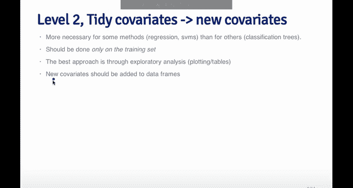

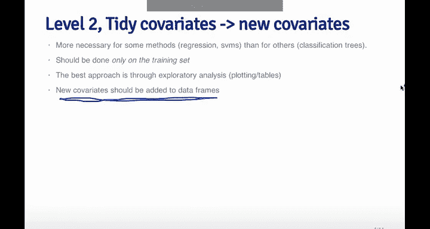

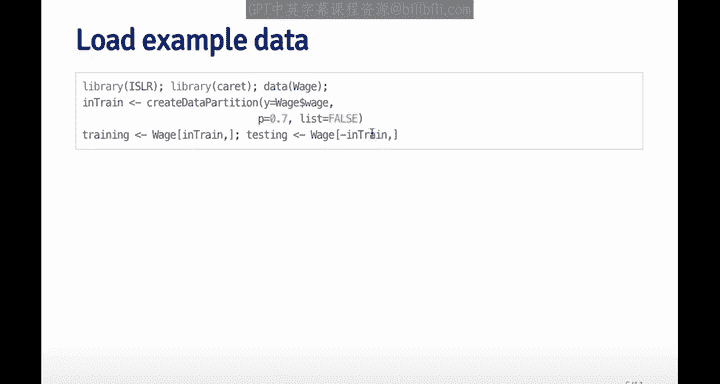

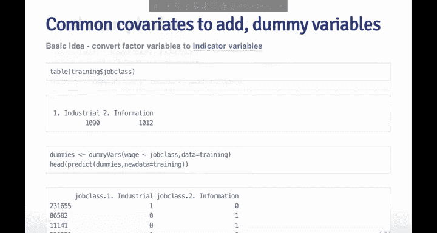

在总结和信息丢失之间存在平衡。一般来说，最好偏向于创建更多的特征，这样信息丢失更少，然后在模型构建过程中过滤掉其中一些特征。这一切都可以自动化，并且已经以各种方式实现了自动化，但在使用这种方法时通常必须非常谨慎，因为有时某个特定特征在你创建的训练集中非常有用，但在新的数据集和测试集中可能不那么有用，泛化能力不强。

第二个层面是获取已整理好的协变量，即你已经基于数据创建的特征，然后从中创建新的协变量。这通常是对协变量进行转换或函数变换，这些变换在构建预测模型时可能有用。对于像回归或支持向量机这样的方法，这可能有时更为必要，因为这些方法可能更依赖于数据的分布；而对于像分类树这样的方法，则不那么必要，因为在这些方法中，你不一定有那么多的基于模型的预测，换句话说，你不那么依赖于数据呈现特定的形态。另一方面，一般来说，花些时间确保你的模型中有正确的协变量是一个好主意。

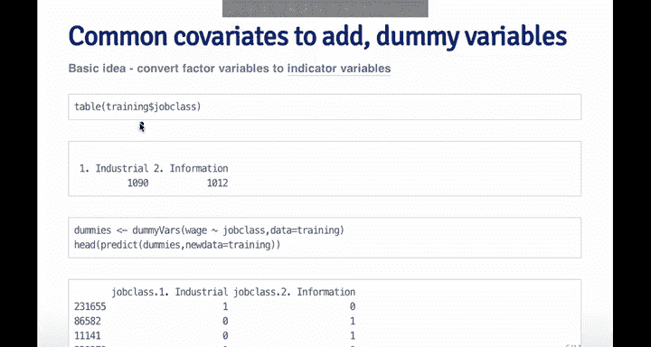

当你创建这些函数或决定使用这些函数时，你必须在训练集中进行。这是机器学习的一个常见主题：构建特征只能发生在训练集中，不能发生在测试集中。稍后当你将预测函数应用于测试集时，你将使用协变量的相同函数，以便应用你的预测器。但是，原始创建或思考构建什么协变量必须仅在训练集中进行，否则会导致过拟合。

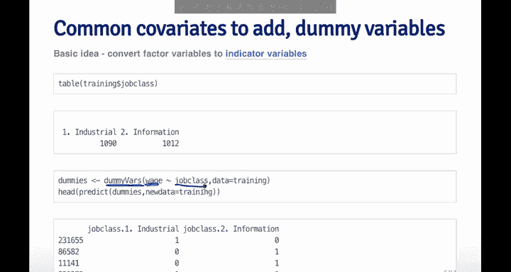

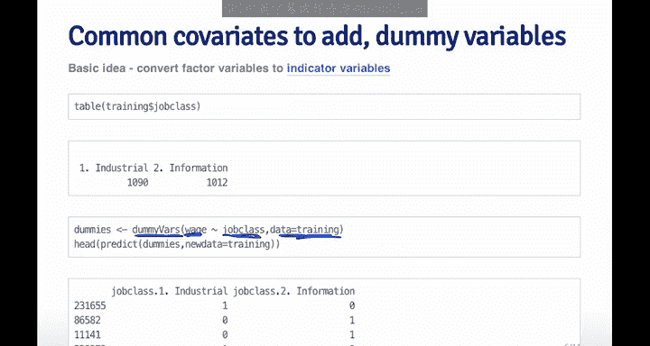

我发现的最佳方法是通过探索性分析。基本上，就是绘制图表和制作数据表格，试图理解数据中的变异模式，以及它们可能与结果有何关联。

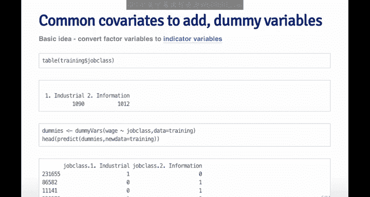

当你使用caret包或在R中进行此分析时，需要将新的协变量添加到数据框中，以便在下游预测中使用。确保新变量的名称是可识别的，以便你可以在测试数据集上使用相同的名称，这一点很重要。

以下是一个示例数据集。这里我们从ISLR包加载数据，并加载caret包，获取关于工资的数据。再次，我将构建一个训练集和测试集，以便我可以在训练集中进行所有协变量创建。我使用`createDataPartition`函数为两个数据集创建索引，然后将数据分离为训练集和测试集。

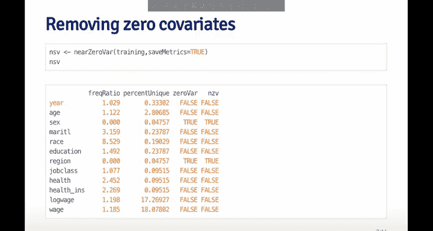

一个在构建机器学习算法时非常常见的想法是将定性或因子变量转换为所谓的虚拟变量。如果你通过这个数据科学专业课程学习过回归建模课程，你可能已经对此有所了解。基本思想是，假设我们有一个变量，在这个案例中，让我们查看训练集中名为`jobclass`的变量。这个`jobclass`有两个不同的水平：要么是“工业”，要么是“信息”。我们可以尝试直接将这个变量插入预测模型，但该变量的值实际上是一组字符，要么是“工业”，要么是“信息”。有时，预测算法很难使用这些定性变量来进行实际预测。

因此，我们可能想做的是将其转化为定量变量。使用caret包，你可以通过`dummyVars`函数来实现。基本上，它表示我们将传递给它一个模型公式，结果是`wage`，`jobclass`将是预测变量，`training`集是我们要构建这些虚拟变量的集合。然后，如果你使用`predict`函数，将这个`dummies`对象和新的数据（在这个案例中，我们只是将其应用于训练数据集），你会得到两个新变量。第一个是指示你是否为工业的指标，第二个是指示你为信息的指标。

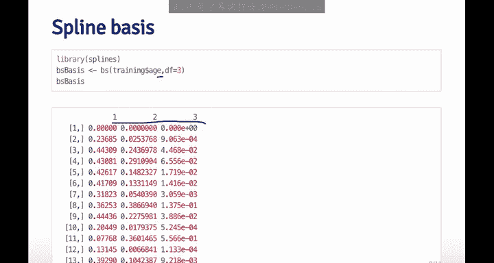

如果工业指标为1，意味着对于那个人，他们有一份工业工作；如果是0，意味着对于那个人，他们没有工业工作。对于信息指标也是如此：如果是0，意味着他们没有信息工作；如果是1，他们有信息工作。在这个案例中，该变量只有两个不同的水平（只有工业和信息），那么每当你的工业指标为1时，你的信息指标就为0；每当你的工业指标为0时，你的信息指标就为1，依此类推。但如果你这里有三个变量，可能每一列都会有两个0（因为那是你不属于的两个类别），和一个1（表示你属于的类别）。这就是将这些因子或定性变量转化为定量变量。

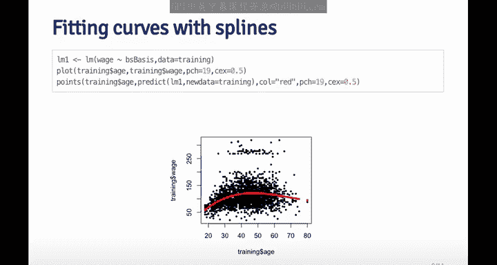

另一个情况是，有些变量基本上没有变异性。通常，你可能会创建一个特征，例如，对于电子邮件，创建一个特征说“没有任何字母”。几乎每封电子邮件都至少有一个字母，所以这个变量将始终等于真（它总是有字母），因此没有变异性，它可能不是一个有用的协变量。因此，你可以使用caret包中的`nearZeroVar`函数来识别那些变异性很小、可能不是良好预测变量的变量。你将其应用于一个数据框（即训练数据），这里我告诉它保存指标，以便我们可以看到它是如何计算哪些变量是近零方差变量的。例如，这里我们可以看到它告诉我们特定变量的唯一值百分比。在这个案例中，该变量大约有0.33%的唯一值，它不是一个近零方差变量。但是，例如，变量`sex`基本上只有男性，所以它的频率比非常低，换句话说，它基本上都是一个类别。因此，这最终成为近零方差变量。所以，你可以使用这个矩阵的列来丢弃所有像`sex`这样的变量，以及在这个案例中像`region`这样基本上没有变异性、不应在预测算法中使用的变量。这是立即丢弃那些意义不大的预测变量的好方法。

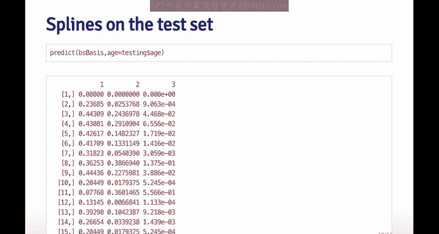

你可能做的另一件事是，如果你使用线性回归或广义线性回归作为你的预测算法（我们将在未来的讲座中讨论），其思想基本上是拟合穿过数据的直线。有时，你希望能够拟合曲线，一种方法是通过基函数来实现。例如，你可以在`splines`包中找到这些函数。你可以做的一件事是使用`bs`函数创建多项式变量。在这个案例中，我们传递给它一个单一变量（即训练集中的`age`变量），并说我们想要这个变量的三次多项式。当你这样做时，你基本上会得到一个三列的矩阵。所以，现在这是三个新变量。第一列对应于`age`的实际值（出于计算目的进行了缩放）。第二列将对应于类似`age`平方的东西，换句话说，你允许`age`和结果之间存在二次关系。第三列将对应于`age`立方，因此你允许`age`和结果之间存在三次关系。如果你在模型中包含这些协变量，而不仅仅是`age`变量，那么当你拟合线性回归时，你将允许曲线模型拟合。为了向你展示一个例子，这里我拟合了一个线性模型（你会从你的线性建模课程中记住这个）。`wage`是结果，波浪号`~`告诉你我们用什么来预测它。这里我们传递给它那个`bs`基，换句话说，我们传递给它从多项式模型生成的所有预测变量。在这个案例中，是`age`、`age`平方和`age`立方。

然后，我们可以绘制`age`数据与`wage`数据的图表。x轴是`age`，y轴是`wage`。你可以看到这两个变量之间存在一种曲线性的线性关系。我们可以绘制`age`和来自我们线性模型的预测值（包括曲线项、多项式项），你会看到一条曲线拟合穿过数据集，而不仅仅是一条直线。因此，生成新变量的一种方法是允许在建模特定变量时具有更大的灵活性。

然后，在测试集上，你必须预测那些相同的变量。这是机器学习中极其关键的思想：当你创建新的协变量时，你必须使用与训练集完全相同的程序在测试数据上创建协变量。你可以通过以下方式实现：我将从这个使用`bs`函数创建的变量中预测一组新值，这些是测试集的`age`值。这些是我在测试集上测试我的预测模型时要实际插入的值。这与直接对`age`变量应用`bs`函数创建一组新的预测变量不同，后者会在测试集上创建一组与你在训练集上创建的变量无关的新变量，并可能引入一些偏差。

关于这些思想的一些说明以及为你提供的进一步阅读材料：
*   **第一层特征创建**基本上都是关于科学或应用特定知识。我发现，对于我在这里没有谈到的、你不了解或刚接触的特定应用，最好的方法是搜索你试图分析的数据类型的特征提取，例如“图像特征提取”、“语音特征提取”等。你也可以直接查找该特定数据类型，并尽可能多地了解相关信息，特别是寻找可能在不同样本之间存在差异的显著特征。一般来说，你最好偏向于过度创建特征，因为你总可以在机器学习算法过程的后期过滤掉它们。在一些应用如图像和语音中，通常既可能也几乎必须创建那些不一定只是你凭空想象的特征。很难确切知道图像中哪些组成部分应作为特征包含在模型中。因此，有一些方法，比如你可能听说过的深度学习，它基本上是一种为图像和语音等创建特征的方法。我在这里链接了一个很好的教程，它解释了对于这些事物，特征创建过程是如何工作的。但总的来说，自动特征创建需要同等程度的思考，以确保你的特征创建过程生成的特征是有意义的。
*   **第二层特征创建**（从协变量到新协变量）可以通过caret包的预处理组件完成很多工作。你可以使用R中任何有意义的函数来创建新的协变量。关键同样是制作大量图表并进行探索性分析，以查看预测变量和结果之间的关联在哪里。如果你认为它们会改善拟合，你可以创建新的协变量。同样，你可以偏向于过度创建特征，但有时特征只是没有意义，你不应该创建它们。
*   注意过拟合，即如果你创建了许多特别适合你的训练集的特征，它们可能在测试集中效果不佳。因此，一个好的想法是，如果你过度创建了许多特征，在实际应用机器学习算法之前进行一些过滤。这篇关于caret预处理的教程非常好，是开始真正基础预处理的好地方。如果你想使用像我谈到的具有灵活曲线的模型，你可以使用caret包中的`gam`方法，它允许使用每个变量的不同平滑函数对多个变量进行平滑处理。
*   关于特征创建和数据整理的更多内容，请参见数据科学专业课程中的“获取和清理数据”课程。

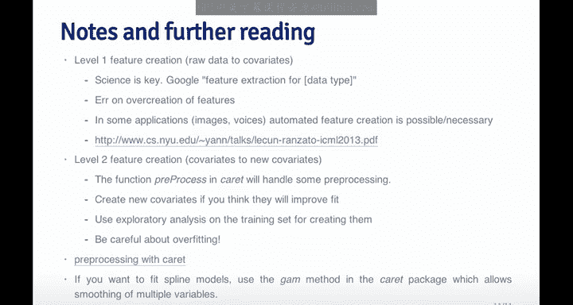

在本节课中，我们一起学习了协变量创建的两个层面：从原始数据创建特征，以及对现有特征进行转换以增强模型表达能力。我们探讨了特征创建中的平衡艺术，如总结与信息丢失，并强调了仅在训练集上进行特征工程以避免过拟合的重要性。我们还通过实例学习了如何将分类变量转换为虚拟变量、识别并移除近零方差变量，以及使用多项式基函数为模型引入非线性关系。最后，我们了解了特征创建依赖于领域知识，并可以通过探索性分析和现有工具包（如caret）来有效实施。