# 课程 P96：使用主成分分析进行预处理 📊

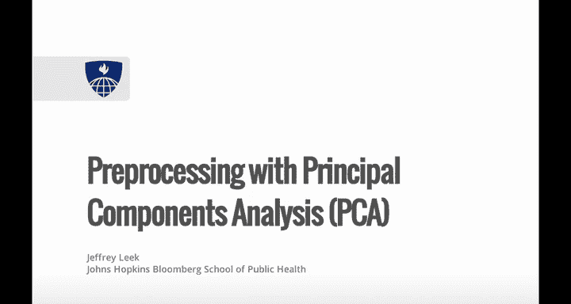

在本节课中，我们将学习如何使用主成分分析（PCA）对数据进行预处理。当数据集中存在多个高度相关的定量变量时，PCA可以帮助我们提取核心信息，减少变量数量，并可能提升模型的性能。

---

## 概述

在数据分析中，我们常常会遇到多个定量变量高度相关的情况。这意味着这些变量包含的信息非常相似，将它们全部纳入模型可能并非最佳选择。主成分分析（PCA）提供了一种方法，可以将这些相关的变量总结为少数几个“主成分”，这些主成分能够捕捉原始数据中的大部分信息。

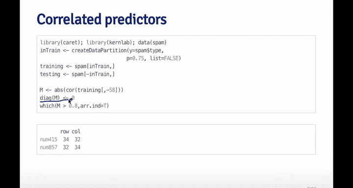

上一节我们介绍了数据预处理的背景，本节中我们来看看如何使用PCA来解决变量高度相关的问题。

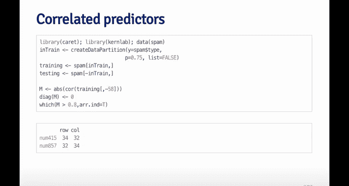

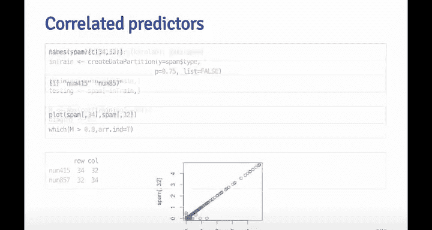

---

## 识别高度相关的变量

首先，我们需要识别数据集中哪些变量是高度相关的。以下是在R语言中实现这一步骤的方法。

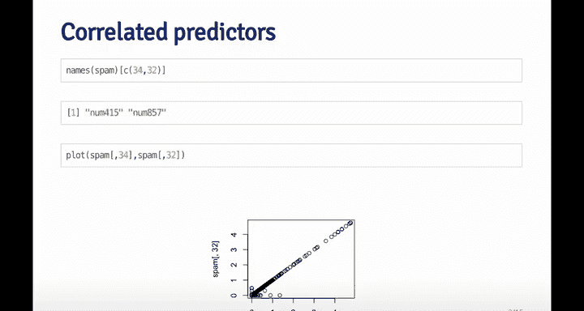

1.  加载必要的库和数据。
2.  将数据分为训练集和测试集。**所有探索性分析和特征工程都必须在训练集上进行**。
3.  计算训练集中所有预测变量之间的相关系数矩阵。
4.  将矩阵对角线（变量与自身的相关性，恒为1）设置为0，然后找出相关系数绝对值大于0.8的变量对。

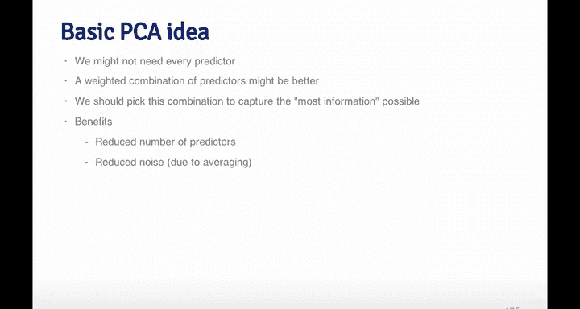


```r
# 示例代码：找出高度相关的变量对
library(caret)
library(kernlab)
data(spam)

# 创建训练集和测试集
inTrain <- createDataPartition(y=spam$type, p=0.75, list=FALSE)
training <- spam[inTrain,]
testing <- spam[-inTrain,]


# 计算预测变量的相关系数矩阵（排除结果变量第58列）
M <- abs(cor(training[,-58]))
# 将对角线设为0
diag(M) <- 0
# 找出相关系数大于0.8的变量
which(M > 0.8, arr.ind=TRUE)
```

执行上述代码后，我们可能会发现，例如，变量`num415`和`num857`（分别代表电子邮件中数字“415”和“857”出现的频率）高度相关。这是因为它们可能同时出现在某个电话号码中。

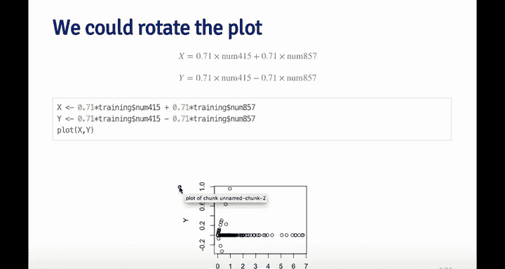

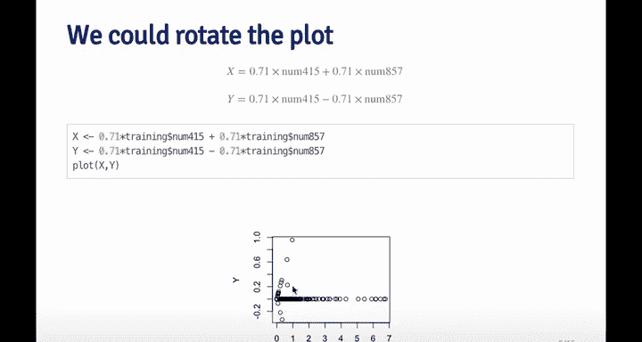

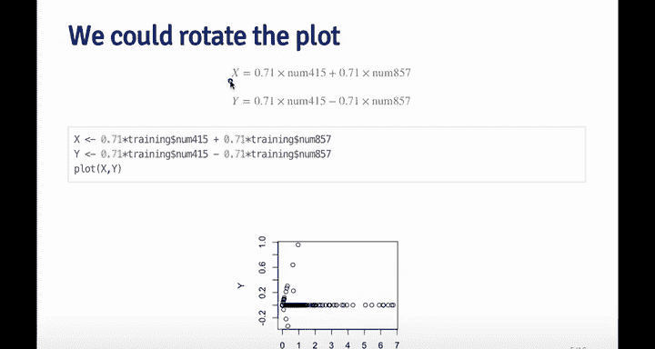

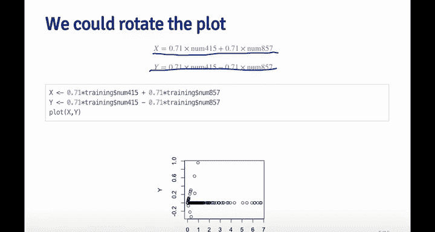

---

## 主成分分析的基本思想

当我们发现两个变量高度相关时，将它们同时纳入模型可能不会带来额外收益。PCA的核心思想是：**如何将这些变量转换成一个或少数几个新的变量，使其能最大程度地保留原始数据的信息**。

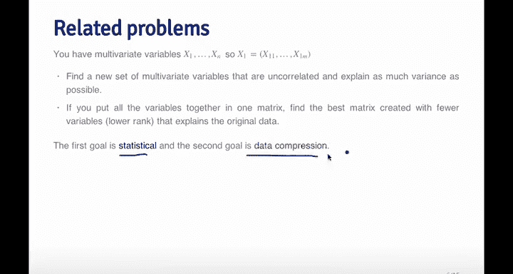

具体来说，PCA寻找原始变量的一个加权组合，这个组合能够解释数据中尽可能多的变异性。

假设我们有两个高度相关的变量X1和X2。我们可以考虑创建两个新变量：
*   **PC1** = 0.71 * X1 + 0.71 * X2 （将两个变量相加）
*   **PC2** = 0.71 * X1 - 0.71 * X2 （将两个变量相减）

如果我们绘制PC1和PC2，会发现数据点在PC1轴（相加方向）上分散很广，而在PC2轴（相减方向）上则紧密聚集在0附近。这意味着**PC1捕捉了这两个变量中的绝大部分信息**。因此，在建模时，我们或许可以只使用PC1这一个新变量，来代替原来的两个变量，从而达到降维和去噪的目的。

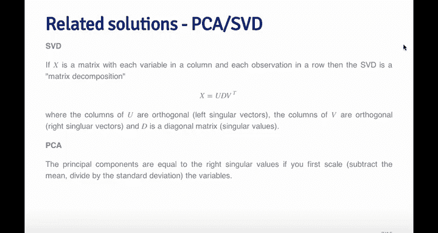

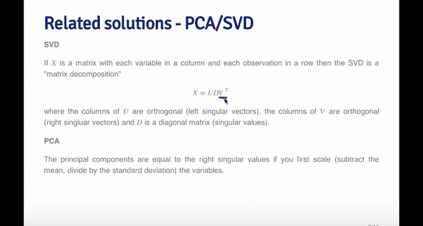

---

## PCA的数学原理与实现

在更普遍的情况下，PCA要解决两个紧密相关的问题：
1.  **统计目标**：找到一组新的、互不相关的变量，使其能解释原始数据中最大程度的变异性。
2.  **数据压缩目标**：用更少的变量（一个低秩矩阵）来近似表示原始数据。

这两个问题的解决方案都涉及**奇异值分解（SVD）**。对于一个数据矩阵X（每列是一个变量，每行是一个观测），SVD将其分解为三个矩阵：

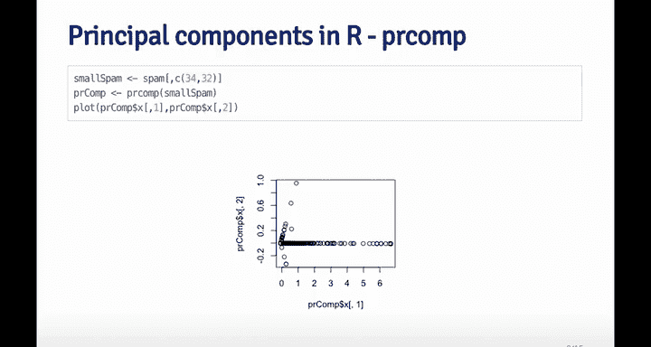

**X = U D V^T**

其中，**V**的列被称为右奇异向量，在数据经过适当缩放后，它们就等同于**主成分**。这些主成分是按照能够解释的变异大小排序的，第一主成分解释的变异最大，第二主成分次之，依此类推。

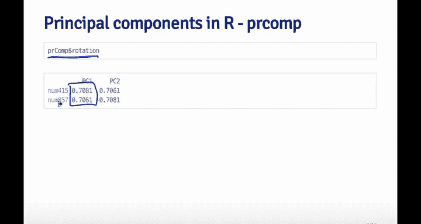

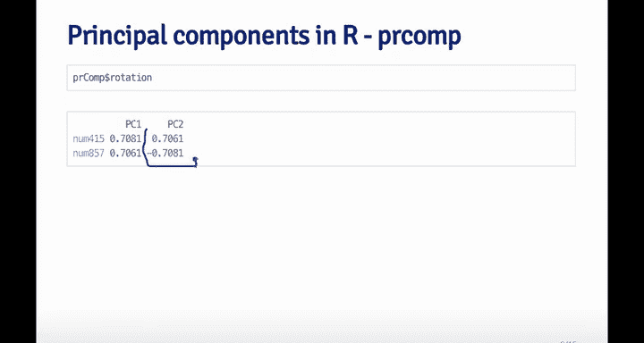

以下是使用R对两个高度相关变量进行PCA的示例：

```r
# 对两个高度相关的变量（例如第34和32列）进行PCA
smallSpam <- spam[, c(34,32)]
prComp <- prcomp(smallSpam)
# 绘制第一主成分与第二主成分
plot(prComp$x[,1], prComp$x[,2])
```


我们可以查看`prComp$rotation`矩阵，它显示了每个原始变量对主成分的贡献权重（载荷）。对于我们的例子，可能会发现第一主成分基本上是`num415`和`num857`的相加，而第二主成分是它们的相减。

---

## 在完整数据集上应用PCA

PCA的强大之处在于它能处理多个变量。我们可以对整个数据集（或其中所有定量变量）应用PCA，从而将数十甚至数百个变量压缩为少数几个主成分。

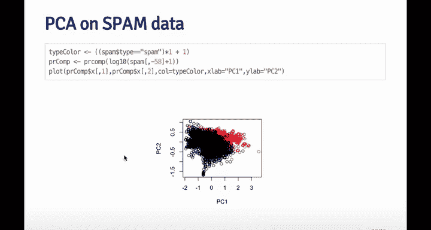

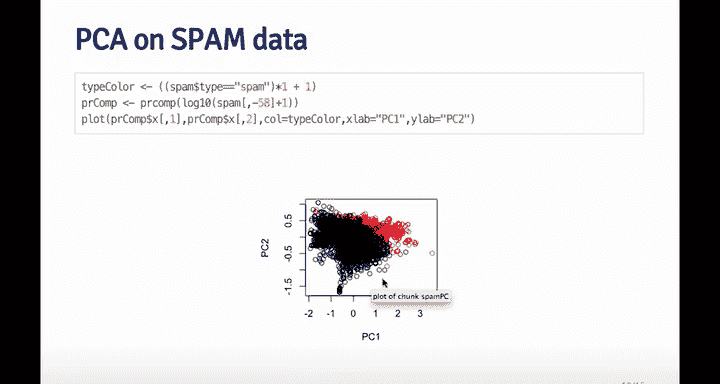

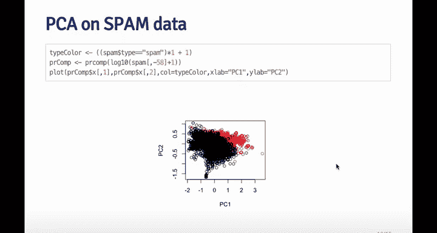

在应用PCA前，通常需要对数据进行预处理，例如对偏态分布的数据进行对数变换（`log10(x+1)`），以使数据更接近正态分布，让PCA的结果更有意义。

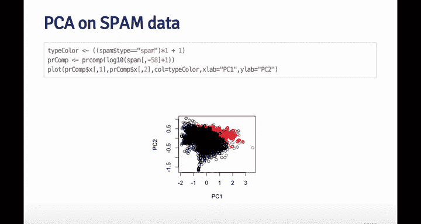

```r
# 对完整训练集进行PCA预处理（应用对数变换）
trainPC <- prcomp(log10(training[,-58]+1))
# 绘制前两个主成分，并按垃圾邮件类型着色
plot(trainPC$x[,1], trainPC$x[,2], col=training$type)
```

通过绘图，我们可能会发现，在第一主成分（PC1）或第二主成分（PC2）上，垃圾邮件（spam）和非垃圾邮件（ham）的分布略有不同。这表明，即使大幅降低了数据维度，我们仍然保留了能够区分两类邮件的关键信息。

---

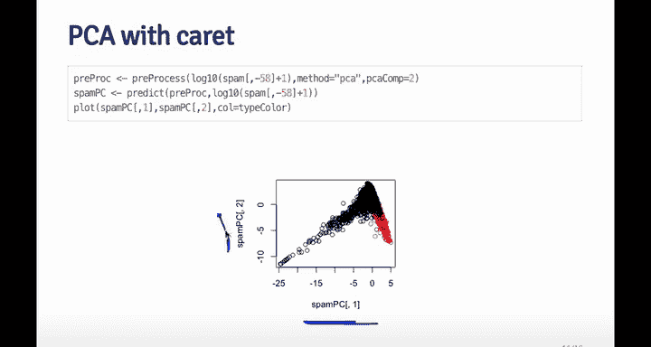

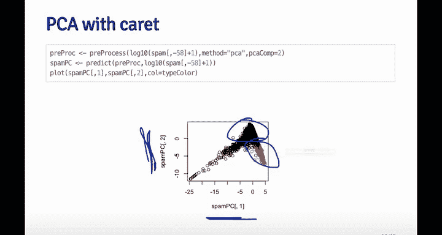

## 使用`caret`包集成PCA流程

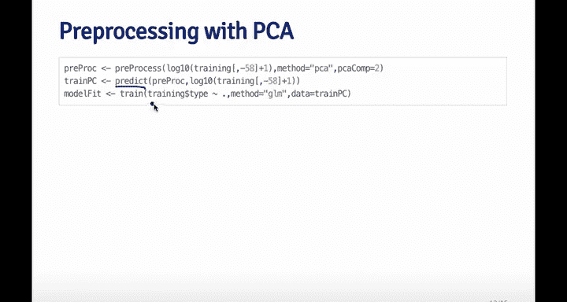

`caret`包提供了便捷的函数，将PCA预处理集成到模型训练流程中。

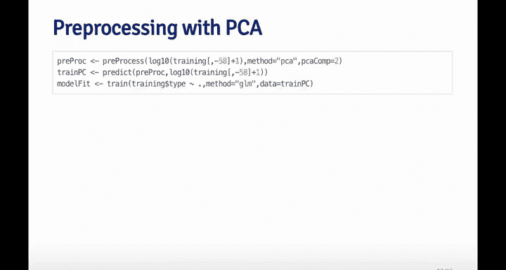

以下是分步实现的方式，有助于理解底层过程：

1.  **在训练集上计算PCA模型**：
    ```r
    preProc <- preProcess(log10(training[,-58]+1), method=“pca”, pcaComp=2)
    ```
2.  **将PCA模型应用于训练集和测试集，得到主成分得分**：
    ```r
    trainPC <- predict(preProc, log10(training[,-58]+1))
    testPC <- predict(preProc, log10(testing[,-58]+1))
    ```
3.  **使用主成分训练模型并进行预测**：
    ```r
    modelFit <- train(training$type ~ ., method=“glm”, data=trainPC)
    predictions <- predict(modelFit, testPC)
    # 评估准确率
    confusionMatrix(predictions, testing$type)
    ```

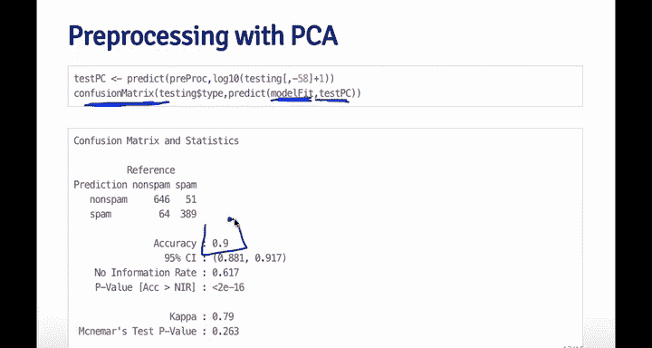

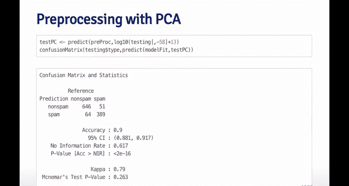

更简洁的方式是直接在`train`函数中指定预处理参数，`caret`会自动完成上述所有步骤：
```r
modelFit <- train(type ~ ., data=training, method=“glm”, preProcess=“pca”)
```

---

## 注意事项与总结

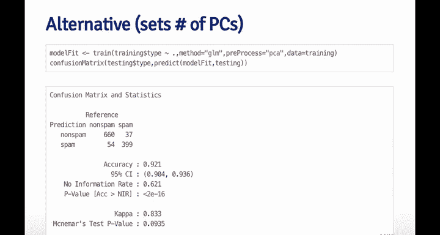

本节课中我们一起学习了如何使用主成分分析进行数据预处理。

**PCA的主要用途和优点包括**：
*   减少预测变量数量，简化模型。
*   消除多重共线性。
*   在降低维度的同时，尽可能保留数据变异性和信息。
*   对于线性模型（如线性回归、线性判别分析）特别有用。

**应用PCA时需要注意**：
*   **可解释性下降**：主成分是原始变量的加权组合，当变量很多时，其实际含义可能难以解释。
*   **对异常值敏感**：异常值会严重影响PCA的结果。在分析前应进行探索性数据分析，识别并处理异常值。
*   **数据预处理**：通常需要对偏态数据做变换（如对数变换、Box-Cox变换），使数据更符合PCA的假设。

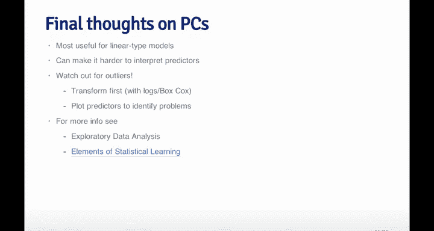

总之，主成分分析是一种强大的特征提取和数据降维工具。通过将多个相关变量转化为少数几个不相关的主成分，我们可以在不显著损失信息的前提下，构建更简洁、更稳健的预测模型。