# 课程 P97：使用回归进行预测 📈

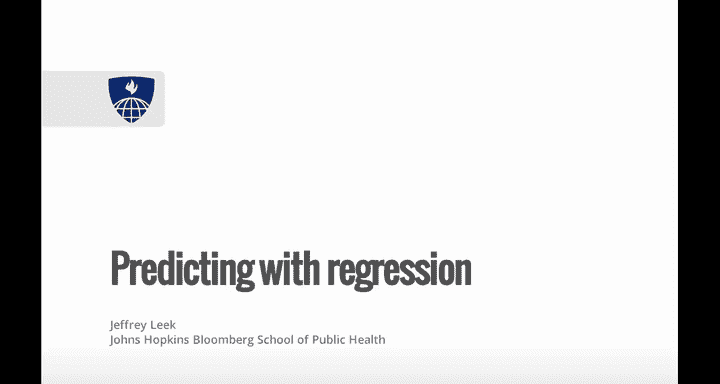

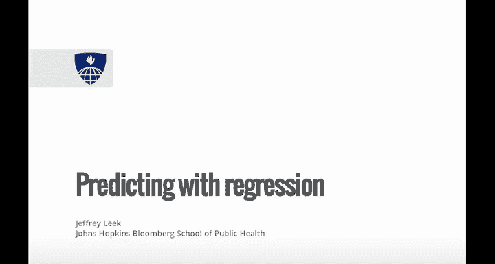

在本节课中，我们将学习如何使用回归建模这一最直接、最简单的机器学习方法进行预测。如果你已经学习过回归建模课程，那么本课的大部分内容对你来说会很熟悉。我们主要关注如何利用回归模型进行预测。

## 回归预测的核心思想 💡

上一节我们介绍了本课程的目标。本节中，我们来看看回归预测的核心思想。

其关键思想是拟合一个简单的回归模型。如果你不了解回归模型，不必担心，本课会简要解释。基本思路是，我们为数据集拟合一条直线。这条直线由一组系数乘以各个不同的预测变量构成。当我们获得新的预测变量或协变量时，只需将它们与通过预测模型估计出的系数相乘，就能得到对新值的预测。

当线性模型基本正确时，即变量之间的关系可以线性方式（即直线函数）建模时，这种方法非常有用。它易于实现，并且与许多机器学习算法相比，也更容易解释，因为你是在用一组直线拟合数据，而直线相对容易理解。

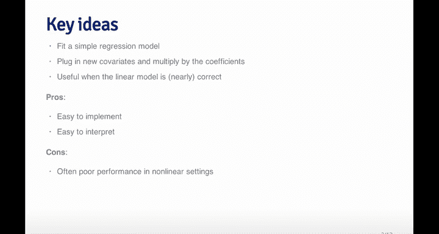

在非线性场景下，它也可能有不错的表现，因此在处理复杂案例时，通常与其他机器学习算法结合使用。

## 数据集介绍与准备 📊

上一节我们了解了回归预测的基本概念。本节中，我们将介绍用于演示的数据集并进行准备工作。

我们将使用关于间歇泉喷发的数据。间歇泉在两次喷发之间有一个等待时间，以及实际的喷发持续时间。有一个数据集可以轻松加载，其中包含美国著名间歇泉“老忠实泉”的喷发信息。

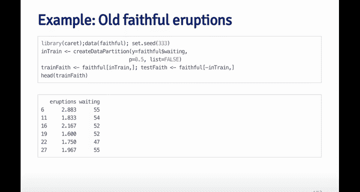

以下是数据准备步骤：

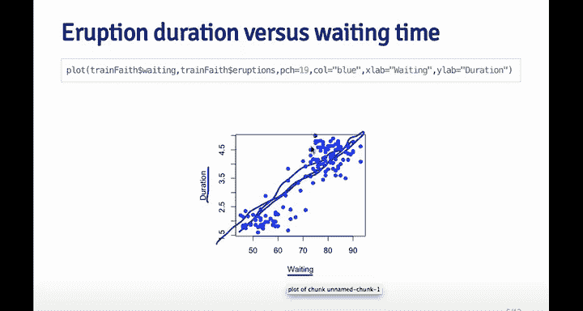

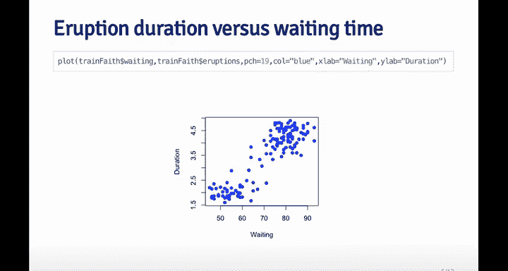

*   加载 `caret` 包和喷发数据集。
*   设置随机种子，以确保之后的所有分析都可以复现。
*   像往常一样，创建训练集和测试集。我们只在训练集上构建模型，然后在测试集上应用它们。

观察训练集，可以看到只有两个变量，这是一个非常简单的例子。我们有喷发持续时间（`eruptions`）和等待时间（`waiting`）。等待时间是两次喷发之间的间隔，喷发持续时间是间歇泉喷发的时长。

## 数据探索与可视化 🔍

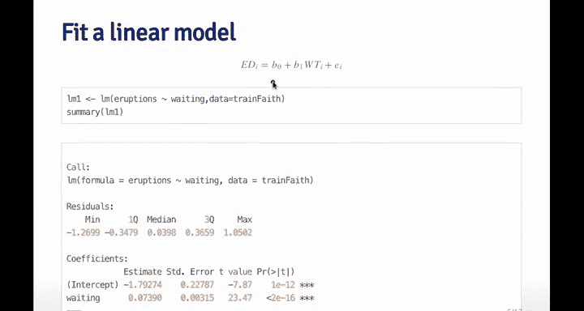

上一节我们准备好了数据。本节中，我们通过可视化来探索变量之间的关系。

如果绘制这两个变量，以等待时间为X轴，持续时间为Y轴，可以看到大致存在线性关系。你可以想象画一条穿过这些点的直线，能相对较好地根据等待时间预测持续时间。

## 拟合线性回归模型 📐

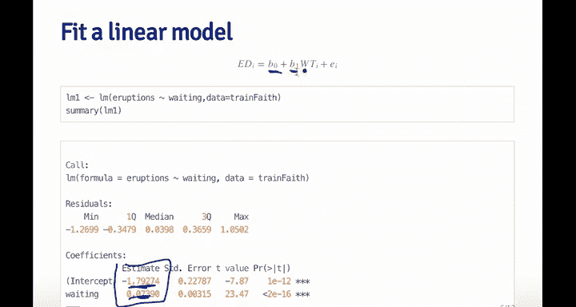

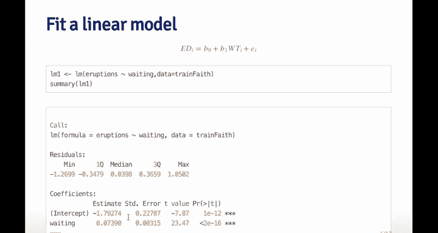

上一节我们观察到了变量间的线性趋势。本节中，我们来看看如何用公式描述并拟合一个线性模型。

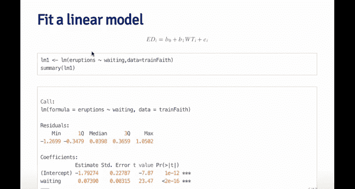

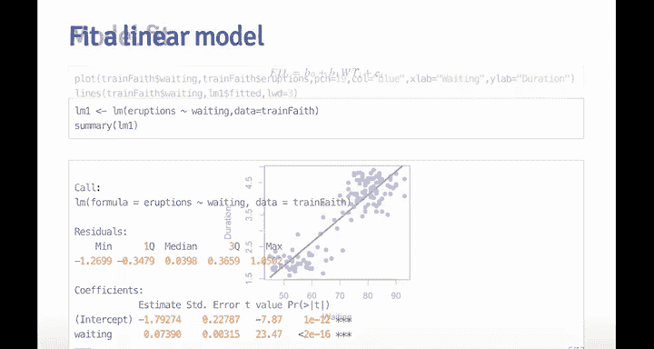

我们可以通过拟合一个直线公式来实现。直线的公式是：喷发持续时间 = 常数（截距项）+ 另一个常数 × 等待时间 + 误差项。正如上一张幻灯片所示，即使一条穿过数据中间的直线看起来是关系的合理近似，但点显然并不完全落在直线上。这就是为什么我们在模型中允许存在一些误差，误差项模拟了我们未测量或未理解的关系部分。

在R中，我们可以使用 `lm` 命令拟合线性模型。`lm` 将 `eruptions`（你试图预测的结果变量）与预测变量关联起来。波浪号 `~` 表示我们将根据波浪号右侧的一切来预测它。这里我们使用等待时间数据，并基于训练集的数据构建模型。

如果我们对模型进行摘要，在预测方面需要关注的部分是这些估计值。这里的估计值是截距，即公式中的 B0；等待时间的估计值是公式中的 B1。因此，要得到新的预测，我们只需计算：-1.79 + 0.073 × 新的等待时间，这就产生了我们对预期持续时间的预测。

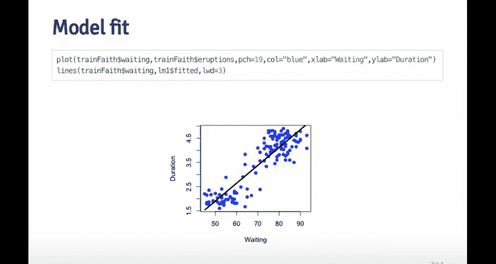

## 模型拟合结果可视化 📉

上一节我们拟合了模型并得到了系数。本节中，我们通过绘图来可视化模型的拟合效果。

我再次绘制了训练集，即等待时间与喷发持续时间的关系图。然后我绘制了拟合值。可以通过从线性模型对象 `lm1` 中提取 `fitted` 值来获得拟合值，然后将其与用于预测的变量（这里是等待时间）进行绘图。点来自第一个绘图命令，而拟合的黑色线条来自 `lines` 命令，它添加了一条使用拟合值的线。正如我们之前所见，有一条直线能合理地表示这两个变量之间的关系。显然它并不完美，点没有完全落在线上，但它合理地捕捉了数据的主要特征。

## 进行新预测 🔮

上一节我们可视化了模型在训练集上的拟合情况。本节中，我们学习如何对新的观测值进行预测。

要进行新预测，我们只需取 B0 和 B1 的估计值（通常用小帽子符号表示），然后使用前一页的公式将它们相乘。在这个公式中，我们没有误差项，因为我们不知道这个特定值的误差项是什么，所以我们只使用可以估计的部分。

要从线性模型对象中提取这些值，可以使用 `coef` 命令，它给出系数（即这两个变量的估计值）。`coef(lm1)[1]` 给出截距值（β̂₀），`coef(lm1)[2]` 给出等待时间的拟合值（β̂₁）。假设我们有一个新的等待时间 80，那么得到的预测喷发持续时间是 4.119。

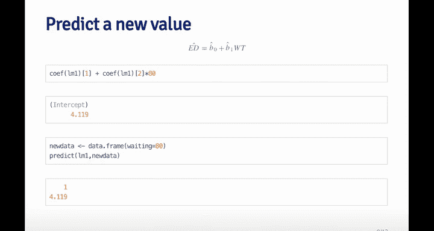

我们还可以直接使用 `lm` 对象进行预测，而不必每次都提取系数并相乘。如果我们创建一个新的数据集（数据框），其中包含一个我们想要预测的新值（例如 `waiting = 80`），然后输入 `predict` 并传入在训练集上拟合的模型以及新创建的数据框，它就会给出新值的预测结果，这与手动计算的结果一致。

## 评估模型在测试集上的表现 ⚖️

上一节我们学会了如何进行单个预测。本节中，我们评估模型在未见过的测试数据上的表现。

需要记住的是，我们像往常一样在训练集上构建了这个模型，并希望看看它在测试集上的表现。这里我将数据分成了训练集和测试集两个独立的集合，并制作了两个图：左边是训练数据的图，右边是测试数据的图。

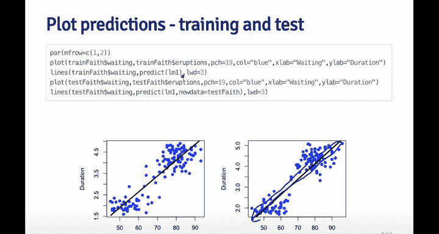

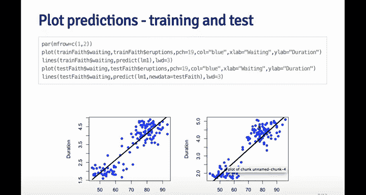

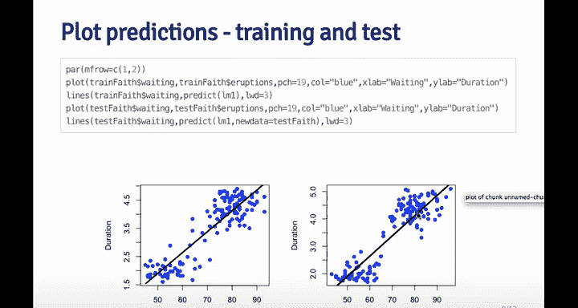

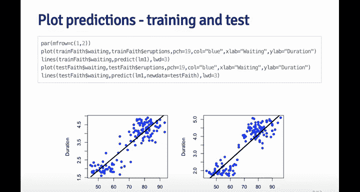

在训练数据中，我绘制了等待时间与持续时间的关系，并加入了模型拟合线。这是一个相当好的模型拟合，这是可以预期的，因为它正是我们用来构建模型的数据。我还绘制了测试数据集，这里的线（预测值）来自于在训练集上构建的模型。

可以看到，它不再像在训练集上那样完美地拟合数据，在这里有点倾斜，但这是可以预期的，因为测试集是一个略有不同的数据集。不过，你仍然可以看到它捕捉了由等待时间解释的整体趋势或主要变异部分。

## 计算训练集与测试集误差 📏

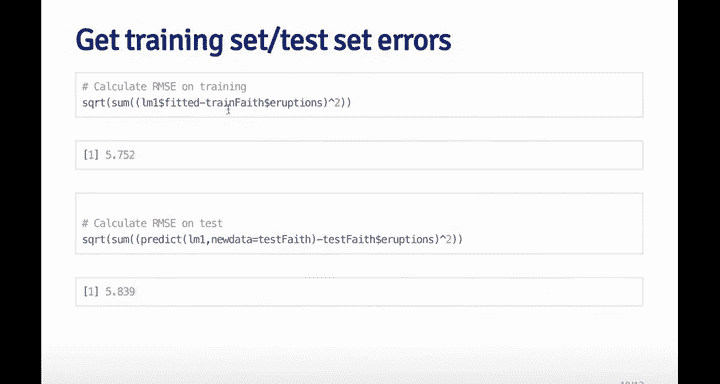

上一节我们观察了模型在测试集上的拟合情况。本节中，我们定量计算训练误差和测试误差。

接下来要做的是获取训练集和测试集的误差。要获得训练集误差，我们获取拟合值 `lm1$fitted`（记住 `lm1` 是我们拟合模型的对象，拟合值是我们在训练集上得到的预测值），然后减去训练集上喷发持续时间的实际值，求平方，求和，再取平方根。这就得到了均方根误差。它基本上衡量了拟合值接近真实值的程度，我们得到的值是 5.752。

我们也可以计算测试集上的均方根误差。方法是，我们再次使用在训练集上拟合的 `lm` 对象进行预测，但现在我们传入新数据（测试数据集）。这会预测测试数据集上的值，然后减去测试数据集上我们知道的实际值，求平方并求和。由于我们在构建算法时完全没有使用测试集，因此与在训练集上得到的值相比，这是对新数据均方根误差更现实的估计。和往常一样，测试数据误差几乎总是大于训练集误差，因为我们要处理一组未用于计算模型的新值，这代表了转移到新数据集时产生的额外误差和变异性，即样本外误差。

## 计算预测区间 📈

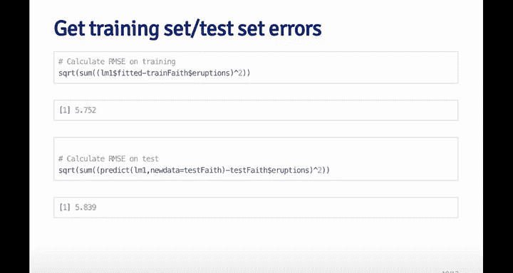

上一节我们计算了点预测的误差。本节中，我们学习如何计算预测区间，以了解预测的不确定性范围。

使用线性建模进行预测的另一个优点是，你可以计算预测区间。这里，我再次使用在训练数据集上构建的线性模型，为测试数据集计算一组新的预测，并指定我也想要输出一个预测区间。这只是我传递给 `predict` 函数的一个参数。然后，如果我对测试数据集的值进行排序，并绘制测试等待时间与喷发时间的关系图，我不仅可以添加显示预测值的黑线，还可以添加显示区间的线，这个区间捕获了我们预期预测值会落入的区域。如果我们的线性模型正确，我们预期大多数预测值会落在这两条红线之间。这不仅显示单个预测，还显示了我们可能预测到的可能值范围，这对于了解模型在新预测上可能的表现很有用，它会告诉你可能得到的预测范围。

## 使用 `caret` 包实现 🔧

上一节我们手动实现了回归预测的各个步骤。本节中，我们看看如何使用 `caret` 包更便捷地完成同样任务。

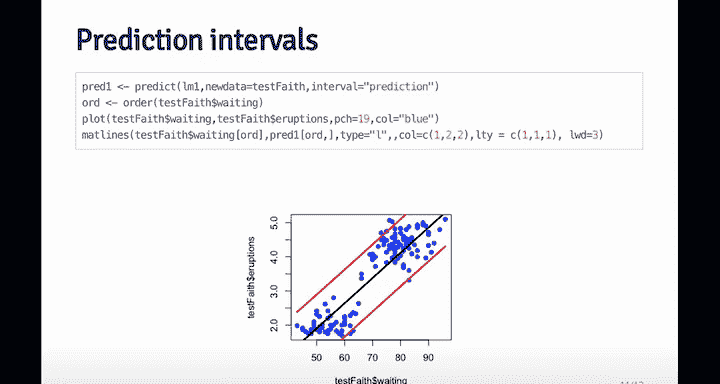

你同样可以在 `caret` 包中轻松实现。我使用 `caret` 包中的 `train` 函数来构建模型。同样，`eruptions` 是输出结果，`waiting` 是预测变量，它们由波浪号 `~` 分隔。然后我指定要在哪个数据集上构建模型，对于方法，我告诉它是线性建模。

如果你对该最终模型拟合进行摘要，`finalModel` 是 `train` 创建的模型拟合对象的一部分，它告诉你用于预测的确切最终模型。同样，它看起来与我们手动拟合的模型非常相似，截距是 -1.79，等待时间的系数是 0.07。

## 总结与拓展 📚

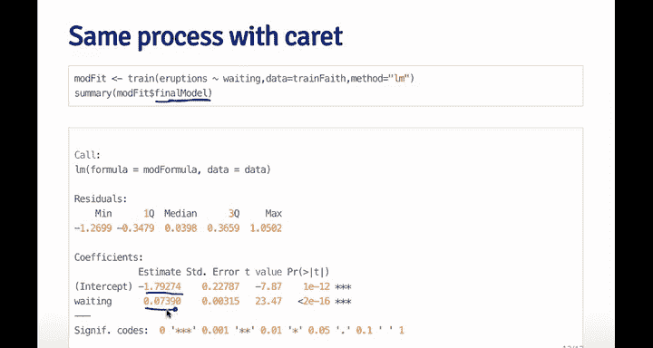

本节课中，我们一起学习了如何使用线性回归模型进行预测。

回归建模也可以使用多个协变量来完成，我们会有专门的一节课来讲解。你还可以将其与所有其他预测和机器学习方法结合使用。它可以说是一种快速简便的实用方法。当关系不一定是线性时，它确实会产生较高的误分类错误。许多关于预测的内容都涵盖在回归建模中，这些书籍是很好的参考资料，如果你想了解更多信息，可以查阅。

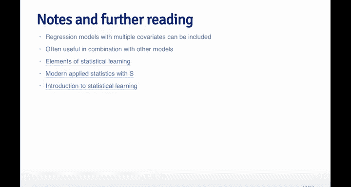

**总结一下，在本节课中我们：**
1.  理解了使用线性回归进行预测的核心思想。
2.  学习了一个关于间歇喷发的数据集，并进行了训练集/测试集划分。
3.  探索了变量间的线性关系。
4.  使用 `lm()` 函数拟合了线性回归模型，并理解了模型系数。
5.  可视化了模型的拟合直线。
6.  学会了如何对新的观测值进行点预测。
7.  评估了模型在测试集上的表现，并计算了训练误差与测试误差。
8.  了解了如何计算和可视化预测区间，以评估预测的不确定性。
9.  掌握了使用 `caret` 包中的 `train()` 函数便捷地实现线性回归预测。