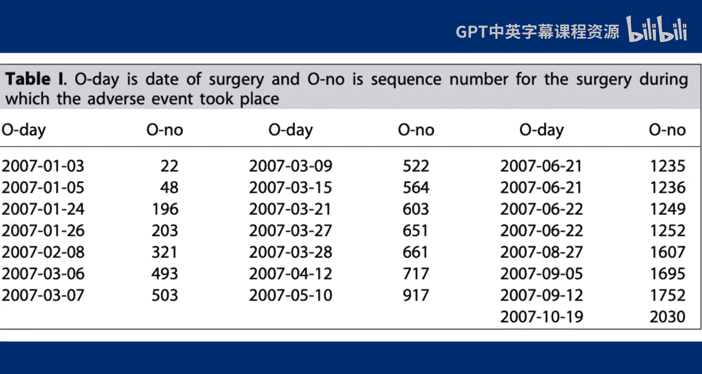
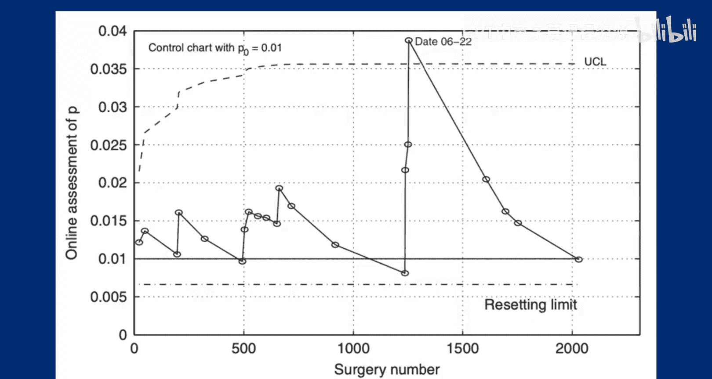
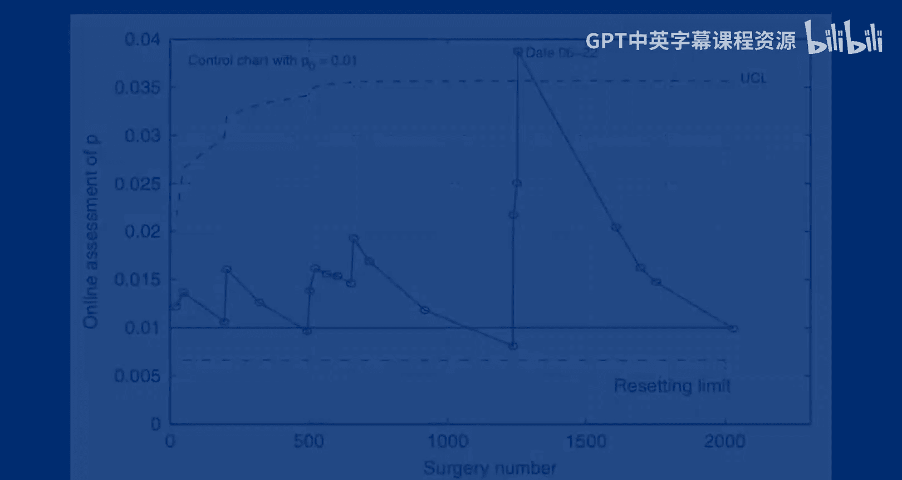
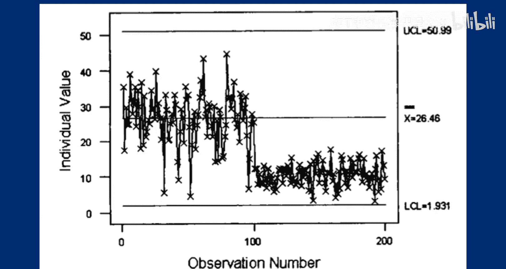
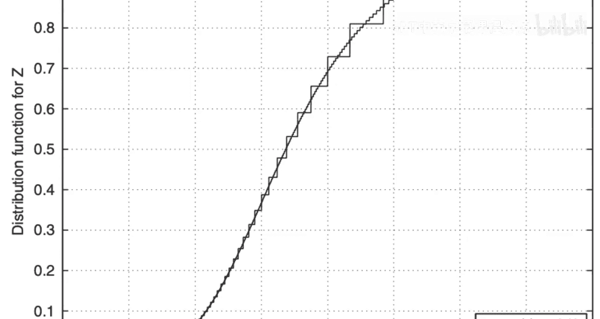
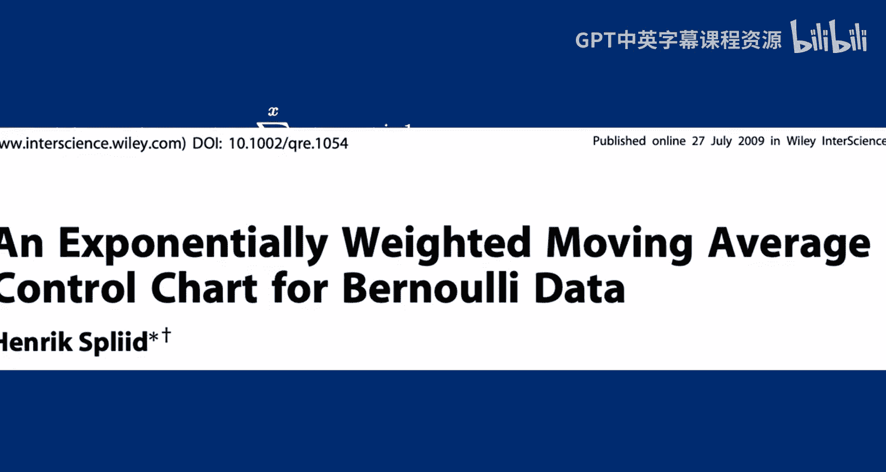
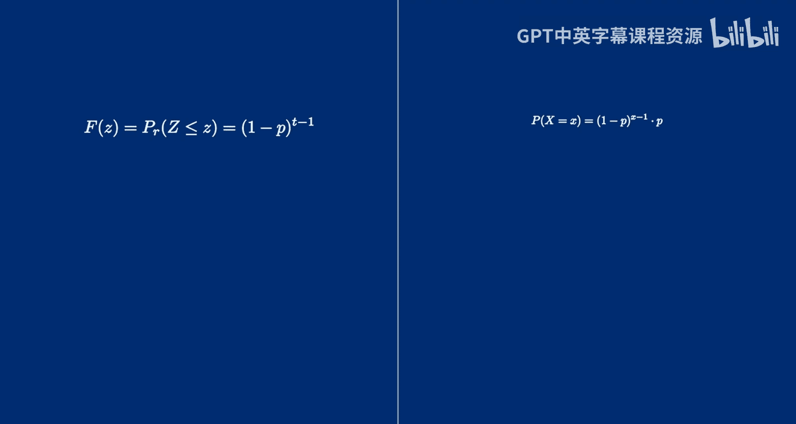
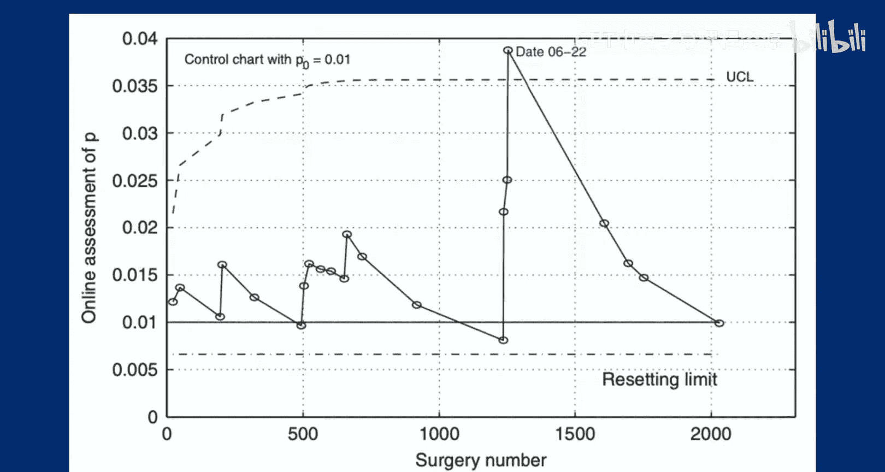
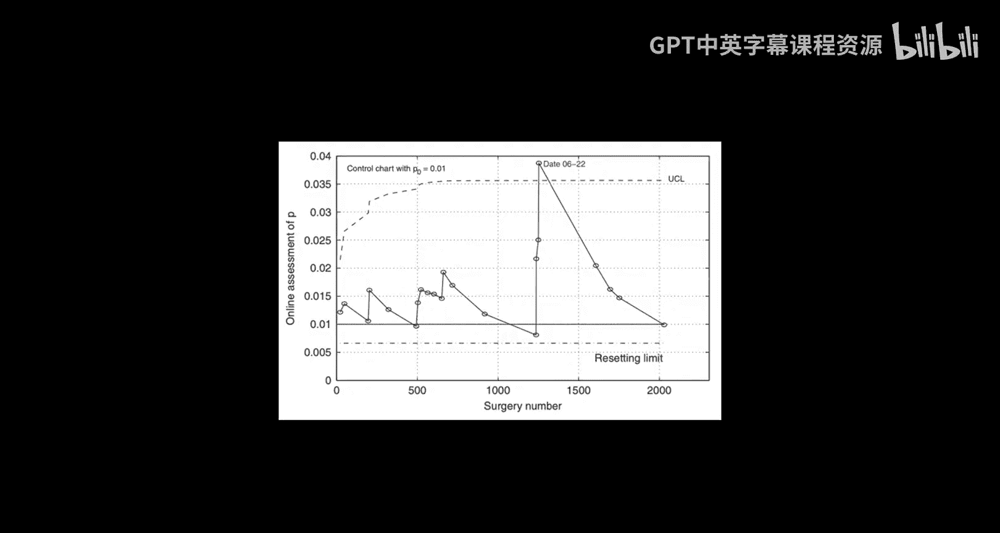

#  004：质量控制图 📊

在本节课中，我们将学习质量控制图。这是一种在工业界广泛使用的工具，用于监控复杂过程，确保其保持在预期的性能水平。我们将探讨其基本原理、数学公式以及如何通过数据转换来更清晰地识别过程是否失控。

---

## 概述

质量控制图提供了一种简单而有力的视觉方法，用于监控通常非常复杂的过程。通过监控控制图，可以确保由过程定义的总体结果以期望的故障率保持在受控状态。如果过程开始偏离，显示出更高的故障率，生产线或手术中心就可以采取积极的纠正措施。

上一节我们介绍了序列分析的基本概念，本节中我们来看看如何将这些概念应用于实际的质量控制场景。

---

## 质量控制图的基本原理

质量控制图的核心思想是监控一个持续进行的过程，以了解其运行状况。我们可以将其视为跟踪一个分布函数，该函数由单个参数定义，我们则寻找该参数的偏差。

最常见的控制图是单侧控制图，主要用于监控故障率是否升高。当然，也存在双侧控制图，其工作原理基本相同，用于监控过程是否在设定的上下限之间运行。

以下是质量控制图的关键要素：
*   **控制限**：图上标出的上限和下限，定义了过程的正常波动范围。
*   **个体值**：每个数据点代表一次观测或事件的结果。
*   **失控信号**：当数据点超出控制限或呈现某种非随机模式时，表明过程可能失控。

---

## 应用场景：医院手术部门

假设你负责管理一家大型医院的手术部门。大多数时候，手术顺利进行。但偶尔，可能由于设备故障、患者未到场或程序错误，事情会出错。我们希望将这些“出错”的时刻控制在很低的概率，例如千分之一。

问题在于：如何实施一个序列测试，来帮助我们评估何时一切顺利，何时出现了问题？

这个想法很好地源自瓦尔德1945年的工作。其核心思想是使用一种称为控制图的工具来寻找罕见事件（即故障）。这与我们之前讨论的瓦尔德最初的序列概率比检验图在本质上是相同的。

---

## 数学模型：几何分布

此处的假设与瓦尔德所做的非常相似。我们必须假设事件是独立同分布的，并将在几何分布的框架内工作。

几何分布是离散形式的指数分布，它描述的是在获得一次“成功”（此处指故障事件）之前，所经历的“失败”（此处指正常事件）次数。

设随机变量 **X** 表示第一次出现故障事件时经历的总事件数（即故障发生在那一次）。那么，在第 **x** 次事件首次出现故障的概率由以下公式给出：

**P(X = x) = (1 - p)^(x-1) * p**

其中：
*   **p** 是单次事件中出现故障（罕见事件）的概率。
*   **(1-p)** 是单次事件中正常（常见事件）的概率。

我们关注的是故障事件之间的间隔时间。显然，故障间隔时间越长越好，这正是我们试图控制的目标。

我们的统计问题是：能否确定这个 **p** 值（控制几何分布的罕见事件概率）？能否保持尽可能长的故障间隔？或者，如果存在一个改变点使得故障变得更常见，我们能否发现它？

---

## 数据转换与指数加权移动平均图

为了更清晰地洞察过程是否失控，我们可以对数据进行转换。这篇2009年的论文提出了一种转换方法，能将几何分布的数据转换到一个新的框架下，使得失控信号更加明显。

这种转换的核心概念是**指数加权移动平均**。本质上，我们通过一种加权移动平均的构建方式，来观察过程是否受控。

转换涉及一个对数函数，具体形式如下：

**Z = log( (x - 1/2) / (1/p - 1/2) )**

这个 **Z** 转换帮助我们将累积分布函数 **F(z)** 映射到一个框架中。在这个框架下，无论 **p** 值如何，转换后的数据都会遵循非常相似的曲线。这使得我们能够更清晰、更快速地看到概率 **p** 的分布情况，从而判断过程是否处于控制之中。

通过这种转换，我们能够对过程实施控制。这个例子中的数学非常有趣，它展示了数据转换如何帮助我们更深入地理解数据所传达的信息。

---

## 总结与联系

本节课中，我们一起学习了质量控制图。它是一种基于序列或在线数据做出及时决策的强大工具。

我们回顾了其基本原理，探讨了如何用几何分布为罕见事件建模，并介绍了一种通过数据转换（特别是利用指数加权移动平均）来增强控制图洞察力的方法。这种方法与瓦尔德1945年的序列分析工作一脉相承。

在课程后期，我们将有机会讨论鞅——另一个与序列事件和赌博理论相关的概念。鞅理论为我们思考序列事件中分布的极限提供了有趣的方式，而指数加权移动平均图在视觉上呈现随时间变化的数据力量，不断提醒我们基于数据及时做出决策的重要性。

总而言之，这种分析和这类问题在我们现代互联的世界中正变得越来越重要。希望本节内容能帮助你进一步理解如何基于随时间序列到达的数据来做出更好的决策。