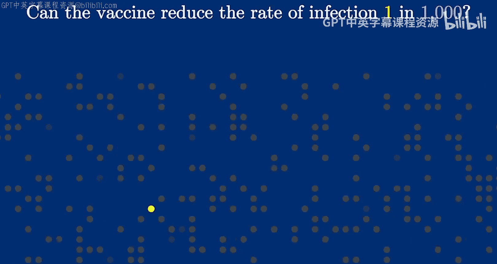
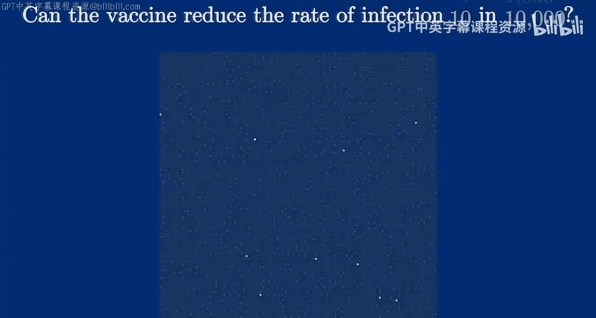
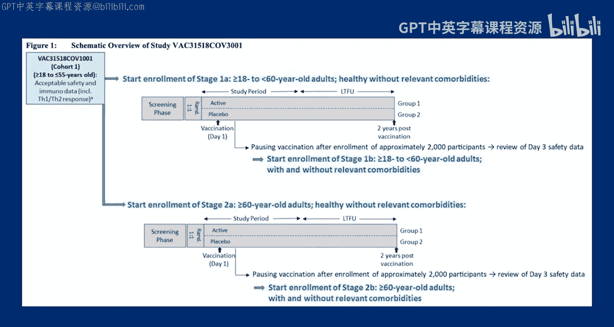
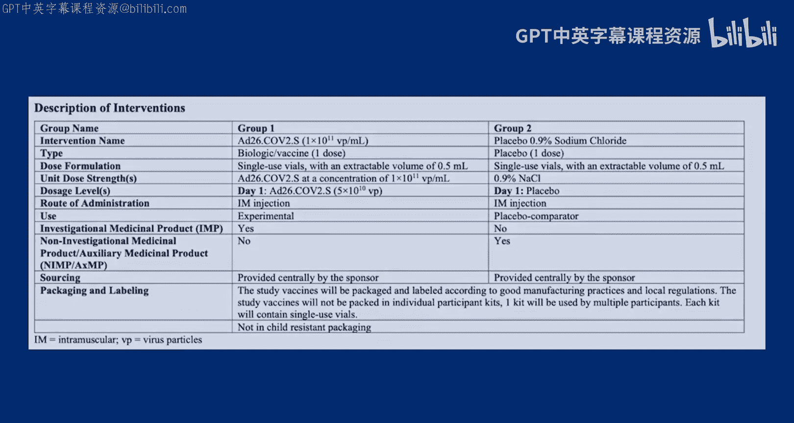
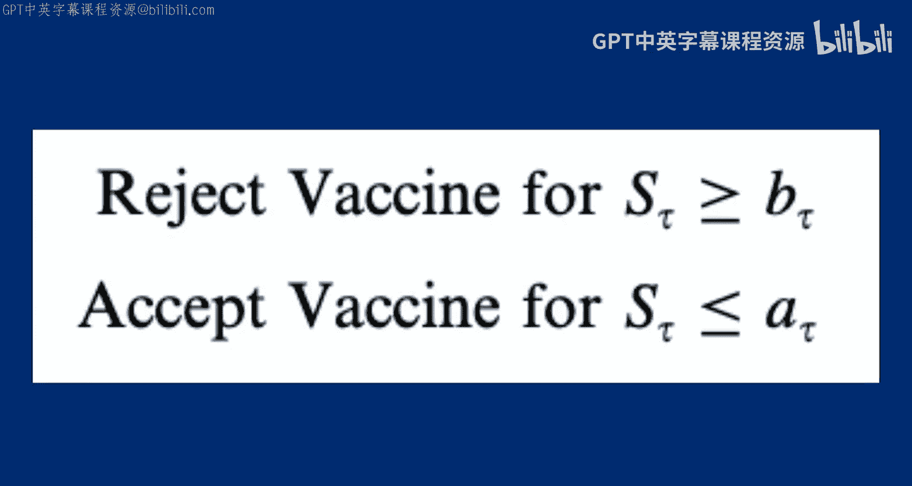
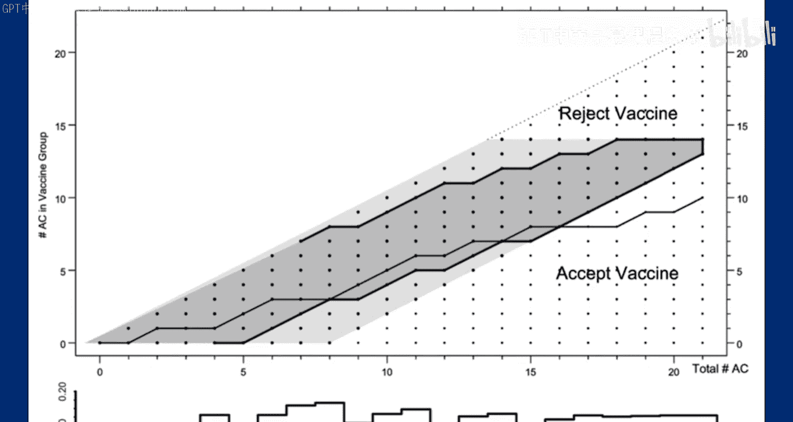
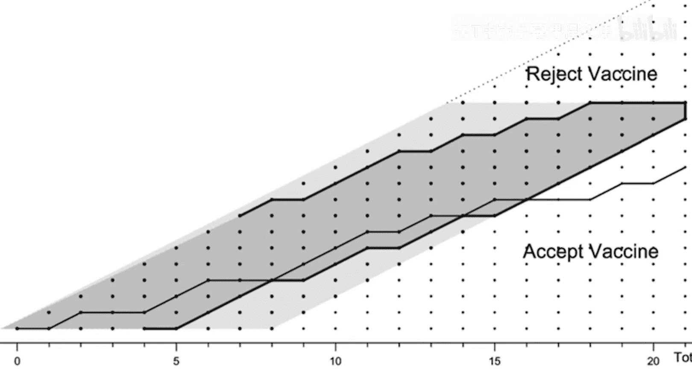

#  005：疫苗序贯测试方法 💉

在本节课中，我们将学习疫苗开发中使用的序贯测试方法。我们将探讨如何通过统计测试来验证疫苗的安全性和有效性，并以强生公司的疫苗测试为例进行说明。理解这些方法有助于我们建立对疫苗审批过程的信心。

---

在过去的一年里，世界因新冠疫情发生了巨大变化。对许多人而言，隧道尽头的光明是疫苗的研发。你可能已经接种或正在考虑接种疫苗。但我们必须问：这些疫苗有多安全？如果你对接种疫苗犹豫不决，原因是什么？这种犹豫是基于对疫苗设计、测试和安全性评估的理解吗？

本课程涵盖的许多内容，可以追溯到针对疫苗、药物等的序贯测试。因此，我们认为，通过理性分析这些序贯测试思想如何揭示疫苗的相对安全性，大家都能从中受益。正确进行测试在当下至关重要，而它们确实可以被正确执行。

本节我们将讨论强生公司为其疫苗采用的测试路径。针对不同情况有不同的测试方法，这只是其中一种序贯测试路径。但我相信，在了解之后，你会感到用于测试疫苗的方法（包括我们现在讨论的序贯测试）非常严谨且理由充分，足以验证疫苗的安全性。因此，你可以确信，通过此类测试的疫苗是安全的产品，接种是安全的，并且有助于控制疫情，让世界对我们所有人都更安全。

想象你有一种可能的新冠疫苗。你如何向世界证明你有一个可行的解决方案？在你的想象中，疫苗是100%有效的。但现实会如此吗？你如何判断？在现实世界中，有些参与者接种后会有效，有些则无效。这意味着你不能立即告诉所有人应该接种你的疫苗并确保安全。

那么，你如何向自己和世界证明你拥有一种好疫苗？这就是序贯测试的问题，也是药物开发、医疗手段以及疫苗开发中常见的问题。请看右侧的新冠模型疫苗。现在，我们可以通过序贯测试的视角来看待它。

## 序贯测试的核心思想 💡

正如前面提到的，序贯测试的思想可追溯到20世纪40年代Wald的理论。其核心是将疫苗视为具有一个固定的有效性百分比。我们需要序贯地观察大量个体，并统计有效和无效的案例数。在本例中，即统计接种后感染新冠与未感染的人数。

以下是两个关键假设：第一，存在一个单一参数描述疫苗的有效性；第二，这个数值不随时间改变。因此，当我们想象接种疫苗时（如图中所示，有时是真疫苗，有时是安慰剂），我们通过测试来发现谁在接种后感染了新冠，谁没有。这一切都关乎计数。

理想情况下，我们再次假设病毒本身保持不变，并且疫苗在我们所研究的人群中具有同等效力（或无效）。这是一个相对简单但仍相当稳健合理的假设，即我们认为可以用一个单一的分布来捕捉所有情况。基于这个想法，我们可以再次描述一个测试——一个序贯测试，用于定义疫苗是否很可能有效，或者是否应该撤回，以及我们是否应该继续研究其他疫苗方案。

例如，这里有一个动画演示，我们可以借此向FDA和潜在的疫苗客户说明我们预期疫苗的表现如何。

## 测试设计与统计比较 📊

我们运行的序贯测试，旨在探究两个人群中感染新冠的人数对比：第一个是未接种人群，第二个是接种人群。如果疫苗有效，那么与未接种人群相比，在已接种的测试人群中，我们应该看到更少的病毒感染病例。

那么，如果我们观察1000人，疫苗能否将感染率降低到1%？这将是理想情况。对于10000人的群体呢？应该是相同的百分比。因此，如果我们设想一个不随时间变化的有效性度量（病毒不变，人群基本不变），我们就可以进行测试。

在整个过程中，我们必须考虑假阳性和假阴性。我们不能期望完美地测量，但可以预期会有一定比例的测量误差。例如，在我们认为被感染的10人中，可能只有9人是真正的阳性。

我们将测量误差分为两类：第一类错误和第二类错误。我们需要说服FDA、公众以及我们自己，我们已经正确测量了疫苗预防新冠的有效性。所以，这又是我们的挑战：我们能否从统计上证明这一点？我们再次通过计数来实现。我们持续记录两个人群中的感染数量，并随着计数的增加，建立我们看到有效疫苗的信心。这就是强生公司在其疫苗测试中采用的方法思路。

你可以在屏幕上看到他们的描述，其中提供了更多细节。我们主要探讨两种可能性，即两个假设：本质上，我们拥有一个可行的疫苗，或者我们没有。

## 假设与风险计算 🧮

在我之前展示的带有R的方程中，我们正在比较相对风险（即R值）与一个阈值。我们使用R来表示这个符号。我们有一个备择假设，即我们会停止疫苗研发，这是相反方向的相对风险。这源于定义R的计数。

不要被我们这里使用的“相对风险”所迷惑，只需理解它是在测试、是在对两组（接种疫苗组和未接种组）进行计数。我们再次提出的问题是，在暴露于病毒的人群中，我们是否看到了改善。

这是他们不久前提到的研究设计。他们使用了两个阶段，每个阶段都有两组，再次强调，这两组分别是接种疫苗组和未接种组。两个阶段之间的唯一区别是与患者相关的年龄。你可以想象疫苗在这些不同年龄组中可能具有不同的有效性。

因此，我们可以考虑两种类型的错误：α和β。思考这两种错误非常常见。α是我们的第一类风险，β是我们的功效，即第二类风险。你可以将α视为消费者风险，正如屏幕上简单定义的：接受疫苗而疫苗实际上不安全的概率。β是第二类错误，是相反的风险。

显然，我们希望控制第一类和第二类错误。当你自愿参加疫苗试验时，仍然意味着要接种一针，但你不会知道接种的是疫苗还是安慰剂。这听起来对那些接种候选疫苗的人可能不公平，但你需要记住，在这个阶段我们还不知道疫苗是否有效。因此，无论接种的是疫苗还是安慰剂，你都不知道哪个一定更好。

再次强调，β是功效，即第二类风险，你可以将其视为生产者风险。在这种情况下，我们实际上通过β在问：为了将第二类错误控制在可接受的范围内，我们需要测试多少个体？这就是功效。我们希望在合理的效应量下具备这种能力，而β同时衡量了功效和效应量，即疫苗安全却被拒绝的概率。我们希望控制这个概率。这意味着，接种候选疫苗的人甚至可能面临更大的风险，因为只是不知道而已。在没有测试结果之前，你并不知道自己更希望属于哪一组。

## 序贯测试的决策过程 📈

我已经提到了这两种错误类型，它们再次与我们的序贯测试方法或序贯试验相关联。第一种我们可以认为是消费者风险，这意味着你接种了疫苗，但疫苗实际上并不安全。第二种是疫苗安全却被拒绝的概率。你可以将β视为衡量错失机会的指标。

因此，在一个设计好的序贯假设检验中，我们预期在疫苗治疗组和安慰剂治疗组中，有一定比例的试验参与者会感染新冠。我们保持一个运行计数，就像听起来那么简单：统计我们两个测试组中患病与未患病的人数。我们也可以记录副作用，甚至可以区分轻微和严重副作用，或长期和短期副作用。

在这种序贯任务的视角下，我们询问的是这些随时间变化的计数，相对于我们从固定概率分布中预期看到的数字。这就是序贯测试的整体方法。那个固定的先验分布告诉我们疫苗可能的有效性，我们假设它有一个值、一个描述有效性的参数，并且我们可以持续监控我们的数字。

在这种类型的序贯测试中，我们可以在每个时间点考虑三种结果。

## 测试的三种可能结果 🎯

显然，我们可以无限期地继续测试，但我们可能希望拒绝疫苗（这是一种可能），或者接受疫苗（这是第二种和第三种结果）。所有这些决策最终都由我们需要向FDA和公众讲述的、关于疫苗效果如何的故事来定义。

因此，我们需要谨慎，并且要有信心，相信我们的统计数据或计数能正确得出疫苗是否有效的结论。这应该立刻让你想到大量的测试次数，这会影响功效，而这是正确的直觉。

另一种说法是，我无法通过两三次抛掷来判断一枚硬币是否公平（即正反面概率是否为50%）。但如果我有1000次抛掷，我对它是否公平就会有更强的感觉。如果我有10000次抛掷，那么我对硬币具有特定正面或反面概率P的信心就相当合理了。换句话说，只要有足够的抛掷次数，我就可以相当肯定地判断它是否是一枚公平的硬币。同样，如果是一枚55%正面朝上的硬币，我们可以绘制一个序贯设计图来总结情况。

## 序贯测试边界图 📉

如果我们根据错误率在图表上设定边界，定义何时接受、何时拒绝，我们就可以为继续测试定义一个广阔的区域（三种选择），它看起来会像屏幕上显示的这样。实际的数字和边界将取决于疫苗，以及我们想要传达的对疫苗有效性二项式参数测量结果的信心程度。

因此，再次强调，测试的边界a_i和b_i将类似于屏幕上即将出现的图表。这设定了我们将何时停止、何时继续的界限。这将帮助我们再次公平地评估我们的测试进展如何，因为显然，正如我在引言中提到的，疫苗制造商、公共卫生部门都不希望将未通过这些测试的疫苗推向市场。换句话说，我们只会将合理的产品推向市场。

再次强调，我们的X轴是序贯测试的次数，我们的a和b设定了那些实线。所以我们有“接受疫苗”范围、“拒绝疫苗”范围和“继续测试”范围。这就是我们的序贯测试所处的三个范围。因此，当我们计数、查看数字时，我们就在这类图表上绘制点，并可以将其视为设定边界。

我希望这能帮助你更深入地理解Wald的序贯抽样思想及其如何应用于疫苗开发。我也希望这有助于理解疫苗被证明安全有效的细微之处，因为它们可以从统计上被证明是安全有效的。这是一个重要的公共卫生信息：像新冠病毒及其引发的新冠肺炎这样可怕的事物，我们可以通过疫苗以及每个人贡献力量来控制它——通过教育他人了解疫苗测试，并通过自己接种疫苗来确保安全。

## 总结与公共卫生意义 🌍

因此，药物和疫苗的安全性是公共卫生的核心，我想我们都同意这一点。企业、政府或任何个人都没有兴趣将一种会给任何人带来新的健康风险或问题的药物或疫苗推向市场。换句话说，为什么要通过给予新药或新疫苗让人病情加重？这毫无道理。这是一个成本与效益的平衡，是相对风险的平衡。

我实在无法想象任何制药公司试图从对患者无益的东西上赚钱，那将是一个毫无意义的商业模式。因此，我认为我们都需要成为好公民，需要公正地评估我们自己关于相对风险的想法。同时，我也认为我们需要成为好的公众公民，并为将这些疫苗带给公众所付出的努力感到自豪——真正在创纪录的时间内推出、测试它们，并仔细考量它们的相对风险和相对收益。这是一项非常不平凡的巨大努力，是许许多多人付出巨大努力的成果。

其中一部分就是我们刚刚讨论过的测试，通过测试来真正放心并确信它们确实产生了影响。另一部分则是传达这些疫苗是有帮助的、它们确实产生了影响的信息。我认为在这一点上，证据表明它们确实有帮助，确实产生了影响。我们刚刚讨论的强生疫苗测试，同样付出了大量不平凡的努力，涉及许多人，并且最终再次证明了一个安全的产品。

因此，如果你对接种疫苗有任何犹豫，我想建议你无需犹豫，这些是安全的产品。我们刚刚讨论的测试方法，我认为是检验疫苗是否安全的一种非常稳健的方法。

---
**本节课总结**：我们一起学习了疫苗开发中的序贯测试方法。我们了解了如何通过持续计数和统计比较来评估疫苗的有效性与安全性，认识了第一类错误（消费者风险）和第二类错误（生产者风险）的概念，并通过序贯测试边界图理解了何时接受、拒绝或继续测试疫苗。最后，我们认识到基于这种严谨统计测试的疫苗是安全可靠的，接种疫苗对个人和公共健康都具有重要意义。