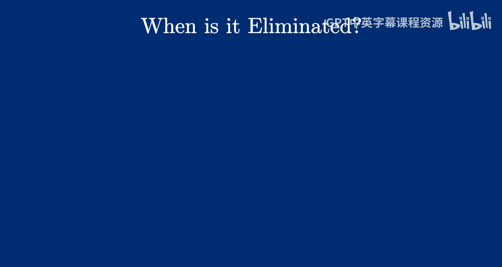
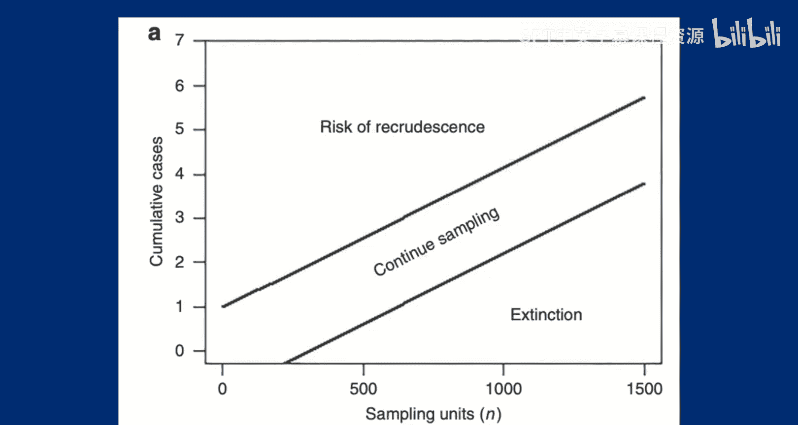
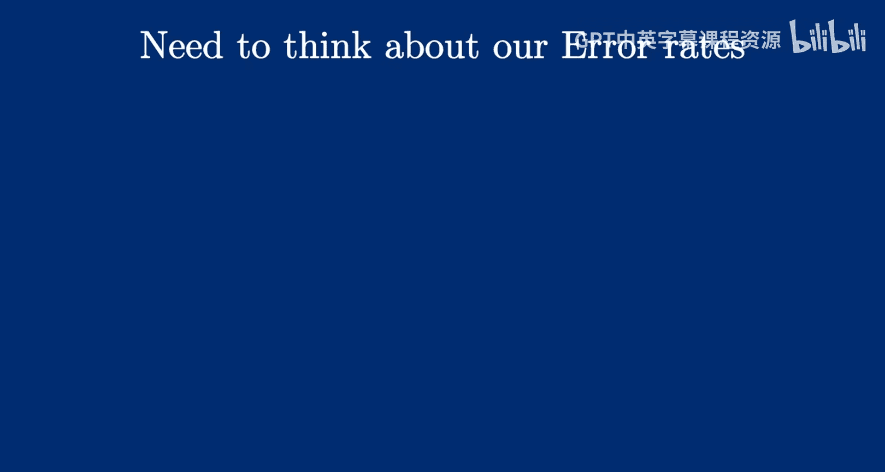
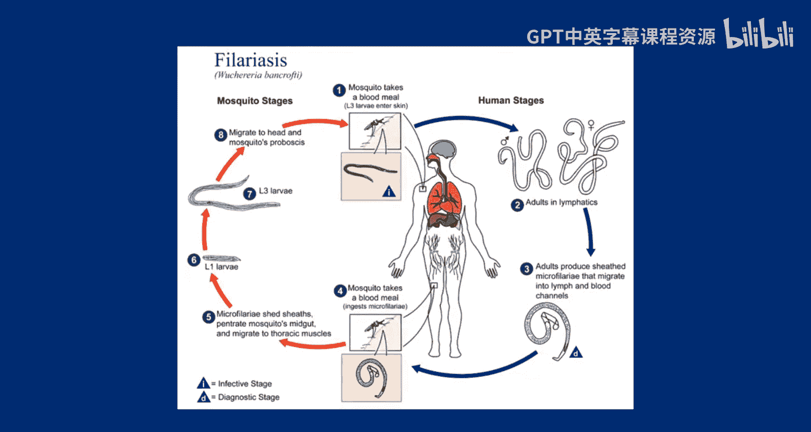
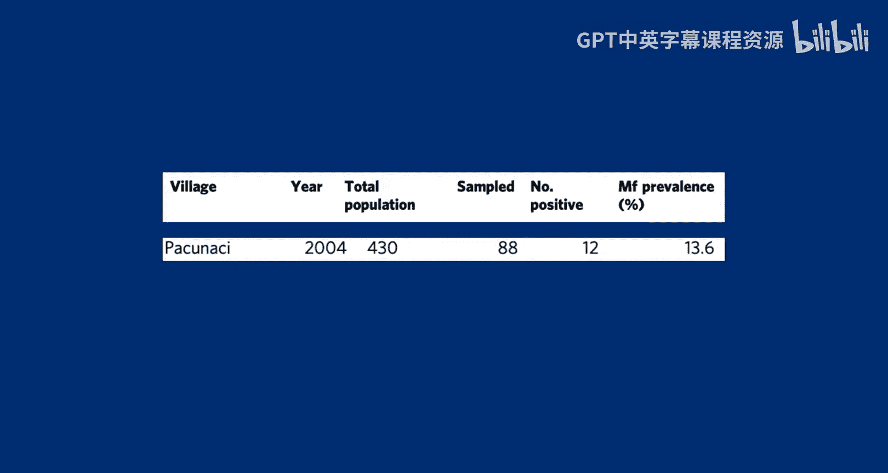
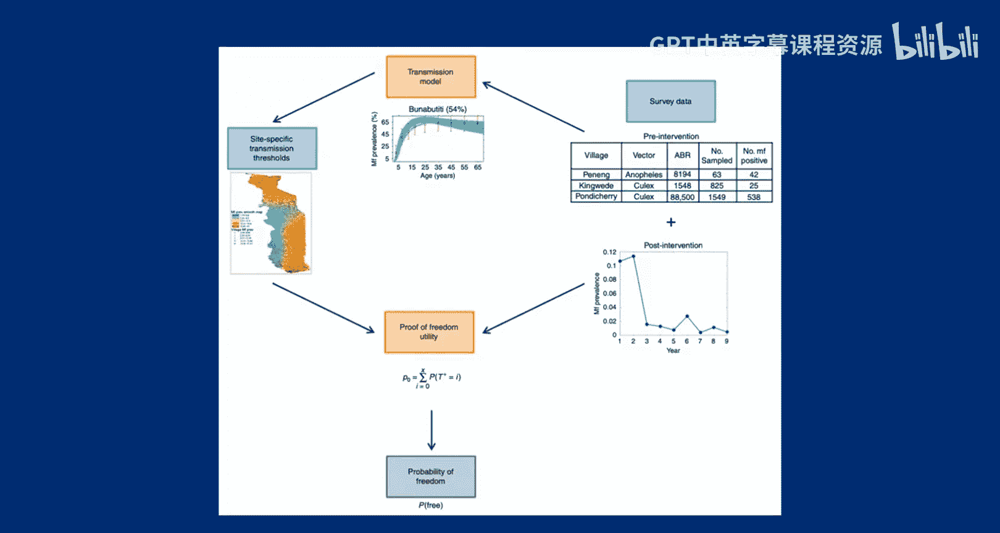
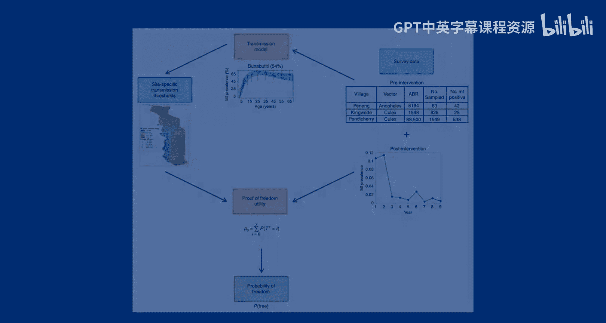
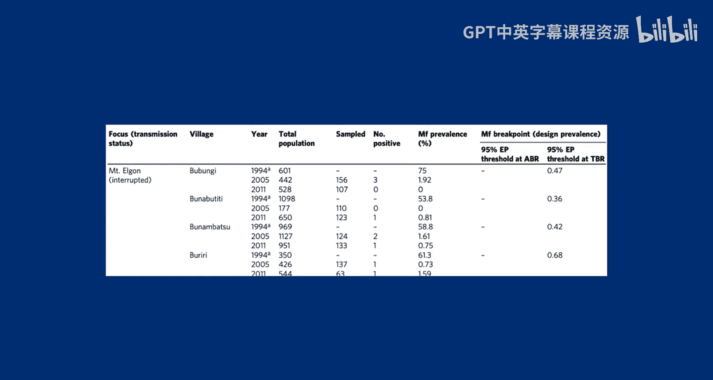
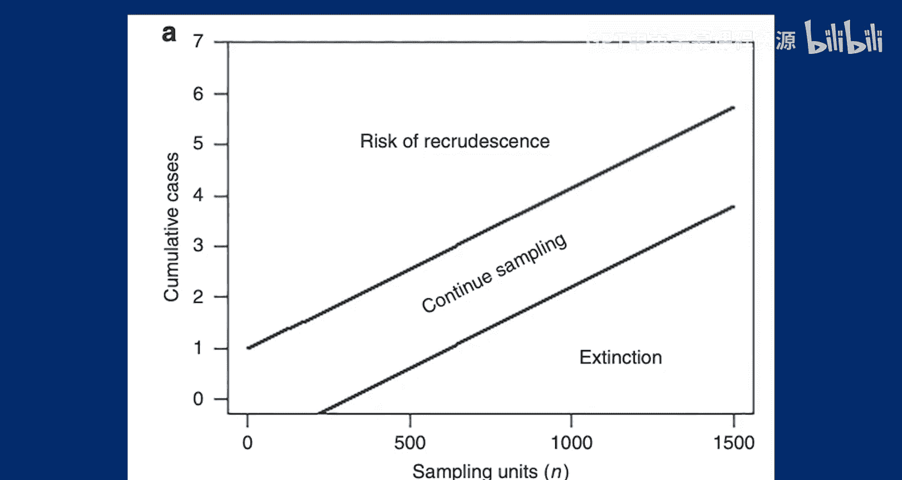

#  007：风险识别方法 🦟

在本节课中，我们将学习如何将沃尔德序贯抽样方法应用于一个重要的公共卫生领域——被忽视的热带病。我们将探讨如何通过抽样来判定一种疾病是否已被根除，从而为资源分配决策提供依据。

上一节我们介绍了沃尔德序贯抽样的基本原理，本节中我们来看看如何将其应用于现实世界的疾病监测问题。

## 从沃尔德抽样到汤普森抽样 🔄

通过本节内容，我们将完成从沃尔德序贯抽样到汤普森抽样的过渡。这是一个非常自然的过渡。沃尔德和汤普森两位学者都做出了重要贡献，他们的方法相关但略有不同。

在沃尔德序贯抽样中，我们已经讨论了如何在一系列序贯样本中，给定特定的第一类和第二类错误水平时，决定停止抽样或继续抽样。换句话说，我们可以决定拒绝一个假设、接受一个假设，或者需要继续抽样。

我们第二周课程的切入点，是帮助大家理解同样的沃尔德序贯抽样方法可以应用于像被忽视的热带病这样的问题，以判断它们何时已经停止传播。我们将直接使用汤普森抽样继续讨论被忽视的热带病，这将解决我们是否应该分配资源的问题。换句话说，我们能否识别出疾病热点区域并相应调整资源。这是一种与沃尔德抽样紧密相关，但更侧重于确定热带病热点区域的抽样方法，是“探索-利用”权衡的经典案例。

因此，我们的内容分为两部分。在第一部分中，我们将讨论如何思考热带病，特别是被忽视的热带病，以及如何衡量某种疾病是否已经灭绝。

## 被忽视的热带病问题 🩺

被忽视的热带病可能造成严重的毁容，是一个真实而严峻的问题。核心问题在于：我们如何根除它们？如何将其限制到零？这些疾病主要由蚊子、黑蝇等媒介传播，属于寄生虫感染。

我们可以监测携带寄生虫的蚊子数量，考虑涉及的人群和治疗方案。最简单的方法是避免接触污染源。最终，理想的问题是：我们能否控制它？能否将其消除到特定疾病不再是我们社会或世界人口需要担忧的程度？正如其名，这些疾病主要发生在热带地区。特定的传播媒介限制了其分布范围。但这也是沃尔德抽样的一个经典应用案例。

## 应用沃尔德抽样进行判定 📊

再次回顾第一周的内容，我们可以在沿X轴（抽样次数）进行抽样时定义三种结果：继续抽样、判定风险已消除（即无风险），或者判定确实存在风险需要继续监测。这些判定界限由我们的错误容忍度，即第一类错误（假阳性）和第二类错误（假阴性）设定。

我们需要非常清晰地思考：当我们判定某种疾病已被根除时，我们在这个判断上的错误率是多少？我们有多大把握相信这个“已完全根除、无需再担忧”的结论？就像上周第一个案例中的船运检验一样，这很可能也是我们需要持续监测的事情。

以盘尾丝虫病（一种被忽视的热带病）为例，它由蚊子传播。这里简要说明其运行机制：本质上存在蚊子阶段和人类阶段的相互作用。蚊子吸血（步骤一），然后疾病从该点扩散开来。我们可以观察非洲的某些村庄（这是2004年的数据，人口规模较小，430人中有88人接受了抽样，12人呈阳性）。然后我们可以定义患病率，这些基本上是基于该地区和该人群估计的、患有这种特定被忽视热带病的人数统计。同样，主要由黑蝇和蚊子传播，且它们必须携带该疾病。虽然这不是世界大多数人口需要担心的问题，但对世界上某些地区来说，这是一种极其可怕和重要的疾病。

因此，了解其所在位置和传播方式至关重要。

## 监测与根除循环 🔁

我们正在观察一个特定的被忽视热带病疫点（特定区域）。我们有一个传播模型，在调查这些特定区域时，可以看到这个循环可能发生。换句话说，我们可以定义一个“无病证明”函数，它将有效地告诉我们，并且我们希望在第一类和第二类错误范围内，我们已经真正消除了这种特定疾病的风险。

这是一个理想的循环：当我们观察受影响的人数时，可以想象将其降低到，对于生活在黑蝇和蚊子携带疾病的这些地区的人们来说，受影响的概率已经下降。因此，目标如右图所示，我们可以将比例降低。换句话说，我们可以将每年叮咬次数或可能导致疾病的感染数量降低到这些叮咬不一定有传播疾病风险的程度。

但关键问题，真正的难点在于：我们能否定义一个模型，结合一系列样本，来测量疾病的流行率，以便我们作为一个社会有信心将风险降至零？

以下是另一种观察方式，这是关于芒贡山特定地点的数据，在不同年份进行了抽样。可以看到总人口（再次说明，这些村庄规模相对较小）、每个村庄的抽样人数、阳性人数，然后我们可以定义患病率和断点。同样，这些95%的阈值是根据携带疾病的昆虫媒介的不同叮咬次数设定的。

这同样是一种造成严重毁容的疾病，象皮病（这里主要关注它）。存在多种被忽视的热带病，都由黑蝇和蚊子传播，并且同样只流行于世界的某些特定地区，但都是造成严重毁容、非常可怕的疾病，是我们希望看到消失的。因此，第二周的切入点在于，沃尔德抽样可以帮助我们解决这个问题。它可以帮助我们理解何时这些疾病构成问题、需要继续抽样或疾病复发的风险依然存在，或者何时风险已消除。然后，我们或许可以评估是否希望以相同的关注度继续抽样，也许一种监测型的抽样会更合适。但通过沃尔德方法，我们可以用更适度的支出，更有效地应对这类疾病。这也是为什么使用这个案例作为桥梁，因为它是连接上周和本周内容的重要纽带。

## 本节总结 📝

我希望我已经让大家对沃尔德序贯抽样应用于被忽视热带病有了一定的了解。其核心思想是，在这种情况下，我们希望以可接受的第一类和第二类错误水平进行抽样，直到我们有信心说一种疾病已经消失。这对于许多造成毁容、在许多方面非常可怕的疾病来说至关重要。

因此，我们再次希望做的是：设计我们的错误容忍度，并在给定一定检测水平的情况下设计抽样策略，以便我们知道疾病已经消失。这对于一些被忽视的热带病极为重要。正如其名，它们获得的资助不多，影响的人数也不多，但它们是极其可怕和令人恐惧的疾病。如果我们能找到根除它们的方法，特别是在全球对此类问题的支出方面，那将是非凡和了不起的。这再次是沃尔德序贯抽样可以帮助我们理解如何根除疾病的一个例子。

本节课中我们一起学习了如何将沃尔德序贯抽样框架应用于公共卫生监测，特别是判定被忽视的热带病是否已被根除。我们看到了如何通过设定统计阈值，在持续抽样中做出“继续监测”、“风险消除”或“风险存在”的决策。

现在，我们第二周的下一个主题与此相关：如何提高我们判断将有限资源投向何方的能力。这将是汤普森抽样的一个例子，它更侧重于决定在哪里投入努力最为重要，同样是“探索-利用”权衡的经典案例。