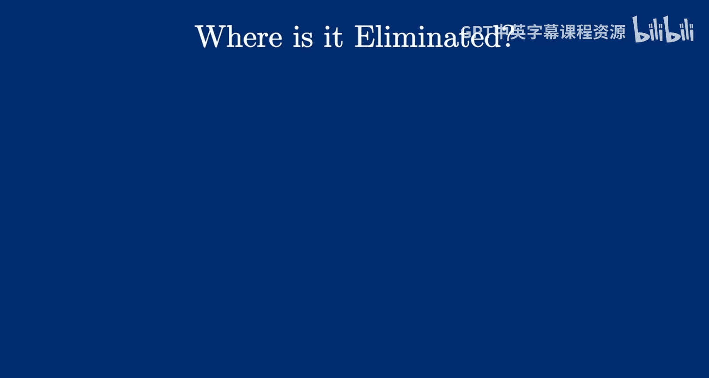
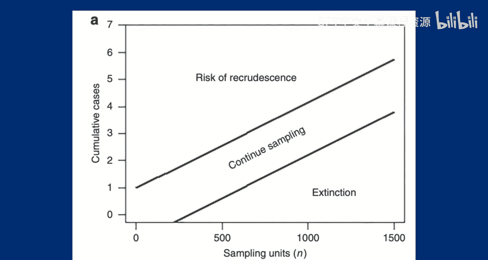
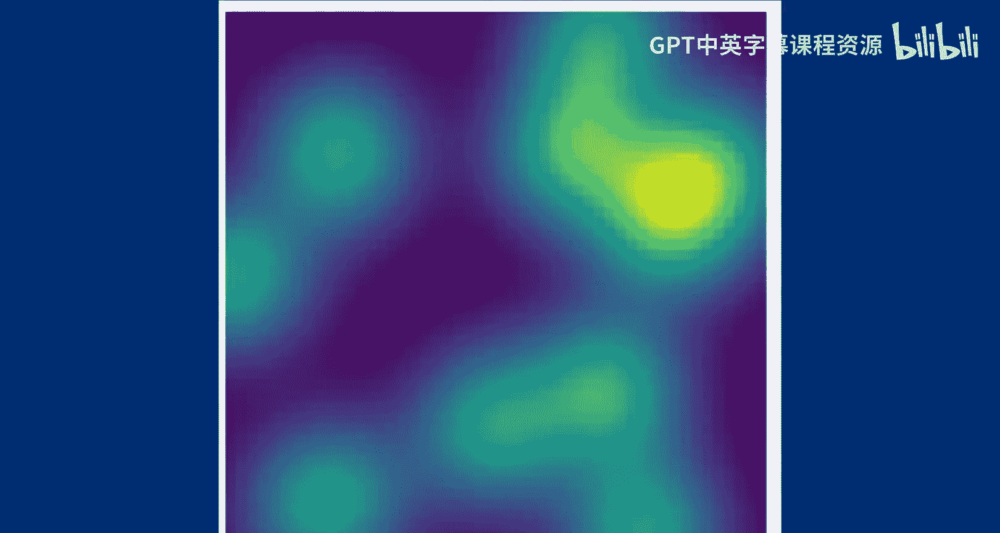
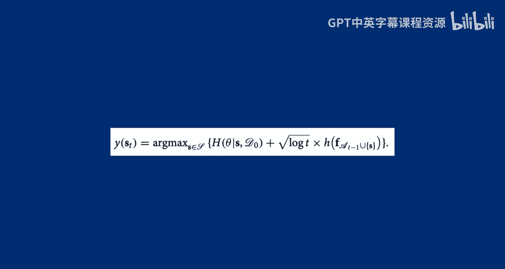
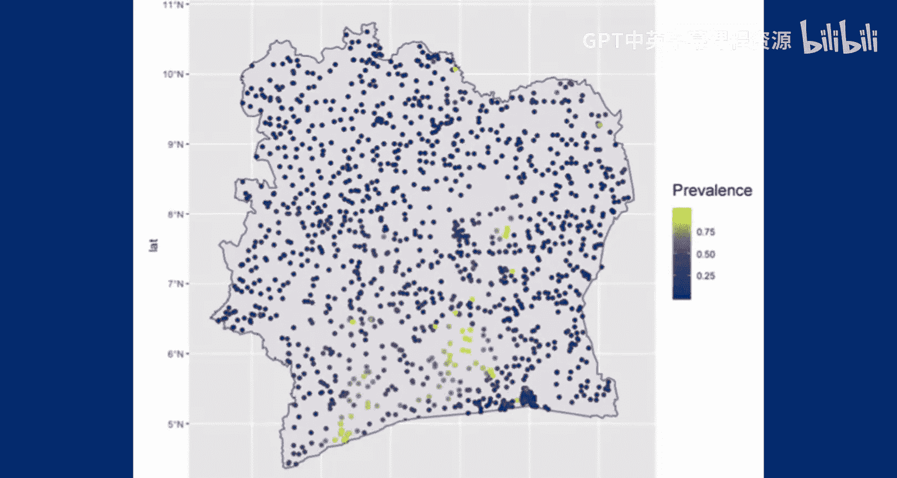

#  008：被忽视热带病的空间维度分析

在本节课中，我们将学习如何利用空间分析技术，定位被忽视热带病（NTDs）的“热点”区域。我们将从“疾病是否已消除”的问题，转向“疾病在哪里最严重”的问题，并探讨如何优化有限的资源分配。这涉及到一种名为**汤普森采样**的贝叶斯优化方法。

上一节我们介绍了沃尔德序贯概率比检验，用于判断疾病是否得到控制。本节中，我们来看看如何在复杂的地理环境中，高效地找到疾病最严重的区域。

## 从“是否”到“何处”

被忽视热带病是真实存在的健康问题，会导致毁容和衰弱，但并非全球普遍存在。应对这些疾病的资金有限，对患者而言过程痛苦。我们的目标是找到疾病最猖獗的区域，即“热点”。

在关于被忽视热带病和序贯采样的第一部分中，我们讨论了疾病“何时”或“如何”被消除。现在，我们将讨论“何处”被消除。这是一个探索与利用的典型案例，也是汤普森采样方法的核心问题。

## 探索与利用的挑战

想象一个地形图，代表疾病风险分布。疾病可能在某些区域（例如右上角）比其他区域严重得多。问题在于：如果我们不知道热点在哪里，应如何分配采样资源以找到它？

以下是两种策略：
*   **单纯利用**：如果我们通过网格采样发现一个相对严重的区域，就将所有资源集中在该区域。这就像在多臂老虎机问题中，只拉动我们认为最好的那个手臂。但这样会忽略大片未探索的区域。
*   **探索与利用结合**：更好的搜索策略是像汤普森采样那样，在继续利用已发现热点的同时，也分散探索其他区域。这样可以识别出其他可能的热点。

汤普森采样的核心论点是，这本质上是一个贝叶斯优化问题。我们有一个先验分布（对事物可能位置的初步想法），然后根据数据对其进行调整。

## 构建空间分析模型

我们的目标是优化采样策略，以最快速度找到真正的热点，同时控制错误率。为此，论文中引入了一个熵尺度。

熵尺度基于 **P log P** 类型的熵公式，用于强调那些风险值高于或低于某个阈值 θ 的区域。阈值 θ 可以是一个经验值或常识值（例如 0.5）。我们需要设定这个参数。

数据包含以下信息：
*   **sᵢ**：经纬度向量（地理位置）。
*   **N, Y**：采样人数和感染人数。
*   **xᵢ**：协变量向量，包含水温、湿度、蚊虫密度等各种其他因素。

我们将所有数据记为 **D₀**。这就像一个多臂老虎机，我们收集了大量信息，但此处信息是地理分布（连续的）和计数分布（各地点感染人数）的结合。

## 优化搜索策略

我们希望在连续和离散的空间中优化采样。在连续空间中，我们可以考虑一个局部连接函数 **hᵢ**，它类似于从一个区域到另一个区域的局部游走。这使用了一个核函数 **K(A, A)**，类似于高斯过程中的克里金法，它假设区域之间存在空间相关性。

然后，我们可以进行优化。核心是之前提到的熵 **H**（P log P 尺度），它根据数据区分我们相对于阈值 θ 的位置。这些条件概率是贝叶斯分析的一种形式。最终，我们会得到一个预测热点位置的能力指标。

通过结合估计连续空间变化的核函数，以及包含在熵 **H** 中的计数型度量，我们能够优化搜索策略。换句话说，我们可以更好地理解在这个特定国家，应将稀缺资源投放在何处。

## 总结

本节课中，我们一起学习了如何利用空间分析和汤普森采样来定位被忽视热带病的热点区域。我们发现，尽管寻找热点充满挑战，但通过高效的、自适应的贝叶斯优化方法是可能实现的。这本质上是利用贝叶斯框架来提高估计“最佳收益”或“最大值”位置的能力。这类优化问题在序贯决策中反复出现：我们能否基于数据优化决策，从而做出更好的决策？本节与前一节共同构成了我们对汤普森采样的介绍，这是我们“在时间中做出决策”第二周课程的重要内容。