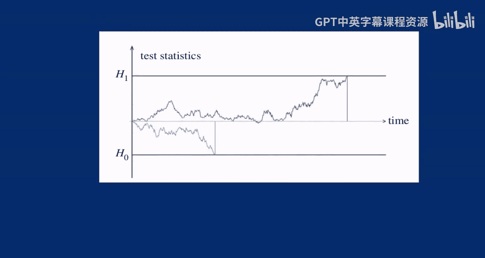
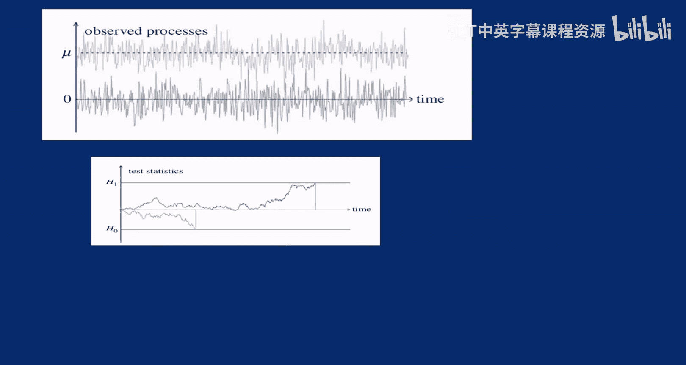
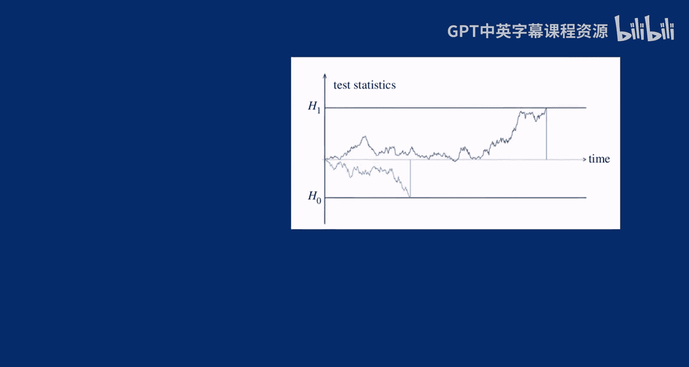

#  009：气候变化案例导论 🌍

在本节课中，我们将开始学习一种新的抽样方法——变点抽样。我们将探讨如何检测数据序列中发生根本性变化的时刻，并以气候变化作为核心案例进行分析。

上一节我们介绍了序贯抽样和汤普森抽样。本节中，我们将转向变点分析，这是一种用于检测数据生成过程何时发生根本性变化的技术。它在许多现实世界应用中至关重要。

## 变点分析的重要性

变点分析在许多现实应用中具有巨大价值。以下是两个关键示例：

*   **气候变化**：全球气温模式是否发生了统计上显著的、持续性的变化？如果能更早地检测到这种变化，我们是否能更早地采取行动？
*   **临床医学**：在患者服用某种药物期间，其生理指标（例如，用于治疗儿童肥胖症的某项指标）是否出现了有意义的改变？这能帮助医生更好地评估疗效和调整治疗方案。

这些例子表明，变点分析是从我们前两周所学内容自然延伸出来的，核心依然是在时间序列数据的基础上做出决策。

## 气候变化案例研究

以天气和气候变化为例。随着本世纪的推进，越来越多的证据表明气候确实在改变。我们面临的问题是：我们能否从数据中清晰地看到这种变化？

我们可以将全球气温数据视为一个时间序列。从统计学的角度看，一个理想化的简单模型是：气候在某个时间点前后，其数据遵循的分布（例如高斯分布）的**均值**或**标准差**发生了偏移。

**公式示例：**
假设变化前数据服从分布 N(μ₀, σ₀²)，变化后服从 N(μ₁, σ₁²)。变点分析的目标就是检测这个参数从 (μ₀, σ₀) 变为 (μ₁, σ₁) 的时刻 τ。

这类似于我们在第一周学习的**假设检验**。我们可以设立两个假设：
*   **H₀**：数据均值 μ = μ₀ （无气候变化）
*   **H₁**：数据均值 μ = μ₁ （发生气候变化）

随着时间推移和数据积累，我们计算证据，判断数据更支持哪一个假设。沃尔德序贯概率比检验的思想在这里依然适用，即持续评估数据对两个假设的支持程度，直到证据足够做出判断。

然而，现实中的气候变化分析比这个简单模型复杂得多。我们无法像控制工厂生产线那样轻易地“停止”变化，也无法进行严格的A/B测试。但将其视为一种持续的证据积累和假设检验过程，仍然是理解和沟通此问题的有力框架。

## 变点分析的挑战与考量

我们已经对变点的含义有了初步了解。最简单的解释是：如果一个高斯分布的均值或标准差（或两者）发生了偏移，变点分析应该能够检测到它。

然而，实际应用会面临多种复杂情况和权衡：

*   **信号与噪声**：变化的幅度相对于数据本身的波动（噪声）越小，检测就越困难。
*   **分布类型**：数据是否真的服从简单的高斯分布？更复杂的分布会增加分析难度。
*   **在线与离线分析**：
    *   **在线分析**：实时处理数据流，适用于需要即时反馈的场景（如临床监护）。
    *   **离线分析**：在获得全部数据后进行分析，适用于允许深入计算和政策制定的场景（如气候变化研究）。
*   **准确性与计算效率的权衡**：在线方法需要在“立即获得一个可能带有误差的答案”和“花费更多时间计算一个更可靠的答案”之间做出权衡。这本质上是**实用性**与**置信度/保险性**之间的权衡。

没有一种变点检测方法是完美且适用于所有情况的。大多数方法只在特定设置下有效。因此，关键是根据具体问题（数据分布、噪声水平、实时性要求等）选择合适的方法。

本节课中，我们一起学习了变点抽样的基本概念及其在气候变化等领域的应用重要性。我们了解到，变点分析可以视为假设检验在时间序列上的延伸，旨在检测数据生成过程的根本性变化。同时，我们也认识到实际应用中的复杂性，包括噪声、分布假设以及在线/离线分析模式带来的不同挑战和权衡。在接下来的课程中，我们将深入探讨具体的变点检测算法。