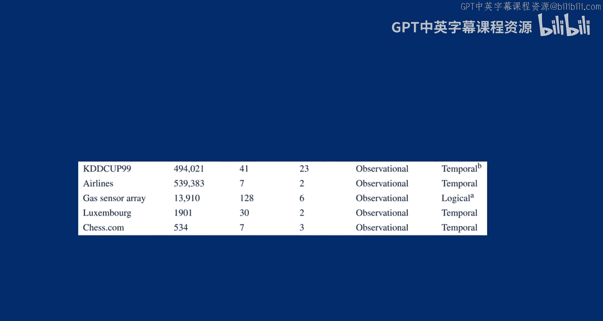

#  010：高斯模型在变点检测中的应用 🧮

在本节课中，我们将学习变点检测的具体计算方法，特别是使用滑动窗口和概率分布比较的方法。我们将探讨如何通过非参数统计检验来判断数据分布是否随时间发生了变化。

## 概述

上一节我们讨论了变点的基本概念。本节中，我们将深入了解如何实际计算变点。有多种代码库（如R或Python）可以实现这些算法。接下来，我们将重点介绍一种使用滑动窗口进行变点检测的具体方法。

## 滑动窗口与分布比较

这种方法的核心思想是：计算一个参考窗口内的候选分布，再计算另一个窗口内的候选分布，然后比较这两个分布是否相同。这本质上是一种假设检验。

我们随时间推移不断提出一个问题：这两个分布是相同还是不同？我们可以将窗口沿时间轴滑动。每当两个分布不再相同时，我们就在该点检测到一个变点，然后将参考窗口重置为新的分布，并继续滑动。

这种方法通过设置容差和窗口宽度来控制变化的检测范围，同时也提供了一种检测多个变点的方法。选择合适的参数和检验方法，原则上可以判断一个分布中是否存在多个变点。

## 数据漂移与变点

现在让我们更详细地思考变点问题。想象我们有两个分布，如这张示意图所示。在某个时间点，这两个分布是明显分离的。如果我们从这两个不同的分布中采样（称为S1和S2），并有一个时间序列，我们就能清楚地区分它们属于哪个分布。

然而，这两个分布可能随时间不稳定，它们可能开始漂移（如T1或T2所示）。随着漂移，它们可能不再保持分离。在这个示意图中，它们虽然在移动，但仍保持分离。这种数据漂移或分布随时间移动的概念，与变点一样，在实际应用中反复出现，是一个重要的概念。

核心问题始终是：我们能否区分两类不同的事件？我们可能有来自三个不同分布的三类原始数据。问题是，随着时间的推移，这些分布是否保持稳定？

因此，我们本周的核心问题仍然是变点检测。我们思考的问题是：事物的边界可能已经移动，我们可能仍有三个类别，但分布的参数已经发生了偏移。我们要解决的问题是：能否识别出这些变化？能否检测到分布参数已经偏移？

## 非参数框架与假设检验

我们将从两个数据集开始思考，并采用所谓的“非参数”框架。非参数听起来可能令人困惑，但它实际上意味着“无限参数”，即我们不预设任何参数。我们将在这两个数据集S1和S2上进行采样，并评估数据点属于其中任一集合的概率。

设P1和P2为从这两个数据集的S1或S2中采样的概率。最终，我们提出一个非常简单的问题：这两个参数相同吗（P1 = P2）？还是它们不同（P1 ≠ P2）？

我们将以非参数方式评估这些概率，这意味着我们在没有预设参数的背景下进行评估。这更具挑战性，但也可能更具启发性，因为我们可以考虑更广泛的概率函数。

为此，我们需要定义一个**距离函数**。这本质上是两个概率分布之间的距离。这很重要，因为如果我们不能为样本分配距离，就无法真正比较来自不同样本分布的数据。

## 算法步骤

从算法上讲，大致步骤如下：

以下是算法的五个核心步骤：

1.  定义两个窗口，它们可能从不同的时间点采样。
2.  初步思考：第一个窗口内的分布与第二个窗口内的分布相同吗？
3.  将M视为两个样本集（例如，第一个集合从1到5，第二个从6到15）。
4.  在我们的数据流中进行第二组采样。
5.  调整两个窗口的相对位置，并在顺序采样的每个点上询问：分布是相同还是不同？

换句话说，我们问事件是来自相同的概率分布还是不同的概率分布？这正是我们从一开始就在讨论的变点检测算法。无论是气候变化还是其他系统，我们都可以假设数据点来自某个概率分布，然后随着不断采样，询问它们是否相同或不同。

## 参数选择与距离度量

这意味着我们必须定义两个窗口（M1和M2）以及一个参数α。α与我们评估或判断是否发生变化的程度有关，可以理解为置信度。如果两个分布之间的距离超过某个临界阈值，我们就认为它们不同；如果低于阈值，则认为相同。

显然，我们必须明智地选择参数：采样应该持续多久（即M应多大）？α应设为多少？

我们将采用文献中称为“距离”的框架。我们可以定义两个概率分布P和P'之间的距离`d_A(P, P')`。上确界（supremum）是数学术语，指两个集合之间的最大距离。我们将从集合A中采样，并最终以非参数方式定义两者之间的经验拟合。

我们将通过两种不同的方式来实现：

第一种是`P_A`，这是我们两个分布P1和P2之间的距离。P1和P2只是采样得到的。我们再次从集合A的采样中取上确界，定义P1和P2之间的距离。你可以将其视为两个窗口或两个M之间的距离，除以平方根。注意括号，这是对该集合取最小值。现在我们通过这个公式定义了距离。

第二种度量我们称之为`Θ_A(P1, P2)`。它在某种意义上与第一种类似，我们再次假设可以对两个概率P1和P2定义上确界，并取其平方根，而不是像第一种那样进行集合表征。

## 非参数统计检验

我们将使用两种检验方法进行比较。

以下是两种核心的非参数检验方法：

*   **Wilcoxon符号秩检验**：这是一种常见的非参数统计检验。你可以将其视为从我们认为的一个分布与另一个分布中配对抽取数据。我们假设这些抽取是独立的，即配对选取之间没有相关性。当我们抽取它们时，将计算它们之间的距离`x_{2,i} - x_{1,i}`（类似于之前的距离），以及一个取决于哪个值更大的符号`s_i`。这样我们可以进行排序，然后对配对进行秩次排序。我们计算`W`，即这些符号值（可视为正负号）乘以距离的总和。这是一种相对直接的计算方法。
*   **Kolmogorov-Smirnov检验**：这是另一种标准的非参数检验。我们定义累积分布函数（CDF），其值在0到1之间。单样本KS检验是将样本与一个已知分布进行比较；双样本KS检验可以比较两个样本的经验分布曲线。我们计算距离，使用一个指示函数来计算向上走了多远，给定该指示函数，我们总是可以再次定义一个上确界。我们可以定义`sup_x |F_n(x) - F(x)|`，然后进行检验。至此，我们定义了新的分布，这是一个相对直接的检验。

## 模拟实验与应用

我们模拟了200万个数据点，它们来自不同的分布，但每20000个点就会改变一次。这类似于一开始描述的概念漂移或数据漂移。我们将对均匀分布`U(-p, p)`进行此操作，其中p等于5（即从-5到5），然后每20000个点，p变为0.5（即从-0.5到0.5），之后每50000个点，p再变回5。W检验和KS检验是不同版本，而这种新方法效果很好。

这种方法可以推广到其他类型的场景。例如，你可以想象电力数据、森林覆盖类型数据、扑克手牌数据、PDD数据、航空公司数据、气体传感器阵列数据、卢森堡数据或国际象棋数据等。在这些数据集中，存在不同的类别，我们可以提出问题：它们是否相同？还是不同？

## 总结

本节课中，我们一起学习了变点检测的具体算法实现。我们重点介绍了一种基于滑动窗口比较概率分布的非参数方法，包括定义距离函数以及使用Wilcoxon符号秩检验和Kolmogorov-Smirnov检验进行假设检验。通过模拟实验，我们看到这种方法能有效检测数据分布的变化。

希望到课程最后，你能认识到现实中存在许多庞大而有趣的数据集，它们带有标签，使我们能够探究分布是否随时间发生了变化。当然，在现实世界中，这些都是核心问题，例如：是否存在气候变化？疾病特征是否在变化？电力需求是否以特定方式变化？这些都是极其重要的问题。

我们概述的方法让你对其有所了解，但检测这些变点并非总是易事。因此，当你在实际中应用这些方法时（例如作为本课程项目的一部分），需要谨慎评估所输入的参数范围。换句话说，你可能希望使用多种不同算法或不同参数来检查变点，只有当你确信看到了特定的变点时，才可以开始深入探究该变点发生的原因及其可能意味着什么。从我们刚刚介绍的这类方法中，可以衍生出许多非常有趣的问题。